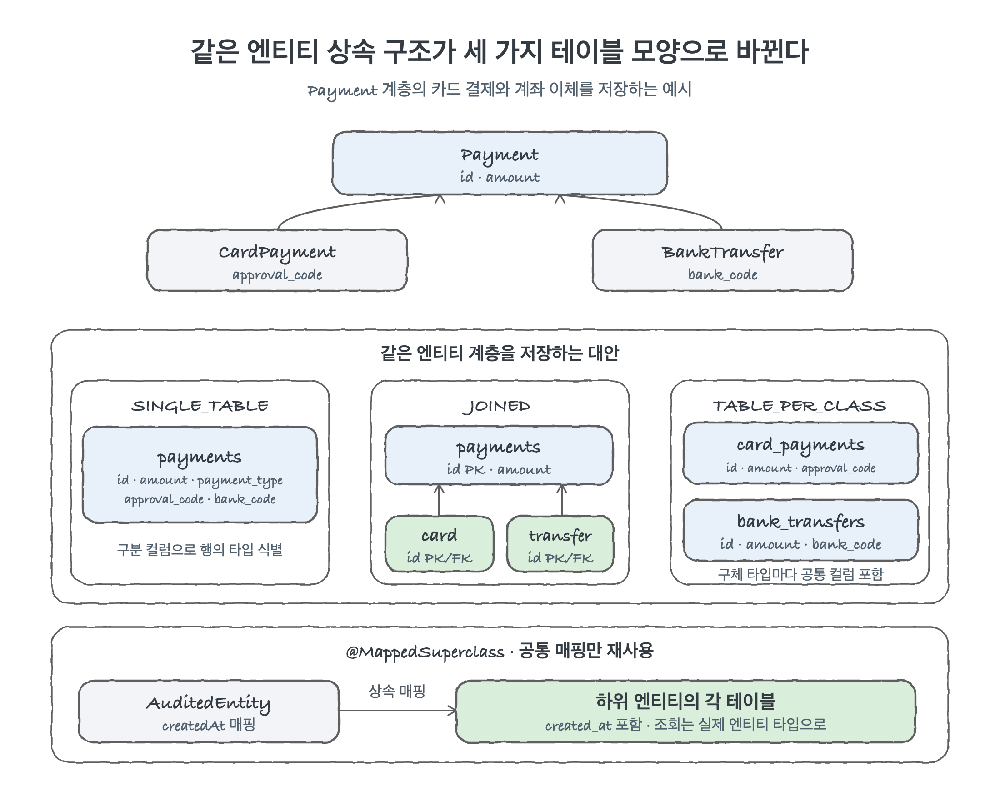

# JPA Inheritance Mapping and Mapped Superclasses

상속 관계를 DB에 저장할 때는 상위 타입으로 모든 하위 타입을 조회할 필요가 있는지부터 확인한다. 엔티티 계층을 조회하려면 상속 전략을 선택하고, 여러 엔티티가 공통 컬럼만 재사용한다면 `@MappedSuperclass`를 사용할 수 있다.



그림의 근거 · [상속 매핑 전략](https://jakarta.ee/specifications/persistence/3.1/jakarta-persistence-spec-3.1#a966) · [MappedSuperclass](https://jakarta.ee/specifications/persistence/3.1/jakarta-persistence-spec-3.1#mapped-superclasses)

## 1. 상속 매핑 전략

| 전략 | 테이블 구조 | 조회 및 제약의 특징 |
| --- | --- | --- |
| `SINGLE_TABLE` | 상위·하위 타입을 한 테이블에 저장 | 구분 컬럼으로 타입을 식별한다. 특정 하위 타입에만 있는 컬럼은 다른 타입의 행에서 비어 있을 수 있다. |
| `JOINED` | 상위·하위 테이블을 기본 키로 연결 | 공통 속성과 하위 타입 속성을 분리해 제약을 걸 수 있다. 조회할 때 조인이 필요할 수 있다. |
| `TABLE_PER_CLASS` | 구체 타입마다 공통 컬럼을 포함한 테이블 사용 | 각 타입을 개별 조회하기 쉽다. 상위 타입 조회에서 여러 테이블을 합쳐야 할 수 있다. |

상속 전략을 생략하면 기본값은 `SINGLE_TABLE`이다. 타입을 구분하는 컬럼은 `@DiscriminatorColumn`, 타입별 저장값은 `@DiscriminatorValue`로 지정할 수 있다. `TABLE_PER_CLASS`는 사용 중인 JPA 구현체의 지원 범위와 생성 SQL을 확인한다. [Jakarta Persistence 3.1 · 상속 매핑 전략](https://jakarta.ee/specifications/persistence/3.1/jakarta-persistence-spec-3.1#a966)

```java
@Entity
@Inheritance(strategy = InheritanceType.SINGLE_TABLE)
@DiscriminatorColumn(name = "payment_type")
public abstract class Payment {
    @Id
    @GeneratedValue
    private Long id;

    @Column(nullable = false)
    private BigDecimal amount;

    protected Payment() {}
}
```

```java
@Entity
@DiscriminatorValue("CARD")
public class CardPayment extends Payment {
    private String approvalCode;

    protected CardPayment() {}
}
```

이 모델의 `select p from Payment p`는 하위 타입 행도 조회한다. JPQL에서 타입을 제한하는 방법은 [09번 문서](09_jpql_and_object_oriented_queries.md)에서 다룬다.

## 2. 공통 컬럼을 재사용하는 MappedSuperclass

```java
@MappedSuperclass
public abstract class AuditedEntity {
    @Column(name = "created_at", nullable = false, updatable = false)
    private LocalDateTime createdAt;

    @PrePersist
    protected void assignCreationTime() {
        if (createdAt == null) {
            createdAt = LocalDateTime.now(ZoneOffset.UTC);
        }
    }
}
```

`AuditedEntity`를 상속한 각 엔티티의 테이블에 `created_at` 컬럼이 매핑된다. JPQL은 실제 엔티티 타입을 조회 대상으로 사용한다. 상속받은 속성의 컬럼 설정이 엔티티마다 달라야 하면 `@AttributeOverride`를 사용한다. [Jakarta Persistence 3.1 · MappedSuperclass](https://jakarta.ee/specifications/persistence/3.1/jakarta-persistence-spec-3.1#mapped-superclasses) · [Jakarta Persistence 3.1 · 생명주기 콜백](https://jakarta.ee/specifications/persistence/3.1/jakarta-persistence-spec-3.1#lifecycle-callback-methods)
