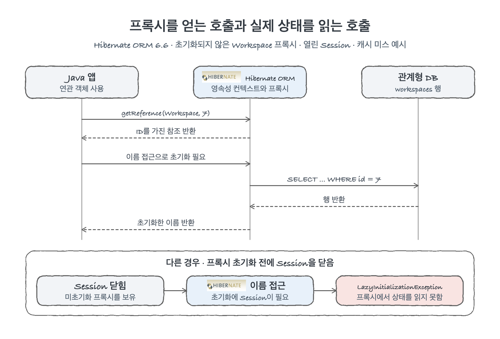
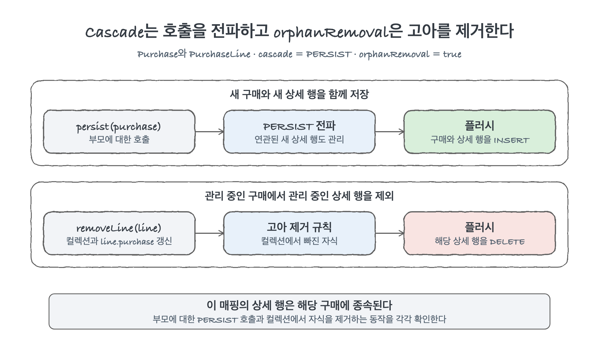

# JPA Proxies, Fetching, Cascades, and Orphan Removal

조회할 때 연관 객체를 언제 가져올지와 저장·삭제할 때 작업을 어디까지 전파할지는 서로 다른 결정이다. 먼저 조회 경로에 맞춰 로딩 방식을 고르고, 생명주기를 함께 관리할 연관관계에만 전파를 적용한다.

## 1. 참조와 프록시

```java
Workspace reference = em.getReference(Workspace.class, workspaceId);
WorkItem item = em.find(WorkItem.class, workItemId);
item.moveTo(reference);
```

`getReference()`는 해당 기본 키를 가진 엔티티에 대한 참조를 얻는다. Hibernate는 상황에 따라 상태를 읽기 전까지 초기화를 미룰 수 있는 프록시를 반환한다. 같은 컨텍스트에 이미 관리 중인 인스턴스가 있으면 이를 재사용할 수 있다. 존재하지 않는 ID의 참조는 얻는 시점이나 상태에 접근하는 시점에 실패할 수 있다.

프록시 타입은 엔티티 클래스의 런타임 이름과 다를 수 있다. 로딩 여부를 확인할 때는 `em.getEntityManagerFactory().getPersistenceUnitUtil().isLoaded(entity, "workspace")`를 사용할 수 있다. Hibernate에서 초기화되지 않은 프록시의 상태를 컨텍스트가 닫힌 뒤 읽으면 `LazyInitializationException`이 날 수 있다. [Jakarta Persistence 3.1 · EntityManager API](https://jakarta.ee/specifications/persistence/3.1/jakarta-persistence-spec-3.1#a1066) · [Hibernate 6.6 · 프록시 참조](https://docs.hibernate.org/orm/6.6/userguide/html_single/#pc-get-reference)

위 예제의 `moveTo()`는 양방향 컬렉션도 갱신하므로 기존·새 워크스페이스가 초기화될 수 있다. 참조를 얻는 것만으로 어떤 후속 코드에서도 SQL이 생략된다고 가정하면 안 된다.



그림의 근거 · [EntityManager 초기 참조](https://jakarta.ee/specifications/persistence/3.1/jakarta-persistence-spec-3.1#a1066) · [Hibernate 프록시](https://docs.hibernate.org/orm/6.6/userguide/html_single/#pc-get-reference) · [지연 초기화 예외](https://docs.hibernate.org/orm/6.6/userguide/html_single/#best-practices-fetching-associations)

## 2. 지연 로딩과 즉시 로딩

| 설정 | 동작 |
| --- | --- |
| `LAZY` | 구현체에 로딩을 미룰 수 있게 한다. JPA의 지연 로딩 설정은 힌트다. |
| `EAGER` | 연관 상태를 미리 가져오도록 요구한다. SQL 조인이나 추가 조회 중 어떤 방법으로 가져올지는 구현체가 결정한다. |

다대일·일대일은 기본 `EAGER`, 일대다·다대다는 기본 `LAZY`다. 작업 N건을 가져온 뒤 각 작업의 워크스페이스에 접근하면 작업 목록 쿼리 외에 여러 연관 조회가 생길 수 있다. JPQL에서 `EAGER` 연관을 별도 조회로 가져오는 경우에도 같은 문제가 발생할 수 있다. [Hibernate 6.6 · 직접 조회와 엔티티 쿼리의 로딩 차이](https://docs.hibernate.org/orm/6.6/userguide/html_single/#fetching-direct-vs-query)

연관 값이 필요한 화면은 [JPQL 페치 조인](09_jpql_and_object_oriented_queries.md)이나 엔티티 그래프로 로딩 범위를 지정할 수 있다. 필요한 값이 적다면 DTO로 직접 조회해 반환한다.

## 3. Cascade와 orphanRemoval

| 옵션 | 함께 일어나는 동작 |
| --- | --- |
| `PERSIST` | 부모를 영속화할 때 연관된 새 엔티티도 영속화한다. |
| `MERGE` | 부모의 변경 상태를 병합할 때 연관 상태도 병합한다. |
| `REMOVE` | 부모를 삭제할 때 연관된 엔티티도 삭제한다. |
| `REFRESH`, `DETACH` | 부모의 새로고침 또는 분리를 연관 엔티티에도 적용한다. |
| `ALL` | 위 다섯 동작을 모두 전파한다. |

다음은 구매 객체에만 속하는 상세 행의 양방향 매핑이다.

```java
// Purchase
@OneToMany(mappedBy = "purchase", cascade = CascadeType.PERSIST,
           orphanRemoval = true)
private List<PurchaseLine> lines = new ArrayList<>();

public void addLine(PurchaseLine line) {
    lines.add(line);
    line.attachTo(this);
}

public void removeLine(PurchaseLine line) {
    if (lines.remove(line)) {
        line.attachTo(null);
    }
}
```

`PurchaseLine.purchase`는 FK를 가진 다대일 속성이다. `attachTo()`가 그 참조를 바꾸며, 관리 중인 `Purchase`에서 관리 중인 행을 컬렉션에서 빼면 `orphanRemoval`이 플러시 때 해당 행을 삭제한다. 부모가 삭제될 때도 고아 제거가 적용되는 연관의 자식이 함께 삭제된다. 다른 부모로 옮기거나 여러 엔티티가 공유하는 대상에는 자식 삭제를 전파하기 전에 소유 규칙을 점검한다. [Jakarta Persistence 3.1 · 고아 제거 규칙](https://jakarta.ee/specifications/persistence/3.1/jakarta-persistence-spec-3.1#a516) · [Hibernate 6.6 · 연관관계 전파](https://docs.hibernate.org/orm/6.6/userguide/html_single/#pc-cascade)



그림의 근거 · [고아 제거 규칙](https://jakarta.ee/specifications/persistence/3.1/jakarta-persistence-spec-3.1#a516) · [Hibernate Cascade](https://docs.hibernate.org/orm/6.6/userguide/html_single/#pc-cascade)
