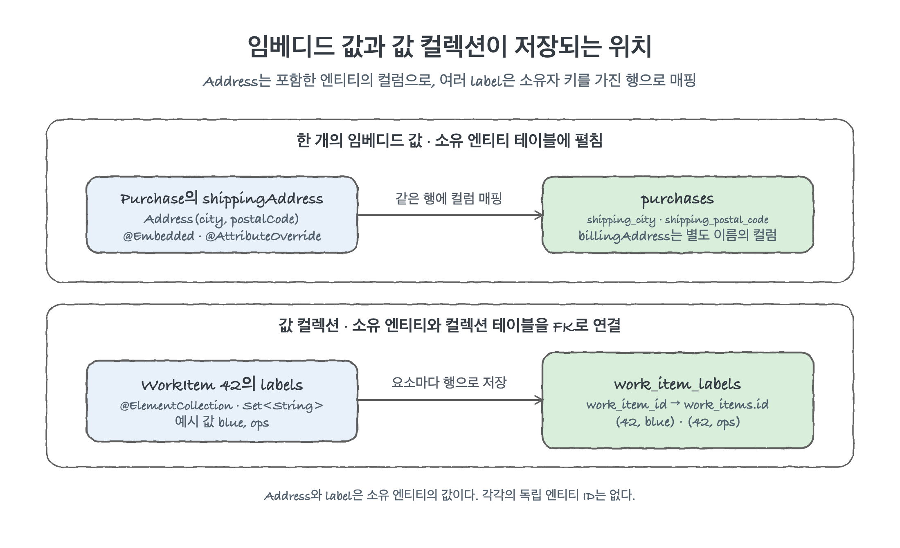

# JPA Value Types, Embeddables, and Collections

엔티티는 식별자로 구별되며, 값 타입은 속성의 값으로 의미가 정해진다. 이름, 날짜, 주소 같은 값은 이를 가진 엔티티의 상태로 저장한다. 주소가 스스로 이력과 식별자를 관리해야 한다면 별도 엔티티로 모델링할 수 있다.



그림의 근거 · [임베디드 값](https://jakarta.ee/specifications/persistence/3.1/jakarta-persistence-spec-3.1#a487) · [값 컬렉션](https://jakarta.ee/specifications/persistence/3.1/jakarta-persistence-spec-3.1#a494)

## 1. 기본 값과 임베디드 타입

정수, 문자열, 날짜처럼 하나의 값은 기본 속성으로 매핑한다. 여러 기본 값을 하나의 개념으로 묶을 때는 `@Embeddable`을 사용한다. `Address`의 각 필드는 이를 포함하는 엔티티의 테이블 컬럼으로 저장된다. [Jakarta Persistence 3.1 · 임베디드 타입](https://jakarta.ee/specifications/persistence/3.1/jakarta-persistence-spec-3.1#a487)

```java
@Embeddable
public class Address {
    private String city;
    private String postalCode;

    protected Address() {}

    public Address(String city, String postalCode) {
        this.city = city;
        this.postalCode = postalCode;
    }

    @Override
    public boolean equals(Object other) {
        return other instanceof Address address
            && Objects.equals(city, address.city)
            && Objects.equals(postalCode, address.postalCode);
    }

    @Override
    public int hashCode() {
        return Objects.hash(city, postalCode);
    }
}
```

엔티티 하나가 같은 값 타입을 두 번 사용하면 각 매핑에 서로 다른 컬럼 이름을 지정한다.

```java
@Embedded
@AttributeOverrides({
    @AttributeOverride(name = "city", column = @Column(name = "shipping_city")),
    @AttributeOverride(name = "postalCode", column = @Column(name = "shipping_postal_code"))
})
private Address shippingAddress;

@Embedded
@AttributeOverrides({
    @AttributeOverride(name = "city", column = @Column(name = "billing_city")),
    @AttributeOverride(name = "postalCode", column = @Column(name = "billing_postal_code"))
})
private Address billingAddress;
```

값 객체의 내부를 바꾸는 setter를 두지 않으면 객체를 공유해도 변경이 함께 퍼지지 않는다. 주소를 수정할 때는 `new Address(...)`로 새 값을 만들어 기존 값을 교체한다. `equals()`와 `hashCode()`는 함께 정의하고, 두 값의 동등성을 결정하는 속성을 동일하게 사용한다.

임베디드 타입도 엔티티를 참조할 수 있다. 그 FK는 임베디드 값을 포함한 엔티티 테이블에 매핑한다. 같은 임베디드 타입을 여러 번 사용하면서 FK 이름을 달리하려면 `@AssociationOverride`로 재정의한다. [Jakarta Persistence 3.1 · AttributeOverride](https://jakarta.ee/specifications/persistence/3.1/jakarta-persistence-spec-3.1#a14084) · [Jakarta Persistence 3.1 · AssociationOverride](https://jakarta.ee/specifications/persistence/3.1/jakarta-persistence-spec-3.1#a13942)

## 2. 값 타입 컬렉션

```java
@ElementCollection
@CollectionTable(name = "work_item_labels",
    joinColumns = @JoinColumn(name = "work_item_id"))
@Column(name = "label", nullable = false)
private Set<String> labels = new HashSet<>();
```

문자열이나 임베디드 값의 컬렉션은 별도의 컬렉션 테이블에 저장된다. 각 행은 소유 엔티티의 키를 보유한다. 값 요소는 독립 엔티티 ID가 없으며, 컬렉션 변경을 DB에 반영하는 방식은 구현체와 컬렉션 종류에 따라 달라진다. 일부 매핑에서는 소유자에 해당하는 행을 삭제하고 현재 값을 다시 삽입한다. [Jakarta Persistence 3.1 · 기본 값과 임베디드 값의 컬렉션](https://jakarta.ee/specifications/persistence/3.1/jakarta-persistence-spec-3.1#a494)

규모가 작고 소유 객체의 일부로 바뀌는 태그는 값 컬렉션으로 표현할 수 있다. 요소별 이력, 독립 조회, 개별 갱신이 중요해지면 자체 ID가 있는 엔티티와 일대다 연관으로 표현할 수 있다.
