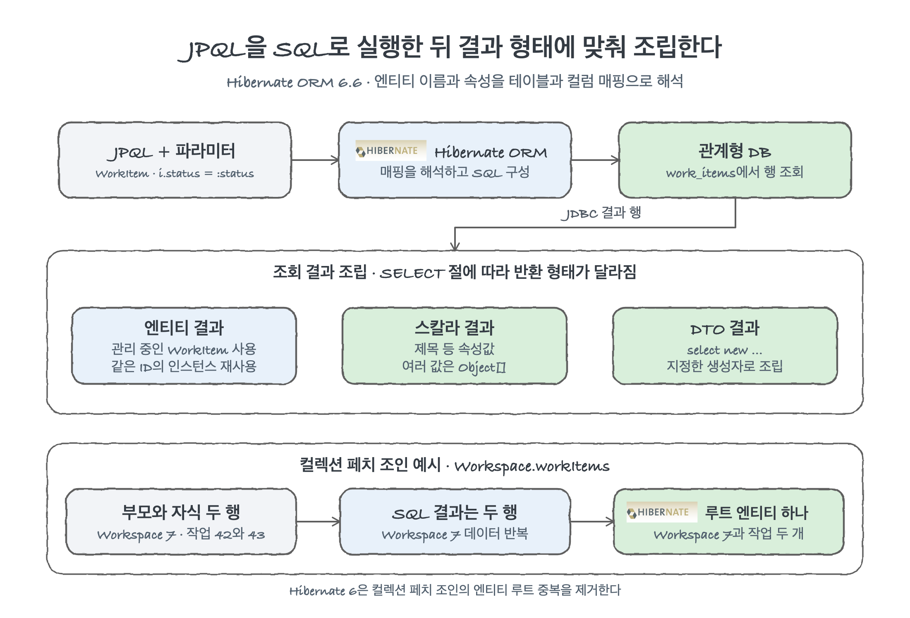
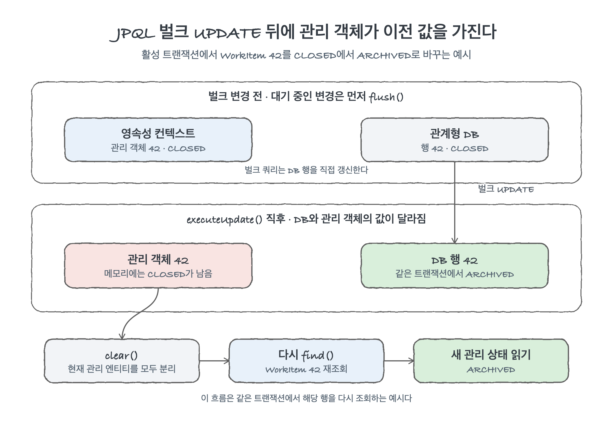

# JPQL and Object-Oriented Queries

JPQL은 엔티티 이름과 속성으로 조회를 표현한다. 실행 시 JPA 구현체가 매핑을 참고해 SQL로 바꾼다. 동적 조건이 많으면 Criteria API나 Querydsl을 사용하고, DB 고유 기능이 필요하면 네이티브 SQL을 선택할 수 있다. [Jakarta Persistence 3.1 · JPQL 쿼리 대상](https://jakarta.ee/specifications/persistence/3.1/jakarta-persistence-spec-3.1#abstract-schema-types-and-query-domains)

## 1. 결과 형태, 안전한 조건 바인딩, 페이징

```java
List<WorkItem> items = em.createQuery("""
        select i
        from WorkItem i
        where i.status = :status
        order by i.id
        """, WorkItem.class)
    .setParameter("status", WorkStatus.OPEN)
    .setFirstResult(0)
    .setMaxResults(20)
    .getResultList();
```

이름 기반 파라미터는 `:status`처럼 쓰고, 위치 기반 파라미터는 `?1`부터 시작한다. 값을 바인딩하면 조회 입력을 쿼리 문자열에 직접 이어 붙일 필요가 없다. `getResultList()`는 결과가 없으면 빈 리스트를 반환한다. JPA 3.1의 `getSingleResult()`는 결과가 없거나 여러 개이면 각각 `NoResultException`, `NonUniqueResultException`을 던진다.

| 프로젝션 | 예 | 반환 형태 |
| --- | --- | --- |
| 엔티티 | `select i from WorkItem i` | 영속성 컨텍스트가 관리하는 엔티티 |
| 값 | `select i.title from WorkItem i` | 문자열 같은 스칼라 값 |
| 여러 값 | `select i.id, i.title from WorkItem i` | 기본적으로 행마다 `Object[]` |
| DTO | `select new example.jpa.WorkItemSummary(i.id, i.title) from WorkItem i` | 인자 타입과 순서가 일치하는 생성자로 만든 DTO |

위 DTO는 `example.jpa` 패키지의 `public record WorkItemSummary(Long id, String title) {}`로 구현할 수 있다.

집계는 `COUNT`, `SUM`, `AVG` 등으로 표현한다. `WHERE`는 그룹화 전 행을, `HAVING`은 집계된 그룹을 제한한다. 여러 페이지를 이어 읽을 때는 `ORDER BY`에 유일한 기준을 포함해 페이지 경계의 순서를 정한다.



그림의 근거 · [JPQL 쿼리 대상](https://jakarta.ee/specifications/persistence/3.1/jakarta-persistence-spec-3.1#abstract-schema-types-and-query-domains) · [JPQL 결과 유형](https://jakarta.ee/specifications/persistence/3.1/jakarta-persistence-spec-3.1#a5438) · [페치 조인과 중복 제거](https://docs.hibernate.org/orm/6.6/querylanguage/html_single/#distinct)

## 2. 조인, 서브쿼리와 경로식

```jpql
select i.title, w.name
from WorkItem i
left join i.workspace w on w.name = :workspaceName
order by i.id
```

여기서 `ON`은 오른쪽의 조인 결과를 제한한다. `WHERE w.name = :workspaceName`으로 옮기면 일치하지 않아 `null`이 된 오른쪽 값도 걸러진다. `i.workspace.name`처럼 단일 연관을 연달아 탐색하면 묵시적 내부 조인이 생길 수 있다. 선택적으로 연결된 작업을 포함하려면 위처럼 조인 종류를 명시한다. 컬렉션 요소의 속성에 접근하려면 컬렉션을 조인해 요소에 별칭을 붙인다.

JPA 3.1의 이식 가능한 JPQL 서브쿼리는 `WHERE` 또는 `HAVING`에 둔다. `EXISTS`로 일치 여부, `IN`으로 결과 집합 포함 여부를 표현할 수 있다. 비연관 엔티티의 외부 조인이나 `FROM` 안의 서브쿼리 같은 표현은 JPA 버전과 Hibernate HQL 지원 범위를 확인한다. [Jakarta Persistence 3.1 · JPQL 서브쿼리](https://jakarta.ee/specifications/persistence/3.1/jakarta-persistence-spec-3.1#a5196) · [Hibernate 6.6 · HQL 쿼리 언어](https://docs.hibernate.org/orm/6.6/querylanguage/html_single/)

`CASE`로 조건에 따른 값을 만든다. `COALESCE`는 처음으로 null이 아닌 값을, `NULLIF`는 두 값이 같을 때 null을 반환한다. DB 함수는 `FUNCTION('함수명', 인자...)`로 호출할 수 있으며 DB와 구현체의 반환 타입 처리를 확인한다.

## 3. 페치 조인으로 조회 범위 지정

```jpql
select i
from WorkItem i
left join fetch i.workspace
where i.status = :status
```

일반 조인은 조건과 결과에 연관 테이블을 사용한다. 페치 조인은 반환되는 엔티티의 연관 객체도 같은 조회에서 초기화한다. 컬렉션에 페치 조인을 쓰면 SQL에서 부모 행이 자식 수만큼 반복될 수 있다. Hibernate 6은 엔티티 결과의 페치 조인에서 이러한 루트 중복을 제거하지만, DB가 읽고 전달하는 행 수는 여전히 늘어날 수 있다. [Hibernate 6.6 · 페치 조인 결과의 중복 제거](https://docs.hibernate.org/orm/6.6/querylanguage/html_single/#distinct)

컬렉션 페치 조인에 `setFirstResult()`와 `setMaxResults()`를 적용한 결과는 JPA에서 정의되지 않는다. 페이지가 필요하면 먼저 부모 ID를 정렬해 페이지 단위로 읽고, 해당 ID의 연관을 별도 쿼리로 불러오는 방식을 사용할 수 있다. 두 번째 조회 결과는 첫 페이지의 ID 순서로 조립한다. [Jakarta Persistence 3.1 · 페치 조인](https://jakarta.ee/specifications/persistence/3.1/jakarta-persistence-spec-3.1#a4931) · [Hibernate 6.6 · 페치 조인과 페이징](https://docs.hibernate.org/orm/6.6/querylanguage/html_single/#explicit-fetch-join)

## 4. 다형성, NamedQuery, 벌크 변경

- `TYPE(p) = CardPayment`는 선택한 하위 타입으로 결과를 제한한다. `TREAT`는 하위 타입의 속성을 참조할 때 사용할 수 있다.
- 엔티티를 파라미터로 바인딩한 `i.workspace = :workspace` 비교는 엔티티의 식별자를 기준으로 한다. ID 값을 받는 API는 `i.workspace.id = :id`로 비교할 수 있다.
- `@NamedQuery`로 이름을 붙인 쿼리는 `createNamedQuery()`로 재사용한다. Hibernate에서는 영속성 유닛 초기화 시 검증할 수 있다.

```java
em.flush();
int changed = em.createQuery("""
        update WorkItem i
        set i.status = :archived
        where i.status = :closed
        """)
    .setParameter("archived", WorkStatus.ARCHIVED)
    .setParameter("closed", WorkStatus.CLOSED)
    .executeUpdate();
em.clear();
```

벌크 `UPDATE`와 `DELETE`는 활성 트랜잭션에서 DB 행에 직접 적용된다. 이미 관리 중인 객체에는 결과가 자동 반영되지 않는다. 위 예제는 실행 전에 미반영 변경을 저장하고, 실행 후 컨텍스트를 비워 다음 조회가 새 상태를 읽도록 한다. 버전이나 엔티티 콜백에 의존하는 변경은 벌크 작업에서 별도로 설계한다. [Jakarta Persistence 3.1 · 벌크 갱신과 삭제](https://jakarta.ee/specifications/persistence/3.1/jakarta-persistence-spec-3.1#a5636)



그림의 근거 · [JPQL 벌크 갱신](https://jakarta.ee/specifications/persistence/3.1/jakarta-persistence-spec-3.1#a5636) · [플러시와 분리](https://jakarta.ee/specifications/persistence/3.1/jakarta-persistence-spec-3.1#a1066)
