# 카프카 시작하기

## 1. 발행/구독 메시지 전달

발행/구독 메시지 전달 패턴의 특징은 전송자(발행하는 쪽)가 데이터(메시지)를 보낼 때, 직접 수신자(구독하는 쪽)로 보내지 않는다는 것이다.

대신, 전송자(쓰는 쪽)는 어떤 형태로든 메시지를 분류해서 보내고, 수신자(읽는 쪽)는 이렇게 분류된 메시지를 구독한다. 발행/구독 시스템에는 대개 발행된 메시지를 전달받고 중계해주는 중간 지점 역할을 하는 브로커가 있다.

### 초기의 발행/구독 시스템

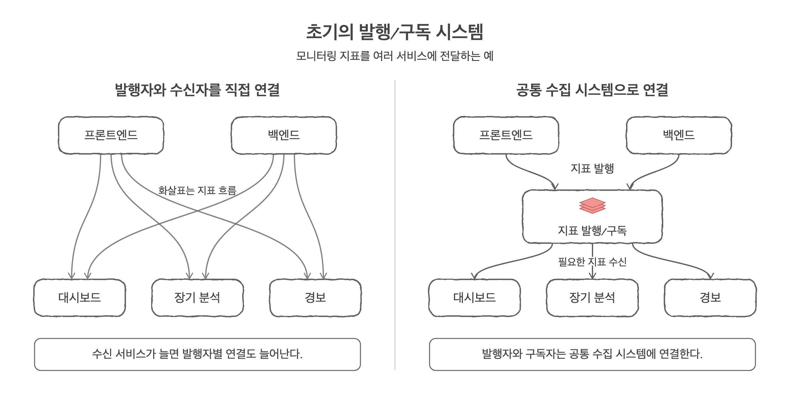

처음에는 애플리케이션이 모니터링 지표를 대시보드로 직접 보낸다. 장기 분석이나 경보처럼 지표를 쓰는 곳이 늘어나면, 애플리케이션별로 전송 대상을 추가하거나 조회용 연결을 열어야 해서 연결을 관리하기 어려워진다.

지표 수집을 한곳으로 모으면 각 애플리케이션은 공통 수집 시스템에 지표를 보내고, 대시보드·분석·경보 서비스는 그곳에서 필요한 지표를 얻는다. 발행자와 구독자 사이의 개별 연결이 줄어든다.

### 개별 메시지 큐 시스템

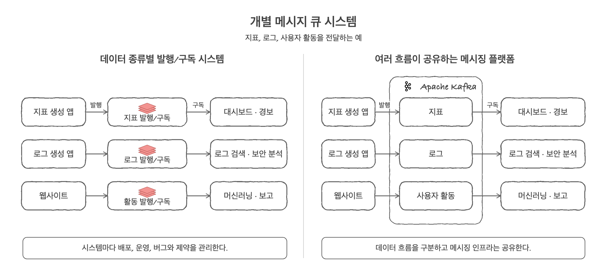

지표 수집 방식을 로그와 웹사이트 사용자 활동에도 적용하면, 데이터 종류마다 발행자와 구독자를 분리할 수 있다. 지표는 대시보드와 경보에, 로그는 검색과 보안 분석에, 사용자 활동은 머신러닝과 보고에 활용한다.

용도별로 시스템을 따로 두면 구현과 운영이 중복되고, 시스템마다 다른 버그와 제약을 관리해야 한다. 여러 종류의 데이터를 발행·구독할 수 있는 공통 시스템이 필요해졌고, 카프카는 이 문제를 해결하기 위해 설계됐다.

## 2. 카프카 입문

파일시스템이나 데이터베이스 커밋 로그(commit log)는 모든 트랜잭션 기록을 지속성(durability) 있게 보존함으로써 시스템의 상태를 일관성(consistency) 있게 복구할 수 있도록 고안되었다.

이와 유사하게, 카프카에 저장된 데이터는 순서를 유지한 채로 지속성 있게 보관되며 결정적(deterministic)으로 읽을 수 있다. 또한, 확장 시 성능을 향상시키고 실패가 발생하더라도 데이터 사용에는 문제가 없도록 시스템 안에서 데이터를 분산시켜 저장할 수 있다.

### 메시지와 배치

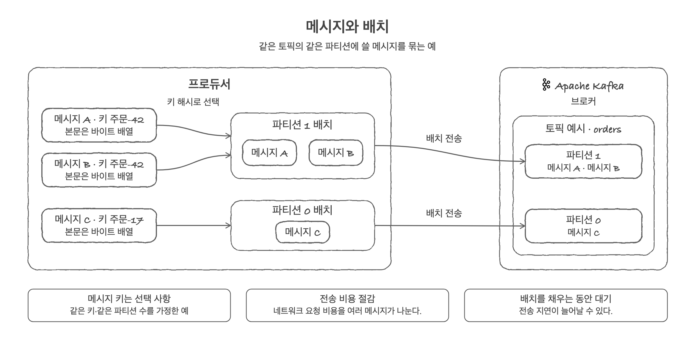

카프카에서 데이터의 기본 단위는 메시지(message)다. 카프카의 입장에서 메시지는 단순히 바이트의 배열일 뿐이기 때문에 여기에 포함된 데이터에는 특정한 형식이나 의미가 없다.

메시지는 키(Key)라 불리는 메타데이터를 포함할 수도 있다. 키 역시 메시지와 마찬가지로 카프카 입장에서 특별한 의미가 없는 바이트 배열일 뿐이다. 키는 메시지를 저장할 파티션을 결정하기 위해 사용된다.

가장 간단한 방법은 키값에서 일정한 해시값을 생성한 뒤 이 값을 토픽의 파티션 수로 나눴을 때 나오는 나머지 값에 해당하는 파티션에 메시지를 저장하는 것이다. 이렇게 하면 같은 키값을 가진 메시지는 (파티션 수가 변하지 않는 한) 항상 같은 파티션에 저장된다.

카프카는 효율성을 위해 메시지를 배치(batch) 단위로 저장한다. 배치는 그저 같은 토픽의 파티션에 쓰여지는 메시지들의 집합일 뿐이다. 메시지를 쓸 때마다 네트워크상에서 신호가 오가는 것은 막대한 오버헤드를 발생시키는데, 메시지를 배치 단위로 모아서 쓰면 이것을 줄일 수 있다.

물론 이것은 지연(latency)과 처리량(throughput) 사이에 트레이드오프를 발생시킨다. 즉, 배치 크기가 커질수록 시간당 처리되는 메시지의 수는 늘어나지만, 각각의 메시지가 전달되는 데 걸리는 시간은 늘어나는 것이다. 배치는 더 효율적인 데이터 전송과 저장을 위해 약간의 처리 능력을 들여서 압축되는 경우가 많다.

### 스키마

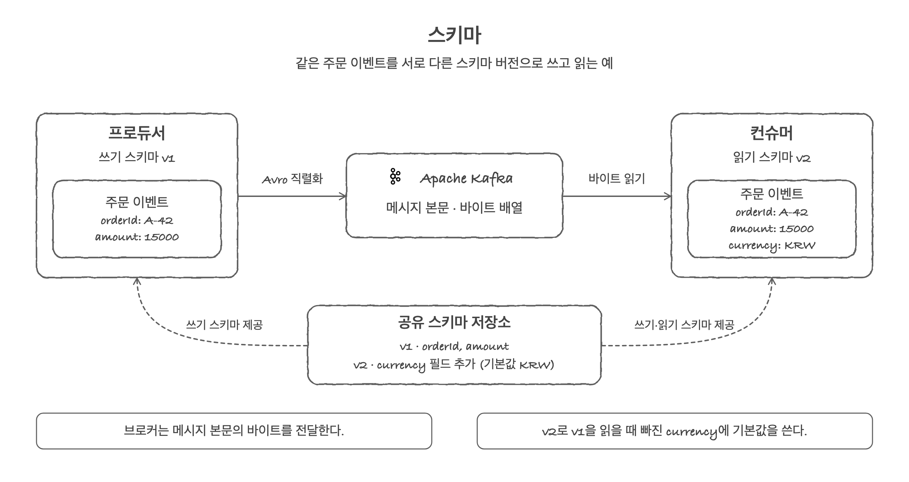

카프카 입장에서 메시지는 단순한 바이트 배열일 뿐이지만, 내용을 이해하기 쉽도록 일정한 구조(혹은 스키마)를 부여하는 것이 권장된다. 각 애플리케이션의 필요에 따라 사용 가능한 메시지 스키마는 여러 가지가 있는데, 가장 간단한 방법으로는 쓰기 쉽고 사람이 알아볼 수 있는 JSON이나 XML이 있다.

하지만 이 방식들은 타입 처리 기능이나 스키마 버전 간의 호환성 유지 기능이 떨어진다. 많은 아파치 카프카 개발자들은 아파치 에이브로(Avro)를 선호한다. 에이브로는 조밀한 직렬화 형식을 제공하는 데다 메시지 본체와 스키마를 분리하기 때문에 스키마가 변경되더라도 코드를 생성할 필요가 없다. 또한, 강력한 데이터 타이핑과 스키마 변경에 따른 상위 호환성, 하위 호환성 역시 지원한다.

카프카에서는 일관적인 데이터 형식이 중요하다. 메시지 쓰기와 읽기 작업을 분리할 수 있도록 해주기 때문이다. 만약 이 작업들이 서로 결합되어 있다면 우선 메시지를 구독하는 애플리케이션들이 먼저 구버전과 신버전 형식을 동시에 함께 지원할 수 있도록 업데이트되어야 할 것이며, 그 다음에야 메시지를 발행하는 애플리케이션이 신버전 형식을 사용하도록 업데이트될 수 있을 것이다.

### 토픽과 파티션

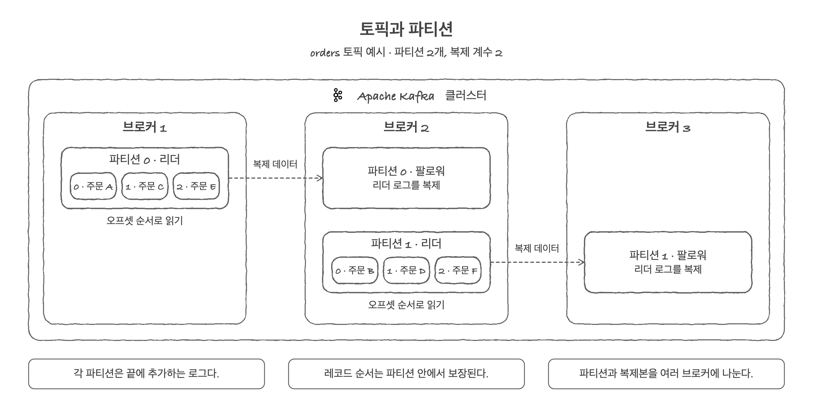

카프카에 저장되는 메시지는 토픽(topic) 단위로 분류된다. 토픽은 다시 여러 개의 파티션(partition)으로 나뉘어진다. 커밋 로그의 관점으로 되돌아가자면, 파티션은 하나의 로그에 해당한다. 파티션에 메시지가 쓰여질 때는 추가만 가능(append-only)한 형태로 쓰여지며, 읽을 때는 맨 앞부터 제일 끝까지의 순서로 읽힌다. 대개 토픽에 여러 개의 파티션이 있는 만큼 토픽 안의 메시지 전체에 대해 순서는 보장하지 않으며, 단일 파티션 안에서만 순서가 보장될 뿐이다.

파티션은 카프카가 데이터 중복과 확장성을 제공하는 방법이기도 하다. 각 파티션이 서로 다른 서버에 저장될 수 있기 때문에 하나의 토픽이 여러 개의 서버로 수평적으로 확장되어 하나의 서버의 용량을 넘어가는 성능을 보여 줄 수 있다.

또 하나, 파티션은 복제될 수 있다. 즉, 서로 다른 서버들이 동일한 파티션의 복제본을 저장하고 있기 때문에 서버 중 하나에 장애가 발생한다고 해서 읽거나 쓸 수 없는 상황이 벌어지진 않는다.

카프카와 같은 시스템에서 스트림(stream)이라는 용어가 자주 사용된다. 대부분의 경우 스트림은 (파티션의 개수와 상관없이) 하나의 토픽에 저장된 데이터로 간주되며, 프로듀서(producer)로부터 컨슈머(consumer)로 이어지는 하나의 데이터 흐름을 나타낸다.

메시지의 집합을 스트림이라는 용어로 부르는 것은 카프카 스트림즈(Kafka Streams), 아파치 삼자(Samza), 아파치 스톰(Storm)과 같은 프레임워크에서 메시지를 실시간으로 처리하는 것처럼 스트림 처리에 대한 논의를 진행할 때 가장 일반적이다. 이는 스트림 처리를 위한 프레임워크가 메시지의 집합을 스트림으로 처리하는 방식을 사용하기 때문이다.

### 프로듀서와 컨슈머

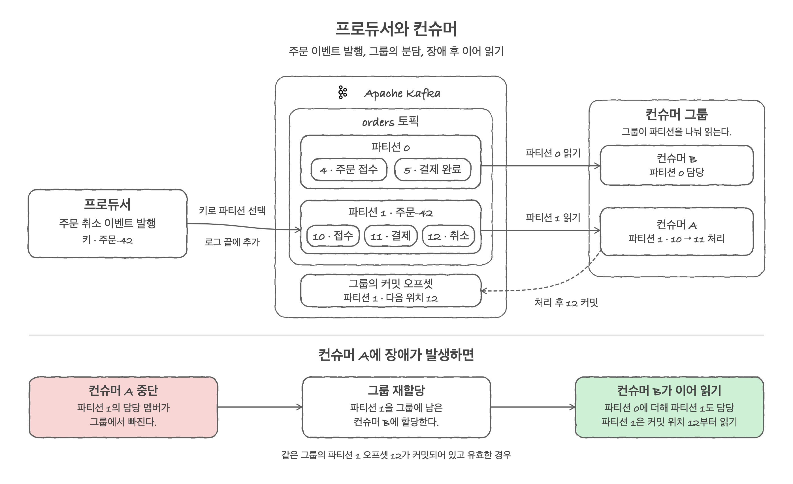

프로듀서는 새로운 메시지를 생성한다. 다른 발행/구독 시스템에서는 발행자(publisher) 혹은 작성자(writer)라고도 부른다. 메시지는 특정한 토픽에 쓰여진다. 기본적으로 프로듀서는 메시지를 쓸 때 토픽에 속한 파티션들 사이에 고르게 나눠서 쓰도록 되어 있다.

하지만 어떠한 경우에는 프로듀서가 특정한 파티션을 지정해서 메시지를 쓰기도 한다. 이것은 대개 메시지 키(key)와 키값의 해시를 특정 파티션으로 대응시켜 주는 파티셔너(partitioner)를 사용해서 구현된다.
이렇게 함으로써 동일한 키값을 가진 모든 메시지는 같은 파티션에 저장되게 된다. 프로듀서는 메시지를 파티션으로 대응시켜주는 나름의 규칙을 가진 커스텀 파티셔너를 사용할 수도 있다.

컨슈머는 메시지를 읽는다. 다른 발행/구독 시스템에서는 구독자(subscriber) 혹은 독자(reader)라고도 한다.
컨슈머는 1개 이상의 토픽을 구독해서 여기에 저장된 메시지들을 각 파티션에 쓰여진 순서대로 읽어 온다. 컨슈머는 메시지의 오프셋(offset)을 기록함으로써 어느 메시지까지 읽었는지를 유지한다.

오프셋은 지속적으로 증가하는 정수값으로, 카프카의 메시지를 저장할 때 각각의 메시지에 부여해주는 또 다른 메타데이터이다. 주어진 파티션의 각 메시지는 고유한 오프셋을 가지며, 뒤에 오는 메시지가 앞의 메시지보다 더 큰 오프셋을 가진다.
파티션별로 다음 번에 사용 가능한 오프셋 값을 저장함(대체로 카프카 자체에 저장됨)으로써 컨슈머는 읽기 작업을 정지했다가 다시 시작하더라도 마지막으로 읽었던 메시지의 바로 다음 메시지부터 읽을 수 있다.

컨슈머는 컨슈머 그룹(consumer group)의 일원으로서 작동한다. 컨슈머 그룹은 토픽에 저장된 데이터를 읽어오기 위해 협업하는 하나 이상의 컨슈머로 이루어진다.
컨슈머 그룹은 각 파티션이 하나의 컨슈머에 의해서만 읽히도록 한다. 컨슈머는 컨슈머 그룹 내에서 메시지를 읽는 순서를 정의할 수 있다.

이 방법을 사용함으로써 대량의 메시지를 갖는 토픽들을 읽기 위해 컨슈머들을 수평 확장할 수 있다. 또한, 컨슈머 중 하나에 장애가 발생하더라도 그룹 안의 다른 컨슈머들이 장애가 발생한 컨슈머가 읽고 있던 파티션을 재할당받은 뒤 이어서 데이터를 읽어올 수 있다.

### 브로커와 클러스터

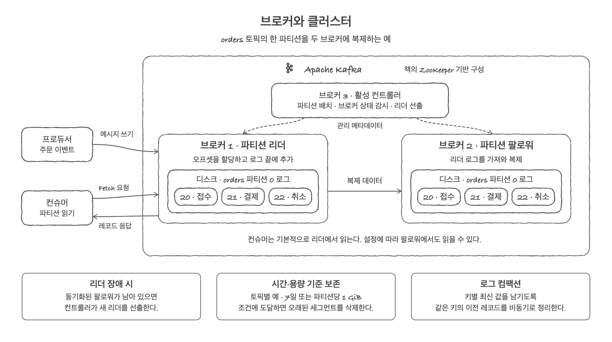

하나의 카프카 서버를 브로커라고 부른다. 브로커는 프로듀서로부터 메시지를 전달받아 오프셋을 할당한 뒤 디스크 저장소에 쓴다.
브로커는 컨슈머의 파티션 읽기(fetch) 요청 역시 처리하고 발행된 메시지를 보내준다. 시스템 하드웨어의 성능에 따라 다르겠지만, 하나의 브로커는 초당 수천 개의 파티션과 수백만 개의 메시지를 쉽게 처리할 수 있다.

카프카 브로커는 클러스터의 일부로서 작동하도록 설계되었다. 하나의 클러스터 안에 여러 개의 브로커가 포함될 수 있으며, 그중 하나의 브로커가 클러스터 컨트롤러의 역할을 하게 된다. (컨트롤러는 클러스터 안의 현재 작동 중인 브로커 중 하나가 자동으로 선정된다)
컨트롤러는 파티션을 브로커에 할당해주거나 장애가 발생한 브로커를 모니터링하는 등의 관리 기능을 담당한다. 파티션은 클러스터 안의 브로커 중 하나가 담당하며, 그 브로커를 파티션 리더(partition leader)라고 부른다.
복제된 파티션이 여러 브로커에 할당될 수도 있는데 이것들은 파티션의 팔로워(follower)라고 부른다. 복제(replication) 기능은 파티션의 메시지를 중복 저장함으로써 리더 브로커에 장애가 발생했을 때 팔로워 중 하나가 리더 역할을 이어받을 수 있도록 한다.
모든 프로듀서는 리더 브로커에 메시지를 발행해야 하지만, 컨슈머는 리더나 팔로워 중 하나로부터 데이터를 읽어올 수 있다.

아파치 카프카의 핵심 기능 중에 일정 기간 동안 메시지를 지속성(durability) 있게 보관하는 보존(retention) 기능이 있다.
카프카 브로커는 토픽에 대해 기본적인 보존 설정이 되어 있는데, 특정 기간 동안 메시지를 보존하거나(예: 7일) 파티션의 크기가 특정 사이즈에 도달할 때까지(예: 1GB) 데이터를 보존한다.
이러한 한도값에 도달하면 메시지는 만료되어 삭제된다. 이렇게 보존 설정은 어떤 시점에 있어서건 사용 가능한 최소한의 데이터 양을 정의한다.
각각의 토픽에는 메시지가 필요한 정도까지만 저장되도록 보존 설정을 잡아줄 수 있다.
토픽에는 로그 압축(log compaction) 기능을 설정할 수도 있는데, 이 경우 같은 키를 갖는 메시지 중 가장 최신인 것만 보존된다. 이 기능은 마지막 변경값만이 중요한 체인지로그(changelog) 형태의 데이터에 사용하면 좋다.

### 다중 클러스터

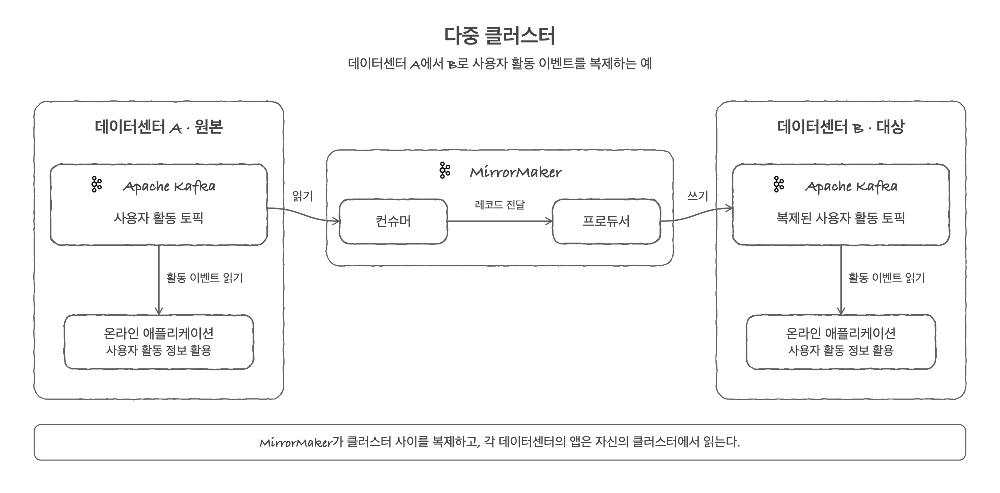

특히 카프카가 다수의 데이터센터에서 운용될 때는 데이터센터 간에 메시지를 복제해 줄 필요가 있는 경우가 많다.
이렇게 하면 온라인 애플리케이션은 양쪽 데이터센터 모두에서 사용자 활동 정보를 사용할 수 있다.

카프카 프로젝트는 데이터를 다른 클러스터로 복제하는 데 사용되는 미러메이커(MirrorMaker)라는 툴을 포함한다.
근본적으로 미러메이커도 단지 큐로 연결된 카프카 컨슈머와 프로듀서에 불과하다. 하나의 카프카 클러스터에서 메시지를 읽어와서 다른 클러스터에 쓴다.

## 3. 왜 카프카인가?

### 다중 프로듀서

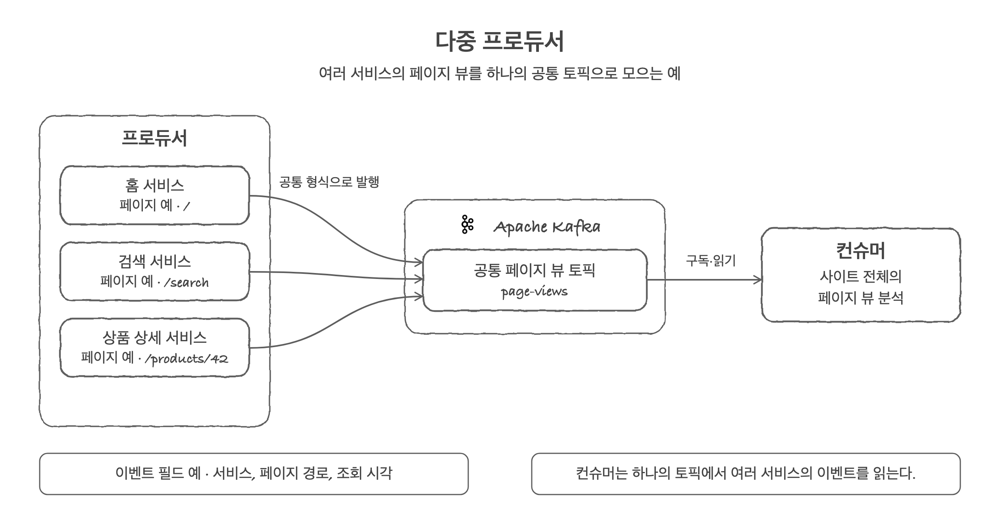

카프카는 자연스럽게 여러 프로듀서를 처리할 수도 있다. 프로듀서 클라이언트가 여러 토픽을 사용하든 하나의 토픽을 사용하든 간에 말이다.
이런 이유 때문에 많은 프론트엔드 시스템으로부터 데이터를 수집하고 일관성을 유지하는 데 적격이다. 예를 들어, 마이크로서비스(microservice)를 통해 사용자에게 콘텐츠를 서비스하는 사이트에서 모든 서비스가 공통의 형식으로 쓸 수 있는 페이지 뷰용 토픽을 가질 수 있다.
이제 컨슈머 애플리케이션은 애플리케이션별로 하나씩, 여러 개의 토픽에서 데이터를 읽어올 필요 없이 사이트의 모든 애플리케이션에 대한 페이지 뷰 스트림 하나만 읽어오면 된다.

### 다중 컨슈머

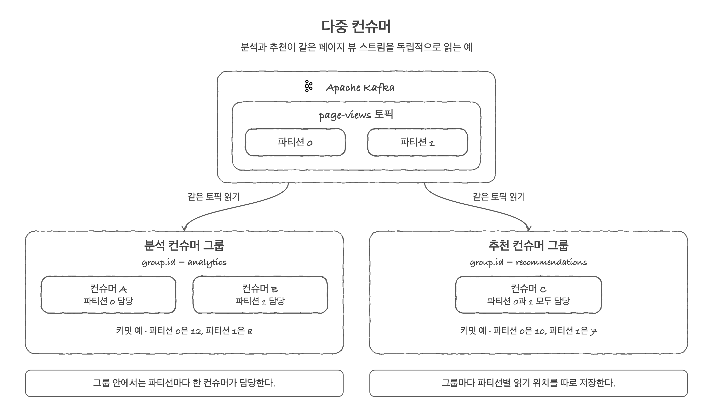

다중 프로듀서와 함께, 카프카는 많은 컨슈머가 상호 간섭 없이 어떠한 메시지 스트림도 읽을 수 있도록 설계되었다.
이것이 하나의 메시지를 하나의 클라이언트에서만 소비할 수 있도록 되어 있는 많은 큐 시스템과의 결정적인 차이점이기도 하다.
다수의 카프카 컨슈머는 컨슈머 그룹의 일원으로 작동함으로써 하나의 스트림을 여럿이서 나뉘어 읽을 수 있다. 이 경우 주어진 메시지는 전체 컨슈머 그룹에 대해 한 번만 처리된다.

### 디스크 기반 보존

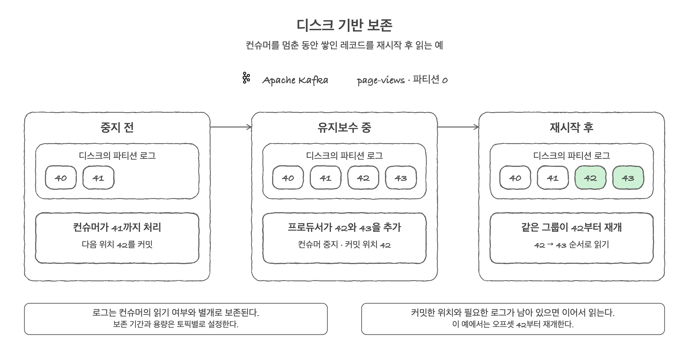

카프카는 다중 컨슈머를 처리할 수 있을 뿐만 아니라 메시지를 지속성 있게 저장할 수도 있다.
이는 컨슈머들이 항상 실시간으로 데이터를 읽어올 필요는 없다는 의미이기도 하다. 메시지는 디스크에 쓰여진 뒤 설정된 보유 규칙과 함께 저장된다.
이 옵션들은 토픽별로 설정이 가능하기 때문에 서로 다른 메시지 스트림이 컨슈머의 필요에 따라 서로 다른 기간 동안 보존될 수 있다. 따라서 만약 컨슈머가 느린 처리 속도 혹은 트래픽 폭주로 인해 뒤처질 경우에도 데이터 유실의 위험은 없다.

프로듀서 쪽에서 메시지를 백업해야 하거나 메시지가 유실될 걱정 없이 잠시 애플리케이션을 내리고 컨슈머를 유지보수할 수 있다는 것이다.
컨슈머를 정지하더라도 메시지는 카프카 안에 남아있게 된다. 그리고 컨슈머가 다시 시작되면 작업을 멈춘 지점에서부터 유실 없이 데이터를 처리할 수 있다.

### 확장성

카프카는 유연한 확장성을 가지고 있기 때문에 어떠한 크기의 데이터도 쉽게 처리할 수 있다.

카프카 클러스터는 작동 중에도 시스템 전체의 가용성(availability)에 영향을 주지 않으면서 확장이 가능하다.
여러 대의 브로커로 구성된 클러스터는 개별 브로커의 장애를 처리하면서 지속적으로 클라이언트의 요청을 받아서 처리할 수 있다는 의미다.

동시다발적인 장애를 견뎌야 하는 클러스터의 경우 더 큰 복제 팩터(replication factor)를 설정해주는 것이 가능하다.

### 고성능

아파치 카프카가 고부하 아래에서도 높은 성능을 보여주는 발행/구독 메시지 전달 시스템이 될 수 있었던 것은 지금까지 설명한 모든 특징들 덕분이다.

발행된 메시지가 컨슈머에게 전달될 때까지 1초도 안 걸리면서도 프로듀서, 컨슈머, 브로커 모두가 매우 큰 메시지 스트림을 쉽게 다룰 수 있도록 수평적으로 확장될 수 있는 것이다.

### 플랫폼 기능

YARN처럼 구조화된 런타임 환경을 포함하는 완전한 플랫폼은 아니지만 이 기능들은 탄탄한 기반과 자유로운 형태로 실행할 수 있는 유연성을 갖춘 API와 라이브러리의 형태로 사용이 가능하다.

카프카 커넥트는 소스 데이터 시스템으로부터 카프카로 데이터를 가져오거나 카프카의 데이터를 싱크 시스템으로 내보내는 작업을 도와준다.

## 4. 데이터 생태계

아파치 카프카는 데이터 생태계에 있어서 순환 시스템을 제공한다. 모든 클라이언트에 대해 일관된 인터페이스를 제공하면서 다양한 인프라스트럭처 요소들 사이에 메시지를 전달하는 것이다.

메시지 스키마를 제공하는 시스템과 결합하면 프로듀서와 컨슈머는 더 이상 어떤 형태로든 밀접하게 결합되거나 연결될 필요가 없다.
필요할 때마다 관련 컴포넌트를 추가하거나 제거해주면 되며, 프로듀서는 누가 데이터를 사용하는지, 컨슈머 애플리케이션이 몇 개인지와 같은 것에 신경 쓸 필요가 없다.
