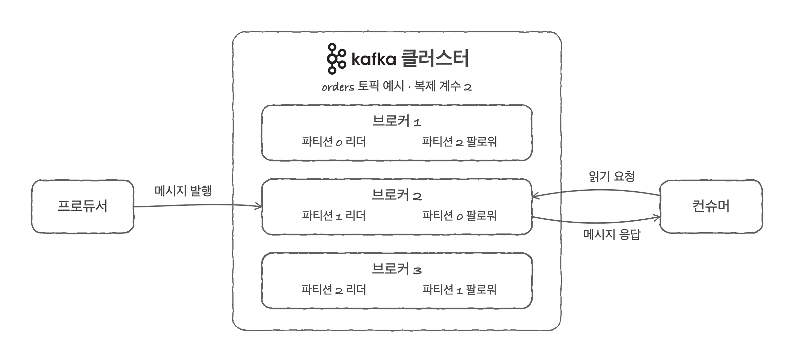

# 카프카 설치하기

『카프카 핵심 가이드』 개정증보판 2장의 ZooKeeper 기반 브로커 설정과 운영 고려 사항을 정리한다. [원서 2장](https://d2cvlmmg8c0xrp.cloudfront.net/book/kafka_guide_2022.pdf)

## 1. 브로커 설정하기

단일 서버에서 단독으로 실행하는 브로커가 아니라면 어떤 환경에서 카프카를 설치하건 간에 살펴봐야만 하는 브로커 설정 매개변수들이 있다. 이 매개변수들은 카프카를 실행하는 서버의 환경에 따라 달라질 수 있다.

이 매개변수들은 브로커의 기본적인 설정을 담당하며, 이들 중 대부분은 다른 브로커들과 함께 클러스터 모드로 작동시키려면 기본값이 아닌 다른 값으로 바꿔줘야 한다.

### broker.id

모든 카프카 브로커는 정숫값 식별자를 갖는다. 이 값은 `broker.id`로 설정 가능하다.
기본값은 0이지만 어떤 값도 될 수 있다.

중요한 것은 이 정숫값이 클러스터 안의 각 브로커별로 전부 달라야 한다는 점이다.
임의로 선택할 수 있으며, 필요하다면 브로커 간에 이동도 가능하다.

### listeners

구버전 카프카는 단순한 `port` 설정을 사용했다. 이 설정은 단순한 구성에서 여전히 사용 가능하지만 지원 중단되었다.
배포판에 포함되어 있는 예제 설정 파일에서는 9092번 TCP 포트에서 돌아가는 리스너(listener)와 함께 카프카를 실행시킨다.
새로 도입된 listener 설정은 쉼표로 구분된 리스너 이름과 URI의 목록이다.

만약 리스너 이름이 보안 프로토콜이 아니라면 반드시 `listener.security.protocol.map` 설정을 잡아 주어야 한다.
리스너는 `{프로토콜}://{호스트 이름}:{포트}`의 형태로 정의된다.

유효한 listener 설정의 예로는 `PLAINTEXT://localhost:9092,SSL://:9091`가 있다.
호스트 이름을 `0.0.0.0`으로 잡아줄 경우 모든 네트워크 인터페이스로부터 연결을 받게 되며, 이 값을 비워 주면 기본 인터페이스에 대해서만 연결을 받게 된다. [Apache Kafka 3.0 · Broker Configs](https://kafka.apache.org/30/generated/kafka_config.html)
1024 미만의 포트 번호를 사용할 경우 루트 권한으로 카프카를 실행시켜야 한다는 점을 명심해야 한다.

### zookeeper.connect

브로커의 메타데이터가 저장되는 주키퍼의 위치를 가리킨다. 로컬 호스트의 2181번 포트에서 작동 중인 주키퍼를 사용할 경우 `localhost:2181`로 잡아 주면 된다.
- 호스트 이름 : 주키퍼 서버의 호스트 이름이나 IP 주소
- 포트 : 주키퍼의 클라이언트 포트 번호
- /{경로} : 선택 사항. 카프카 클러스터의 chroot 환경으로 사용될 주키퍼의 경로. 지정하지 않으면 루트 디렉터리가 사용된다.

### log.dirs

카프카는 모든 메시지를 로그 세그먼트(log segment) 단위로 묶어서 `log.dir` 설정에 지정된 디스크 디렉터리에 저장한다.
다수의 디렉터리를 지정하고자 할 경우, `log.dirs`를 사용하는 것이 좋다. `log.dirs`가 설정되어 있지 않을 경우, `log.dir`가 사용된다.
`log.dirs`는 쉼표로 구분된 로컬 시스템 경로의 목록이다. 1개 이상의 경로가 지정되었을 경우, 브로커는 가장 적은 수의 파티션이 저장된 디렉터리에 새 파티션을 저장할 것이다.(같은 파티션에 속하는 로그 세그먼트는 동일한 경로에 저장된다)

사용된 디스크 용량 기준이 아닌 저장된 파티션 수 기준으로 새 파티션의 저장 위치를 배정한다는 점에 유의한다.
바로 이런 이유 때문에 다수의 디렉터리에 대해 균등한 양의 데이터가 저장되지는 않는다.

### num.recovery.threads.per.data.dir

카프카는 설정 가능한 스레드 풀을 사용해서 로그 세그먼트를 관리한다. 현재 이 스레드 풀은 아래와 같은 작업을 수행한다.
- 브로커가 정상적으로 시작되었을 때, 각 파티션의 로그 세그먼트 파일을 연다.
- 브로커가 장애 발생 후 다시 시작되었을 때, 각 파티션의 로그 세그먼트를 검사하고 잘못된 부분은 삭제한다.
- 브로커가 종료할 때, 로그 세그먼트를 정상적으로 닫는다.

기본적으로 하나의 로그 디렉터리에 대해 하나의 스레드만이 사용된다. 이 스레드들은 브로커가 시작될 때와 종료될 때만 사용되기 때문에 작업을 병렬화하기 위해서는 많은 수의 스레드를 할당해주는 것이 좋다. [Apache Kafka 3.0 · Broker Configs](https://kafka.apache.org/30/generated/kafka_config.html)

특히 브로커에 많은 파티션이 저장되어 있을 경우, 이 설정을 어떻게 잡아주느냐에 따라 언클린 셧다운 이후 복구를 위한 재시작 시간이 몇 시간씩 차이가 날 수도 있다.
이 설정값을 잡아 줄 때는 `log.dirs`에 지정된 로그 디렉터리별 스레드 수라는 점을 명심한다. 예를 들어, `num.recovery.threads.per.data.dir`이 8이고 `log.dirs`에 지정된 경로 수가 3개일 경우, 전체 스레드 수는 24개가 된다.

### auto.create.topics.enable

카프카 기본 설정에는 아래와 같은 상황에서 브로커가 토픽을 자동으로 생성하도록 되어 있다.
- 프로듀서가 토픽에 메시지를 쓰기 시작할 때
- 컨슈머가 토픽으로부터 메시지를 읽기 시작할 때
- 클라이언트가 토픽에 대한 메타데이터를 요청할 때

만약 토픽 생성을 명시적으로 관리하고자 할 경우, `auto.create.topics.enable`을 `false`로 설정할 수 있다.

### auto.leader.rebalance.enable

모든 토픽의 리더 역할이 하나의 브로커에 집중됨으로써 카프카 클러스터의 균형이 깨지는 수가 있다. 이 설정을 활성화해주면 가능한 한 리더 역할이 균등하게 분산되도록 함으로써 이런 사태가 발생하는 것을 방지할 수 있다.

이 설정을 켜면 파티션의 분포 상태를 주기적으로 확인하는 백그라운드 스레드가 시작된다.
만약 전체 파티션 중 특정 브로커에 리더 역할이 할당된 파티션의 비율이 `leader.imbalance.per.broker.percentage`에 설정된 값을 넘어가면 파티션의 선호 리더 리밸런싱이 발생한다.

### delete.topic.enable

환경과 데이터 보존 가이드라인에 따라 클러스터의 토픽을 임의로 삭제하지 못하게끔 막아야 할 때가 있다. 이 플래그를 `false`로 잡아 주면 토픽 삭제 기능이 막힌다.

## 2. 토픽별 기본값

카프카 브로커 설정은 새로 생성되는 토픽에 적용되는 수많은 설정의 기본값 역시 지정한다. 이 매개변수 중 몇 개(파티션 수나 메시지 보존 등)는 관리용 툴을 사용해서 토픽 단위로 설정이 가능하다.

### num.partitions

`num.partitions` 매개변수는 새로운 토픽이 생성될 때 몇 개의 파티션을 갖게 되는지를 결정하며, 주로 자동 토픽 생성 기능이 활성화되어 있을 때 사용된다. 기본값은 1이다.
**단, 토픽의 파티션 개수는 늘릴 수만 있지 줄일 수는 없다.** 

브로커가 추가될 때 클러스터 전체에 걸쳐 메시지 부하가 고르게 분산되도록 파티션 개수를 잡아 주는 게 중요하다. 많은 사용자들은 토픽당 파티션 개수를 클러스터 내 브로커 수와 맞추거나 아니면 배수로 설정한다.
이렇게 하면 파티션이 브로커들 사이에 고르게 분산되도록 할 수 있으며, 결과적으로 메시지 부하 역시 고르게 분산되게 된다. 예를 들어, 10개의 파티션으로 이루어진 토픽이 10개의 호스트로 구성된 카프카 클러스터에서 작동 중이고, 각 파티션의 리더 역할이 이 10개 호스트에 고르게 분산되어 있다면 최적의 처리량이 나올 것이다.
**단, 토픽을 여럿 생성하는 것과 같이 다른 방법으로 메시지 부하를 분산시키는 것 역시 가능하기 때문에 이것이 필수사항은 아니다.**

> **❓파티션 수는 어떻게 결정해야 하는가?**
>
> 파티션의 수를 결정할 때 고려해야 할 요소에는 여러 가지가 있다.
  > * 토픽에 대해 달성하고자 하는 처리량은 대략 어느 정도인가? 예를 들어서, 쓰기 속도가 초당 100KB여야 하는가 1GB여야 하는가?
  > * 단일 파티션에 대해 달성하고자 하는 최대 읽기 처리량은 어느 정도인가? 하나의 파티션은 항상 하나의 컨슈머만 읽을 수 있다. 만약 컨슈머 애플리케이션이 느리게 데이터를 데이터베이스에 쓰는데, 이 데이터베이스의 쓰기 스레드 각각이 초당 50MB 이상을 처리할 수 없다면, 하나의 파티션에서 읽어올 수 있는 속도는 초당 50MB로 제한된다.
  > * 각 프로듀서가 단일 파티션에 쓸 수 있는 최대 속도에 대해서 비슷한 추정을 할 수 있다. 하지만 프로듀서가 컨슈머에 비해 훨씬 더 빠른 것이 보통이기 때문에, 이 작업은 건너뛰어도 괜찮다.
>
> 만약 키값을 기준으로 선택된 파티션에 메시지를 전송하고 있을 경우, 나중에 파티션을 추가하고자 하면 꽤나 골치 아플 수 있다. 따라서 현재의 사용량이 아닌, 미래의 사용량 예측값을 기준으로 처리량을 계산한다.
  > * 각 브로커에 배치할 파티션 수뿐만 아니라 브로커별로 사용 가능한 디스크 공간, 네트워크 대역폭 역시 고려한다.
  > * 과대 추산을 피한다. 각 파티션은 브로커의 메모리와 다른 자원들을 사용할 뿐만 아니라 메타데이터 업데이트나 리더 역할 변경에 걸리는 시간 역시 증가시킨다.
  > * 데이터를 미러링할 예정인가? 그렇다면 미러링 설정의 처리량 역시 고려할 필요가 있다. 미러링 구성에서 큰 파티션이 병목이 되는 경우가 많다.
  > * 만약 클라우드 서비스를 사용하고 있다면 가상 머신이나 디스크에 초당 입출력(input/output operations per second, IOPS) 제한이 걸려 있는지? 사용중인 클라우드 서비스나 가상 머신 설정에 따라 허용되는 IOPS 상한선이 설정되어 있을 수 있다. 파티션 수가 너무 많으면 병렬 처리 때문에 본의 아니게 IOPS 양이 증가할 수 있다. [원서 2장 · Topic Defaults](https://d2cvlmmg8c0xrp.cloudfront.net/book/kafka_guide_2022.pdf)

이 모든 것을 종합하면 파티션은 많아야 하지만 그렇다고 해서 너무 많아서는 안 된다. 일단 작은 크기로 시작해 나중에 필요할 때 확장하는 것이 처음부터 너무 크게 시작하는 것보다 쉽다.

### default.replication.factor

자동 토픽 생성 기능이 활성화되어 있을 경우, 이 설정은 새로 생성되는 토픽의 복제 팩터를 결정한다. 어떻게 복제를 해야 하는가의 문제는 클러스터에 필요한 지속성과 가용성에 크게 영향을 받는다.

**복제 팩터 값은 `min.insync.replicas` 설정값보다 최소한 1 이상 크게 잡아줄 것을 강력히 권장한다.** 좀 더 내고장성(fault tolerance)이 있는 설정을 바란다면, `min.insync.replicas` 설정값보다 2 큰 값으로 복제 팩터를 설정하는 게 좋다.
이것을 보통 RF++로 줄여 쓰는데, 이렇게 함으로써 유지관리와 장애 대응이 쉬워진다. 이 값을 결정하는 이유는 레플리카 셋(replica set) 안에 일부러 정지시킨 레플리카와 예상치 않게 정지된 레플리카가 동시에 하나씩 발생해도 장애가 발생하지 않기 때문이다.

결국 일반적인 클러스터의 경우 파티션별로 최소한 3개의 레플리카를 가져야 한다는 얘기다. 예를 들어서, 네트워크 스위치나 디스크에 장애가 발생하거나 혹은 카프카나 운영체제를 롤링 업데이트하는 와중에 예기치 못한 문제가 발생할 경우에도 적어도 1개 레플리카는 여전히 정상 작동 중이라는 것을 보장할 수 있는 것이다.

### log.retention.ms

카프카가 얼마나 오랫동안 메시지를 보존해야 하는지를 지정할 때 가장 많이 사용되는 설정이 시간 기준 보존 주기 설정이다. 설정 파일에 정의되어 있는 기본값은 `log.retention.hours` 설정을 사용하며, 168시간(=1주일)이다.
또 다른 단위로 `log.retention.minutes`나 `log.retention.ms`를 사용할 수도 있다. **이 세 설정은 모두 동일한 역할(메시지가 만료되어 삭제되기 시작할 때까지 걸리는 시간)을 하지만, `log.retention.ms`를 사용하는 것을 권장한다.**
1개 이상의 설정이 정의되었을 경우 더 작은 단위 설정값이 우선권을 갖기 때문이다. 즉, `log.retention.ms`에 설정된 값은 언제나 적용될 것이다.

### log.retention.bytes

메시지 만료의 또 다른 기준은 보존되는 메시지의 용량이다. 이 값은 `log.retention.bytes` 매개변수로 설정할 수 있으며, 파티션 단위로 적용된다.
만약 8개의 파티션을 가진 토픽에 `log.retention.bytes` 설정값이 1GB로 잡혀 있다면, 토픽의 최대 저장 용량은 8GB가 되는 것이다. 

**모든 보존 기능은 파티션 단위로 작동하는 것이지 토픽 단위로 작동하는 게 아니라는 점을 명심해야 한다.**
다시 말하면, `log.retention.bytes` 설정을 사용 중인 상태에서 토픽의 파티션 수를 증가시키면 보존되는 데이터 양도 함께 늘어난다. 이 값을 `-1`로 잡아 주면 데이터가 영구히 보존된다.

### log.segment.bytes

`log.retention.ms`와 `log.retention.bytes`와 같은 로그 보존 설정은 로그 세그먼트에 적용되는 것이지 메시지 각각에 적용되는 것이 아니다.
카프카 브로커에 쓰여진 메시지는 해당 파티션의 현재 로그 세그먼트 끝에 추가된다. 로그 세그먼트 크기가 `log.segment.bytes`에 지정된 크기에 다다르면, 브로커는 기존 로그 세그먼트를 닫고 새로운 세그먼트를 연다.
로그 세그먼트는 닫히기 전까지 만료와 삭제의 대상이 되지 않는다. 더 작은 로그 세그먼트 크기는 곧 파일을 더 자주 닫고 새로 할당한다는 것을 의미한다.

### log.roll.ms

로그 세그먼트 파일이 닫히는 시점을 제어하는 또 다른 방법은 파일이 닫혀야 할 때까지 기다리는 시간을 지정하는 `log.roll.ms` 매개변수를 사용하는 것이다.
`log.retention.bytes`와 `log.retention.ms`가 그러하듯, `log.segment.bytes`와 `log.roll.ms`는 상호 배타적인 속성이 아니다.
책은 크기 제한과 시간 제한 가운데 먼저 도달한 조건에 따라 세그먼트를 교체한다고 설명한다. `log.roll.ms`를 지정하지 않은 경우에는 크기 기준만 적용된다고 적고 있다. [원서 2장 · log.roll.ms](https://d2cvlmmg8c0xrp.cloudfront.net/book/kafka_guide_2022.pdf)

### min.insync.replicas

책은 데이터 내구성을 높이는 예로 `min.insync.replicas=2`와 `acks=all`을 함께 제시한다. 이 경우 쓰기가 성공하려면 리더와 팔로워를 포함해 최소 두 레플리카의 확인이 필요하다고 설명한다. [원서 2장 · min.insync.replicas](https://d2cvlmmg8c0xrp.cloudfront.net/book/kafka_guide_2022.pdf)
이것은 아래와 같은 상황에서의 데이터 유실을 방지할 수 있다.

1. 리더가 쓰기 작업에 응답한다.
2. 리더에 장애가 발생한다.
3. 리더 역할이 최근의 (성공한) 쓰기 작업 내역을 복제하기 전의 다른 레플리카로 옮겨진다.

이런 설정이 되어 있지 않을 경우, 프로듀서는 쓰기 작업이 성공했다고 착각하지만 실제로는 메시지가 유실되는 상황이 발생할 수 있는 것이다.
하지만 지속성을 높이기 위해 이 값을 올려잡아 줄 경우 추가적인 오버헤드가 발생하면서 성능이 떨어지는 문제가 발생할 수 있다.
따라서 몇 개의 메시지 유실 정도는 상관없고, 높은 처리량을 받아내야 하는 클러스터의 경우, 이 설정값을 기본값인 1에서 변경하지 않을 것을 권장한다.

### message.max.bytes

카프카 브로커는 쓸 수 있는 메시지의 최대 크기를 제한한다. 이것은 `message.max.bytes` 매개변수에서 설정하며, 기본값은 1,000,000(=1MB)이다.
프로듀서가 여기에 지정된 값보다 더 큰 크기의 메시지를 보내려고 시도하면 브로커는 메시지를 거부하고 에러를 리턴한다.
브로커에 설정된 모든 바이트 크기와 마찬가지로, 이 설정 역시 압축된 메시지 크기를 기준으로 한다. 즉, 프로듀서는 압축된 결과물이 `message.max.bytes`보다 작기만 하면 압축 전 기준으로는 이 값보다 훨씬 큰 메시지도 보낼 수 있는 것이다.

허용 가능한 메시지 크기를 증가시키는 것은 성능에 큰 영향을 미친다. 메시지가 커지는 만큼 네트워크 연결과 요청을 처리하는 브로커 스레드의 요청당 작업 시간도 증가하기 때문이다.
디스크에 써야하는 크기 역시 증가하는데, 이는 I/O 처리량에 영향을 미친다. 개체 저장소나 계층화된 저장소와 같은 다른 저장소 솔루션은 디스크 용량 문제에 대한 해법이 될 수 있다.

## 3. 하드웨어 선택하기

카프카 브로커로 사용하기에 적절한 하드웨어를 고르는 것은 과학이라기보다 기예에 가깝다. 카프카 그 자체는 특정한 하드웨어 구성을 요구하지 않으며, 대부분의 시스템에서 문제없이 실행할 수 있기 때문이다.
하지만 성능을 고려한다면, 전체적인 성능에 영향을 미칠 수 있는 요소들이 몇 개 있는데, 바로 디스크 처리량과 용량, 메모리, 네트워크, CPU를 감안해야 한다.
카프카를 매우 크게 확장할 경우 업데이트되어야 하는 메타데이터의 양 때문에 하나의 브로커가 처리할 수 있는 파티션의 수에도 제한이 생길 수 있다.
일단 사용하고자 하는 환경에 가장 중요한 성능 유형이 무엇인지를 결정했다면 예산 안에서 최적화된 하드웨어 설정을 선택하면 된다.

### 디스크 처리량

로그 세그먼트를 저장하는 브로커 디스크의 처리량은 프로듀서 클라이언트의 성능에 가장 큰 영향을 미친다.
카프카에 메시지를 쓸 때 메시지는 브로커의 로컬 저장소에 커밋되어야 하며, 대부분의 프로듀서 클라이언트는 메시지 전송이 성공했다고 결론 내리기 전에 최소한 1개 이상의 브로커가 메시지가 커밋되었다고 응답을 보낼 때까지 대기하게 된다.
즉, 디스크 쓰기 속도가 빨라진다는 것은 곧 쓰기 지연이 줄어든다는 뜻이다.

디스크 처리량과 관련해서 가장 명백한 문제는 전통적인 HDD를 쓸 것이냐, SSD를 쓸 것이냐의 문제일 것이다.
SSD 쪽이 탐색과 접근에 들어가는 시간이 압도적으로 짧은 만큼 최고의 성능이 나온다. 반면 HDD는 더 싸고 같은 가격에 더 많은 용량을 제공한다.
데이터 디렉터리를 여러 개 잡아 주거나 RAID 구성을 하는 식으로 브로커에 여러 대의 HDD를 사용함으로써 성능을 향상시키는 것도 가능하다. 
이것 외에도 SAS나 SATA와 같은 특정한 드라이브 기술이나 드라이브 컨트롤러의 성능과 같은 요소들 역시 처리량에 영향을 준다.
경험적으로는 대체로 많은 수의 클라이언트 연결을 받아내야 하는 경우에는 SSD가 더 나은 옵션이 되지만 자주 쓸 일이 없는 데이터를 굉장히 많이 저장해야 하는 클러스터의 경우라면 HDD 드라이브가 더 낫다.

### 디스크 용량

용량은 저장 장치를 선택할 때 고려해야 하는 또 다른 측면이다. 필요한 디스크 용량은 특정한 시점에 얼마나 많은 메시지들이 보존되어야 하는지에 따라 결정된다.
만약 브로커가 하루에 1TB의 트래픽을 받을 것이라 예상되고, 받은 메시지를 1주일간 보존해야 한다면, 브로커는 로그 세그먼트를 저장하기 위한 저장 공간이 최소한 7TB가 필요할 것이다.
여기에 트래픽의 변동이나 증가를 대비한 예비 공간, 저장해야 할 다른 파일도 감안해서 최소 10% 가량의 오버헤드를 고려해야 한다.

저장 용량은 카프카 클러스터의 크기를 변경하거나 확장 시점을 결정할 때 고려해야 할 요소 중 하나이다.
클러스터에 들어오는 전체 트래픽은 토픽별로 다수의 파티션을 잡아 줌으로써 클러스터 전체에 균형 있게 분산이 가능하다.
그렇기 때문에 단일 브로커의 용량이 충분치 않은 경우 브로커를 추가해 줌으로써 전체 용량을 증대시킬 수 있는 것이다. 필요한 디스크 용량은 클러스터에 설정된 복제 방식에 따라서도 달라질 수 있다.

### 메모리

카프카 컨슈머는 프로듀서가 막 추가한 메시지를 바로 뒤에서 쫓아가는 식으로 파티션의 맨 끝에서 메시지를 읽어 오는 것이 보통이다.
이런 상황에서 최적의 작동은 시스템의 페이지 캐시에 저장되어 있는 메시지들을 컨슈머가 읽어 오는 것이 된다. 따라서, 시스템에 페이지 캐시로 사용할 수 있는 메모리를 더 할당해 줌으로써 컨슈머 클라이언트 성능을 향상시킬 수 있다.

카프카 그 자체는 자바 가상 머신(JVM)에 많은 힙 메모리를 필요로 하지 않는다. 초당 150,000개의 메시지에 200MB 데이터 속도를 처리하는 브로커일지라도 5GB 힙과 함께 돌아간다.
시스템 메모리의 나머지 영역은 페이지 캐시로 사용되어 시스템이 사용중인 로그 세그먼트를 캐시하도록 함으로써 카프카의 성능을 향상시킬 수 있는 것이다.
이것은 카프카를 하나의 시스템에서 다른 애플리케이션과 함께 운영되는 것을 권장하지 않는 주된 이유다. 이 경우 페이지 캐시를 나눠서 쓰게 되기 때문이고, 이것은 카프카의 컨슈머 성능을 저하시킨다.

### 네트워크

사용 가능한 네트워크 대역폭은 카프카가 처리할 수 있는 트래픽의 최대량을 결정한다. 
이것은 디스크 용량과 함께 클러스터의 크기를 결정하는 가장 결정적인 요인이라 할 수 있다.
이 문제는 카프카 특유의 네트워크 불균형 때문에 복잡해지는데, 카프카가 다수의 컨슈머를 동시에 지원하기 때문에 인입되는 네트워크 사용량과 유출되는 네트워크 사용량 사이에 불균형이 생길 수 밖에 없는 것이다.
네트워크 인터페이스가 포화 상태에 빠질 경우 클러스터 내부의 복제 작업이 밀려서 클러스터가 취약한 상태로 빠지는 사태는 드물지 않다.
네트워크 문제가 불거져 나오는 것을 방지하기 위해서 10Gbps 이상의 네트워크 인터페이스 카드를 사용할 것을 권장한다. [원서 2장 · Networking](https://d2cvlmmg8c0xrp.cloudfront.net/book/kafka_guide_2022.pdf)

### CPU

카프카 클러스터를 매우 크게 확장하지 않는 한, 처리 능력은 디스크나 메모리만큼 중요하지는 않다.
하지만 브로커의 전체적인 성능에는 어느 정도 영향을 미친다. 이상적으로는 네트워크와 디스크 사용량을 최적화하기 위해 클라이언트가 메시지를 압축해서 보내야 하는데, 카프카 브로커는 각 메시지의 체크섬을 확인하고 오프셋을 부여하기 위해 모든 메시지 배치의 압축을 해제해야 하기 때문이다.
브로커는 이 작업이 끝난 뒤에야 디스크에 저장하기 위해 메시지를 다시 압축하게 된다. 바로 이 부분이 카프카에서 처리 능력이 가장 중요해지는 지점이다.
하지만 그렇다고 해서 이것이 하드웨어를 선택할 때 주된 요소가 되어선 안 된다. 클러스터 하나에 수백 개의 노드와 수백만 개의 파티션이 포함될 정도로 엄청나게 거대해지지 않는 한 말이다.
이런 상황에서는 CPU의 성능을 올리는 것이 클러스터 크기를 줄이는 데 도움이 될 수 있다.

## 4. 카프카 클러스터 설정하기



### 브로커 개수

카프카 클러스터의 적절한 크기를 결정하는 요소에는 여러 가지가 있다. 대개 아래와 같은 요소들에 의해 결정된다.

- 디스크 용량
- 브로커당 레플리카 용량
- CPU 용량
- 네트워크 용량

가장 먼저 고려할 요소는 필요한 메시지를 저장하는 데 필요한 디스크 용량과 단일 브로커가 사용할 수 있는 저장소 용량이다.
만약 클러스터가 10TB의 데이터를 저장하고 있어야 하는데 하나의 브로커가 저장할 수 있는 용량이 2TB이면, 클러스터의 최소 크기는 브로커 5대가 된다.
또한, 복제 팩터를 증가시킬 경우 필요한 저장 용량이 최소 100% 이상 증가하게 된다. 이 경우 레플리카는 하나의 파티션이 복제되는 서로 다른 브로커의 수를 의미한다.

CPU는 대개 주요한 병목이 되지 않는다. 하지만 브로커 하나에 감당할 수 없는 수준의 클라이언트 연결이나 요청이 쏟아지게 되면 그렇게 될 수도 있다.
연결하는 클라이언트 개수와 컨슈머 그룹의 수를 감안한 전체 CPU 사용량을 주시하고 있다가 필요에 맞춰 확장하면 상대적으로 더 큰 클러스터의 경우 전체적인 성능을 향상시키는 데 도움이 된다.
네트워크 용량에 대해 이야기하자면, 다음과 같은 사항을 염두에 둘 필요가 있다.

- 네트워크 인터페이스의 전체 용량은 얼마인지?
- 데이터를 읽어가는 컨슈머가 여럿이거나, 데이터가 보존되는 동안 트래픽이 일정하지 않을 경우에도 클라이언트 트래픽을 받아낼 수 있는지?

만약 피크 시간대 단일 브로커에 대해 네트워크 인터페이스 전체 용량의 80%가량이 사용되고, 이 데이터를 읽어가는 컨슈머가 두 대 있다고 치면, 두 대 이상의 브로커가 있지 않은 한 컨슈머는 피크 시간대 처리량을 제대로 받아낼 수 없을 것이다.
클러스터에 복제 기능이 설정되어 있다면 브로커 간 복제 트래픽도 네트워크 용량 산정에 반영해야 한다. 디스크 처리량이나 시스템 메모리가 부족하여 발생하는 성능 문제를 해결하려면 클러스터에 브로커를 추가 투입하여 확장해주어야 할 것이다. [원서 2장 · How Many Brokers?](https://d2cvlmmg8c0xrp.cloudfront.net/book/kafka_guide_2022.pdf)

### 브로커 설정

다수의 카프카 브로커가 하나의 클러스터를 이루게 하기 위해서 설정해 줘야 하는 건 두 개뿐이다.
하나는 모든 브로커들이 동일한 `zookeeper.connect` 설정값을 가져야 한다는 것이다. 이것은 클러스터가 메타데이터를 저장하는 주키퍼 앙상블과 경로를 지정한다.
두 번째는 클러스터 안의 모든 브로커가 유일한 `broker.id` 설정값을 가져야 한다는 것이다.
만약 동일한 `broker.id` 설정값을 가지는 두 개의 브로커가 같은 클러스터에 들어오려고 하면 늦게 들어온 쪽에 에러가 났다는 로그가 찍히면서 실행이 실패하게 된다.

### 운영체제 튜닝

대부분의 리눅스 배포판은 웬만한 애플리케이션에 대해 꽤 잘 작동하는 커널 튜닝 매개변수가 미리 잡혀 있지만, 몇 가지를 변경함으로써 카프카 브로커의 성능을 끌어올릴 수 있다.
주로 가상 메모리와 네트워크 서브 시스템, 로그 세그먼트를 저장하기 위해 사용되는 디스크 마운트 등이다.
이 매개변수들은 대개 `/etc/sysctl.conf`에 설정되지만, 커널 설정 관련한 자세한 내용은 리눅스 배포판의 문서를 참조해야 한다.

#### 가상 메모리

일반적으로, 리눅스의 가상 메모리 시스템은 시스템 부하에 따라 자동으로 메모리 사용량을 조절한다.
카프카의 경우 카프카의 부하 특성에 맞게 스왑 공간이나 더티 메모리 페이지(Dirty Memory Page)가 사용되는 방식을 조절해줄 수 있다.

대부분의 애플리케이션, 특히 처리량이 중요한 애플리케이션에서는 어떻게 해서든 스와핑을 막아보는 것이 최선이다.
메모리의 페이지가 디스크로 스와핑되는 과정에서 발생하는 비용은 카프카 성능의 모든 측면에 있어서 눈에 띄는 영향을 미치기 때문이다.
또한, 카프카는 시스템 페이지 캐시를 매우 많이 사용하기 때문에 가상 메모리 시스템이 디스크로 페이지를 스와핑할 경우 페이지 캐시에 할당할 메모리가 충분하지 않게 된다.

스와핑을 방지하는 방법 중 하나는 아예 스왑 공간 자체를 할당하지 않는 것이다. 스왑 공간은 반드시 필요한 것은 아니기 때문이다. 하지만 스왑 공간이 있으면 치명적인 문제가 발생했을 때 안전 장치 역할을 해줄 수 있다.
스왑 공간이 있으면 메모리가 부족할 때 운영체제가 실행 프로세스를 강제로 종료시키는 것을 방지할 수 있다. 이러한 이유 때문에 `vm.swappiness` 설정을 매우 작은 값으로 잡아주는 것이 좋다.
이 매개변수는 가상 메모리 서브시스템이 (물리 메모리 공간을) 페이지 캐시로 사용할지 아니면 스왑 공간으로 사용할지에 대한 선호도를 백분율로 나타낸 것이다.(이 값이 높을수록 페이지 캐시보다 스왑 공간을 선호하게 된다)
스왑 메모리보다 페이지 캐시 쪽에 더 많은 메모리를 할당해주는 것이 좋다.

> **❓swappiness 설정을 0으로 잡지 않는 이유는?**
> 
> * `vm.swappiness`를 항상 0으로 잡아주는 것이 예전에는 권장됐다. 이 값은 "메모리 부족 사태가 발생하지 않는 한 스와핑하지 말라"는 의미였다.
> * 하지만 리눅스 커널 버전 3.5-rc1부터 이 설정의 의미가 변경되었으며, 이는 레드햇 엔터프라이즈 리눅스의 버전 2.6.32-303 커널을 포함한 많은 배포판에 적용되었다.
> * 이에 따라 0의 의미가 "어떤 경우에도 스와핑하지 말라"로 바뀌었다. 이런 이유 때문에 지금은 1로 설정하는 것이 권장되는 것이다.

커널이 디스크로 내보내야 할 더티 페이지를 다루는 방식을 조정해주는 것에는 또 다른 이점이 있다. 카프카는 프로듀서 요청에 빠르게 응답하기 위해 디스크 입출력 성능에 의존한다.
이것은 로그 세그먼트가 (SSD와 같이 응답속도가 빠른 디스크이든지, RAID와 같은 캐시로 쓸 수 있는 NVRAM이 많이 장착된 디스크 서브시스템이라든지 간에) 대체로 더 빠른 디스크에 저장되는 이유이기도 하다.
커널이 더티 페이지를 다루는 방식을 조정해 줌으로써 백그라운드 프로세스가 디스크로 내보내기 시작하기 전에 (물리 메모리 상에) 유지 가능한 더티 페이지의 양을 줄일 수 있는데, `vm.dirty_background_ratio` 설정값을 기본값인 10보다 작게 잡아주면 된다.
이 값은 전체 시스템 메모리에서 더티 페이지가 차지할 수 있는 비율을 백분율로 나타낸 값이며, 많은 경우 5로 잡아 주는 것이 적절하다. 하지만 이 값을 0으로 설정하면 안 된다.
리눅스 커널이 더티 페이지를 버퍼링하지 않고 계속해서 디스크로 내보내려고 하기 때문에 저장 장치 성능이 일시적으로 튀어오르는 사태가 발생하기 때문이다.

리눅스 커널이 더티 페이지를 강제로 디스크로 동기적으로 내보내기 전에 유지할 수 있는 더티 페이지 전체 수는 `vm.dirty_ratio` 설정값을 올려잡아 줌으로써 증가시킬 수 있다.
이 값은 폭넓게 설정할 수 있지만, 60 ~ 80 사이가 바람직하다. 이 설정은 아래와 같이 약간의 위험을 발생시킨다.

1. 밀린 디스크 쓰기 작업이 늘어날 수 있다.
2. 더티 페이지를 동기적으로 내보내야 할 경우 I/O 멈춤이 길어질 수 있다.

카프카는 로그 세그먼트를 저장하고 연결을 열기 위해 파일 디스크립터를 사용한다.
만약 브로커에 많은 파티션이 저장되어 있을 경우, 브로커는 최소한 아래와 같은 수의 파일 디스크립터를 필요로 한다.

> (파티션 수) x ((파티션 크기) / (세그먼트 크기)) + (브로커에 생성된 네트워크 연결 수) [원서 2장 · Virtual Memory](https://d2cvlmmg8c0xrp.cloudfront.net/book/kafka_guide_2022.pdf)

그런 점에서 `vm.max_map_count` 설정값을 위 계산에 근거해서 매우 큰 값으로 올려잡아 줄 것을 권장한다.
환경에 따라서 대략 400,000이나 600,000 정도로 잡아 주면 적절하다. `vm.overcommit_memory` 설정값을 0으로 잡아 주는 것 역시 권장된다.
만약 이 속성을 0이 아닌 값으로 잡아줄 경우 운영체제가 지나치게 많은 메모리를 차지함으로써 카프카가 최적으로 작동하기 위한 메모리가 모자라게 될 수 있다.
이러한 현상은 데이터를 빠르게 받아들여야 하는 애플리케이션에서 흔하다.

#### 디스크

저장 장치 하드웨어를 선택하는 것과 RAID 설정 다음으로 성능에 큰 영향을 미칠 수 있는 것이 디스크의 파일시스템이다.

사용할 수 있는 파일시스템은 많지만, 대부분의 경우 Ext4나 XFS 중 하나를 로컬 파일시스템으로 사용한다. XFS는 많은 리눅스 배포판에서 기본 파일시스템으로 사용중인데, 여기에는 이유가 있다.
즉, Kafka 워크로드에서 최소한의 튜닝만으로도 Ext4보다 성능이 더 높기 때문이다. Ext4 역시 좋긴 하지만, 덜 안전한 것으로 여겨지는 튜닝 매개변수를 직접 잡아줄 필요가 있다. [원서 2장 · Disk](https://d2cvlmmg8c0xrp.cloudfront.net/book/kafka_guide_2022.pdf)
여기에는 커밋 간격(기본값은 5)을 올려 잡아 줌으로써 flush가 덜 자주 일어나도록 하는 것이 포함된다. 
Ext4는 시스템에 장애가 발생했을 때 데이터가 유실되거나 파일시스템이 오염될 가능성을 증가시키는 블록 지연 할당 기능 역시 도입했다.
XFS 파일시스템 역시 지연 할당 알고리즘을 사용하기는 하지만, 일반적으로 Ext4에 사용되는 것보다는 비교적 더 안전하다.
XFS는 직접 튜닝 필요 없이 파일시스템에 의해 자동으로 수행되는 튜닝만으로도 카프카의 작업 부하에 대해 더 좋은 성능을 보여준다. 이는 디스크 쓰기를 배치 처리할 때도 더 효율적이다.

로그 세그먼트를 저장하는 파일시스템을 어떤 것으로 선택했건 간에 마운트 옵션에는 `noatime` 옵션을 지정해주는 것이 좋다.
책은 파일시스템 마운트 옵션을 설명하면서 `ctime`, `mtime`, `atime`을 각각 생성, 수정, 접근 시각으로 소개한다. [원서 2장 · Disk](https://d2cvlmmg8c0xrp.cloudfront.net/book/kafka_guide_2022.pdf)
기본적으로 `atime`은 파일이 읽힐 때마다 변경되는 만큼 대량의 디스크 쓰기 작업을 발생시킨다. 대부분의 경우 `atime`는 거의 사용되지 않는 것으로 여겨진다.
파일이 마지막으로 수정된 이래 사용된 적이 있는지를 애플리케이션이 알아야 하는 경우가 아닌 한 말이다(이 경우에는 `relatime` 옵션을 사용할 수 있다)
카프카는 `atime`를 전혀 사용하지 않으므로 이 기능은 꺼도 안전하다. 파일시스템에 `noatime`을 설정해주면 이러한 타임스탬프 값들이 업데이트되는 것을 방지하면서도 `ctime`, `mtime` 속성값의 처리에도 영향을 주지 않는다.
크기가 큰 디스크 쓰기 작업을 수행해야 할 경우, `largeio` 옵션 역시 카프카의 효율성을 증대시키는 데 도움이 될 수 있다.

#### 네트워킹

대량의 네트워크 트래픽을 발생시키는 애플리케이션을 사용할 때 리눅스 네트워킹 스택의 기본 설정 값을 조정해주는 것은 흔한 일이다.
리눅스 커널은 기본적으로 대량의 데이터를 빠르게 주고받는 데 최적화되어 있지 않기 때문이다. 사실, 카프카에 권장되는 변경은 대부분의 웹 서버나 다른 네트워크 애플리케이션에 권장되는 것과 같다.
첫 번째로 조정해주어야 할 부분은 각 소켓의 송신, 수신 버퍼에 할당되는 기본/최대 메모리 양이다. 이것은 큰 전송을 주고받을 때의 성능을 눈에 띄게 향상시킨다.
소켓별 송신, 수신 버퍼의 기본 크기와 연관이 있는 매개변수는 `net.core.wmem_default`와 `net.core.rmem_default`인데 합리적인 설정값은 131072(128KB)이다.
송신, 수신 버퍼의 최대 크기를 정의하는 매개변수 `net.core.wmem_max`와 `net.core.rmem_max`로 2097152(2MB)가 적절하다.
최대 크기가 소켓 버퍼 공간을 할당할 때 항상 적용되지는 않는다. 필요한 경우에만 적용되는 최댓값이다.

소켓 설정에 더해서, TCP 소켓의 송신, 수신 버퍼 크기 역시 별도로 설정(`net.ipv4.tcp_wmem`, `net.ipv4.tcp_rmem`)해주어야 한다. [Linux 커널 · IP Sysctl](https://docs.kernel.org/networking/ip-sysctl.html)
이 매개변수들은 빈칸으로 구분된 정숫값 3개(각각 최소, 기본, 최대)로 설정된다. 여기서 최대 크기는 `net.core.wmem_max`와 `net.core.rmem_max`에 설정된 모든 소켓에 적용되는 최대 크기보다 클 수 없다.
예를 들어 이 매개변수에 "4096 65536 2048000"라고 설정해주었다면 최소 버퍼 크기는 4KB, 기본 크기는 64KB, 그리고 최대 크기는 2MB가 된다.
네트워크 연결에 더 많은 버퍼링을 허용하고 싶다면 카프카 브로커의 실제 작업 부하에 근거해서 최댓값을 올려 잡아 주면 된다.

설정해주면 좋은 네트워크 튜닝 매개변수는 이것 외에도 몇 개가 있다. `net.ipv4.tcp_window_scaling`값을 1로 잡아 줌으로써 TCP 윈도우 스케일링 기능을 활성화시키면 클라이언트가 데이터를 더 효율적으로 전달할 수 있도록 (그리고 브로커가 현재 전달받고 있는 데이터를 버퍼링할 수 있도록) 할 수 있다. [Linux 커널 · IP Sysctl](https://docs.kernel.org/networking/ip-sysctl.html)
`net.ipv4.tcp_max_syn_backlog` 설정값을 기본값인 1024보다 크게 잡아줄 경우 브로커가 동시에 받을 수 있는 연결의 수를 증가시킬 수 있다.
`net.core.netdev_max_backlog`를 기본값인 1000보다 더 큰 값으로 올려잡아 주면 커널이 처리해야 할 패킷을 더 많이 큐에 올릴 수 있게 되기 때문에 (특히 멀티 기가비트 네트워크를 사용하고 있을 경우) 네트워크 트래픽이 급증할 때 도움이 된다.

## 5. 프로덕션 환경에서의 고려사항

### 가비지 수집기 옵션

애플리케이션의 가비지 수집기 옵션을 설정하는 것은 언제나 기예에 더 가깝다.
애플리케이션이 메모리를 어떻게 사용하는지에 대해 상세히 알아야 할 뿐만 아니라 상당한 시행착오 역시 수반하는 일이기 때문이다.
다행히 Java 7에서 '가비지 우선' 수집기(Garbage-First garbage collector)가 등장하면서 상황이 바뀌었다.
G1GC가 처음 소개되었을 때는 불안정한 물건으로 여겨졌지만, JDK 8과 JDK 11에서 크게 개선되었다. 현재 카프카에는 G1GC를 기본 가비지 수집기로 사용할 것이 권장된다.
G1GC는 서로 다른 작업 부하를 자동으로 조절하고 애플리케이션이 실행되는 동안 더 일정한 정지 시간(pause time)을 보여주도록 설계되었다. G1GC는 전체 힙을 한 번에 처리하는 대신 여러 개의 작은 영역으로 나눠 처리함으로써 커다란 크기를 가진 힙 영역을 더 잘 처리한다.

- 책은 `MaxGCPauseMillis`를 GC 정지 시간의 목표로 소개하고, G1GC가 기본값인 200ms에 맞춰 수집 주기와 한 번에 처리할 영역의 수를 조절한다고 설명한다. [원서 2장 · Garbage Collector Options](https://d2cvlmmg8c0xrp.cloudfront.net/book/kafka_guide_2022.pdf)
- 책은 `InitiatingHeapOccupancyPercent`를 G1GC가 수집 사이클을 시작하기 전까지 사용할 수 있는 전체 힙의 비율로 설명한다. 기본값은 45%로 제시한다. [원서 2장 · Garbage Collector Options](https://d2cvlmmg8c0xrp.cloudfront.net/book/kafka_guide_2022.pdf)

카프카 브로커는 힙 메모리를 상당히 효율적으로 사용할 뿐 아니라 가비지 수집의 대상이 되는 객체 역시 가능한 한 적게 생성하기 때문에 이 설정값들을 낮게 잡아줘도 괜찮다.
원서의 예시는 `MaxGCPauseMillis`를 20ms로 설정하고, `InitiatingHeapOccupancyPercent`를 기본값 45%에서 35%로 낮췄다. [원서 2장 · Garbage Collector Options](https://d2cvlmmg8c0xrp.cloudfront.net/book/kafka_guide_2022.pdf)
책은 초기 카프카와 JVM의 호환성 배경을 설명하며 CMS를 카프카의 기본 가비지 수집기로 소개한다. [원서 2장 · Garbage Collector Options](https://d2cvlmmg8c0xrp.cloudfront.net/book/kafka_guide_2022.pdf)
원서는 Java 8 이상을 사용하는 환경에서 G1GC를 권장한다. 아래 예시는 `KAFKA_JVM_PERFORMANCE_OPTS`로 G1GC를 활성화하고 설정 파일 경로를 브로커 시작 명령의 인자로 전달한다. [원서 2장 · Garbage Collector Options](https://d2cvlmmg8c0xrp.cloudfront.net/book/kafka_guide_2022.pdf)

```bash
export KAFKA_JVM_PERFORMANCE_OPTS="-server -Xmx6g -Xms6g
-XX:MetaspaceSize=96m -XX:+UseG1GC
-XX:MaxGCPauseMillis=20 -XX:InitiatingHeapOccupancyPercent=35
-XX:G1HeapRegionSize=16M -XX:MinMetaspaceFreeRatio=50
-XX:MaxMetaspaceFreeRatio=80 -XX:+ExplicitGCInvokesConcurrent"

/usr/local/kafka/bin/kafka-server-start.sh -daemon /usr/local/kafka/config/server.properties
```

### 데이터센터 레이아웃

개발이나 테스트용 환경의 경우 데이터센터에 설치된 카프카 브로커의 물리적 위치는 그리 중요하지 않다. 클러스터의 일부 혹은 전체가 짧은 시간 동안 작동을 정지한다고 해서 큰 문제가 되지는 않기 때문이다.
하지만, 프로덕션 환경에서 트래픽을 받아내야 하는 경우 중단되는 시간이 손익과 직결된다. 중단된 시간만큼 사용자에게 서비스를 제공할 수 없거나 사용자 활동을 추적할 수 없기 때문이다.
이는 카프카 클러스터에 복제를 설정하는 것이 중요한 이유이며, 브로커가 데이터센터의 랙(rack)에서 차지하는 물리적 위치가 중요한 이유이기도 하다. 장애 영역 개념이 있는 데이터센터 환경이 더 좋다.
만약 카프카를 설치하기 전에 이 문제를 고려하지 않으면, 나중에 서버를 이동시켜야 할 때 막대한 유지관리 비용이 들어갈 수 있다.

카프카는 브로커에 새 파티션을 할당할 때 랙 위치를 고려함으로써 특정 파티션의 레플리카가 서로 다른 랙에 배치되도록 할 수 있다.
이 기능을 사용하려면 각 브로커에 `broker.rack` 설정을 잡아 주어야 한다. 비슷한 이유로 이 설정은 클라우드 환경의 장애 도메인에 대해서도 해줄 수 있다.
단, 이 설정은 새로 생성된 파티션에 대해서만 적용된다. 카프카 클러스터는 파티션이 랙 인식(rack awareness) 할당을 유지하고 있는지 모니터링하지 않으며, 자동으로 이를 교정하지도 않는다.
랙 인식 할당을 유지함으로써 클러스터의 균형을 유지하고 싶다면, 크루즈 컨트롤과 같은 툴을 사용할 것을 권한다.

전반적으로 카프카 클러스터의 각 브로커가 서로 다른 랙에 설치되도록 하거나 아니면 최소한 전원이나 네트워크와 같은 인프라스트럭쳐 서비스의 측면에서 단일 장애점이 없도록 하는 것이 모범적인 방법이다.
대체로 이중 전원과 이중 네트워크 스위치가 장착된 서버에 카프카 브로커를 설치하면 된다.
단, 이중 연결이 되어 있더라도 브로커를 서로 다른 랙에 배치하는 것이 좋다. 서버를 옮긴다던가 전원 케이블을 다시 감아 주는 것과 같이 랙이나 캐비닛의 전력을 내려야 하는 물리적 유지 관리 작업을 해줘야 하는 경우도 가끔 있기 때문이다.

### 주키퍼 공유하기

카프카는 브로커, 토픽, 파티션에 대한 메타데이터 정보를 저장하기 위해 주키퍼를 사용한다. 컨슈머 그룹 멤버나 카프카 클러스터 자체에 뭔가 변동이 있을 때만 주키퍼 쓰기가 이루어진다.
이 트래픽은 작은 것이 보통이기 때문에 굳이 하나의 주키퍼 앙상블을 하나의 카프카 클러스터에만 사용할 필요는 없다. 사실, 많은 경우 하나의 주키퍼 앙상블을 여러 대의 카프카 클러스터가 공유해서 쓰기도 한다.

하지만, 설정에 따라서는 컨슈머와 주키퍼가 직접 연관될 수도 있다. 컨슈머는 오프셋을 커밋하기 위해 주키퍼를 직접 사용할 수도 있고, 카프카를 사용할 수도 있기 때문이다.
커밋 사이의 간격을 조정하는 것도 가능하다. 만약 컨슈머가 오프셋을 커밋하기 위해 주키퍼를 사용할 경우, 각 컨슈머는 읽어오는 파티션 각각에 대해 일정 시간마다 주키퍼에 쓰기 작업을 수행하게 된다.
합리적인 오프셋 커밋 간격은 1분인데, 이는 오프셋 커밋 간격이 곧 컨슈머 중 하나에 장애가 발생했을 때 컨슈머 그룹이 메시지를 중복으로 읽어오게 되는 간격이기도 하기 때문이다.
이러한 커밋 작업은 특히 클러스터에 연결된 컨슈머의 수가 많은 경우 주키퍼 트래픽에 상당한 영향을 미칠 수 있으므로 고려할 필요가 있다.
주키퍼 앙상블이 이 트래픽을 받아내지 못할 때는 주키퍼에 대한 의존성 없이 카프카를 사용해서 오프셋을 커밋하는 최신 카프카 라이브러리를 사용할 것을 권장한다.

다수의 카프카 클러스터가 하나의 주키퍼 앙상블을 공유하는 것을 제외하면 다른 애플리케이션과 주키퍼 앙상블을 공유하는 것은 피할 수 있다면 피하는 것이 좋다.
카프카는 주키퍼의 지연과 타임아웃에 민감한 시스템이고, 앙상블과의 통신에 중단이 발생할 경우 브로커들이 예상치 못한 방식으로 작동할 수 있다.
주키퍼에 대한 연결이 끊어질 경우, 다수의 브로커가 동시에 오프라인 상태로 빠지면서 여기에 포함된 파티션들도 함께 오프라인 상태가 되어버릴 수 있다는 것이다.
이것은 클러스터 컨트롤러에도 부하를 발생시키는데 이것은 주키퍼와의 통신 문제가 지나가고 나서 한참 뒤, 브로커가 제어된 정지를 시도할 때와 같은 상황에서 미묘한 에러가 발생하는 식으로 드러난다.
주키퍼를 많이 사용하든 부적절한 작업을 실행하든 주키퍼 앙상블에 부하를 줄 수 있는 다른 애플리케이션들은 별도의 앙상블을 사용하는 식으로 격리될 필요가 있다.

## 6. 보정과 버전 변경

### 공식 문서로 확인한 보정

- Kafka 3.0은 `log.roll.ms`를 지정하지 않으면 `log.roll.hours`를 사용한다. 기본값은 168시간이므로 이 경우에도 시간 기준이 적용된다. [Apache Kafka 3.0 · Broker Configs](https://kafka.apache.org/30/generated/kafka_config.html)
- 팔로워 레플리카는 파티션 리더에서 레코드를 가져와 자신의 로그를 동기화한다. [Apache Kafka 3.0 · Replication](https://kafka.apache.org/30/design/design/#replication)
- `acks=all`과 `min.insync.replicas=2`를 함께 사용하면 동기화된 레플리카(ISR)가 최소 2개 있어야 한다. 리더는 모든 ISR에 레코드가 복제된 뒤 프로듀서에 성공을 응답한다. [Apache Kafka 3.0 · Producer Configs](https://kafka.apache.org/30/generated/producer_config.html) · [Apache Kafka 3.0 · Broker Configs](https://kafka.apache.org/30/generated/kafka_config.html)
- Linux의 `ctime`은 파일 상태가 마지막으로 변경된 시각이다. 파일 생성 시각은 파일시스템이 지원하는 경우 `btime`으로 확인할 수 있다. [Linux 매뉴얼 · inode(7)](https://man7.org/linux/man-pages/man7/inode.7.html)
- `MaxGCPauseMillis`의 기본값 200ms는 개별 GC 정지 시간의 목표다. G1은 목표 시간에 맞춰 수집할 영역을 선택하며, 실제 정지 시간은 목표를 넘을 수 있다. [Oracle JDK 8 · G1 GC](https://docs.oracle.com/javase/8/docs/technotes/guides/vm/gctuning/g1_gc.html)
- JDK 8의 G1은 `InitiatingHeapOccupancyPercent`를 전체 힙 점유율 기준으로 사용한다. JDK 11은 기본적으로 적응형 IHOP를 사용하며, 이 값은 올드 세대 점유율의 초기 기준이 된다. [Oracle JDK 8 · G1 GC](https://docs.oracle.com/javase/8/docs/technotes/guides/vm/gctuning/g1_gc.html) · [Oracle JDK 11 · G1 GC](https://docs.oracle.com/en/java/javase/11/gctuning/garbage-first-g1-garbage-collector3.html)
- Kafka 3.0.0 배포판의 실행 스크립트는 `KAFKA_JVM_PERFORMANCE_OPTS`가 비어 있으면 `-XX:+UseG1GC`를 기본 옵션으로 넣는다. [Apache Kafka 3.0.0 · kafka-run-class.sh](https://raw.githubusercontent.com/apache/kafka/3.0.0/bin/kafka-run-class.sh)

### Kafka 4.0부터 달라진 점

- Kafka 4.0부터 ZooKeeper 모드가 제거되고 KRaft만 지원된다. 기존 ZooKeeper 클러스터를 4.x로 업그레이드하려면 먼저 KRaft로 마이그레이션해야 한다. [Apache Kafka 4.0 · Upgrading](https://kafka.apache.org/40/getting-started/upgrade/)
- KRaft에서는 컨트롤러 쿼럼이 클러스터 메타데이터를 관리한다. `zookeeper.connect`는 제거되었으며, 서버 식별에는 `node.id`를 사용한다. [Apache Kafka 4.0 · KRaft vs ZooKeeper](https://kafka.apache.org/40/getting-started/zk2kraft/)
