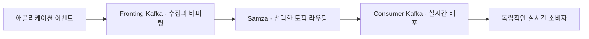

# Analyzing Kafka-Based Event Architectures

Kafka를 여러 시스템 사이에 두면 같은 이벤트를 독립적으로 소비하고, 일정 기간 보관된 데이터를 다시 읽을 수 있다. 실제 설계에서는 수집과 처리를 어디에서 분리할지, 처리 지연과 재처리를 어느 범위까지 허용할지 먼저 정한다.

## 1. Netflix Keystone의 수집과 전달

2016년 Netflix가 공개한 Keystone 파이프라인에서 Fronting Kafka 클러스터는 애플리케이션 이벤트를 수집하고 버퍼링했다. Samza 라우팅 작업은 필요한 토픽을 Consumer Kafka 클러스터로 전달했다. 실시간 소비자는 전달된 토픽을 읽고, 다른 경로의 데이터는 일괄 분석용으로 저장할 수 있었다. 2018년에 공개된 Keystone 플랫폼은 구성에 따른 라우팅과 필터링, 외부 저장소 전달, 관리형 스트림 처리 작업을 제공했다. [Netflix TechBlog · Kafka Inside Keystone Pipeline](https://netflixtechblog.com/kafka-inside-keystone-pipeline-dd5aeabaf6bb) · [Netflix TechBlog · Keystone Real-time Stream Processing Platform](https://netflixtechblog.com/keystone-real-time-stream-processing-platform-a3ee651812a)

아래는 2016년 공개 사례의 수집과 실시간 소비 경로를 줄여 표현한 것이다.

수집과 소비 클러스터를 나누면 두 경로의 부하와 장애를 따로 다룰 수 있다. 이 사례에서 추론할 수 있는 비용은 클러스터와 라우팅 단계가 추가되어 운영 대상과 지연 측정 지점이 늘어난다는 것이다. 한 클러스터의 토픽과 컨슈머 그룹만으로 예상 부하를 감당할 수 있는 서비스라면 단일 클러스터로 시작해 어느 경로에서 자원 경합이 발생하는지 측정할 수 있다. [Netflix TechBlog · Kafka Inside Keystone Pipeline](https://netflixtechblog.com/kafka-inside-keystone-pipeline-dd5aeabaf6bb) · [Apache Kafka · Design](https://kafka.apache.org/43/design/design/)

## 2. 주문 시스템에 적용해 보기

주문 서비스에서 `OrderConfirmed`를 발행하고, 정산·알림·분석 서비스가 각자의 그룹으로 소비하는 설계를 가정한다. 같은 주문의 상태 변경 순서가 중요하므로 `orderId`를 키로 사용한다. Kafka의 순서 보장은 파티션 단위다. 동시 발행자가 같은 주문의 상태를 변경할 수 있다면 소비자도 이벤트 버전이나 업무 상태 전이 규칙을 검사한다. [Apache Kafka · Design](https://kafka.apache.org/43/design/design/) · [Kafka로 주문 Saga 구성하기](../microservice-architecture/25_choreographing_order_sagas_with_kafka.md)

| 설계 결정 | 주문 시스템에서 확인할 항목 |
| --- | --- |
| 발행 경계 | 주문 상태와 이벤트 발행을 맞춰야 하면 주문 DB 트랜잭션에 Outbox 레코드를 함께 저장하고, 커밋된 변경을 Kafka로 전달한다. |
| 소비 경계 | 정산·알림·분석이 별도 컨슈머 그룹을 사용하면 읽기 위치와 재처리 일정을 독립적으로 관리할 수 있다. |
| 처리 위치 | Kafka 안에서 보강·집계하려면 Kafka Streams를, 외부 시스템과 데이터를 옮기려면 Kafka Connect를 검토한다. |
| 복구 범위 | 장애 감지·복구·재처리 시간을 고려해 보관 기간을 정한다. 결제·알림처럼 외부 부작용이 있는 소비자는 이벤트 ID로 중복 반영을 제어한다. |

[Outbox와 CDC](../microservice-architecture/11_distributed_transactions_sagas_and_outbox.md) · [Kafka Streams 처리 모델](07_kafka_streams_dsl_joins_and_stateful_processing.md) · [Kafka Connect 파이프라인](08_building_and_operating_kafka_connect_pipelines.md)

## 3. 운영 시나리오로 검증하기

| 상황 | 검증 방법 |
| --- | --- |
| 분석 서비스 중단 | 정산·알림 그룹이 계속 소비하는지 확인한다. 분석 그룹이 복구되면 보관 기간 안의 이벤트를 따라잡고, 처리율이 신규 유입률을 넘어 Lag이 줄어야 한다. |
| 처리 후 오프셋 커밋 전 중단 | 같은 이벤트를 다시 받아도 정산 기록이나 발송 요청이 중복 생성되지 않는지 확인한다. |
| 특정 주문 키에 이벤트 집중 | 파티션별 유입률과 Lag을 비교한다. 소수 키가 집중되면 파티션을 늘려도 해당 키의 병목은 남을 수 있다. |
| 새 분석 모델로 재처리 | 별도 그룹과 목적지로 재처리하고, 사용 가능한 가장 이른 오프셋이 필요한 기간을 포함하는지 확인한다. |

운영 화면에서는 발행 실패율, 파티션별 Lag, 이벤트 시각에서 목적지 반영까지의 지연을 함께 본다. 브로커가 정상이어도 목적지 쓰기 실패로 애플리케이션 처리가 밀릴 수 있다. [Apache Kafka · Monitoring](https://kafka.apache.org/43/operations/monitoring/) · [Consumer Lag 확인](05_developing_reliable_kafka_consumer_applications.md#6-컨슈머-lag과-burrow)
