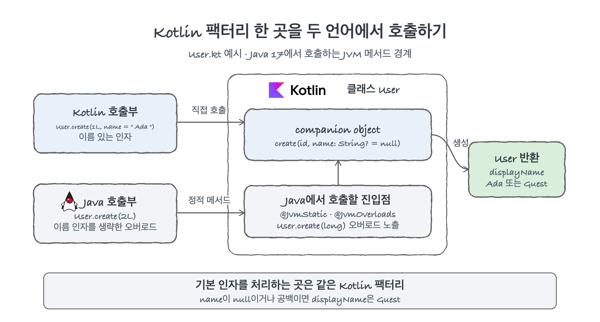

# 34 Kotlin Essentials for Java Developers

Java 코드를 읽을 수 있다면 Kotlin/JVM의 변수, 함수, 클래스도 금방 익힐 수 있다. 처음에는 `val`이 보장하는 범위, `String?`의 null 처리, Java에서 넘어오는 값의 타입에 주목하면 코드를 이해하기 쉽다. Java 쪽 예시는 Java 17을 기준으로 한다.

## 1. 변수와 제어 흐름

| 번호 | Kotlin | Java 개발자가 볼 차이 |
| --- | --- | --- |
| 1 | `val`과 `var` | 지역 변수는 `val`로 선언하면 재할당할 수 없고, `var`로 선언하면 재할당할 수 있다. Java의 `final` 참조처럼 `val`이 가리키는 객체의 내부 상태는 바뀔 수 있다. |
| 2 | 타입 추론과 `이름: 타입` | `val count = 3`은 `Int`로 추론된다. 타입을 명시하면 `val count: Int = 3`으로 쓴다. Java 17의 `var`도 초기값이 있는 지역 변수의 타입을 추론한다. |
| 3 | 생성자 호출 | `ArrayList<String>()`처럼 클래스 이름을 함수처럼 호출한다. Java에서는 `new ArrayList<String>()`으로 쓴다. |
| 4 | 숫자 변환 | `val n: Int = 3`의 값을 `Long` 변수에 대입할 때는 `n.toLong()`을 호출한다. Java는 `int`에서 `long`으로 확대 변환할 수 있다. |
| 5 | 문자열 템플릿 | `"Hello, $name"`이나 `"Total: ${price * quantity}"`로 값을 삽입한다. Java 17에서는 문자열 연결이나 포매팅을 사용할 수 있다. |
| 6 | 동등성과 동일성 | 문자열 같은 참조 값을 비교할 때 Kotlin의 `a == b`는 null을 고려한 `equals` 비교이고 `a === b`는 참조 동일성 비교다. Java에서는 각각 `Objects.equals(a, b)`와 `a == b`에 대응한다. |
| 7 | 값을 만드는 `if` | `val status = if (active) "active" else "inactive"`처럼 분기 결과를 바로 대입한다. Java의 삼항 연산자와 비슷하다. |
| 8 | `when` | Java의 `switch` 표현식과 비슷하게 분기 결과를 반환한다. `when`은 `in`이나 `is`를 분기 조건으로 사용할 수 있고, 대상 없이 작성하면 각 분기에 불리언 조건을 넣을 수 있다. |
| 9 | 범위와 소속 검사 | `1..3`은 1부터 3까지 포함하고 `1 until 3`은 3을 제외한다. 범위에 속하는지 `value in 1..3`으로 검사한다. |
| 10 | `for`와 인덱스 | `for (item in items)`는 Java의 향상된 `for`와 비슷하다. 인덱스와 값이 함께 필요하면 `for ((index, item) in items.withIndex())`로 순회한다. |

[기본 문법](https://kotlinlang.org/docs/basic-syntax.html) · [숫자 타입](https://kotlinlang.org/docs/numbers.html) · [동등성](https://kotlinlang.org/docs/equality.html) · [제어 흐름](https://kotlinlang.org/docs/control-flow.html) · [`until` API](https://kotlinlang.org/api/core/kotlin-stdlib/kotlin.ranges/until.html)

## 2. Null 안전성

| 번호 | Kotlin | Java 개발자가 볼 차이 |
| --- | --- | --- |
| 11 | `String`과 `String?` | `String?`은 `null`을 허용한다. Kotlin 컴파일러는 두 타입을 구분해 nullable 값의 직접적인 멤버 접근을 제한한다. |
| 12 | 안전 호출 `?.` | `customer?.name`은 `customer`가 `null`이면 `null`을 반환한다. 여러 단계에 걸쳐 `order?.customer?.name`으로 연결할 수 있다. |
| 13 | 엘비스 연산자 `?:` | `name ?: "Guest"`는 왼쪽이 `null`일 때만 오른쪽을 평가한다. `value ?: return`처럼 조기 반환에도 쓸 수 있다. |
| 14 | 널 아님 단언 `!!` | `name!!.length`는 `name`이 `null`이면 `NullPointerException`을 던진다. 값이 없을 때 할 동작을 정할 수 있으면 `?.`나 `?:`로 표현할 수 있다. |
| 15 | 스마트 캐스트 | `value is String`이나 `name != null`을 검사한 뒤, 컴파일러가 값의 안정성을 확인할 수 있으면 해당 분기에서 별도 캐스트 없이 좁혀진 타입을 사용한다. |

[Null 안전성](https://kotlinlang.org/docs/null-safety.html) · [스마트 캐스트](https://kotlinlang.org/docs/typecasts.html#smart-casts)

## 3. 함수 선언과 호출

| 번호 | Kotlin | Java 개발자가 볼 차이 |
| --- | --- | --- |
| 16 | `fun`과 `Unit` | `fun add(a: Int, b: Int): Int`처럼 반환 타입이 매개변수 목록 뒤에 온다. 의미 있는 반환값이 없는 함수에는 값이 하나인 `Unit` 타입을 사용한다. Java에서는 이러한 메서드에 `void`를 쓴다. |
| 17 | 표현식 본문 | `fun double(n: Int) = n * 2`처럼 단일 표현식을 함수 본문으로 쓸 수 있고, 반환 타입을 추론할 수 있다. |
| 18 | 기본 인자 | `fun greet(name: String = "Guest")`를 선언하면 Kotlin에서 `greet()`로 호출할 수 있다. 호출 선택지를 위해 별도 오버로드를 작성할 필요가 줄어든다. |
| 19 | 이름 있는 인자 | `greet(name = "Ada")`처럼 매개변수 이름으로 인자의 의미를 드러낼 수 있다. Kotlin에서 Java 메서드를 호출할 때는 이름 있는 인자를 사용할 수 없다. |
| 20 | 최상위 함수 | 함수는 파일의 최상위에 선언할 수 있다. JVM에서는 `Greeting.kt`의 최상위 함수를 Java에서 기본적으로 `GreetingKt` 클래스의 정적 메서드로 호출한다. |
| 21 | 함수 타입 | `(Int) -> String`처럼 매개변수와 반환 타입으로 함수의 타입을 적는다. Java에서는 `IntFunction<String>`과 같은 함수형 인터페이스를 이용할 수 있다. |
| 22 | 확장 함수 | `fun String.badge() = "[$this]"`처럼 기존 타입에 `.badge()` 호출 문법을 더할 수 있다. 최상위 확장 함수의 선택은 수신 객체의 선언 타입을 따른다. |

[함수](https://kotlinlang.org/docs/functions.html) · [함수 타입](https://kotlinlang.org/docs/lambdas.html#function-types) · [확장](https://kotlinlang.org/docs/extensions.html)

## 4. 클래스와 객체

| 번호 | Kotlin | Java 개발자가 볼 차이 |
| --- | --- | --- |
| 23 | 프로퍼티와 접근자 | `order.total`처럼 프로퍼티에 접근한다. 사용자 정의 `get()`으로 계산 결과를 반환하거나 `set(value)`로 쓰기 동작을 정의할 수 있다. |
| 24 | 주 생성자와 `init` | `class User(val id: Long, name: String)`에서 `id`는 프로퍼티가 되고 `name`은 생성자 매개변수다. 생성 시 검증은 `init` 블록에 둘 수 있다. |
| 25 | 기본 `final`과 `open` | 일반 클래스와 멤버는 기본적으로 상속과 재정의가 닫혀 있다. 확장 지점에 `open`을 붙인다. Java의 일반 클래스와 인스턴스 메서드는 `final` 등으로 제한하지 않으면 상속과 재정의가 가능하다. |
| 26 | `data class` | 주 생성자의 프로퍼티로 `equals`, `hashCode`, `toString`, `copy`, 구조 분해에 쓰이는 `componentN`을 생성한다. Java의 `record`와 비슷한 용도로 쓸 수 있다. `copy()`는 내부 참조를 공유하는 얕은 복사다. |
| 27 | `sealed class`와 `sealed interface` | 직접 하위 타입을 제한한다. 가능한 타입을 모두 처리한 `when` 표현식은 `else` 없이 작성할 수 있다. Java 17에도 `sealed` 클래스와 인터페이스가 있다. |
| 28 | `object`와 `companion object` | 이름 있는 `object` 선언은 싱글턴을 만든다. `companion object`에 둔 팩터리는 Kotlin에서 `User.create()`처럼 클래스 이름으로 호출할 수 있다. |

[클래스와 생성자](https://kotlinlang.org/docs/classes.html) · [프로퍼티](https://kotlinlang.org/docs/properties.html) · [상속](https://kotlinlang.org/docs/inheritance.html) · [데이터 클래스](https://kotlinlang.org/docs/data-classes.html) · [봉인 클래스](https://kotlinlang.org/docs/sealed-classes.html) · [객체 선언](https://kotlinlang.org/docs/object-declarations.html) · [Java 17 언어 명세의 클래스](https://docs.oracle.com/javase/specs/jls/se17/html/jls-8.html)

## 5. 컬렉션과 Java 상호운용

| 번호 | Kotlin | Java 개발자가 볼 차이 |
| --- | --- | --- |
| 29 | `List`와 `MutableList` | `List` 인터페이스는 조회 연산을 제공하고 `MutableList`는 추가와 삭제도 제공한다. `List`가 같은 가변 객체를 참조하면 다른 참조에서 일어난 변경이 보일 수 있다. |
| 30 | 컬렉션 연산과 `Sequence` | `list.filter(...).map(...)`은 단계별 결과 컬렉션을 만든다. `asSequence()`를 쓰면 중간 연산을 지연 평가하고 `toList()` 같은 최종 연산에서 소비한다. Java의 `Stream`과 비슷한 평가 방식이다. |
| 31 | Java 플랫폼 타입 | null 허용 여부를 알 수 없는 Java 참조는 IDE에서 `String!`처럼 표시될 수 있다. Java API가 실제로 `null`을 반환할 수 있다면 Kotlin에서 `String?`으로 받아 처리한다. |
| 32 | JavaBeans 접근자 | 관례를 따르는 Java의 `getName()`과 `setName(...)`은 Kotlin에서 `person.name` 조회와 대입으로 표현할 수 있다. |
| 33 | `@JvmStatic`과 `@JvmOverloads` | `@JvmStatic`은 companion의 함수를 둘러싼 클래스의 정적 메서드로도 노출한다. `@JvmOverloads`는 기본 인자를 활용하는 오버로드를 생성해 Java에서도 짧게 호출할 수 있게 한다. |
| 34 | 검사 예외와 `@Throws` | Kotlin 컴파일러는 검사 예외에 대해 `catch`나 선언을 강제하지 않는다. Kotlin 함수에 `@Throws(IOException::class)`를 붙이면 Java 호출자가 보는 메서드 시그니처에 `throws IOException`이 생긴다. |

[컬렉션 개요](https://kotlinlang.org/docs/collections-overview.html) · [시퀀스](https://kotlinlang.org/docs/sequences.html) · [Kotlin에서 Java 호출](https://kotlinlang.org/docs/java-interop.html) · [Java에서 Kotlin 호출](https://kotlinlang.org/docs/java-to-kotlin-interop.html)

## 6. 같은 코드를 Kotlin과 Java에서 호출하기

`User.kt`에서 nullable 이름을 받고, 값이 없거나 공백이면 기본 표시 이름을 사용한다. `@JvmStatic`과 `@JvmOverloads`를 함께 붙여 Java에서도 `User.create(2L)`로 기본 인자를 사용할 수 있게 한다.

```kotlin
data class User(val id: Long, val displayName: String) {
    companion object {
        @JvmStatic
        @JvmOverloads
        fun create(id: Long, name: String? = null): User {
            val displayName = name?.trim()?.takeIf { it.isNotEmpty() } ?: "Guest"
            return User(id, displayName)
        }
    }
}

fun main() {
    val names = listOf(User.create(1L, name = " Ada "), User.create(2L))
        .map { it.displayName }

    check(names == listOf("Ada", "Guest"))
    println(names) // [Ada, Guest]
}
```

Java에서는 Kotlin 컴파일러가 생성한 `getDisplayName()` 접근자를 사용한다. 아래 코드는 `JavaClient.java`에 둔다.

```java
import java.util.List;

class JavaClient {
    public static void main(String[] args) {
        var names = List.of(User.create(1L, " Ada "), User.create(2L)).stream()
                .map(User::getDisplayName)
                .toList();

        if (!names.equals(List.of("Ada", "Guest"))) {
            throw new AssertionError(names);
        }
        System.out.println(names); // [Ada, Guest]
    }
}
```



그림의 근거 · [Kotlin · Java에서 Kotlin 호출](https://kotlinlang.org/docs/java-to-kotlin-interop.html) · [Kotlin · 기본 인자와 이름 있는 인자](https://kotlinlang.org/docs/functions.html)
