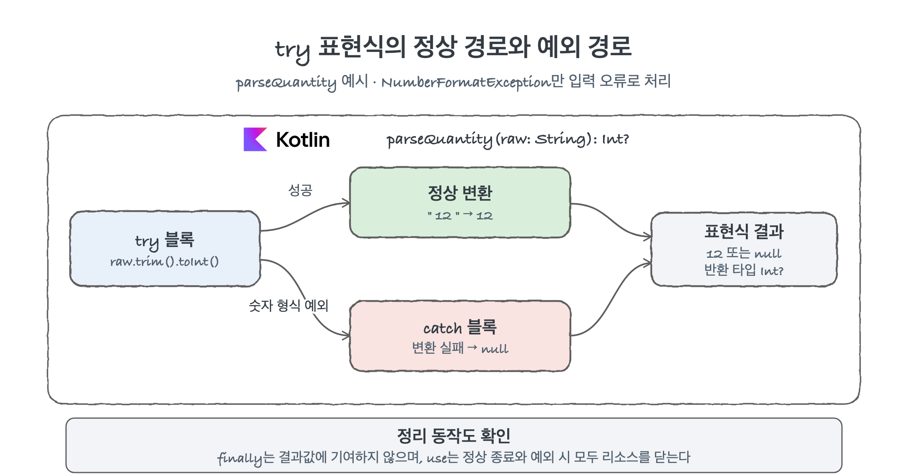

# Kotlin Fundamentals: Control Flow, Exceptions, and Functions

Kotlin의 `if`, `when`, `try`는 값을 반환하는 표현식으로 쓸 수 있다. 분기에서 고른 값이나 예외 처리의 결과를 바로 반환하면, 결과를 담기 위한 임시 변수를 줄일 수 있다. 각 예제는 독립된 Kotlin/JVM 파일로 실행할 수 있다.

## 1. `if`와 `when`으로 분기하기

`if`를 표현식으로 사용하면 조건이 참일 때와 거짓일 때의 값을 모두 제공한다. `when`은 위에서부터 처음 일치하는 분기 하나를 실행한다. `when`의 값을 사용하려면 모든 가능성을 처리해야 한다. 예를 들어 enum의 항목을 모두 명시하면 `else`를 생략할 수 있다. 대상 없는 `when`은 각 분기에 불리언 조건을 직접 적을 때 사용한다. [Kotlin · 조건과 반복](https://kotlinlang.org/docs/control-flow.html)

```kotlin
enum class Delivery { STANDARD, EXPRESS }

fun deliveryFee(subtotal: Int, delivery: Delivery): Int {
    val baseFee = when (delivery) {
        Delivery.STANDARD -> 3_000
        Delivery.EXPRESS -> 5_000
    }
    return if (subtotal >= 50_000) 0 else baseFee
}

fun main() {
    check(deliveryFee(49_999, Delivery.STANDARD) == 3_000)
    check(deliveryFee(49_999, Delivery.EXPRESS) == 5_000)
    check(deliveryFee(50_000, Delivery.EXPRESS) == 0)
}
```

## 2. `for`, `while`, `do-while`로 반복하기

| 문법 | 사용 기준 |
| --- | --- |
| `for (item in items)` | 컬렉션을 순회한다. 인덱스도 필요하면 `items.withIndex()`를 쓴다. |
| `for (i in 0..<size)` | `0`부터 `size` 직전까지 순회한다. `..`는 끝값을 포함하고, `downTo`는 역순, `step`은 반복 간격을 지정한다. |
| `while (condition)` | 본문 실행 전에 조건을 검사하므로 처음부터 조건이 거짓이면 실행 횟수는 0이다. |
| `do { ... } while (condition)` | 본문을 한 번 실행한 뒤 반복을 계속할지 판단한다. |
| `break` / `continue` | `break`는 반복문을 끝내고 `continue`는 이번 반복의 나머지를 건너뛴다. 중첩 반복문에서는 라벨로 대상을 지정할 수 있다. |

[Kotlin · 조건과 반복](https://kotlinlang.org/docs/control-flow.html) · [Kotlin · 반환과 점프](https://kotlinlang.org/docs/returns.html)

```kotlin
fun main() {
    val labels = mutableListOf<String>()
    for ((index, item) in listOf("notebook", "", "pen").withIndex()) {
        if (item.isBlank()) continue
        labels.add("${index + 1}. $item")
    }

    var remaining = 3
    while (remaining > 0) {
        remaining--
    }

    var attempts = 0
    do {
        attempts++
    } while (attempts < 1)

    check(labels == listOf("1. notebook", "3. pen"))
    check(remaining == 0)
    check(attempts == 1)
}
```

## 3. 예외를 처리하고 자원 닫기

`try`를 표현식으로 쓰면 정상 경로에서는 `try` 블록의 마지막 표현식을, 예외가 처리된 경로에서는 해당 `catch` 블록의 마지막 표현식을 반환한다. 여러 예외를 처리할 때는 구체적인 타입을 먼저 잡는다. `finally`는 정리에 사용하고 표현식의 결과값에는 기여하지 않는다. Kotlin에서는 Java 메서드가 검사 예외를 선언해도 호출부에서 `catch`나 예외 선언이 강제되지 않는다. Java 호출자에게 Kotlin 함수의 검사 예외를 알려야 할 때는 `@Throws`를 사용한다. [Kotlin · 예외 처리](https://kotlinlang.org/docs/exceptions.html) · [Kotlin · Java 호출자의 검사 예외](https://kotlinlang.org/docs/java-to-kotlin-interop.html#checked-exceptions)

```kotlin
import java.io.StringReader

fun parseQuantity(raw: String): Int? = try {
    raw.trim().toInt()
} catch (_: NumberFormatException) {
    null
}

fun readFirstLine(text: String): String? =
    StringReader(text).buffered().use { reader -> reader.readLine() }

fun main() {
    check(parseQuantity(" 12 ") == 12)
    check(parseQuantity("twelve") == null)
    check(parseQuantity("2147483648") == null)
    check(readFirstLine("notebook\npen") == "notebook")
    check(readFirstLine("") == null)
}
```

숫자 변환 실패를 `null`로 표현하려면 `raw.trim().toIntOrNull()`로도 쓸 수 있다. `use`는 블록이 끝나거나 도중에 예외가 발생해도 리더를 닫는다. [Kotlin · `toIntOrNull`](https://kotlinlang.org/api/core/kotlin-stdlib/kotlin.text/to-int-or-null.html) · [Kotlin · `use`](https://kotlinlang.org/api/core/kotlin-stdlib/kotlin.io/use.html)



그림의 근거 · [Kotlin · 예외 처리](https://kotlinlang.org/docs/exceptions.html) · [Kotlin · use](https://kotlinlang.org/api/core/kotlin-stdlib/kotlin.io/use.html)

## 4. 함수의 반환값과 인자 설계하기

표현식 본문은 `fun double(value: Int) = value * 2`처럼 쓰고 반환 타입을 추론할 수 있다. 블록 본문이 값을 반환할 때는 반환 타입과 `return`을 명시한다. 반환할 값이 없는 블록 본문의 `Unit` 표기는 생략할 수 있다. [Kotlin · 함수](https://kotlinlang.org/docs/functions.html)

기본 인자는 흔한 호출을 짧게 만들고 이름 있는 인자는 값의 역할을 드러낸다. 여러 값을 받는 매개변수에는 `vararg`를 붙인다. 배열을 펼쳐 전달하려면 `*`를 사용한다. 아래에서 `vararg amounts: Int`는 `IntArray`를 펼쳐 받을 수 있다. [Kotlin · 기본 인자와 가변 인자](https://kotlinlang.org/docs/functions.html)

```kotlin
fun formatPrice(amount: Int, currency: String = "KRW"): String =
    "$amount $currency"

fun subtotal(vararg amounts: Int): Int = amounts.sum()

fun main() {
    val lineAmounts = intArrayOf(12_000, 3_000)
    val amount = subtotal(*lineAmounts, 5_000)

    check(amount == 20_000)
    check(formatPrice(amount) == "20000 KRW")
    check(formatPrice(amount = 15, currency = "USD") == "15 USD")
}
```
