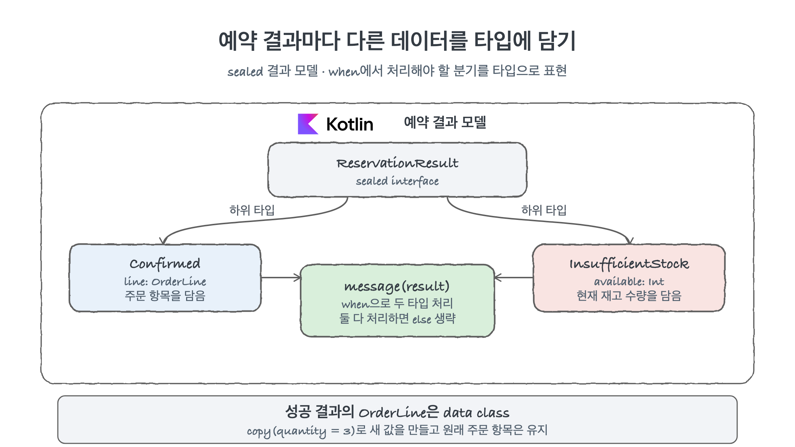

# Kotlin Object-Oriented Programming: Classes, Inheritance, and Objects

Kotlin에서는 주 생성자에서 객체가 보관할 값을 선언하고, 상속이나 재정의를 허용할 지점을 명시한다. 주문과 재고 예제로 객체의 상태, 공개 범위, 생성 방식, 가능한 결과 타입을 어떻게 표현하는지 살펴본다. 각 예제는 독립된 Kotlin/JVM 파일로 실행할 수 있다.

## 1. 클래스와 생성자

`class Order(val id: Long, quantity: Int)`에서 `id`는 읽기 전용 프로퍼티이고 `quantity`는 생성자 매개변수다. 프로퍼티 초기화와 `init` 블록은 클래스 본문에 등장하는 순서대로 실행된다. 주 생성자가 있는 클래스의 보조 생성자는 `this(...)`로 주 생성자에 직접 또는 간접 위임한다. 프로퍼티의 `get()`을 정의하면 읽을 때 값을 계산할 수 있다. [Kotlin · 클래스와 생성자](https://kotlinlang.org/docs/classes.html) · [Kotlin · 프로퍼티와 접근자](https://kotlinlang.org/docs/properties.html)

```kotlin
class Order(val id: Long, quantity: Int) {
    val quantity: Int = quantity

    init {
        require(quantity > 0) { "Quantity must be positive" }
    }

    constructor(id: Long) : this(id, 1)

    val isBulk: Boolean
        get() = quantity >= 10
}

fun main() {
    check(Order(1L).quantity == 1)
    check(Order(2L, 10).isBulk)
    check(runCatching { Order(3L, 0) }.exceptionOrNull() is IllegalArgumentException)
}
```

## 2. 상속과 인터페이스

일반 클래스와 멤버는 기본적으로 `final`이다. 상속 또는 재정의를 허용하려면 `open`을 붙인다. `abstract` 클래스는 직접 인스턴스화할 수 없고, `abstract` 멤버는 구체 하위 클래스에서 구현해야 한다. 재정의에는 `override`가 필요하다. 이미 재정의한 멤버의 추가 재정의를 막으려면 `final override`를 쓴다. [Kotlin · 상속](https://kotlinlang.org/docs/inheritance.html)

인터페이스는 함수의 기본 구현을 제공할 수 있다. 상위 타입 여러 곳에서 동일한 시그니처의 구현을 상속하면 하위 클래스에서 재정의하고, 필요한 구현은 `super<상위타입>`으로 지정한다. 상위 클래스의 초기화 블록에서 재정의 가능한 멤버를 호출하면 하위 클래스의 상태가 초기화되기 전에 접근할 수 있으므로, 초기화에는 생성자 인자나 재정의할 수 없는 멤버를 사용한다. [Kotlin · 인터페이스 구현 충돌](https://kotlinlang.org/docs/interfaces.html#resolving-overriding-conflicts) · [Kotlin · 파생 클래스 초기화 순서](https://kotlinlang.org/docs/inheritance.html#derived-class-initialization-order)

```kotlin
abstract class DeliveryPolicy {
    abstract fun fee(subtotal: Int): Int
    open fun label(): String = "delivery"
}

interface Trackable {
    fun label(): String = "tracked"
}

class ExpressDelivery : DeliveryPolicy(), Trackable {
    override fun fee(subtotal: Int): Int = if (subtotal >= 50_000) 0 else 5_000

    override fun label(): String =
        "${super<DeliveryPolicy>.label()} (${super<Trackable>.label()})"
}

fun main() {
    val policy: DeliveryPolicy = ExpressDelivery()
    check(policy.fee(49_999) == 5_000)
    check(policy.fee(50_000) == 0)
    check(policy.label() == "delivery (tracked)")
}
```

## 3. 접근 제어와 상태 보호

| 지정자 | 최상위 선언 | 클래스 멤버 |
| --- | --- | --- |
| `public` | 선언에 접근할 수 있는 곳에 공개한다. 기본값이다. | 클래스를 볼 수 있는 호출자가 접근할 수 있다. |
| `internal` | 같은 Kotlin 모듈 안에서 접근할 수 있다. | 같은 Kotlin 모듈에서 클래스를 볼 수 있을 때 접근할 수 있다. |
| `protected` | 사용할 수 없다. | 선언한 클래스와 하위 클래스에서 접근할 수 있다. |
| `private` | 같은 파일에서 접근할 수 있다. | 선언한 클래스 내부에서 접근할 수 있다. |

Kotlin/JVM의 `internal`은 Kotlin 컴파일러가 모듈 경계를 기준으로 검사한다. Java의 패키지 전용 접근과 범위가 다르다. `private set`을 쓰면 외부에서 값을 읽을 수 있게 하면서, 값을 바꾸는 경로는 클래스가 제공하는 메서드로 제한할 수 있다. [Kotlin · 접근 지정자](https://kotlinlang.org/docs/visibility-modifiers.html) · [Kotlin · Java에서 보이는 접근 범위](https://kotlinlang.org/docs/java-to-kotlin-interop.html#visibility)

```kotlin
class Inventory(initialStock: Int) {
    var available: Int = initialStock
        private set

    init {
        require(initialStock >= 0)
    }

    fun reserve(quantity: Int): Boolean {
        require(quantity > 0)
        if (quantity > available) return false
        available -= quantity
        return true
    }
}

fun main() {
    val stock = Inventory(5)
    check(stock.reserve(3))
    check(!stock.reserve(3))
    check(stock.available == 2)
}
```

## 4. `object`의 세 가지 쓰임

- **객체 선언**은 `object DefaultStock`처럼 이름 있는 싱글턴이 필요할 때 사용한다. 최초 접근 시 초기화된다. [Kotlin · 객체 선언](https://kotlinlang.org/docs/object-declarations.html#object-declarations)
- **동반 객체**(`companion object`)는 팩터리처럼 클래스와 함께 제공할 멤버를 묶는다. Kotlin에서는 `Inventory.empty()`로 호출한다. Java에도 같은 모양의 정적 메서드를 노출하려면 함수에 `@JvmStatic`을 붙인다. [Kotlin · 동반 객체](https://kotlinlang.org/docs/object-declarations.html#companion-objects) · [Kotlin · JVM 정적 메서드](https://kotlinlang.org/docs/java-to-kotlin-interop.html#static-methods)
- **객체 표현식**은 `object : Comparator<Int> { ... }`처럼 사용할 위치에서 익명 구현을 만든다. 표현식을 평가할 때마다 새 인스턴스를 생성한다. [Kotlin · 객체 표현식](https://kotlinlang.org/docs/object-declarations.html#object-expressions)

```kotlin
object DefaultStock {
    val minimum = 0
}

class Inventory private constructor(val available: Int) {
    companion object {
        @JvmStatic
        fun empty(): Inventory = Inventory(DefaultStock.minimum)
    }
}

fun main() {
    val descending = object : Comparator<Int> {
        override fun compare(left: Int, right: Int): Int = right.compareTo(left)
    }

    check(Inventory.empty().available == 0)
    check(listOf(1, 3, 2).sortedWith(descending) == listOf(3, 2, 1))
}
```

## 5. 중첩 클래스와 내부 클래스

기본 중첩 클래스는 바깥 클래스의 인스턴스 없이 생성할 수 있다. Java의 정적 중첩 클래스와 비슷하다. `inner`를 붙인 내부 클래스는 바깥 인스턴스에 대한 참조를 가지므로, 바깥 객체의 프로퍼티나 함수를 사용할 수 있다. 수신 객체를 명시해야 할 때는 `this@Order`처럼 쓴다. [Kotlin · 중첩 클래스와 내부 클래스](https://kotlinlang.org/docs/nested-classes.html) · [Kotlin · 한정된 `this`](https://kotlinlang.org/docs/this-expressions.html#qualified-this)

```kotlin
class Order(private val id: Long) {
    class Reference(val value: String)

    inner class Label(private val section: String) {
        fun text(): String = "${this@Order.id}-$section"
    }
}

fun main() {
    val reference = Order.Reference("web-42")
    val label = Order(42L).Label("A")

    check(reference.value == "web-42")
    check(label.text() == "42-A")
}
```

## 6. `data`, `enum`, `sealed`로 모델링하기

| 종류 | 적합한 경우 | 동작과 제약 |
| --- | --- | --- |
| `data class` | 프로퍼티 값으로 비교하는 주문 항목, 요청 데이터 | 주 생성자 프로퍼티를 바탕으로 `equals`, `hashCode`, `toString`, `componentN`, `copy`를 제공한다. `copy`는 얕은 복사이므로 가변 프로퍼티의 참조가 공유될 수 있다. |
| `enum class` | 배송 등급처럼 값의 목록이 정해져 있는 경우 | 각 항목은 미리 정해진 단일 인스턴스다. `Delivery.entries`로 전체 항목을 순회할 수 있다. |
| `sealed class` / `sealed interface` | 성공과 실패처럼 경우마다 담는 데이터가 다른 결과 | 직접 하위 타입의 선언을 같은 패키지와 모듈로 제한한다. `when`에서 가능한 경우를 모두 다루면 `else`를 생략할 수 있다. |

[Kotlin · 데이터 클래스](https://kotlinlang.org/docs/data-classes.html) · [Kotlin · 열거형](https://kotlinlang.org/docs/enum-classes.html) · [Kotlin · 봉인 클래스와 인터페이스](https://kotlinlang.org/docs/sealed-classes.html)

```kotlin
enum class Delivery { STANDARD, EXPRESS }

data class OrderLine(val sku: String, val quantity: Int)

sealed interface ReservationResult {
    data class Confirmed(val line: OrderLine) : ReservationResult
    data class InsufficientStock(val available: Int) : ReservationResult
}

fun message(result: ReservationResult): String = when (result) {
    is ReservationResult.Confirmed -> "Reserved ${result.line.quantity}"
    is ReservationResult.InsufficientStock -> "Available ${result.available}"
}

fun main() {
    val requested = OrderLine("pen", 2)
    val revised = requested.copy(quantity = 3)

    check(requested.quantity == 2)
    check(Delivery.entries.size == 2)
    check(message(ReservationResult.Confirmed(revised)) == "Reserved 3")
    check(message(ReservationResult.InsufficientStock(1)) == "Available 1")
}
```



그림의 근거 · [Kotlin · 봉인 클래스와 인터페이스](https://kotlinlang.org/docs/sealed-classes.html) · [Kotlin · 데이터 클래스](https://kotlinlang.org/docs/data-classes.html)
