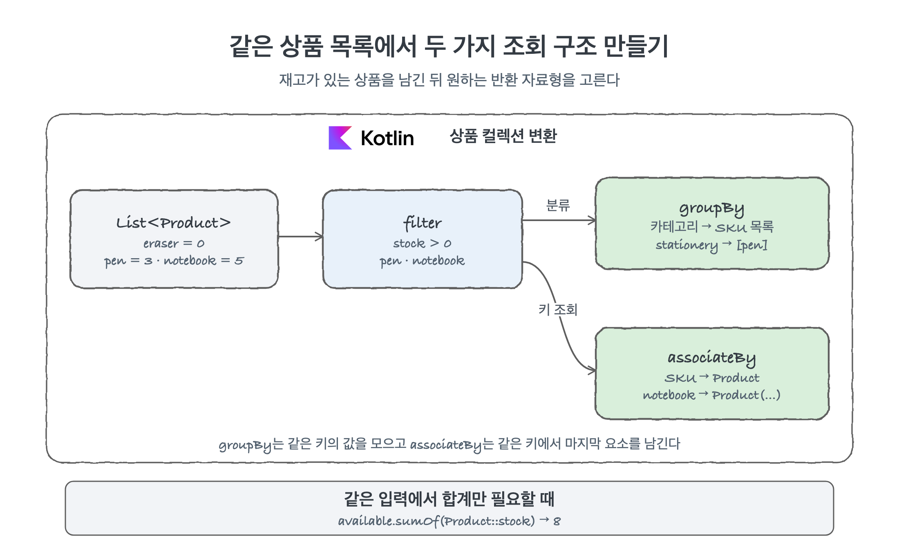

# Kotlin Functional Programming with Lambdas and Collections

Kotlin에서는 함수를 값으로 넘겨 컬렉션을 필터링하고 변환할 수 있다. 재고 목록에서 상품을 고르고, 분류하고, 조회용 인덱스를 만드는 예제로 배열과 컬렉션의 차이부터 람다와 `Sequence`까지 살펴본다. 각 예제는 독립된 Kotlin/JVM 파일로 실행할 수 있다.

## 1. 배열과 컬렉션

| 타입 | 사용 기준 |
| --- | --- |
| `Array<T>` | 크기가 고정된 인덱스 기반 자료가 필요할 때 쓴다. `array[i] = value`로 요소를 바꿀 수 있고, 내용 비교에는 `contentEquals()`를 쓴다. |
| `IntArray` | Kotlin/JVM에서 `int[]`에 대응한다. `Array<Int>`는 요소를 박싱하지만 `IntArray`는 기본형으로 저장한다. |
| `List<T>` / `MutableList<T>` | 순서와 중복을 유지한다. 추가·삭제 API가 필요하면 `MutableList`를 쓴다. |
| `Set<T>` / `MutableSet<T>` | 중복을 제거하거나 소속 여부를 확인할 때 쓴다. |
| `Map<K, V>` / `MutableMap<K, V>` | 키로 값을 조회한다. 같은 키에 다시 값을 넣으면 기존 값을 교체한다. |

`List`, `Set`, `Map`은 읽기 전용 인터페이스다. 같은 객체를 가변 참조와 공유하면 읽기 전용 참조를 통해서도 변경된 내용이 보인다. `map[key]`는 키가 없을 때 `null`을 반환한다. 값에도 `null`을 허용하는 맵에서 키가 있는지 구분하려면 `containsKey(key)`를 쓴다. [Kotlin · 배열](https://kotlinlang.org/docs/arrays.html) · [Kotlin · 컬렉션 개요](https://kotlinlang.org/docs/collections-overview.html) · [Kotlin · 맵 연산](https://kotlinlang.org/docs/map-operations.html)

```kotlin
fun main() {
    val stock = intArrayOf(3, 5)
    stock[0] += 1
    check(stock.contentEquals(intArrayOf(4, 5)))

    val editable = mutableListOf("pen", "notebook")
    val readOnly: List<String> = editable
    editable.add("pen")

    check(readOnly.size == 3)
    check(readOnly.toSet() == setOf("pen", "notebook"))

    val locations = mapOf("pen" to "A1", "notebook" to null)
    check(locations["pen"] == "A1")
    check(locations["notebook"] == null && locations.containsKey("notebook"))
    check(locations["eraser"] == null && !locations.containsKey("eraser"))
}
```

## 2. 확장, 중위, 인라인, 지역 함수

| 선언 | 쓰임과 제약 |
| --- | --- |
| 확장 함수 `fun String.normalizedSku()` | 기존 타입의 값에서 멤버처럼 호출할 수 있다. 어떤 확장을 호출할지는 수신 객체의 선언 타입으로 결정한다. 같은 시그니처의 멤버를 호출할 수 있으면 멤버가 우선한다. |
| 중위 함수 `infix fun String.inAisle(aisle: String)` | `"pen" inAisle "A1"`처럼 점과 괄호를 생략할 수 있다. 멤버나 확장 함수이며 매개변수는 하나여야 한다. 그 매개변수에는 `vararg`나 기본값을 둘 수 없다. |
| 인라인 함수 `inline fun ...` | 고차 함수의 본문과 인라인 대상 람다를 호출 지점에 펼쳐 호출이나 람다 객체 생성 비용을 줄일 수 있다. 큰 본문을 여러 곳에서 인라인하면 컴파일 결과가 커질 수 있다. |
| 지역 함수 | 다른 함수 안에서만 쓰는 동작을 안쪽에 정의한다. 바깥 함수의 지역 변수에 접근할 수 있다. |

[Kotlin · 확장](https://kotlinlang.org/docs/extensions.html) · [Kotlin · 중위 호출과 지역 함수](https://kotlinlang.org/docs/functions.html) · [Kotlin · 인라인 함수](https://kotlinlang.org/docs/inline-functions.html)

```kotlin
fun String.normalizedSku(): String = trim().lowercase()

infix fun String.inAisle(aisle: String): String = "$aisle/$this"

fun inventoryLabels(codes: List<String>, aisle: String): List<String> {
    fun labelFor(code: String): String = code.normalizedSku() inAisle aisle
    return codes.map(::labelFor)
}

fun main() {
    val labels = inventoryLabels(listOf(" PEN ", "Notebook"), "A1")
    check(labels == listOf("A1/pen", "A1/notebook"))
}
```

## 3. 함수 타입, 람다, 함수 참조

`(Product) -> Boolean`은 `Product` 하나를 받아 `Boolean`을 반환하는 함수 타입이다. 함수 타입의 인자를 받거나 반환하는 함수를 고차 함수라고 한다. 마지막 인자가 람다라면 괄호 밖에 적을 수 있다. 인자가 하나인 람다에서는 매개변수를 생략해 `it`으로 참조하고, 의미가 중요하면 `product -> ...`처럼 이름을 붙인다. 기존 함수는 `::hasStock`, 프로퍼티는 `Product::sku`처럼 참조로 넘길 수 있다. [Kotlin · 고차 함수와 람다](https://kotlinlang.org/docs/lambdas.html) · [Kotlin · 호출 가능 참조](https://kotlinlang.org/docs/reflection.html#callable-references)

```kotlin
data class Product(val sku: String, val stock: Int)

fun hasStock(product: Product): Boolean = product.stock > 0

fun matchingSkus(products: List<Product>, matches: (Product) -> Boolean): List<String> =
    products.filter(matches).map(Product::sku)

fun main() {
    val products = listOf(Product("pen", 3), Product("notebook", 1), Product("eraser", 0))
    val minimumStock = 2

    check(matchingSkus(products, ::hasStock) == listOf("pen", "notebook"))
    check(matchingSkus(products) { it.stock >= minimumStock } == listOf("pen"))
}
```

## 4. 컬렉션을 함수형으로 처리하기

| 원하는 결과 | 연산 | 선택 기준 |
| --- | --- | --- |
| 일부 요소 | `filter` | 조건에 맞는 요소를 남긴다. |
| 변환한 요소 | `map`, `mapNotNull`, `flatMap` | 요소별 변환은 `map`, 변환 결과가 `null`이면 제외할 때는 `mapNotNull`, 요소마다 나온 목록을 하나로 펼칠 때는 `flatMap`을 쓴다. |
| 분류 또는 키 조회 | `groupBy`, `associateBy` | 키별 목록이 필요하면 `groupBy`, 키 하나에 요소 하나를 매핑하면 `associateBy`를 쓴다. `associateBy`에서 키가 겹치면 마지막 요소가 남는다. |
| 조건 확인 | `any`, `all`, `none` | 각각 하나라도 일치하는지, 모두 일치하는지, 하나도 일치하지 않는지 검사한다. 빈 컬렉션에서 `any`는 `false`, `all`과 `none`은 `true`다. |
| 합계 또는 누적값 | `sumOf`, `fold` | 숫자의 합에는 `sumOf`, 초기값과 누적 규칙을 정할 때는 `fold`를 쓴다. |

`List`에 `filter`와 `map`을 연결하면 단계마다 중간 목록을 만든다. `asSequence()`를 사용하면 중간 연산을 지연하고 최종 연산이 소비할 때 필요한 요소를 처리한다. 아래에서는 `firstOrNull`이 첫 재고 상품을 찾으면 이후 요소를 확인하지 않는다. 여러 단계를 거치거나 일찍 끝나는 처리에서 유용하며, 작은 목록에서는 시퀀스의 비용도 고려한다. [Kotlin · 컬렉션 변환](https://kotlinlang.org/docs/collection-transformations.html) · [Kotlin · 필터링](https://kotlinlang.org/docs/collection-filtering.html) · [Kotlin · 집계](https://kotlinlang.org/docs/collection-aggregate.html) · [Kotlin · 시퀀스](https://kotlinlang.org/docs/sequences.html)

```kotlin
data class Product(val sku: String, val category: String, val stock: Int)

fun main() {
    val products = listOf(
        Product("eraser", "stationery", 0),
        Product("pen", "stationery", 3),
        Product("notebook", "paper", 5),
    )

    val available = products.filter { it.stock > 0 }
    val skusByCategory = available.groupBy(Product::category, Product::sku)
    val bySku = available.associateBy(Product::sku)
    val firstAvailableSku = products.asSequence()
        .filter { it.stock > 0 }
        .map(Product::sku)
        .firstOrNull()

    check(skusByCategory == mapOf("stationery" to listOf("pen"), "paper" to listOf("notebook")))
    check(bySku["notebook"]?.stock == 5)
    check(available.sumOf(Product::stock) == 8)
    check(firstAvailableSku == "pen")
}
```



그림의 근거 · [Kotlin · 컬렉션 필터링](https://kotlinlang.org/docs/collection-filtering.html) · [Kotlin · 컬렉션 그룹화](https://kotlinlang.org/docs/collection-grouping.html) · [Kotlin · 컬렉션 변환](https://kotlinlang.org/docs/collection-transformations.html) · [Kotlin · 컬렉션 집계](https://kotlinlang.org/docs/collection-aggregate.html)
