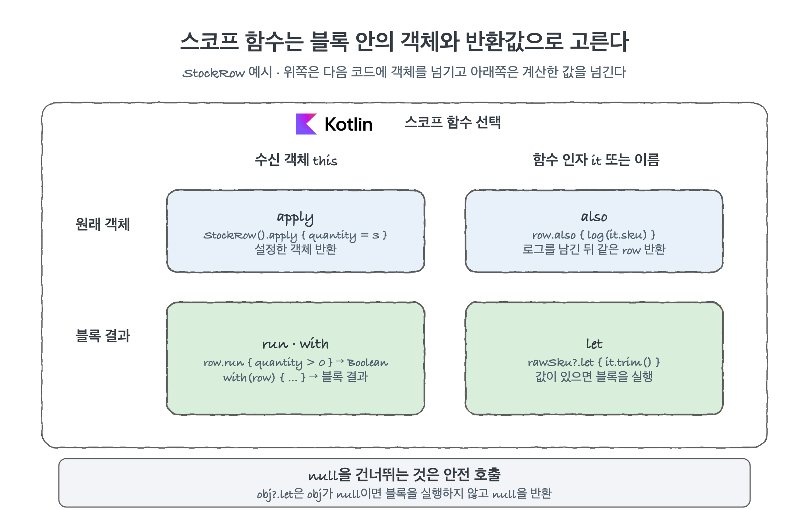

# Kotlin Idioms and Scope Functions

Kotlin의 타입 별칭과 구조 분해는 선언을 읽기 쉽게 하고, 라벨은 중첩된 반복이나 람다에서 제어가 어디로 이동하는지 드러낸다. 스코프 함수를 고를 때는 블록에서 객체를 어떻게 부를지, 블록이 끝난 뒤 어떤 값이 필요한지 살펴본다. 각 예제는 독립된 Kotlin/JVM 파일로 실행할 수 있다.

## 1. 타입 별칭, import 별칭, 구조 분해

`typealias StockBySku = Map<String, Int>`는 기존 타입에 읽기 쉬운 이름을 붙인다. 컴파일러는 별칭을 원래 타입으로 취급하므로 `Map<String, Int>`를 받는 곳에 `StockBySku` 값을 넘길 수 있다. `import ... as ...`는 같은 이름의 선언을 함께 사용할 때 해당 파일에서 부를 이름을 정한다. [Kotlin · 타입 별칭](https://kotlinlang.org/docs/type-aliases.html) · [Kotlin · 패키지와 import](https://kotlinlang.org/docs/packages.html)

`val (sku, quantity) = stock`은 `component1()`과 `component2()`의 값을 순서대로 변수에 담는다. `data class`는 주 생성자 프로퍼티의 선언 순서대로 이 함수들을 생성한다. `val (_, quantity) = stock`처럼 `_`로 생략한 위치의 `componentN()`은 호출하지 않는다. 맵의 항목도 `for ((key, value) in map)`으로 구조 분해할 수 있다. [Kotlin · 구조 분해 선언](https://kotlinlang.org/docs/destructuring-declarations.html)

```kotlin
import java.time.Duration as JavaDuration
import kotlin.time.Duration
import kotlin.time.Duration.Companion.seconds

typealias StockBySku = Map<String, Int>

data class Stock(val sku: String, val quantity: Int)

fun main() {
    val (sku, quantity) = Stock("pen", 3)
    val stockBySku: StockBySku = mapOf(sku to quantity)
    check(stockBySku["pen"] == 3)

    val javaTimeout = JavaDuration.ofSeconds(5)
    val kotlinTimeout: Duration = 5.seconds
    check(javaTimeout.seconds == kotlinTimeout.inWholeSeconds)
}
```

## 2. 라벨로 반복과 람다의 이동 지점 지정하기

중첩 반복에서 `break@outer`는 `outer@`가 붙은 반복문을 끝내고, `continue@outer`는 그 반복문의 다음 회차로 이동한다. `forEach`에서 `return@forEach`는 현재 람다 호출을 끝내고 다음 요소의 처리를 이어 간다. 조건에 따라 반복을 직접 종료하거나 건너뛰어야 할 때는 `for`에서 `break`와 `continue`로 표현할 수 있다. [Kotlin · 반환과 점프](https://kotlinlang.org/docs/returns.html)

```kotlin
fun main() {
    val shelves = listOf(listOf("", "pen"), listOf("notebook"))
    var firstSku: String? = null

    outer@ for (shelf in shelves) {
        for (sku in shelf) {
            if (sku.isBlank()) continue
            firstSku = sku
            break@outer
        }
    }

    val validSkus = mutableListOf<String>()
    listOf("pen", "", "notebook").forEach { sku ->
        if (sku.isBlank()) return@forEach
        validSkus.add(sku)
    }

    check(firstSku == "pen")
    check(validSkus == listOf("pen", "notebook"))
}
```

## 3. 스코프 함수 다섯 가지 고르기

| 함수 | 호출 | 블록에서 객체에 접근 | 반환값 | 주로 쓰는 경우 |
| --- | --- | --- | --- | --- |
| `let` | `obj.let { ... }` | 인자 `it` 또는 직접 붙인 이름 | 블록 결과 | 값을 변환하거나 `?.let`으로 값이 있을 때만 실행 |
| `run` | `obj.run { ... }` | 수신 객체 `this` | 블록 결과 | 객체 멤버를 사용해 결과를 계산 |
| `with` | `with(obj) { ... }` | 수신 객체 `this` | 블록 결과 | 이미 확보한 객체에서 여러 멤버를 함께 사용 |
| `apply` | `obj.apply { ... }` | 수신 객체 `this` | 원래 객체 | 생성 직후 프로퍼티나 설정을 채움 |
| `also` | `obj.also { ... }` | 인자 `it` 또는 직접 붙인 이름 | 원래 객체 | 객체를 이어서 쓰면서 로그나 검사를 수행 |

`this`는 같은 이름의 다른 선언과 구분할 필요가 없으면 생략할 수 있다. `it` 자리에 `stock`, `row`처럼 이름을 붙이면 중첩 블록에서도 대상을 알기 쉽다. `let`이 `null`을 건너뛰는 호출은 `?.let`이다. 수신 객체 없이 여러 문장을 실행해 결과를 만들 때는 `run { ... }` 형태도 쓸 수 있다. [Kotlin · 스코프 함수의 선택 기준](https://kotlinlang.org/docs/scope-functions.html#function-selection)

```kotlin
class StockRow {
    var sku: String = ""
    var quantity: Int = 0
}

fun displayName(rawSku: String?): String =
    rawSku?.let { sku -> sku.trim().uppercase() } ?: "UNKNOWN"

fun main() {
    val events = mutableListOf<String>()
    val row = StockRow().apply {
        sku = "pen"
        quantity = 3
    }.also { item ->
        events.add("loaded ${item.sku}")
    }

    val available = row.run { quantity > 0 }
    val summary = with(row) { "$sku: $quantity" }

    check(available)
    check(summary == "pen: 3")
    check(events == listOf("loaded pen"))
    check(displayName(" pen ") == "PEN")
    check(displayName(null) == "UNKNOWN")
}
```



그림의 근거 · [Kotlin · 스코프 함수](https://kotlinlang.org/docs/scope-functions.html) · [Kotlin · 안전 호출](https://kotlinlang.org/docs/null-safety.html)

## 4. `takeIf`와 `takeUnless`로 값 하나 거르기

`takeIf`는 조건이 참이면 원래 객체를 반환하고, 거짓이면 `null`을 반환한다. `takeUnless`는 조건이 거짓일 때 원래 객체를 반환한다. 결과가 nullable이므로 후속 변환은 `?.let` 같은 안전 호출로 연결할 수 있다. 수신 객체를 만드는 표현식은 조건을 검사하기 전에 평가된다. 조건이 맞을 때만 비싼 연산을 실행해야 하면 먼저 `if`로 분기한다. [Kotlin · `takeIf`와 `takeUnless`](https://kotlinlang.org/docs/scope-functions.html#takeif-and-takeunless)

```kotlin
fun unitsToReserve(rawQuantity: String, available: Int): Int? =
    rawQuantity.toIntOrNull()?.takeIf { it in 1..available }

fun normalizedSku(rawSku: String): String? =
    rawSku.trim().takeUnless { it.isEmpty() }?.let { it.lowercase() }

fun main() {
    check(unitsToReserve("3", available = 5) == 3)
    check(unitsToReserve("6", available = 5) == null)
    check(unitsToReserve("three", available = 5) == null)
    check(normalizedSku(" PEN ") == "pen")
    check(normalizedSku(" ") == null)
}
```
