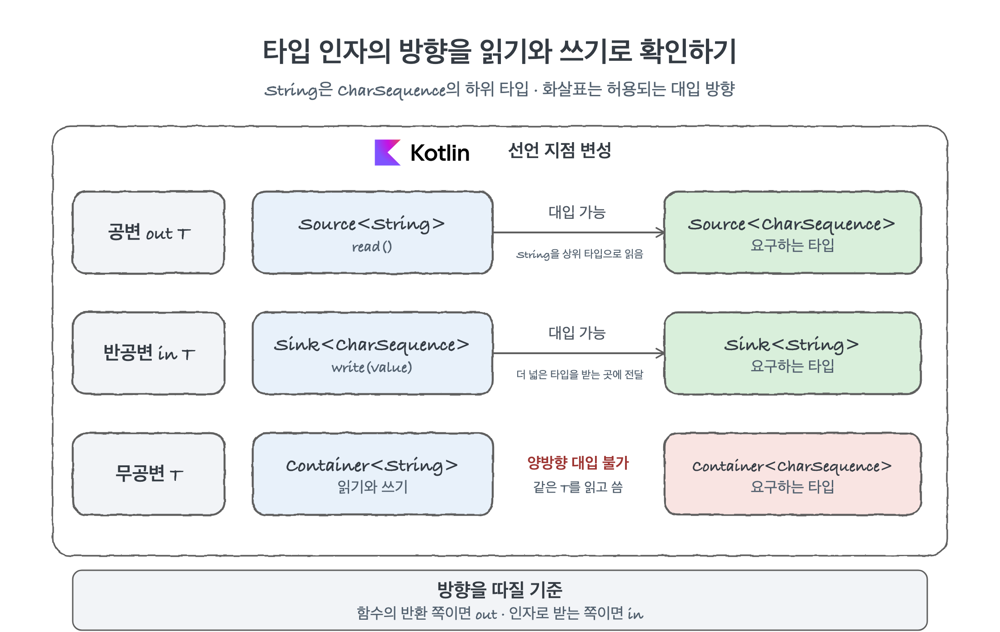

# Kotlin Generics, Variance, and Type Projections

제네릭을 쓰면 값을 저장하거나 옮기는 코드를 여러 타입에 재사용하면서, 컴파일러가 읽고 쓰는 값의 타입을 확인할 수 있다. 변성은 `String`과 `CharSequence`의 하위 타입 관계가 `List<String>`과 `List<CharSequence>` 같은 제네릭 타입 사이에도 성립하는지 설명한다. 각 예제는 독립된 Kotlin/JVM 파일로 실행할 수 있다.

## 1. 제네릭과 타입 파라미터

`Box<T>`를 선언할 때 `T`는 타입 파라미터다. `Box<String>`처럼 타입을 사용할 때 넣은 `String`은 타입 인자다. `Box("pen")`은 생성자 인자로부터 `T`를 `String`으로 추론한다. 타입을 명시하면 추론 결과보다 넓은 타입을 고를 수 있다. [Kotlin · 제네릭](https://kotlinlang.org/docs/generics.html)

```kotlin
class Box<T>(val value: T)

fun main() {
    val name = Box("pen")
    val quantity = Box(3)
    val text = Box<CharSequence>("notebook")

    check(name.value.uppercase() == "PEN")
    check(quantity.value + 2 == 5)
    check(text.value.length == 8)
}
```

## 2. 배열과 리스트의 무공변성

`Array<T>`와 `MutableList<T>`는 요소를 읽고 쓸 수 있고, 타입 파라미터가 무공변이다. `Array<String>`을 `Array<CharSequence>`로 대입할 수 있게 하면, 그 참조로 `StringBuilder`를 써서 원래 배열의 타입 계약을 깨뜨릴 수 있다. `List<out T>`는 컴파일러가 `List<String>`을 `List<CharSequence>`로 사용할 수 있게 한다. 읽기 전용 리스트도 가변 리스트와 같은 객체를 참조할 수 있다. [Kotlin · 배열의 변성](https://kotlinlang.org/docs/arrays.html) · [Kotlin · 컬렉션 개요](https://kotlinlang.org/docs/collections-overview.html)

```kotlin
fun main() {
    val names = mutableListOf("pen")
    val readable: List<CharSequence> = names
    names.add("notebook")
    check(readable[1] == "notebook")

    val array = arrayOf("pen")
    // val wider: Array<CharSequence> = array // 타입 불일치
    // val editable: MutableList<CharSequence> = names // 타입 불일치
    check(array[0] == "pen")
}
```

## 3. 공변성과 반공변성

| 관계 | `String`과 `CharSequence`를 넣었을 때 | 쓰임 |
| --- | --- | --- |
| 공변 `out T` | `Source<String>`을 `Source<CharSequence>`로 사용할 수 있다. | `T`를 만들어 주는 타입에 적합하다. |
| 반공변 `in T` | `Sink<CharSequence>`를 `Sink<String>`으로 사용할 수 있다. | `T`를 받아 처리하는 타입에 적합하다. |
| 무공변 `T` | `Container<String>`과 `Container<CharSequence>` 사이에 대입 관계가 없다. | 같은 `T`를 읽고 쓰는 타입에 적합하다. |

`Source<String>`이 반환하는 `String`은 `CharSequence`로 읽어도 안전하다. `Sink<CharSequence>`는 문자열도 받을 수 있으므로 `Sink<String>`이 필요한 곳에서 쓸 수 있다. [Kotlin · 선언 지점 변성](https://kotlinlang.org/docs/generics.html#declaration-site-variance)

```kotlin
fun interface Source<out T> {
    fun read(): T
}

fun interface Sink<in T> {
    fun write(value: T)
}

fun main() {
    val nameSource: Source<String> = Source { "pen" }
    val textSource: Source<CharSequence> = nameSource
    val messages = mutableListOf<CharSequence>()
    val textSink: Sink<CharSequence> = Sink { messages.add(it) }
    val nameSink: Sink<String> = textSink

    check(textSource.read().length == 3)
    nameSink.write(nameSource.read())
    check(messages == listOf("pen"))
}
```



그림의 근거 · [Kotlin · 제네릭 변성](https://kotlinlang.org/docs/generics.html)

## 4. 선언 지점 변성과 사용 지점 변성

`Source<out T>`처럼 타입을 정의하는 곳에 적으면 선언 지점 변성이다. `Array<out T>`처럼 이미 정의된 타입을 함수의 매개변수 등에 사용할 때 적으면 사용 지점 변성이다. 아래 함수는 `source`에서 `T`를 읽고 `destination`에 `T`를 쓴다. `Array<out T>`에는 요소를 쓸 수 없고, `Array<in T>`에서 읽은 요소는 `Any?`로 다룬다. [Kotlin · 타입 프로젝션](https://kotlinlang.org/docs/generics.html#type-projections)

```kotlin
fun <T> copyItems(source: Array<out T>, destination: Array<in T>) {
    require(destination.size >= source.size)
    for (index in source.indices) {
        destination[index] = source[index]
    }
}

fun main() {
    val source = arrayOf("pen", "notebook")
    val destination = arrayOfNulls<CharSequence>(2)

    copyItems(source, destination)
    check(destination.toList() == listOf("pen", "notebook"))
}
```

## 5. 제네릭 함수와 상한 제약

함수의 타입 파라미터는 `fun <T>`처럼 이름 앞에 선언한다. 별도 제약이 없으면 `T`의 상한은 `Any?`다. `T : Any`는 nullable 타입 인자를 제한한다. 하나의 타입 파라미터가 여러 상한을 충족해야 하면 `where`를 쓴다. 아래에서는 `CharSequence`의 `length`와 `Comparable<T>`의 비교를 함께 사용한다. [Kotlin · 제네릭 함수와 제약](https://kotlinlang.org/docs/generics.html#generic-functions)

```kotlin
fun <T : Any> presentValues(values: List<T?>): List<T> = values.filterNotNull()

fun <T> shorterLabel(first: T, second: T): T
    where T : CharSequence, T : Comparable<T> {
    return when {
        first.length < second.length -> first
        first.length > second.length -> second
        first <= second -> first
        else -> second
    }
}

fun main() {
    check(presentValues(listOf(null, "pen", "notebook")) == listOf("pen", "notebook"))
    check(shorterLabel("notebook", "pen") == "pen")
    check(shorterLabel("red", "ink") == "ink")
}
```

## 6. 타입 소거와 스타 프로젝션

Kotlin/JVM에서 `List<String>`과 `List<Int>`를 런타임에 리스트 객체의 타입 인자로 구분할 수 없다. `value is List<*>`는 리스트 여부를 확인하고, `*`는 호출 지점에서 요소 타입을 알 수 없음을 나타낸다. `List<*>`에서 요소를 읽으면 `Any?`로 다룬다. `MutableList<*>`에서도 요소의 타입을 모르므로 `add`나 `set`으로 값을 넣을 수 없다. `T`에 상한이 있는 타입은 읽을 수 있는 타입이 그 상한으로 좁혀진다. [Kotlin · 스타 프로젝션과 타입 소거](https://kotlinlang.org/docs/generics.html#star-projections)

`inline` 함수의 `reified T`는 호출 지점의 타입을 사용해 `value is T` 검사를 할 수 있게 한다. `T`가 `List<String>`이면 JVM에서 리스트 여부까지 검사할 수 있다. 요소가 문자열인지도 보장하려면 요소를 직접 검사한다. [Kotlin · 런타임 타입 검사와 캐스트](https://kotlinlang.org/docs/generics.html#generics-type-checks-and-casts) · [Kotlin · `reified` 타입 파라미터](https://kotlinlang.org/docs/inline-functions.html#reified-type-parameters)

```kotlin
inline fun <reified T> matchesType(value: Any?): Boolean = value is T

fun textListOrNull(value: Any?): List<String>? {
    if (value !is List<*>) return null
    return value.map { item -> item as? String ?: return null }
}

fun main() {
    check(matchesType<String>("pen"))
    check(!matchesType<String>(3))
    check(matchesType<List<String>>(listOf(3))) // 리스트 여부만 검사
    check(textListOrNull(listOf(3)) == null)
    check(textListOrNull(listOf("pen", "notebook")) == listOf("pen", "notebook"))
}
```

## 7. 용어와 선택 기준

| 용어 | 선언 예 | 확인할 점 |
| --- | --- | --- |
| 타입 파라미터 / 타입 인자 | `Box<T>` / `Box<String>` | 정의할 때 이름을 붙이고, 사용할 때 실제 타입을 정한다. |
| 상한 | `<T : CharSequence>` | 함수나 클래스에서 `CharSequence`의 멤버를 사용할 수 있다. |
| 프로젝션 | `Array<out T>` / `Array<in T>` | 값을 가져올 배열에는 `out`, 값을 넣을 배열에는 `in`을 고려한다. |
| 스타 프로젝션 | `List<*>` | 요소 타입을 몰라도 크기를 확인하거나 순회할 수 있다. |
