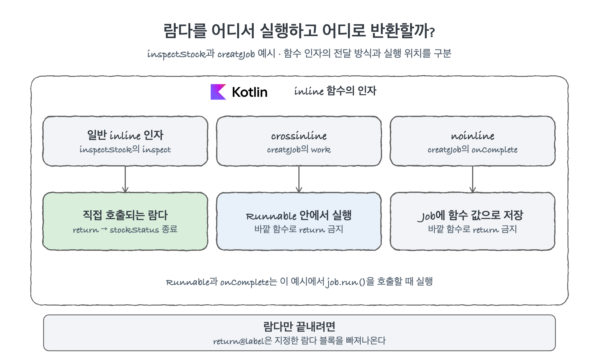

# Advanced Kotlin Functions: Higher-Order Functions, Inlining, and SAM Conversion

함수를 인자로 받으면 호출자가 동작을 바꿔 끼울 수 있고, 함수를 반환하면 설정값을 기억하는 동작을 만들 수 있다. 이때 함수 타입은 호출 방법을, `inline`은 컴파일과 `return`의 동작을, SAM 변환은 함수형 인터페이스를 사용하는 호출 방법을 결정한다. 각 예제는 독립된 Kotlin/JVM 파일로 실행할 수 있다.

## 1. 고차 함수와 함수 리터럴

고차 함수는 함수를 받거나 반환한다. 함수 리터럴은 이름 없이 함수를 정의하는 표현식으로, `{ value -> ... }` 형태의 람다와 `fun(value: String): String { ... }` 형태의 익명 함수가 있다. 람다는 마지막 표현식의 값을 반환한다. 익명 함수는 블록 본문에서 `return`으로 반환할 수 있으며, 그 `return`은 익명 함수 자체를 끝낸다. [Kotlin · 고차 함수와 람다](https://kotlinlang.org/docs/lambdas.html) · [Kotlin · 익명 함수](https://kotlinlang.org/docs/lambdas.html#anonymous-functions)

`StringBuilder.() -> Unit`처럼 수신 객체가 있는 함수 타입의 블록에서는 `this`로 수신 객체를 사용한다. 아래 `renderLabel`의 블록에서 `append`를 바로 호출할 수 있는 이유는 이 블록을 `StringBuilder`에서 실행하기 때문이다. [Kotlin · 수신 객체가 있는 함수 리터럴](https://kotlinlang.org/docs/lambdas.html#function-literals-with-receiver)

```kotlin
fun normalize(raw: String, transform: (String) -> String): String = transform(raw)

fun renderLabel(build: StringBuilder.() -> Unit): String =
    StringBuilder().apply(build).toString()

fun main() {
    val sku = normalize(" PEN ") { it.trim().lowercase() }
    val fallback = normalize("   ", fun(raw: String): String {
        if (raw.isBlank()) return "unknown"
        return raw.trim()
    })
    val label = renderLabel {
        append("SKU ")
        append(sku)
    }

    check(sku == "pen")
    check(fallback == "unknown")
    check(label == "SKU pen")
}
```

## 2. 복잡한 함수 타입과 호출 비용

| 타입 | 의미 |
| --- | --- |
| `(Int) -> Boolean` | 정수를 받아 조건의 참·거짓을 반환한다. |
| `(Int) -> String?` | 함수는 존재하며, 호출 결과는 `null`일 수 있다. |
| `((Int) -> String)?` | 함수 자체가 `null`일 수 있다. 호출하려면 `formatter?.invoke(quantity)`처럼 쓴다. |
| `(Int) -> (Int) -> Boolean` | 정수를 받아 또 다른 함수를 반환한다. `->`는 오른쪽부터 묶인다. |
| `StringBuilder.() -> Unit` | `StringBuilder`를 수신 객체로 받고 반환할 값이 없는 함수다. |

반복해서 쓰는 함수 타입에는 `typealias StockRule = (Int) -> Boolean`처럼 이름을 붙일 수 있다. 아래 `minimumStock`이 반환한 람다는 바깥 매개변수 `minimum`을 캡처하므로 호출 시점에도 그 값을 사용할 수 있다. [Kotlin · 함수 타입과 클로저](https://kotlinlang.org/docs/lambdas.html) · [Kotlin · 타입 별칭](https://kotlinlang.org/docs/type-aliases.html)

```kotlin
typealias StockRule = (Int) -> Boolean

fun minimumStock(minimum: Int): StockRule = { quantity -> quantity >= minimum }

fun stockLabel(quantity: Int, formatter: ((Int) -> String)? = null): String =
    formatter?.invoke(quantity) ?: quantity.toString()

fun main() {
    val canReserve = minimumStock(3)
    check(canReserve(3))
    check(!canReserve(2))
    check(stockLabel(3) == "3")
    check(stockLabel(3) { "${it} units" } == "3 units")
}
```

JVM에서 인라인되지 않은 고차 함수는 함수 객체를 만들거나 간접 호출할 수 있다. 제네릭 `Function1`을 통해 기본형 값을 전달할 때 박싱이 발생할 수 있다. 실제 비용은 캡처 여부, 호출 빈도, 컴파일러와 JVM 최적화에 따라 달라진다. 자주 호출하는 경로에서 비용이 문제라면 해당 입력으로 측정한다. [Kotlin · 인라인 함수와 비용](https://kotlinlang.org/docs/inline-functions.html) · [Kotlin · JVM 숫자 박싱](https://kotlinlang.org/docs/numbers.html)

## 3. `inline`, `noinline`, `crossinline`

| 표기 | 함수 인자의 동작 |
| --- | --- |
| `inline fun`의 일반 함수 인자 | 호출 지점에 펼쳐질 수 있다. 직접 호출되는 람다의 일반 `return`은 그 람다를 넘긴 바깥 함수를 끝낼 수 있다. 이를 비지역 반환이라고 한다. |
| `noinline` | 인자를 함수 값으로 보관하거나 일반 함수에 그대로 넘길 수 있다. 비지역 반환을 허용하지 않는다. |
| `crossinline` | 람다를 인라인할 수 있으며, `Runnable`처럼 다른 실행 문맥의 본문에서 이를 호출할 때 사용한다. 비지역 반환을 허용하지 않는다. |

`return@함수이름`은 람다에서만 빠져나올 때 쓴다. 아래 `stockStatus`의 `return "sold out"`은 `inspectStock`에 넘긴 람다에서 실행되지만 `stockStatus` 전체를 끝낸다. `createJob`의 `work`는 생성한 `Runnable`에서 호출되고, `onComplete`는 `Job`에 함수 값으로 저장된다. `inline`은 큰 함수 본문이 여러 호출부에 복제될 수 있으므로 적용 범위를 함께 고려한다. [Kotlin · 인라인과 비지역 반환](https://kotlinlang.org/docs/inline-functions.html) · [Kotlin · 라벨 반환](https://kotlinlang.org/docs/returns.html#return-to-labels)

```kotlin
inline fun inspectStock(stock: Int, inspect: (Int) -> Unit) {
    inspect(stock)
}

fun stockStatus(stock: Int): String {
    inspectStock(stock) { quantity ->
        if (quantity <= 0) return "sold out"
    }
    return "available"
}

class Job(private val work: Runnable, private val onComplete: () -> Unit) {
    fun run() {
        work.run()
        onComplete()
    }
}

inline fun createJob(crossinline work: () -> Unit, noinline onComplete: () -> Unit): Job =
    Job(Runnable { work() }, onComplete)

fun main() {
    val events = mutableListOf<String>()
    val job = createJob(work = { events.add("reserved") }, onComplete = { events.add("done") })

    check(stockStatus(0) == "sold out")
    check(stockStatus(3) == "available")
    check(events.isEmpty())
    job.run()
    check(events == listOf("reserved", "done"))
}
```



그림의 근거 · [Kotlin · 인라인 함수](https://kotlinlang.org/docs/inline-functions.html) · [Kotlin · 라벨 반환](https://kotlinlang.org/docs/returns.html)

## 4. SAM 변환과 함수 참조

SAM은 추상 메서드를 하나 가진 인터페이스다. Kotlin의 `fun interface`나 Java의 `IntPredicate`처럼 함수형 인터페이스가 필요한 곳에 시그니처가 맞는 람다 또는 함수 참조를 전달할 수 있다. `fun interface`는 메서드 이름과 계약을 갖는 별도 타입이다. 함수 타입의 `typealias`는 기존 함수 타입에 이름만 부여한다. [Kotlin · 함수형 인터페이스](https://kotlinlang.org/docs/fun-interfaces.html) · [Kotlin · Java SAM 변환](https://kotlinlang.org/docs/java-interop.html#sam-conversions) · [Java 17 · `IntPredicate`](https://docs.oracle.com/en/java/javase/17/docs/api/java.base/java/util/function/IntPredicate.html)

`StockPolicy::allows`는 수신 객체를 아직 정하지 않아 호출할 때 객체와 수량을 모두 넘긴다. `policy::allows`는 `policy`에 바인딩되어 수량만 넘긴다. `::hasStock`처럼 최상위 함수도 참조할 수 있으며, `StockPolicy::minimum`처럼 프로퍼티 참조도 전달할 수 있다. [Kotlin · 호출 가능 참조](https://kotlinlang.org/docs/reflection.html#callable-references)

```kotlin
import java.util.function.IntPredicate

fun interface StockRule {
    fun allows(quantity: Int): Boolean
}

class StockPolicy(val minimum: Int) {
    fun allows(quantity: Int): Boolean = quantity >= minimum
}

fun hasStock(quantity: Int): Boolean = quantity > 0

fun permitted(quantity: Int, rule: StockRule): Boolean = rule.allows(quantity)

fun main() {
    val policy = StockPolicy(3)
    val bound: (Int) -> Boolean = policy::allows
    val unbound: (StockPolicy, Int) -> Boolean = StockPolicy::allows
    val minimum: (StockPolicy) -> Int = StockPolicy::minimum
    val javaRule = IntPredicate(::hasStock)

    check(permitted(3, policy::allows))
    check(!permitted(2) { it >= 3 })
    check(bound(3) && unbound(policy, 3))
    check(minimum(policy) == 3)
    check(javaRule.test(1) && !javaRule.test(0))
}
```
