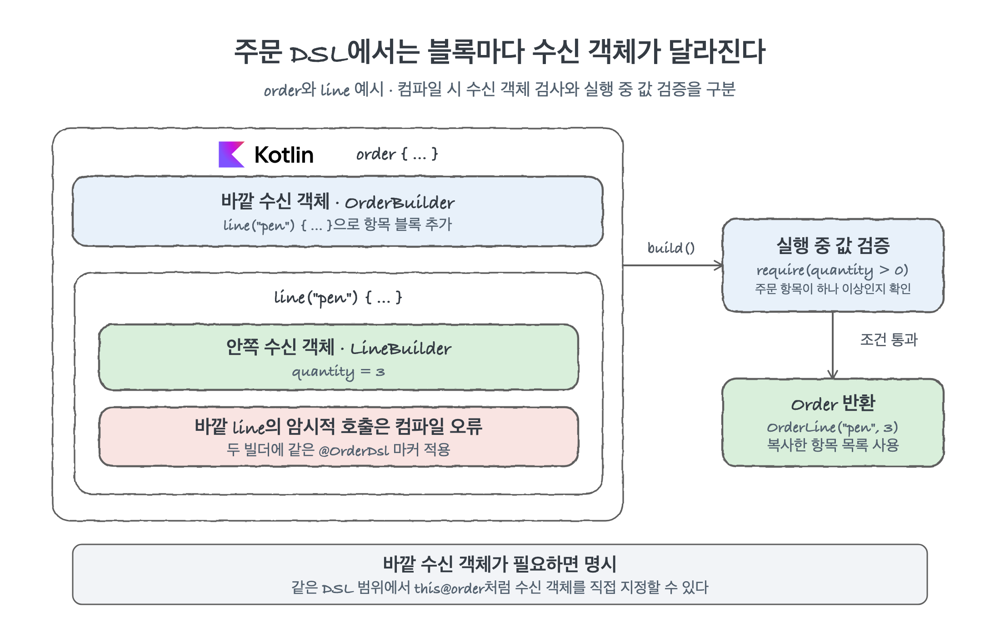

# Kotlin Operator Overloading and Type-Safe DSLs

Kotlin의 연산자 오버로딩은 `a + b`나 `a[key]`를 정해진 이름의 함수에 연결한다. 타입 안전한 DSL은 수신 객체가 있는 람다를 사용해 설정을 중첩된 블록으로 표현한다. 재고 수량과 주문 항목 예제로 두 기능을 살펴본다.

## 1. 연산자 오버로딩

Kotlin이 정한 이름과 시그니처에 맞춰 `operator` 함수를 정의하면 아래 문법을 사용할 수 있다. `compareTo`를 구현하는 경우처럼 상위 타입에서 이미 `operator`인 함수는 `override`에 `operator`를 다시 붙일 필요가 없다. [Kotlin · 연산자 오버로딩](https://kotlinlang.org/docs/operator-overloading.html)

| 표현식 | 연결되는 함수 또는 동작 |
| --- | --- |
| `a + b` / `-a` | `a.plus(b)` / `a.unaryMinus()` |
| `a[key]` / `a[key] = value` | `a.get(key)` / `a.set(key, value)` |
| `x in a` | `a.contains(x)` |
| `a(arg)` | `a.invoke(arg)` |
| `a < b` | `a.compareTo(b) < 0` |
| `a += b` | `a.plusAssign(b)` 또는 `a = a + b`가 적용된다. 두 형태가 모두 가능한 경우 모호성 오류가 날 수 있다. |

아래 `Quantity`에서는 덧셈의 의미가 분명하고, `Stock`에서 인덱스 접근은 SKU로 수량을 조회한다. 보통의 덧셈처럼 호출자가 결과 값을 기대하는 연산에는 목록 갱신이나 로그 기록 같은 부수 효과를 섞지 않으면 호출부를 이해하기 쉽다.

```kotlin
data class Quantity(val units: Int) : Comparable<Quantity> {
    operator fun plus(other: Quantity): Quantity = Quantity(units + other.units)

    override fun compareTo(other: Quantity): Int = units.compareTo(other.units)
}

class Stock(private val quantities: Map<String, Quantity>) {
    operator fun get(sku: String): Quantity = quantities[sku] ?: Quantity(0)
    operator fun contains(sku: String): Boolean = sku in quantities
}

fun main() {
    val stock = Stock(mapOf("pen" to Quantity(3), "notebook" to Quantity(2)))
    val total = stock["pen"] + stock["notebook"]

    check(total == Quantity(5))
    check(stock["pen"] > stock["notebook"])
    check("pen" in stock && "eraser" !in stock)
    check(stock["eraser"] == Quantity(0))
}
```

## 2. 주문 DSL 만들기

`OrderBuilder.() -> Unit`을 받는 `order` 함수는 `OrderBuilder`에서 설정 블록을 실행하고 `Order`를 만든다. `line` 안에서는 수신 객체가 `LineBuilder`로 바뀐다. `@DslMarker`를 두 빌더에 적용하면 내부 블록에서 바깥 빌더의 `line`을 암시적으로 호출하는 실수를 컴파일러가 막는다. 바깥 빌더를 의도적으로 가리켜야 할 때는 `this@order`처럼 수신 객체를 명시할 수 있다. [Kotlin · 타입 안전한 빌더와 `@DslMarker`](https://kotlinlang.org/docs/type-safe-builders.html)

컴파일러가 각 블록에서 사용할 수 있는 함수와 타입을 검사한다. 수량이 1 이상이어야 하고 주문에 항목이 있어야 한다는 조건은 빌더가 실행 중에 검사한다. `build`는 항목 목록을 복사해 반환하므로 이후 빌더에 항목을 추가해도 이미 만들어진 주문 목록에는 반영되지 않는다.

```kotlin
@DslMarker
annotation class OrderDsl

data class OrderLine(val sku: String, val quantity: Int)
data class Order(val customerId: String, val lines: List<OrderLine>)

@OrderDsl
class LineBuilder(private val sku: String) {
    var quantity: Int = 1

    internal fun build(): OrderLine {
        require(sku.isNotBlank()) { "SKU is required" }
        require(quantity > 0) { "Quantity must be positive" }
        return OrderLine(sku, quantity)
    }
}

@OrderDsl
class OrderBuilder(private val customerId: String) {
    private val lines = mutableListOf<OrderLine>()

    fun line(sku: String, configure: LineBuilder.() -> Unit = {}) {
        lines.add(LineBuilder(sku).apply(configure).build())
    }

    internal fun build(): Order {
        require(customerId.isNotBlank()) { "Customer ID is required" }
        require(lines.isNotEmpty()) { "At least one order line is required" }
        return Order(customerId, lines.toList())
    }
}

fun order(customerId: String, configure: OrderBuilder.() -> Unit): Order =
    OrderBuilder(customerId).apply(configure).build()

fun main() {
    val purchase = order("customer-42") {
        line("pen") { quantity = 3 }
        line("notebook")
    }

    check(purchase.lines == listOf(OrderLine("pen", 3), OrderLine("notebook", 1)))
    val invalidOrder = runCatching {
        order("customer-42") { line("pen") { quantity = 0 } }
    }
    check(invalidOrder.exceptionOrNull() is IllegalArgumentException)
}
```



그림의 근거 · [Kotlin · 타입 안전한 빌더](https://kotlinlang.org/docs/type-safe-builders.html) · [Kotlin · require](https://kotlinlang.org/api/core/kotlin-stdlib/kotlin/require.html)

## 3. Kotlin DSL 활용 사례

| 사용처 | 블록에서 표현하는 것 |
| --- | --- |
| Gradle Kotlin DSL | `build.gradle.kts`의 `plugins`, `dependencies`, `tasks.register<Copy>(...)` 블록에서 플러그인, 의존성, 작업 설정을 선언한다. `Copy` 작업 블록에서는 복사할 위치와 대상을 설정할 수 있다. [Gradle · Kotlin DSL](https://docs.gradle.org/current/userguide/kotlin_dsl.html) |
| Ktor 라우팅 | `routing { route("/orders") { get { ... } } }`로 경로와 HTTP 메서드, 핸들러 관계를 나타낸다. 공통 경로가 있는 요청은 같은 `route` 아래 묶을 수 있다. [Ktor · Routing](https://ktor.io/docs/server-routing.html) |
| Kotlin HTML 빌더 | `html { body { p { ... } } }`처럼 호출 블록의 중첩 구조가 생성할 요소의 부모·자식 관계를 나타낸다. [Kotlin · 타입 안전한 HTML 빌더](https://kotlinlang.org/docs/type-safe-builders.html) |

여러 곳에서 같은 계층의 설정을 반복하고, 각 단계에서 허용할 기능이 구분될 때 DSL의 블록 구조가 도움이 된다. 설정이 몇 개의 입력값으로 끝난다면 이름 있는 인자를 받는 함수로도 호출 의도를 드러낼 수 있다.
