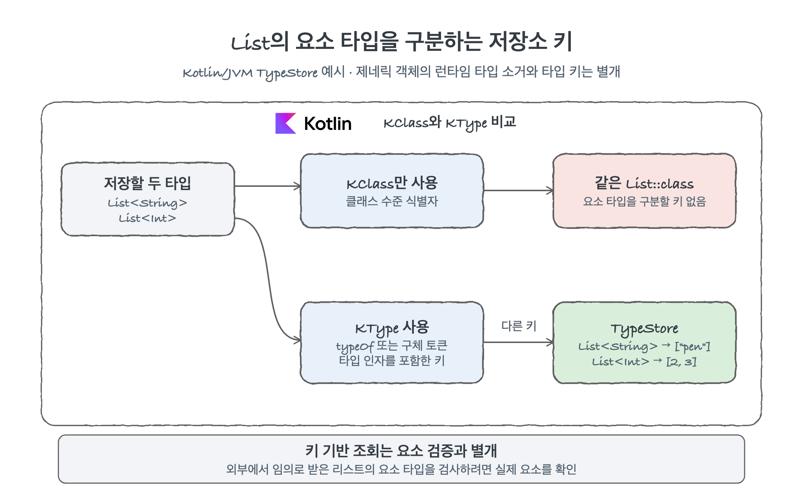

# Kotlin Annotations and Reflection: Dependency Injection and Type Tokens

애너테이션은 선언에 메타데이터를 붙인다. 리플렉션은 런타임에 그 메타데이터와 클래스의 구조를 읽고, 필요하면 생성자나 함수를 호출한다. 이 두 기능을 사용해 생성자 주입을 구현하고, 제네릭 타입 인자까지 구분하는 저장소를 만들어 본다.

예제는 Kotlin/JVM에서 각각 별도 파일로 실행할 수 있다. `primaryConstructor`, `memberProperties` 등 JVM 리플렉션 API를 사용하려면 Kotlin 플러그인과 버전이 맞는 `kotlin-reflect`를 컴파일과 실행 클래스패스에 추가한다. Gradle의 Kotlin DSL에서는 `dependencies`에 `implementation(kotlin("reflect"))`를 선언할 수 있다. [Kotlin · JVM 리플렉션 의존성](https://kotlinlang.org/docs/reflection.html)

## 1. 애너테이션과 사용 지점 대상

`annotation class`를 선언하고 `@Target`으로 붙일 수 있는 대상을 정한다. `@Retention`은 애너테이션이 언제까지 남는지 정한다. `SOURCE`는 소스에만 남고, `BINARY`는 컴파일 결과에 포함되며, `RUNTIME`은 런타임 리플렉션으로도 읽을 수 있다. [Kotlin · 애너테이션 선언](https://kotlinlang.org/docs/annotations.html)

하나의 Kotlin 프로퍼티는 JVM에서 필드와 접근자로 표현될 수 있다. `@property:`는 Kotlin 프로퍼티, `@field:`는 필드, `@get:`은 getter에 붙인다. 프레임워크가 어디서 애너테이션을 읽는지에 맞춰 사용 지점 대상을 지정한다. [Kotlin · 애너테이션 사용 지점 대상](https://kotlinlang.org/docs/annotations.html#annotation-use-site-targets)

```kotlin
import kotlin.reflect.full.findAnnotation
import kotlin.reflect.full.memberProperties

@Target(AnnotationTarget.PROPERTY, AnnotationTarget.FIELD, AnnotationTarget.PROPERTY_GETTER)
@Retention(AnnotationRetention.RUNTIME)
annotation class Label(val value: String)

data class Stock(
    @property:Label("kotlin-property")
    @field:Label("jvm-field")
    @get:Label("jvm-getter")
    val sku: String,
)

fun main() {
    val property = Stock::class.memberProperties.single { it.name == "sku" }
    val jvmClass = Stock::class.java

    check(property.findAnnotation<Label>()?.value == "kotlin-property")
    check(jvmClass.getDeclaredField("sku").getAnnotation(Label::class.java)?.value == "jvm-field")
    check(jvmClass.getMethod("getSku").getAnnotation(Label::class.java)?.value == "jvm-getter")
}
```

## 2. `KClass`, `KType`, `KFunction`으로 구조 읽기

| API | 읽을 수 있는 것 |
| --- | --- |
| `KClass` | 클래스, 멤버, 상위 타입을 표현한다. `Stock::class`로 클래스 참조를 얻고 `value::class`로 객체의 실제 클래스를 얻는다. JVM에서는 `.java`로 `Class`를 얻을 수 있다. |
| `KType` | 프로퍼티나 매개변수의 타입을 표현한다. `classifier`, `arguments`, `isMarkedNullable`로 분류자, 타입 인자, 명시적 null 허용 여부를 확인한다. |
| `KFunction` | 함수와 생성자를 표현한다. `call`은 위치 순서대로 값을 넘기고, `callBy`는 `KParameter`를 키로 값을 넘긴다. `callBy`에서 기본값이 있는 인자는 생략할 수 있다. |

[Kotlin · 리플렉션과 타입 검사](https://kotlinlang.org/docs/reflection.html) · [Kotlin · `primaryConstructor`](https://kotlinlang.org/api/core/kotlin-reflect/kotlin.reflect.full/primary-constructor.html)

```kotlin
import kotlin.reflect.full.memberProperties
import kotlin.reflect.full.primaryConstructor

data class Stock(val sku: String, val quantity: Int = 1)

fun main() {
    val type = Stock::class
    val constructor = requireNotNull(type.primaryConstructor)
    val sku = constructor.parameters.single { it.name == "sku" }
    val stock = constructor.callBy(mapOf(sku to "pen"))
    val quantity = type.memberProperties.single { it.name == "quantity" }

    check(stock == Stock("pen", 1))
    check(stock::class == type && sku.type.classifier == String::class)
    check(quantity.get(stock) == 1 && !quantity.returnType.isMarkedNullable)
}
```

## 3. 생성자 주입용 DI 컨테이너

컨테이너는 먼저 클래스 키로 등록된 인스턴스를 찾는다. 등록된 값이 없으면 공개 주 생성자에 `@Inject`가 있는지 확인하고, 각 매개변수의 타입을 재귀적으로 해석한 뒤 생성자를 호출한다. 해석 중인 타입을 경로에 기록해 순환 의존성을 발견한다. [Kotlin · 리플렉션으로 생성자와 멤버 찾기](https://kotlinlang.org/docs/reflection.html)

이 예제는 `inner`가 아닌 구체 클래스의 생성자를 사용하며, 필수이며 null을 허용하지 않는 비제네릭 생성자 인자를 지원한다. 인터페이스에는 구현 인스턴스를 명시적으로 등록한다. `bind`로 등록한 인스턴스는 재사용하며, 리플렉션으로 만드는 인스턴스는 조회할 때마다 새로 생성한다.

```kotlin
import kotlin.reflect.KClass
import kotlin.reflect.KVisibility
import kotlin.reflect.full.cast
import kotlin.reflect.full.findAnnotation
import kotlin.reflect.full.primaryConstructor

@Target(AnnotationTarget.CONSTRUCTOR)
@Retention(AnnotationRetention.RUNTIME)
annotation class Inject

class Container {
    private val bindings = mutableMapOf<KClass<*>, Any>()

    fun <T : Any> bind(type: KClass<T>, instance: T) {
        require(type.isInstance(instance))
        bindings[type] = instance
    }

    fun <T : Any> get(type: KClass<T>): T = type.cast(resolve(type, emptyList()))

    private fun resolve(type: KClass<*>, path: List<KClass<*>>): Any {
        bindings[type]?.let { return it }
        check(type !in path) {
            "Dependency cycle: " + (path + type).joinToString(" -> ") { it.simpleName.orEmpty() }
        }

        val constructor = type.primaryConstructor
        require(
            constructor != null && !type.isAbstract && !type.isInner &&
                constructor.visibility == KVisibility.PUBLIC && constructor.findAnnotation<Inject>() != null
        ) {
            "No binding or public @Inject primary constructor for ${type.simpleName}"
        }

        val nextPath = path + type
        val values = constructor.parameters.map { parameter ->
            val dependency = parameter.type.classifier as? KClass<*>
            require(
                dependency != null && parameter.type.arguments.isEmpty() &&
                    !parameter.type.isMarkedNullable && !parameter.isOptional && !parameter.isVararg
            ) {
                "Unsupported parameter ${parameter.name} in ${type.simpleName}"
            }
            resolve(dependency, nextPath)
        }
        return constructor.call(*values.toTypedArray())
    }
}

interface StockReader {
    fun quantity(sku: String): Int
}

class OrderService @Inject constructor(private val stock: StockReader) {
    fun canReserve(sku: String, quantity: Int): Boolean = stock.quantity(sku) >= quantity
}

class CycleA @Inject constructor(val next: CycleB)
class CycleB @Inject constructor(val next: CycleA)

fun main() {
    val container = Container()
    check(runCatching { container.get(OrderService::class) }.exceptionOrNull() is IllegalArgumentException)

    container.bind(StockReader::class, object : StockReader {
        override fun quantity(sku: String): Int = if (sku == "pen") 3 else 0
    })
    val service = container.get(OrderService::class)
    check(service.canReserve("pen", 3) && !service.canReserve("pen", 4))

    val cycle = runCatching { container.get(CycleA::class) }.exceptionOrNull()
    check(cycle is IllegalStateException && cycle.message == "Dependency cycle: CycleA -> CycleB -> CycleA")
}
```

## 4. 타입 안전 이종 컨테이너와 슈퍼 타입 토큰

타입 안전 이종 컨테이너는 한 저장소에 여러 타입의 값을 넣고, 조회하는 키의 타입으로 반환값을 결정한다. `KClass`만 키로 쓰면 `List<String>`과 `List<Int>`가 같은 `List::class`에 해당한다. `typeOf<List<String>>()`으로 얻는 `KType`에는 타입 인자 정보가 있어 두 값을 서로 다른 키로 다룰 수 있다. [Kotlin · 타입 소거](https://kotlinlang.org/docs/generics.html#type-erasure) · [Kotlin · `typeOf`](https://kotlinlang.org/api/core/kotlin-stdlib/kotlin.reflect/type-of.html)

슈퍼 타입 토큰은 `object : TypeToken<List<String>>() {}`처럼 구체 타입 인자를 상위 클래스 선언에 남긴다. 이 예제는 직접 상위 타입에서 `KType`을 읽는다. 저장소의 `put`은 키와 값에 같은 `T`를 요구하고, `get`의 검사되지 않는 캐스트는 저장소 안에 둔다. 토큰은 저장과 조회에 쓰이는 타입을 표현한다. 임의로 전달된 리스트의 요소를 검증하려면 요소를 직접 검사해야 한다. [Kotlin · `KClass.supertypes`](https://kotlinlang.org/api/core/kotlin-stdlib/kotlin.reflect/-k-class/supertypes.html) · [Kotlin · `KType.arguments`](https://kotlinlang.org/api/core/kotlin-stdlib/kotlin.reflect/-k-type/arguments.html)

```kotlin
import kotlin.reflect.KClass
import kotlin.reflect.KType
import kotlin.reflect.typeOf

abstract class TypeToken<T : Any> {
    internal val type: KType = requireNotNull(
        this::class.supertypes.singleOrNull { it.classifier == TypeToken::class }
            ?.arguments?.singleOrNull()?.type
    ) { "Declare a direct TypeToken subclass with a concrete type argument" }

    init {
        require(type.isConcrete()) { "TypeToken must capture a concrete type" }
    }

    private fun KType.isConcrete(): Boolean = classifier is KClass<*> &&
        arguments.all { it.type?.isConcrete() == true }
}

class TypeStore {
    private val values = mutableMapOf<KType, Any>()

    fun <T : Any> put(key: TypeToken<T>, value: T) {
        values[key.type] = value
    }

    @Suppress("UNCHECKED_CAST")
    fun <T : Any> get(key: TypeToken<T>): T? = values[key.type] as T?
}

fun main() {
    val store = TypeStore()
    val names = object : TypeToken<List<String>>() {}
    val counts = object : TypeToken<List<Int>>() {}
    val missing = object : TypeToken<List<Long>>() {}

    store.put(names, listOf("pen", "notebook"))
    store.put(counts, listOf(2, 3))

    check(names.type == typeOf<List<String>>() && names.type != counts.type)
    check(store.get(object : TypeToken<List<String>>() {})?.first() == "pen")
    check(store.get(counts)?.sum() == 5)
    check(store.get(missing) == null)
}
```



그림의 근거 · [Kotlin · 제네릭 타입 소거](https://kotlinlang.org/docs/generics.html) · [Kotlin · typeOf](https://kotlinlang.org/api/core/kotlin-stdlib/kotlin.reflect/type-of.html) · [Kotlin · KType.arguments](https://kotlinlang.org/api/core/kotlin-stdlib/kotlin.reflect/-k-type/arguments.html) · [Kotlin · KClass.supertypes](https://kotlinlang.org/api/core/kotlin-stdlib/kotlin.reflect/-k-class/supertypes.html)
