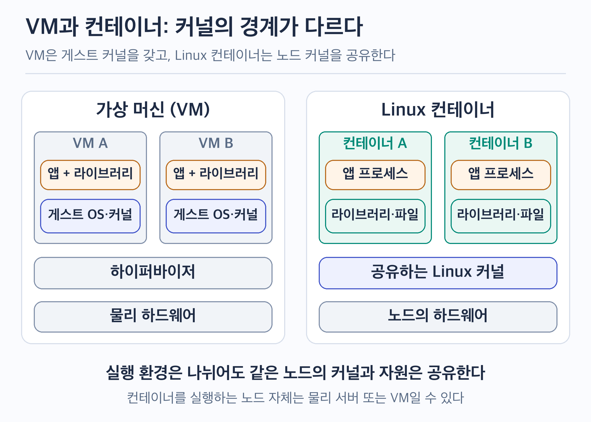
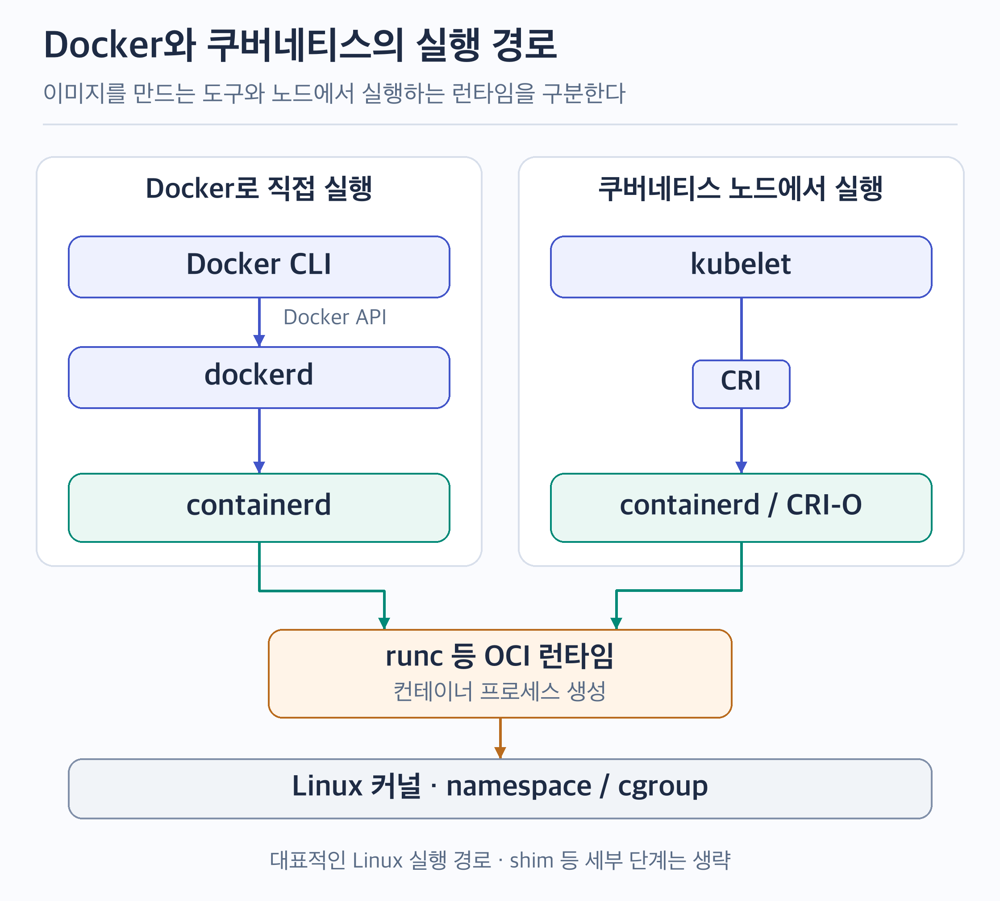
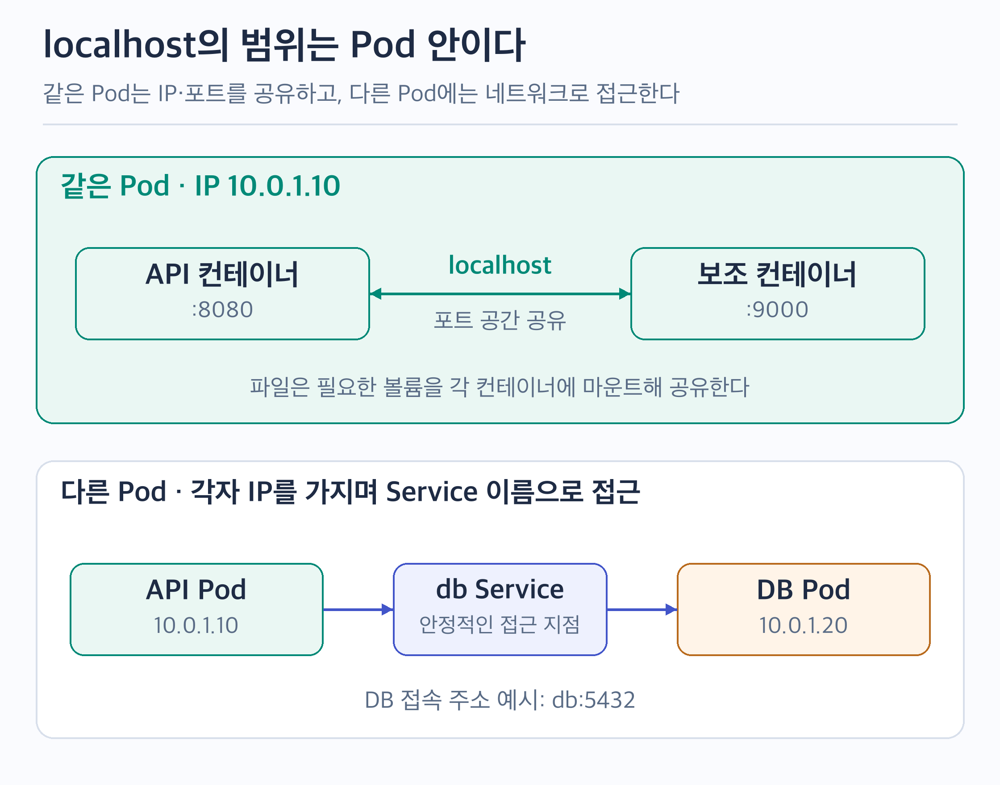

# 컨테이너와 쿠버네티스의 실행 구조 이해하기

## 1. 컨테이너는 운영체제의 커널을 공유하는 격리된 프로세스이다

- **컨테이너는 애플리케이션을 필요한 실행 환경과 함께 패키징하고, 다른 프로세스와 격리해 실행하는 방식이다.**
- Linux 컨테이너 안의 애플리케이션도 노드의 Linux 커널 위에서 실행되는 프로세스이다.
- 컨테이너마다 파일과 네트워크를 별도로 보는 환경을 만들 수 있지만, 컨테이너마다 별도의 커널이 생기는 것은 아니다.
- 애플리케이션과 런타임, 라이브러리를 함께 배포해 서버마다 설치된 소프트웨어의 차이를 줄인다.

| 구분 | 가상 머신(VM) | 일반적인 Linux 컨테이너 |
| :--- | :--- | :--- |
| 실행 환경 | 가상 하드웨어 위에서 게스트 OS와 커널을 실행한다. | 노드의 커널을 공유하면서 프로세스의 실행 환경을 격리한다. |
| 배포 단위 | 게스트 OS를 포함한 머신 이미지이다. | 애플리케이션과 실행에 필요한 파일을 담은 컨테이너 이미지이다. |
| 자원과 기동 비용 | OS 전체를 기동하고 유지하는 비용이 있다. | 별도의 게스트 OS 없이 프로세스를 실행해 상대적으로 가볍다. |



- 컨테이너는 VM 안에서도 실행할 수 있다. 클라우드 VM을 쿠버네티스 노드로 사용하는 구성이 가능하다.
- macOS에서 Linux 컨테이너를 실행하는 경우에는 일반적으로 Linux VM을 통해 필요한 커널 환경을 제공한다.

## 2. 격리와 자원 제어는 Linux 커널 기능을 이용한다

| 기능 | 역할 | 백엔드 개발자가 이해할 점 |
| :--- | :--- | :--- |
| Linux namespace | 프로세스 ID, 네트워크, 마운트 등 프로세스가 보는 환경을 나눈다. | 컨테이너 안에서 보는 프로세스와 네트워크가 호스트의 전체 환경과 다를 수 있다. |
| cgroup | 프로세스 그룹의 CPU·메모리 등 자원을 관리하고 사용을 제한한다. | 컨테이너의 자원 제한이 실제 실행과 성능에 영향을 준다. |
| 루트 파일시스템과 마운트 격리 | 이미지의 파일을 컨테이너의 파일 경로로 제공한다. | 컨테이너마다 서로 다른 라이브러리와 파일 구성을 사용할 수 있다. |

- `chroot`는 프로세스가 보는 루트 디렉터리를 바꾸는 기능이다. 이것만으로 프로세스, 네트워크와 자원이 모두 격리되는 것은 아니다.
- 같은 노드의 컨테이너는 커널과 물리 자원을 공유한다. 격리되어 있어도 자원 경합은 발생할 수 있다.
- Kubernetes의 `Namespace`는 API 리소스를 논리적으로 구분하는 단위이며, Linux namespace와 다른 개념이다.

## 3. 이미지, 컨테이너와 레지스트리를 구분한다

| 개념 | 의미 | 백엔드 예시 |
| :--- | :--- | :--- |
| 이미지(Image) | 애플리케이션, 런타임과 라이브러리 등을 담은 실행용 패키지이다. | JRE와 Spring Boot JAR 파일을 포함한 이미지이다. |
| 컨테이너(Container) | 이미지를 바탕으로 만든 실행 인스턴스이다. | 같은 주문 API 이미지로 실행한 여러 프로세스이다. |
| 레지스트리(Registry) | 이미지를 저장하고 배포하는 저장소이다. | CI에서 이미지를 올리고 쿠버네티스 노드가 내려받는다. |

```text
코드 변경 → 이미지 빌드 → 레지스트리에 업로드 → 배포 명세 변경 → 노드에서 이미지 실행
```

- 이미지 하나로 여러 컨테이너를 실행할 수 있다. 같은 이미지를 쓰더라도 각 실행 인스턴스의 상태는 별개이다.
- 코드 변경은 실행 중인 컨테이너 안에서 파일을 수정하기보다 새 이미지로 빌드해 교체한다.
- `latest`처럼 같은 이름이 다른 이미지를 가리킬 수 있는 태그에만 의존하지 않는다. 버전 태그를 덮어쓰지 않도록 관리하거나 digest로 배포 대상을 고정한다.
- 이미지는 호스트 커널 전체를 포함하지 않는다. CPU 아키텍처와 커널 기능의 호환성을 확인해야 한다.
- 로컬이 `arm64`이고 운영 노드가 `amd64`이면 대상에 맞는 이미지를 빌드하거나 멀티 아키텍처 이미지를 사용한다.
- 환경변수, 외부 서비스와 자원 제한도 동작에 영향을 준다. 같은 이미지라는 사실만으로 모든 환경에서 같은 결과가 보장되지는 않는다.

## 4. Docker와 컨테이너 런타임, 쿠버네티스는 역할이 다르다

| 구성요소 | 역할 |
| :--- | :--- |
| Linux 배포판 | Linux 커널과 셸·패키지 관리자 등 사용자 공간 도구를 묶어 제공한다. |
| Docker Engine | CLI와 API를 통해 이미지, 컨테이너, 네트워크와 볼륨 등을 관리한다. |
| containerd·CRI-O | 컨테이너 실행과 생명주기를 관리하며 쿠버네티스와 CRI로 연동한다. |
| runc | OCI 런타임 표준에 따라 격리 환경을 구성하고 컨테이너 프로세스를 실행한다. |
| Kubernetes | 여러 노드에 걸쳐 Pod의 배치, 복제, 교체와 배포 상태를 관리한다. |

- Docker CLI가 Docker API로 `dockerd`에 요청하면, Docker Engine은 내부적으로 containerd와 runc 같은 구성요소를 활용해 컨테이너를 실행한다.
- 쿠버네티스에서는 각 노드의 kubelet이 CRI(Container Runtime Interface)를 통해 런타임에 실행을 요청한다.
- **CRI는 kubelet과 런타임 사이의 통신 규약이고, OCI는 이미지 형식과 컨테이너 실행 방식 등의 표준이다.**



- 이 흐름은 일반적인 Linux 실행 경로를 단순화한 것이다. 컨테이너 감시용 shim 등 세부 구성은 생략한다.
- Kubernetes 1.24에서 제거된 dockershim은 kubelet과 Docker Engine을 연결하던 내장 연동 계층이다.
- Docker로 빌드한 표준 이미지는 containerd나 CRI-O에서도 실행할 수 있다. 이미지 빌드 도구와 노드의 실행 런타임을 구분한다.
- 노드가 containerd를 사용한다면 `docker ps`만으로 쿠버네티스 컨테이너를 확인하려 하지 않는다. 애플리케이션 상태는 우선 `kubectl`로 확인한다.

## 5. 쿠버네티스는 컨테이너를 Pod 단위로 실행한다

- **Pod는 쿠버네티스에서 생성하고 배치하는 최소 실행 단위이며, 하나 이상의 컨테이너를 포함한다.**
- 노드(Node)는 Pod를 실행하는 서버이며 물리 서버나 VM을 사용할 수 있다. 클러스터는 노드와 전체 상태를 관리하는 컨트롤 플레인으로 구성된다.
- 같은 Pod의 컨테이너는 같은 노드에서 실행되며 IP와 포트 공간을 공유한다. 서로 `localhost`로 통신할 수 있다.
- 필요한 볼륨을 각 컨테이너에 마운트해 파일을 공유할 수도 있다. 컨테이너의 모든 파일이 자동으로 공유되지는 않는다.
- 일반적인 API 서버는 Pod당 애플리케이션 컨테이너 하나로 시작한다. 보조 컨테이너는 같은 생명주기로 함께 실행할 이유가 있을 때 추가한다.
- API 서버와 DB처럼 독립적인 배포와 확장이 필요한 구성요소를 단지 통신한다는 이유로 같은 Pod에 묶지 않는다.
- 다른 Pod의 DB에 접속할 때 `localhost`를 쓰면 자기 Pod를 가리킨다. 대상 Service의 이름과 포트를 사용한다.
- Pod가 교체되면 이름과 IP가 바뀔 수 있다. 클라이언트는 개별 Pod IP보다 Service를 통해 접근한다.



### 배포 요청이 실제 프로세스 실행으로 이어지는 순서

1. 개발자가 `kubectl`이나 배포 도구로 Deployment 같은 명세를 kube-apiserver에 제출한다.
2. 컨트롤러가 원하는 복제 수에 맞춰 ReplicaSet과 Pod를 생성·조정한다.
3. 스케줄러가 아직 노드가 정해지지 않은 Pod를 실행할 노드에 배정한다.
4. 해당 노드의 kubelet이 배정된 Pod 명세를 확인하고 런타임에 필요한 작업을 요청한다.
5. 런타임이 필요하면 이미지를 내려받고 실행 환경을 준비해 컨테이너 프로세스를 시작한다.

- 각 구성요소는 API 서버를 통해 상태를 관찰하고 갱신한다. API 서버가 모든 컨테이너를 직접 실행하는 구조는 아니다.
- 이 과정은 배포를 제어하는 흐름이다. 사용자 API 요청이 매번 kube-apiserver와 kubelet을 거쳐 애플리케이션에 전달되는 것은 아니다.

## 6. 쿠버네티스는 원하는 상태를 유지하도록 운영 작업을 자동화한다

- 컨테이너를 직접 운영하면 새 버전 생성, 기동 확인, 트래픽 전환과 이전 버전 삭제를 별도로 처리해야 한다.
- 쿠버네티스에서는 이미지 버전과 복제 수 같은 원하는 상태를 선언하고, 컨트롤러가 실제 상태를 그 상태에 맞춰 조정한다.

| 리소스·구성요소 | 담당하는 일 |
| :--- | :--- |
| Deployment | 원하는 이미지와 복제 수, 배포 전략을 선언하고 버전 교체를 관리한다. |
| ReplicaSet | 지정한 수의 Pod가 존재하도록 생성과 삭제를 조정한다. |
| Service | 교체되는 Pod 집합에 안정적인 접근 지점을 제공한다. |
| kubelet | 노드에서 Pod의 컨테이너를 실행하고 상태를 확인하며 정책에 따라 재시작한다. |

- 롤링 업데이트에서는 새 버전 Pod를 늘리고 이전 버전 Pod를 줄이는 과정을 배포 전략에 따라 진행한다.
- Service의 라벨 선택자가 새 버전 Pod에도 적용되면 준비된 새 Pod가 요청 처리 대상에 포함된다.
- `Running`은 애플리케이션이 요청을 정상 처리할 준비가 되었다는 뜻과 다르다. readiness 검사로 준비 상태를 구분한다.
- **쿠버네티스가 실행과 교체를 자동화해도 무중단 배포를 위해서는 준비 상태 검사와 정상 종료, 버전 간 호환성을 애플리케이션에서 지원해야 한다.**
- 노드 장애 시 컨트롤러가 대체 Pod를 생성하는 일과, 같은 Pod 안에서 kubelet이 컨테이너를 재시작하는 일은 구분한다. 컨트롤러 없이 단독으로 만든 Pod는 자동 대체 생성이 보장되지 않는다.

## 7. 백엔드 애플리케이션이 제공해야 할 실행 조건을 정한다

| 항목 | 설정·구현할 내용 | 이유 |
| :--- | :--- | :--- |
| 프로세스와 종료 | 서버를 포그라운드로 실행하고 종료 신호가 애플리케이션까지 전달되게 한다. | 주 프로세스가 종료되면 컨테이너도 종료되며, 정상 종료에 신호 처리가 필요하다. |
| 정상 종료 | SIGTERM을 받으면 새 요청 수락을 중단하고 진행 중 요청을 유예 시간 안에 마무리한다. | 배포와 축소 과정에서 요청이 중간에 끊기는 일을 줄인다. |
| startup probe | 초기 기동이 완료되었는지 확인한다. | 느린 초기화 중에 liveness 검사로 재시작되는 일을 방지한다. |
| readiness probe | 현재 요청을 받을 준비가 되었는지 확인한다. | 준비되지 않은 Pod가 일반적인 Service 트래픽 대상에 포함되지 않도록 한다. |
| liveness probe | 재시작이 필요한 비정상 상태인지 확인한다. | 프로세스가 살아 있어도 복구 불가능하게 멈춘 상태를 감지한다. |
| CPU·메모리 | `requests`로 스케줄링에 필요한 자원량을, `limits`로 사용 상한을 지정한다. | 자원 부족과 컨테이너 간 경합을 관리한다. |
| 로그 | 애플리케이션 로그를 표준 출력·표준 오류로 보내고 수집 체계와 연동한다. | 컨테이너가 교체되어도 운영 중 문제를 추적할 수 있게 한다. |
| 데이터와 설정 | 영속 데이터는 DB·외부 저장소·영속 볼륨에 두고 환경별 설정은 실행 시 주입한다. | 컨테이너 교체와 환경 변경에 대응한다. |

- readiness 검사 실패 자체는 컨테이너를 재시작시키지 않는다. liveness와 startup 검사는 실패 기준에 도달하면 컨테이너 종료와 재시작 정책 적용으로 이어진다.
- 일시적인 DB 장애를 liveness 실패로 연결하면 모든 API 서버가 반복 재시작될 수 있다. 재시작으로 복구할 수 있는 상태인지 구분한다.
- CPU limit에 걸리면 CPU 사용이 제한되는 throttling으로 응답 시간이 늘어날 수 있고, 메모리 한도를 넘으면 OOM으로 프로세스가 종료될 수 있다.
- JVM의 `-Xmx`는 컨테이너 전체 메모리 사용량이 아니다. 힙 외에 메타스페이스, 스레드 스택과 네이티브 메모리의 여유도 남긴다.
- 컨테이너의 쓰기 가능 계층에 저장한 데이터는 컨테이너가 재생성되면 유지되지 않는다. 파일이 지속되어야 한다면 저장 위치와 볼륨의 생명주기를 정한다.

## 8. 문제가 생기면 배치, 이미지, 프로세스와 요청 경로를 나눠 확인한다

| 관찰한 상태 | 먼저 확인할 내용 |
| :--- | :--- |
| Pod가 `Pending`이다. | 이벤트에서 자원 부족, 배치 제약과 볼륨 문제 등 대기 이유를 확인한다. |
| `ImagePullBackOff`가 보인다. | 이미지 이름·태그, 레지스트리 인증과 네트워크 접근을 확인한다. |
| `CrashLoopBackOff`가 보인다. | 반복 종료 원인, 이전 컨테이너 로그와 probe 실패를 확인한다. |
| 종료 이유가 `OOMKilled`이다. | 메모리 limit과 실제 사용량, JVM 설정과 메모리 증가 원인을 확인한다. |
| `Running`인데 요청이 실패한다. | readiness, 애플리케이션의 수신 주소·포트와 Service 연결을 확인한다. |

```bash
kubectl get pods -n <namespace> -o wide
kubectl describe pod <pod> -n <namespace>
kubectl logs <pod> -n <namespace> -c <container>
kubectl logs <pod> -n <namespace> -c <container> --previous
kubectl get services,endpointslices -n <namespace>
kubectl rollout status deployment/<deployment> -n <namespace>
```

- `<namespace>`, `<pod>`, `<container>`와 `<deployment>`는 실제 대상 이름으로 바꾼다.
- `CrashLoopBackOff`는 재시도 간격을 늘리며 반복 재시작 중이라는 표시이다. 그 자체가 근본 원인은 아니다.
- 재시작으로 증상이 잠시 사라졌더라도 이미지, 설정, 자원이나 애플리케이션 오류 중 무엇이 원인이었는지 확인한다.
