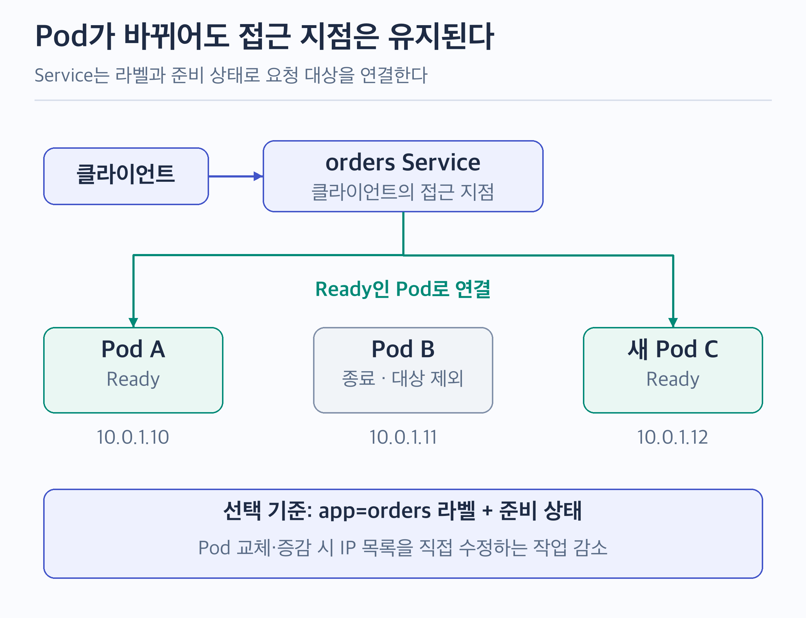
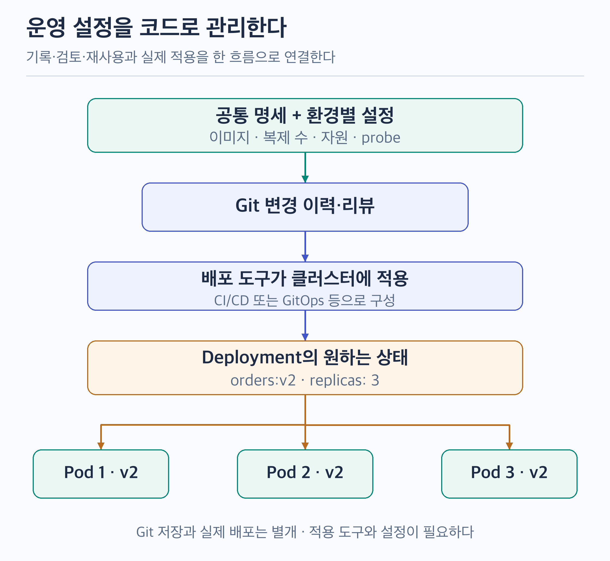

# 실무에서 쿠버네티스가 편해지는 이유

## 1. 서버별 작업을 공통된 운영 방식으로 바꾼다

- **쿠버네티스의 실무적 이점은 컨테이너를 실행하는 데서 끝나지 않고, 배포·연결·복구·확장 작업을 공통 API와 선언적 설정으로 다루는 데 있다.**
- 서버마다 런타임과 네트워크를 구성하고, 요청 대상과 모니터링 설정을 따로 수정하는 반복 작업을 줄일 수 있다.
- 이미지, Pod, Service와 라벨 같은 공통 단위가 생기면 배포 도구와 관측 도구도 같은 기준으로 대상을 관리할 수 있다.
- 처음에 플랫폼과 도구를 연동하는 작업은 필요하다. 그 구성을 재사용하면서 서비스별 수작업과 설정 누락을 줄인다.

## 2. 생태계 도구를 역할별로 연결할 수 있다

| 영역 | 담당하는 일 | 도구·구성요소의 예 |
| :--- | :--- | :--- |
| 빌드·이미지 배포 | 코드를 빌드하고 실행 이미지를 저장한다. | Gradle, Docker와 컨테이너 레지스트리이다. |
| 지속적 통합·배포 | 변경 검증과 배포 명세 적용을 자동화한다. | Jenkins, GitLab CI와 Argo CD 등이다. |
| 실행·네트워크 | 컨테이너를 실행하고 Pod 사이의 통신을 제공한다. | containerd와 CNI 네트워크 플러그인이다. |
| 서비스 접근 | 서비스 이름을 해석하고 요청 대상에 연결한다. | Service와 CoreDNS 등이다. |
| 메트릭·대시보드 | 지표를 수집·저장하고 시각화한다. | Prometheus와 Grafana 등이다. |
| 로그·트레이싱 | 로그를 모으고 서비스 간 요청 흐름을 추적한다. | Loki·Elastic 계열과 Jaeger·Zipkin 등이다. |
| 인프라·설정 관리 | 클러스터 주변 자원과 환경 구성을 관리한다. | Terraform과 Ansible 등이다. |

- 같은 영역의 도구를 모두 도입할 필요는 없다. 이미 사용하는 도구와 실제 운영 요구를 기준으로 필요한 구성을 선택한다.
- 쿠버네티스가 CI/CD, 로그 저장소와 모든 모니터링 기능을 기본 제공하는 것은 아니다. 역할에 맞는 도구를 별도로 설치하거나 관리형 서비스와 연동한다.
- 외부 DB나 메시징 서비스를 사용해도 된다. 생태계에 도구가 있다는 이유만으로 모든 구성요소를 클러스터 안에서 운영하지 않는다.

## 3. 모니터링과 로깅을 개발 초기부터 같은 기준으로 사용한다

- 서비스 개발이 끝난 뒤 운영 직전에 모니터링을 붙이면, 개발 중 보지 못했던 지표와 누락된 수집 대상을 뒤늦게 발견하기 쉽다.
- 공통 수집 체계를 먼저 마련하면 개발 단계부터 응답 시간, 오류와 자원 사용을 확인하고 운영에서도 같은 방식으로 문제를 분석할 수 있다.
- Kubernetes API와 라벨을 이용한 대상 발견을 구성하면 Pod의 생성과 삭제에 맞춰 관측 대상을 갱신할 수 있다.

| 관측 대상 | 공통으로 구성할 내용 | 애플리케이션에서 제공할 내용 |
| :--- | :--- | :--- |
| 메트릭 | 대상 발견 규칙, 수집 주기, 저장과 대시보드를 정한다. | HTTP 요청·오류·지연과 업무 지표를 노출한다. |
| 로그 | 수집 에이전트, 중앙 저장소와 조회 기준을 정한다. | 표준 출력·오류와 일관된 로그 형식을 사용한다. |
| 트레이스 | 수집기와 저장·조회 체계를 구성한다. | 요청 계측과 서비스 간 추적 문맥 전달을 지원한다. |

- **대상이 자동으로 발견되는 것과 필요한 지표가 자동으로 생기는 것은 다르다.** 수집할 엔드포인트와 계측을 애플리케이션에서 준비해야 한다.
- Prometheus는 메트릭 수집·저장을, Grafana는 데이터 소스를 연결한 시각화를 담당한다. Grafana만 설치해서 지표가 수집되지는 않는다.
- Pod가 늘어나거나 교체되어도 관측 대상이 누락되지 않는지 확인한다. 자동 발견 역시 수집 규칙과 권한이 올바르게 구성되어 있어야 한다.

## 4. 연결, 복구, 확장과 버전 교체를 자동화한다

| 기능 | 줄여 주는 반복 작업 | 함께 준비할 조건 |
| :--- | :--- | :--- |
| Traffic Routing | 바뀐 Pod IP를 요청 경로에 매번 반영하는 작업이다. | Service의 라벨 선택자, 네트워크와 readiness 검사를 구성한다. |
| Self-Healing | 종료된 컨테이너를 재시작하거나 부족한 Pod를 다시 만드는 작업이다. | 재시작 정책, 컨트롤러와 적절한 상태 검사를 구성한다. |
| AutoScaling | 부하에 따라 실행 인스턴스 수를 조정하는 작업이다. | HPA, 메트릭 공급 경로와 확장 기준을 설정하고 노드 자원을 확보한다. |
| Rolling Update | 새 버전을 실행하고 준비 상태를 확인하며 이전 버전을 줄이는 작업이다. | Deployment 전략, readiness, 정상 종료와 버전 간 호환성을 준비한다. |

- Self-Healing은 애플리케이션 버그를 고치는 기능이 아니다. 잘못된 설정이나 메모리 누수는 재시작 뒤에도 반복될 수 있다.
- HPA는 Pod 수를 조정한다. 새 Pod를 실행할 노드 자원이 없으면 Pod가 대기할 수 있으며, 노드 확장은 별도의 체계가 필요하다.
- CPU 사용률 기반 HPA는 보통 CPU `requests`를 기준으로 사용률을 계산한다. 메트릭 수집과 자원 설정을 함께 확인한다.
- 롤링 업데이트를 사용해도 무중단이 자동으로 보장되지는 않는다. 새 Pod의 기동 시간, 요청 종료 처리와 DB 스키마 호환성을 검증한다.

## 5. 서버 추가 시 따로 수정하던 설정을 줄인다

| 작업 | 서버별 수작업으로 운영할 때 | 쿠버네티스와 공통 도구를 구성했을 때 |
| :--- | :--- | :--- |
| 실행 환경 준비 | 서버별 JDK·라이브러리 설치 상태를 맞춘다. | 실행 이미지를 재사용하고 이미지 버전으로 배포 대상을 지정한다. |
| 인스턴스 추가 | 서버를 준비하고 프로세스를 실행한다. | 복제 수를 변경하거나 HPA로 Pod 수를 조정한다. |
| 요청 대상 갱신 | 프록시나 웹 서버의 대상 IP 설정을 수정한다. | Service가 선택 조건에 맞는 Pod를 연결 대상으로 반영한다. |
| 관측 대상 갱신 | 새 서버의 수집 설정을 추가한다. | 구성한 발견 규칙에 따라 수집 대상을 갱신한다. |

- VM 환경도 이미지와 자동화 도구로 반복 작업을 줄일 수 있다. 차이는 자동화의 가능 여부보다 공통 리소스와 제어 방식으로 작업을 묶어 관리하는 데 있다.
- Pod가 생성된다고 노드 OS나 JDK가 자동 설치되는 것은 아니다. 노드 실행 환경은 플랫폼에서, 애플리케이션 런타임은 이미지에서 준비한다.
- 새 Pod가 요청을 받기 시작할 때 연결 풀과 DB 부하도 함께 늘어날 수 있으므로 애플리케이션 외부의 한계도 확인한다.

## 6. 운영 설정을 코드로 남기고 환경별로 재사용한다

- Dockerfile과 배포 명세에 실행 환경, 이미지, 복제 수, 자원과 상태 검사 설정을 기록한다.
- Git으로 변경 이유와 이력을 남기면 작업을 검토하고 이전 설정과 비교하기 쉽다.
- 공통 구성과 개발·검증·운영 환경의 차이를 나누면 같은 내용을 반복해서 수정하는 일을 줄일 수 있다.
- 검증된 배포 구성을 다음 서비스에 재사용하고, 반복 작업 대신 상태 검사와 배포 품질 개선에 시간을 쓸 수 있다.

| 코드로 관리할 내용 | 기대 효과 |
| :--- | :--- |
| 이미지 버전·실행 설정 | 어떤 프로그램과 환경을 배포했는지 확인한다. |
| 복제 수·자원·probe | 요청 처리 능력과 복구·배포 조건을 재사용한다. |
| Service와 연결 설정 | 서비스 접근 방식과 변경 내용을 검토한다. |
| 환경별 차이 | 운영과 개발 환경의 차이를 파일에서 확인한다. |

- **Git에 저장하는 일과 실제 클러스터에 적용하는 일은 별개이다.** 명령이나 CI/CD, GitOps 도구 등 적용 경로가 필요하다.
- GitOps 도구는 Git의 명세와 실제 상태를 비교하고, 설정한 동기화 정책에 따라 차이를 반영한다.
- 설정을 이전 버전으로 되돌려도 다시 적용해야 실제 배포에 반영된다. DB 데이터 변경까지 자동으로 되돌아가지는 않는다.
- 환경별 파일을 무작정 복사하면 설정이 어긋날 수 있다. 공통 부분과 환경별 변경값을 구분해 관리한다.

## 7. 최소한의 도구로 전체 흐름을 먼저 경험한다

1. API 서버를 빌드하고 실행 이미지를 만든다.
2. 이미지를 레지스트리에 올리고 Deployment와 Service로 실행·연결한다.
3. 상태 검사와 자원을 설정하고 로그·메트릭을 확인한다.
4. Pod 종료, 복제 수 변경과 버전 교체를 실험하고 요청 처리 상태를 관찰한다.
5. 검증한 명세를 Git과 배포 절차에 연결해 같은 작업을 재현한다.

- 처음부터 생태계의 모든 도구를 익히기보다 빌드, 배포, 접근과 관측이 이어지는 작은 서비스를 완성한다.
- 전체 흐름을 경험한 뒤 업무에 필요한 배포 자동화, 클라우드나 서비스 메시 같은 분야를 깊게 학습한다.
- 새로운 도구는 현재 방식의 어떤 문제를 해결하는지, 추가 운영 부담은 무엇인지 확인한 뒤 적용한다.
- **백엔드 개발자는 실행 이미지를 만들고, 배포·복구 조건을 제공하며, 문제가 생긴 구간을 관측할 수 있어야 한다.**
