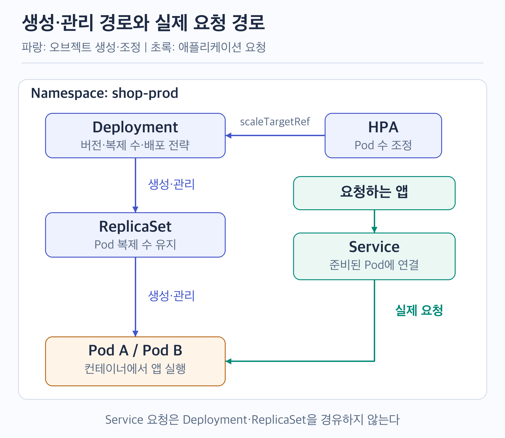
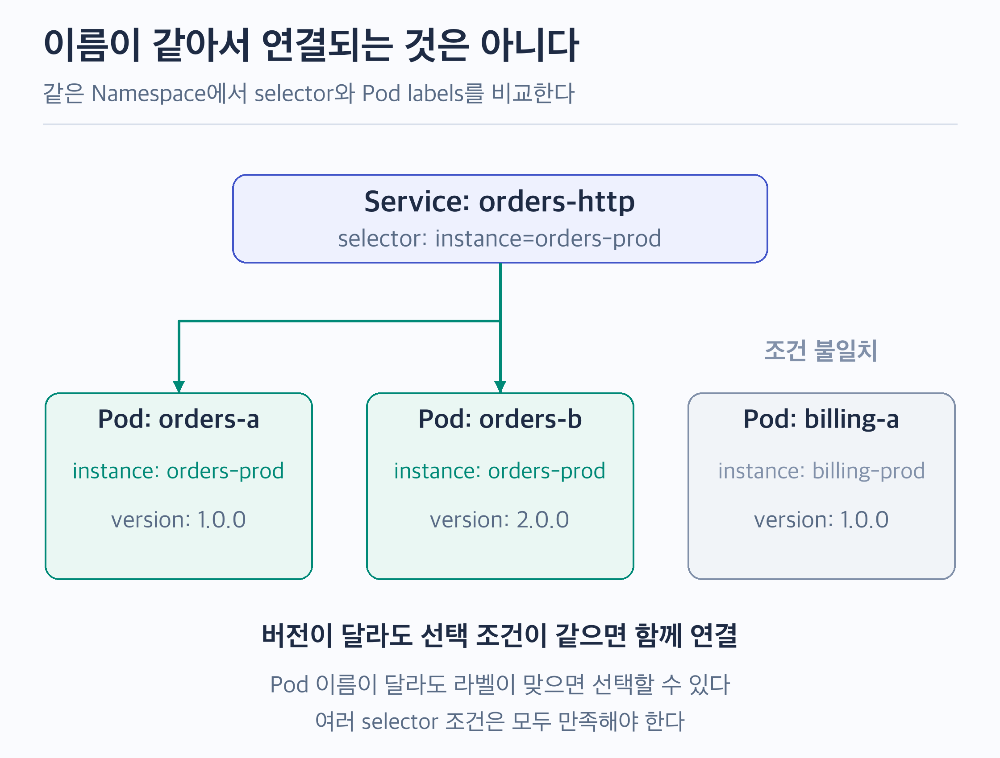
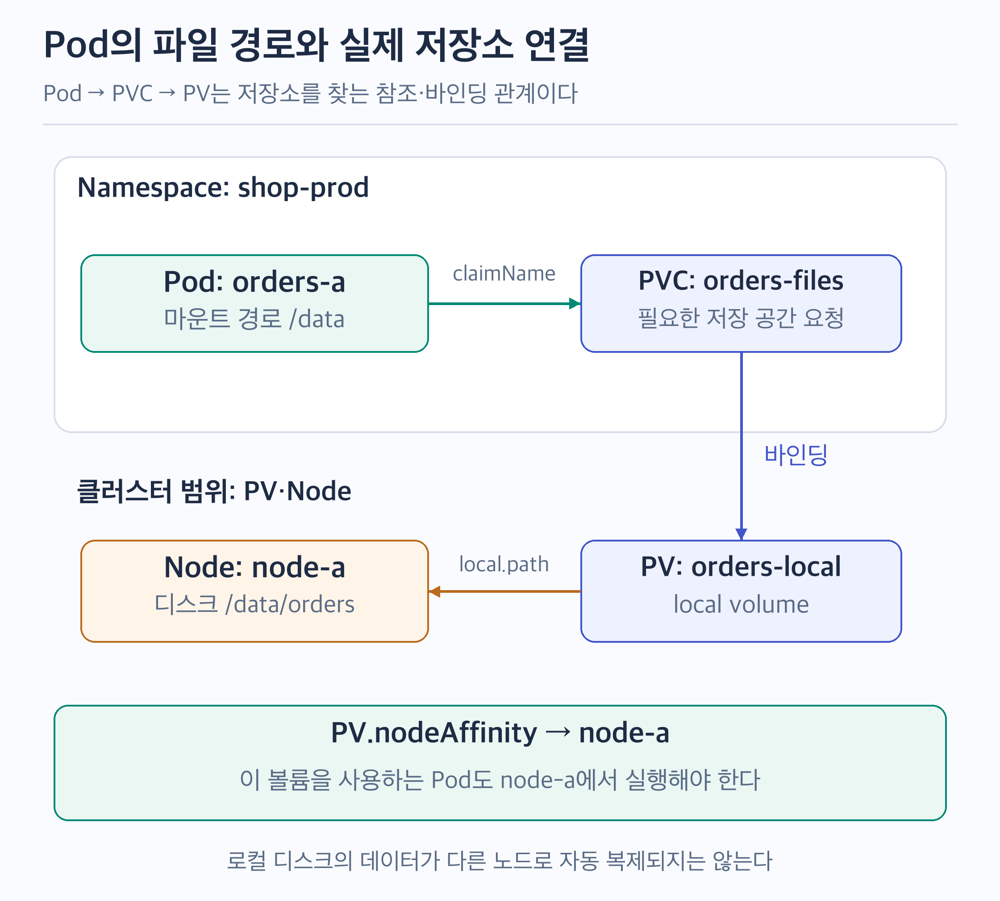

# 쿠버네티스 오브젝트의 역할과 연결 관계 이해하기

## 1. 오브젝트의 범위와 식별 기준을 먼저 확인한다

- **쿠버네티스 오브젝트는 실행, 배포, 연결과 저장 등에 필요한 상태를 API로 표현하는 리소스이다.**
- `apiVersion`과 `kind`로 리소스 종류를, `metadata`로 이름·Namespace·라벨 등을 표현한다. Deployment나 Pod 등은 `spec`에 원하는 상태를 선언한다.
- 모든 리소스의 필드가 같지는 않다. ConfigMap은 `data`, Secret은 `data`나 `stringData` 등으로 값을 제공한다.

| 범위 | 주요 오브젝트 | 이름의 유일성 |
| :--- | :--- | :--- |
| Namespace 범위 | Deployment, ReplicaSet, Pod, Service, HPA, ConfigMap, Secret, PVC이다. | 같은 Namespace에서 같은 종류의 리소스 이름은 중복될 수 없다. |
| 클러스터 범위 | Namespace, Node, PV 등이다. | Namespace에 속하지 않으며 같은 종류의 이름은 클러스터에서 유일해야 한다. |

- Deployment와 Service는 종류가 다르므로 같은 Namespace에서 `orders`라는 이름을 함께 사용할 수 있다.
- `dev`와 `prod`처럼 Namespace가 다르면 같은 종류의 리소스에 같은 이름을 사용할 수 있다.
- Namespace는 리소스를 논리적으로 묶는 단위이다. 네트워크 통신이나 접근 권한까지 자동으로 차단하는 경계는 아니다.
- Namespace를 삭제하면 그 안의 리소스도 삭제된다. PVC 삭제 이후의 저장 데이터 처리는 PV의 반환 정책과 스토리지 구성에 따라 달라진다.

## 2. 생성·관리 경로와 실제 요청 경로를 구분한다

| 오브젝트 | 역할 | 주요 필드 |
| :--- | :--- | :--- |
| Deployment | 앱의 버전과 배포 전략을 관리하고 ReplicaSet을 조정한다. | `selector`, `replicas`, `strategy`, `template`이다. |
| ReplicaSet | 원하는 수의 Pod 복제본을 유지한다. | `selector`, `replicas`, `template`이다. |
| Pod | 하나 이상의 컨테이너를 함께 실행한다. | `containers`, `volumes`, `nodeSelector` 등이다. |
| Service | 선택한 Pod 집합에 접근 지점과 요청 연결을 제공한다. | `selector`, `ports`, `type`이다. |
| HPA | 메트릭을 기준으로 대상 워크로드의 복제 수를 조정한다. | `scaleTargetRef`, `minReplicas`, `maxReplicas`, `metrics`, `behavior`이다. |

- Deployment의 `replicas`는 원하는 Pod 수이고, `strategy`는 버전 교체 방식이다. 실제 Pod 생성과 수 유지는 ReplicaSet이 담당한다.
- `template`은 새 Pod를 만들 때 사용하는 명세이다. 이미지나 Pod 템플릿을 변경하면 Deployment가 새 ReplicaSet을 만들어 배포를 진행한다.
- HPA의 `scaleTargetRef`는 대상의 종류와 이름 등을 참조한다. HPA가 Pod를 직접 생성하거나 Service의 요청을 분산하는 것은 아니다.
- `metrics`는 확장 판단 지표를, `behavior`는 확장·축소 속도와 안정화 동작을 정한다. 최소·최대 복제 수만으로 확장 기준이 완성되지는 않는다.
- **Deployment와 ReplicaSet은 Pod를 관리하는 제어 경로에 있다. 사용자 요청은 Service의 연결 대상인 Pod로 전달된다.**

## 3. 이름, 라벨과 선택자는 서로 다른 역할을 한다

| 개념 | 역할 | 예시 |
| :--- | :--- | :--- |
| `metadata.name` | 특정 오브젝트를 식별한다. | Service 이름은 `orders-http`, Pod 이름은 `orders-a`이다. |
| `metadata.labels` | 오브젝트에 검색·분류·선택에 사용할 키와 값을 붙인다. | Pod에 `instance: orders-prod`와 `version: 1.0.0`을 붙인다. |
| `selector` | 라벨 조건을 만족하는 대상을 고른다. | Service가 `instance: orders-prod`인 Pod를 선택한다. |
| 이름을 참조하는 필드 | 특정 종류와 이름의 리소스를 연결한다. | `scaleTargetRef`, `claimName`, `configMapRef` 등이다. |

- 라벨은 여러 오브젝트에 같은 값으로 붙일 수 있다. 라벨 자체가 리소스 이름처럼 유일성을 보장하지는 않는다.
- 분류용 라벨도 선택자에서 사용하면 실제 동작에 영향을 준다. 정보성·기능성 라벨이 별도의 API 유형으로 나뉘는 것은 아니다.
- 여러 선택 조건을 지정하면 모두 만족하는 대상을 고른다. Service의 일반적인 라벨 선택은 같은 Namespace의 Pod를 대상으로 한다.
- 같은 이름을 쓰거나 같은 라벨을 붙였다는 이유만으로 모든 리소스가 자동 연결되지는 않는다. 리소스별 연결 필드를 확인한다.

### Deployment의 라벨과 Pod 템플릿의 라벨을 구분한다

| 위치 | 의미 |
| :--- | :--- |
| Deployment의 `metadata.labels` | Deployment 오브젝트 자체의 라벨이다. |
| Deployment의 `spec.selector.matchLabels` | 이 Deployment가 관리할 대상을 식별하는 선택 조건이다. |
| Deployment의 `spec.template.metadata.labels` | 새로 생성할 Pod에 붙일 라벨이다. |
| Service의 `spec.selector` | 요청을 전달할 Pod의 라벨 조건이다. |

- Deployment의 선택 조건은 Pod 템플릿의 라벨과 일치해야 한다. Deployment 자체의 라벨만 맞추는 것으로는 부족하다.
- Deployment의 선택자는 생성 후 변경할 수 없으므로 배포 인스턴스를 식별하는 안정적인 라벨을 사용한다.
- 버전처럼 배포마다 바뀌는 값은 일반적인 Deployment 선택자에 넣지 않는다. 버전이 바뀌어도 같은 앱 인스턴스의 관리 관계를 유지해야 한다.
- Service도 버전 라벨을 선택 조건에 넣지 않으면 롤링 업데이트 중 기존 버전과 새 버전의 준비된 Pod를 함께 연결할 수 있다.
- 생성된 리소스의 소유·삭제 관계는 `ownerReferences`로도 관리된다. 라벨 일치만으로 모든 소유 관계가 정해지는 것은 아니다.

## 4. 라벨과 이름에 일관된 규칙을 사용한다

| 권장 라벨 키 | 의미 | 값의 예 |
| :--- | :--- | :--- |
| `app.kubernetes.io/part-of` | 상위 애플리케이션이나 시스템이다. | `commerce`이다. |
| `app.kubernetes.io/component` | 시스템 안의 구성요소 역할이다. | `backend`이다. |
| `app.kubernetes.io/name` | 애플리케이션 이름이다. | `orders`이다. |
| `app.kubernetes.io/instance` | 같은 앱을 여러 번 배포할 때 구분할 배포 인스턴스이다. | `orders-prod`이다. |
| `app.kubernetes.io/version` | 실행 중인 앱 버전이다. | `1.0.0`이다. |
| `app.kubernetes.io/managed-by` | 리소스를 관리하는 도구이다. | `Helm`이나 `kubectl`이다. |

- `name`은 앱의 종류를, `instance`는 그 앱의 특정 배포를 구분한다. 같은 앱을 여러 목적으로 배포할 때 선택 범위가 겹치지 않도록 한다.
- `app.kubernetes.io/` 접두사를 사용하는 공통 규칙을 따르면 배포·관측 도구에서 같은 의미로 활용하기 쉽다. 필수 라벨은 아니다.
- 짧은 `instance`, `version` 같은 사용자 정의 키도 사용할 수 있지만, 팀에서 키와 값의 의미를 일관되게 정한다.
- ConfigMap은 `orders-config`, Secret은 `orders-db`, PVC는 `orders-files`처럼 사용 목적을 이름에 드러낼 수 있다.
- ReplicaSet과 Pod에는 컨트롤러가 접미사를 붙여 이름을 생성한다. 변경될 Pod 이름을 고정된 연결 기준으로 사용하지 않는다.

## 5. Pod 템플릿에서 실행 조건과 주입 대상을 확인한다

| 필드·설정 | 역할 | 확인할 내용 |
| :--- | :--- | :--- |
| `containers[].image` | 실행할 이미지를 지정한다. | 레지스트리, 이미지 버전과 노드 아키텍처의 호환성이다. |
| `env`, `envFrom` | 직접 지정한 값이나 ConfigMap·Secret을 환경변수로 주입한다. | 참조 이름과 필요한 키가 맞는지 확인한다. |
| `startupProbe` | 초기 기동 완료를 확인한다. | 기동 시간이 충분히 허용되는지 확인한다. |
| `readinessProbe` | 요청을 받을 준비가 되었는지 확인한다. | 실패 시 일반적인 Service 요청 대상에서 제외되는지 확인한다. |
| `livenessProbe` | 재시작이 필요한 비정상 상태를 확인한다. | 일시적인 외부 장애를 재시작 조건으로 잘못 사용하지 않는다. |
| `resources.requests`, `resources.limits` | 배치에 필요한 자원량과 사용 상한을 정한다. | CPU·메모리를 앱 특성에 맞게 설정한다. |
| `volumes` | Pod에서 사용할 볼륨과 연결 대상을 정의한다. | PVC·ConfigMap·Secret 등 볼륨의 출처를 확인한다. |
| `containers[].volumeMounts` | 볼륨을 컨테이너 안의 경로에 연결한다. | 볼륨 이름과 마운트 경로가 맞는지 확인한다. |
| `nodeSelector` | 노드 라벨 조건으로 실행 가능한 노드를 제한한다. | 조건을 만족하는 노드와 필요한 자원이 있는지 확인한다. |

- 자원 제한을 생략한다고 노드의 전체 자원을 전용으로 할당받는 것은 아니다. 다른 Pod와 자원을 공유하며 기본 정책이나 노드의 자원 압박에 영향을 받는다.
- `nodeSelector`는 노드의 이름 문자열을 직접 참조하는 필드가 아니라 노드 라벨과 비교하는 조건이다.

## 6. ConfigMap과 Secret은 이름을 참조해 설정을 제공한다

| 오브젝트 | 저장할 내용 | Pod에 제공하는 방식 |
| :--- | :--- | :--- |
| ConfigMap | 서비스 주소, 실행 모드와 설정 파일 등 일반 설정이다. | 환경변수 또는 볼륨 파일로 제공한다. |
| Secret | 비밀번호, 토큰과 인증서 등 민감한 설정이다. | 환경변수 또는 볼륨 파일 등으로 제공한다. |

- Pod가 `envFrom.configMapRef`, `envFrom.secretRef`나 볼륨 설정으로 대상을 참조한다. Pod에서 직접 주입받는 대상은 같은 Namespace에 있어야 한다.
- Secret의 `stringData`는 문자열로 값을 입력하는 편의 필드이다. Secret을 만들었다고 컨테이너 안에 파일이 자동 생성되는 것은 아니며 볼륨 마운트 구성이 필요하다.
- Secret의 `data`에 사용하는 base64는 암호화가 아니다. Secret의 접근 권한과 저장 시 암호화 설정은 별도로 관리한다.
- 환경변수로 주입한 값은 ConfigMap이나 Secret을 변경해도 이미 실행 중인 프로세스에 자동 반영되지 않는다. 컨테이너 재시작이나 Pod 교체 등 반영 방법을 정한다.
- 파일로 제공한 설정도 애플리케이션이 다시 읽어 적용할 수 있어야 실제 동작이 바뀐다.

## 7. PVC는 저장 공간을 요청하고 PV는 실제 저장 자원을 표현한다

| 구성요소 | 역할 | 주요 설정 |
| :--- | :--- | :--- |
| PVC | 앱이 필요한 저장 공간을 요청하는 Namespace 범위 리소스이다. | 요청 용량, `accessModes`, `storageClassName`과 필요 시 `selector`이다. |
| PV | 제공 가능한 저장 자원을 표현하는 클러스터 범위 리소스이다. | `capacity`, `volumeMode`, `accessModes`, 저장소 연결 정보와 반환 정책 등이다. |
| Pod의 볼륨 설정 | 사용할 PVC를 참조하고 컨테이너 경로로 연결한다. | `persistentVolumeClaim.claimName`과 `volumeMounts`이다. |

- **일반적인 사용 관계는 Pod → PVC → PV → 실제 스토리지이다.** PVC와 PV의 이름이 같아야 연결되는 것은 아니다.
- 바인딩에는 용량, 접근 모드, 볼륨 모드와 StorageClass 등의 조건이 사용된다. PVC의 선택자를 지정하면 PV 라벨 조건도 함께 만족해야 한다.
- StorageClass와 프로비저너가 구성되어 있으면 PVC에 맞춰 저장 자원과 PV를 동적으로 생성할 수도 있다. PVC의 선택자가 모든 저장 방식에서 필수인 것은 아니다.
- 비어 있지 않은 PVC `selector`는 동적 프로비저닝을 제한하므로 정적 PV 선택과 동적 생성 방식을 구분한다.
- `ReadWriteOnce`는 한 노드에서 읽기·쓰기로 마운트하는 모드이다. 반드시 Pod 하나만 접근한다는 의미는 아니다.

### 로컬 PV는 저장 장치가 있는 노드의 제약을 받는다

- `local.path`는 특정 노드의 디렉터리나 장치를 가리킨다. PV의 `nodeAffinity`로 그 저장소에 접근할 수 있는 노드를 지정한다.
- 이 PV를 사용하는 Pod는 해당 노드 조건을 만족해야 한다. Pod의 `nodeSelector`와 PV의 `nodeAffinity`가 서로 충돌하면 배치되지 않을 수 있다.
- 경로가 같더라도 다른 노드의 디렉터리는 같은 저장소가 아니다. 로컬 데이터가 다른 노드로 자동 복제되지는 않는다.
- Pod가 교체되어도 저장소를 재사용할 수 있다는 것과 노드 장애에도 데이터를 계속 사용할 수 있다는 것은 별개의 조건이다.

## 8. 오브젝트가 연결되지 않으면 이름보다 연결 필드를 따라 확인한다

| 증상 | 확인할 연결 |
| :--- | :--- |
| Service로 요청이 전달되지 않는다. | Namespace, Service 선택자, Pod 라벨·준비 상태와 `ports` 연결을 확인한다. |
| Pod 수나 버전이 예상과 다르다. | Deployment·ReplicaSet의 복제 수, Pod 템플릿과 HPA의 대상·메트릭을 확인한다. |
| 환경변수나 설정 파일이 없다. | ConfigMap·Secret의 이름, 키, Namespace와 주입·마운트 설정을 확인한다. |
| PVC가 `Pending`이다. | PV·StorageClass, 용량·접근 모드와 선택 조건을 확인한다. |
| 저장소를 사용하는 Pod가 배치되지 않는다. | 볼륨 바인딩 상태, PV의 노드 조건, Pod의 배치 조건과 이벤트를 확인한다. |

- 생성·소유 관계, 라벨로 선택하는 관계와 이름을 참조하는 관계를 구분해 그린다.
- 트래픽 문제는 Service에서 Pod로, 설정 문제는 Pod에서 ConfigMap·Secret으로, 저장 문제는 Pod에서 PVC·PV로 연결을 따라 확인한다.
