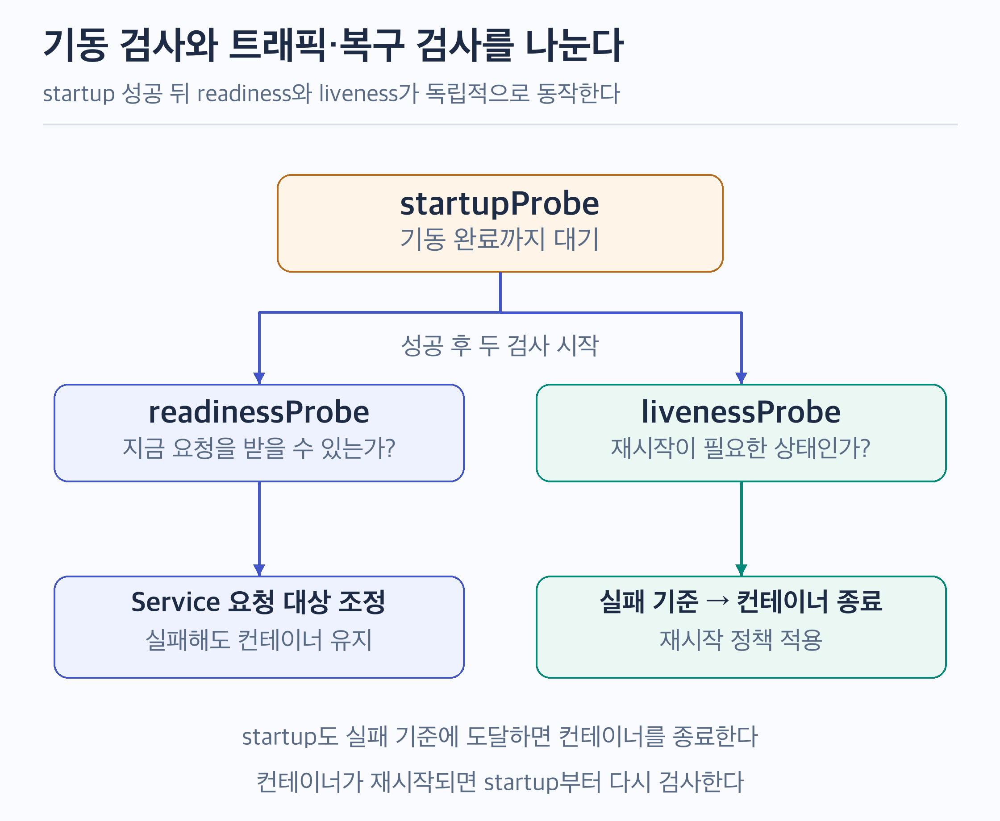
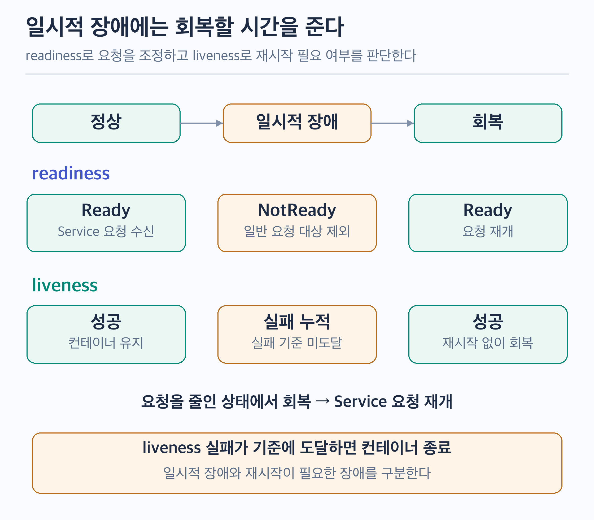

# Pod Probe로 기동, 요청 준비와 복구 조건 나누기

## 1. 프로세스 실행과 정상 서비스 제공은 다르다

- **Probe는 kubelet이 컨테이너의 상태를 검사하고, 그 결과에 따라 요청 대상이나 컨테이너 실행을 조정하는 기능이다.**
- 프로세스가 실행 중이어도 초기 데이터 로딩이 끝나지 않았거나 교착 상태로 요청을 처리하지 못할 수 있다.
- 기동이 완료되었는지, 지금 요청을 받을 수 있는지, 재시작해야 하는지를 서로 다른 기준으로 판단한다.
- 세 Probe는 별도 오브젝트가 아니라 Pod의 `containers[]` 안에 지정하는 컨테이너별 설정이다. 공통 `probe` 필드 하나로 선언하지 않는다.

| Probe | 확인할 질문 | 실패 기준에 도달했을 때 |
| :--- | :--- | :--- |
| `startupProbe` | 앱의 초기 기동이 완료되었는가? | 해당 컨테이너를 종료하고 재시작 정책을 적용한다. |
| `readinessProbe` | 현재 요청을 받아 정상적으로 처리할 준비가 되었는가? | 준비되지 않은 상태로 표시하고 일반적인 Service 요청 대상에서 제외한다. 컨테이너는 계속 실행한다. |
| `livenessProbe` | 재시작이 필요한 비정상 상태인가? | 해당 컨테이너를 종료하고 재시작 정책을 적용한다. |

- Deployment의 Pod처럼 `restartPolicy: Always`인 경우 종료된 컨테이너는 재시작된다.
- **Probe 실패에 따른 컨테이너 재시작과 Pod 삭제·재생성은 다른 동작이다.** 같은 Pod 안의 특정 컨테이너가 재시작될 수 있다.

## 2. Startup 성공 후 Readiness와 Liveness가 독립적으로 동작한다



1. 컨테이너가 시작되면 설정한 Startup Probe로 기동 상태를 확인한다.
2. Startup Probe가 성공하기 전에는 Readiness와 Liveness 검사를 실행하지 않는다.
3. Startup Probe가 성공하면 해당 컨테이너 실행에서는 Startup 검사를 중지하고, Readiness와 Liveness 검사를 시작한다.
4. 앱이 살아 있지만 초기 데이터 로딩 등이 남아 있다면 Liveness는 성공하고 Readiness는 실패할 수 있다.
5. Readiness가 성공해 Pod가 준비되면 Service의 일반 요청 대상에 포함될 수 있다.
6. 이후에는 두 검사가 독립적으로 계속 동작한다. 컨테이너가 재시작되면 Startup 검사부터 다시 수행한다.

| 앱 상태 | 검사 결과의 예 | 기대하는 운영 동작 |
| :--- | :--- | :--- |
| 런타임·프레임워크 초기화 중 | Startup 실패가 누적된다. | 기동 허용 범위 안에서 기다린다. |
| 서버는 응답하지만 업무 준비 중 | Startup 성공, Liveness 성공, Readiness 실패이다. | 프로세스를 유지하면서 Service 요청은 받지 않는다. |
| 정상 서비스 중 | Readiness와 Liveness가 성공한다. | 요청을 처리한다. |
| 일시적으로 요청 처리가 어렵다. | Readiness가 실패할 수 있다. | 일반 요청 대상에서 제외하고 회복을 기다린다. |
| 복구되지 않는 교착 상태 등이다. | Liveness 실패가 기준에 도달한다. | 컨테이너를 종료하고 재시작 정책을 적용한다. |

- Liveness가 Readiness 성공을 기다리는 것은 아니다. 업무 초기화가 남아 있어도 앱이 정상적으로 진행 중이라면 Liveness가 성공할 수 있다.
- Startup Probe를 생략했다면 나머지 검사는 각각의 지연 설정에 따라 시작한다. 느린 기동을 너무 이른 Liveness 검사로 실패시키지 않도록 한다.

## 3. 상태 검사 API와 요청 차단의 범위를 구분한다

| 검사 방식 | 성공 기준 | 확인할 점 |
| :--- | :--- | :--- |
| `httpGet` | 지정 경로의 HTTP 응답 코드가 200 이상 400 미만이다. | 경로, 포트와 앱의 응답 상태가 맞는지 확인한다. |
| `tcpSocket` | 지정 포트에 TCP 연결이 가능하다. | 포트가 열려 있다는 것만으로 업무 처리까지 정상임을 보장하지는 않는다. |
| `exec` | 컨테이너 안에서 실행한 명령이 종료 코드 0을 반환한다. | 명령 실행 비용과 실행 환경을 확인한다. |
| `grpc` | gRPC Health Checking Protocol의 상태가 `SERVING`이다. | 앱이 해당 상태 검사 프로토콜을 구현해야 한다. |

- HTTP Probe는 기본적으로 kubelet이 Pod IP의 지정 포트와 경로를 호출한다. 사용자처럼 Service를 거쳐 요청하는 검사가 아니다.
- `/startup`, `/readiness`, `/liveness`는 앱에서 제공하도록 정한 경로의 예시이다. 쿠버네티스가 이 API를 대신 만들어 주지는 않는다.
- Readiness는 Pod의 라벨이나 Service 선택자를 변경하지 않고 준비 상태를 바꾼다. 그 결과가 일반적인 Service 전달 대상에 반영된다.
- **Readiness 실패는 네트워크 접근을 전부 금지하는 기능이 아니다.** Pod IP 직접 접근이나 이미 맺어진 연결까지 일괄 차단하는 것은 아니다.
- 따라서 Pod 안에서 업무 API 호출은 성공해도 Service 경유 요청은 전달되지 않을 수 있다. 요청을 보낸 위치와 경로를 구분해 확인한다.

## 4. 검사 간격, 시간 제한과 연속 실패 횟수를 함께 정한다

| 필드 | 의미 | 기본값·제약 |
| :--- | :--- | :--- |
| `initialDelaySeconds` | 첫 검사를 시작하기 전에 기다리는 시간이다. | 기본값은 0초이다. Startup이 있으면 후속 검사의 지연도 Startup 성공 후 시작한다. |
| `periodSeconds` | 검사를 수행하는 주기이다. | 기본값은 10초이다. |
| `timeoutSeconds` | 한 번의 검사 응답을 기다리는 제한 시간이다. | 기본값은 1초이다. |
| `failureThreshold` | 전체 검사 실패로 판단하기 위한 연속 실패 횟수이다. | 기본값은 3회이다. |
| `successThreshold` | 실패 이후 성공으로 판단하기 위한 연속 성공 횟수이다. | 기본값은 1회이며 Startup과 Liveness는 반드시 1이다. |

- 한 번의 실패가 곧바로 재시작을 뜻하지는 않는다. 설정한 연속 실패 기준에 도달했을 때 Probe별 조치를 수행한다.
- Readiness가 아직 성공하지 않았다면 처음부터 준비되지 않은 상태이다. 첫 요청 수락과 준비 상태에서의 연속 실패 판정을 구분한다.
- 기동 허용 시간은 대략 `periodSeconds × failureThreshold`를 기준으로 잡는다. 초기 지연, 검사 시점과 실행 시간 등을 함께 고려하며 정확한 종료 시각을 보장하는 계산으로 사용하지 않는다.
- 예를 들어 Startup을 5초 주기·24회 실패로 구성하면 약 120초 규모의 기동 시간을 허용하도록 설계할 수 있다.
- 요청 제한 시간은 상태 검사 API의 정상 응답 시간과 부하 시 지연을 고려해 정한다. 너무 짧으면 정상 앱도 실패로 판단할 수 있다.

## 5. 기동 허용 범위와 운영 중 실패 기준을 따로 설정한다

- 다음은 컨테이너 설정에 넣을 Probe 부분의 예시이다. 각 경로를 앱에서 구현하고 실제 기동·회복 시간을 측정해 값을 조정한다.

```yaml
startupProbe:
  httpGet:
    path: /startup
    port: 8080
  periodSeconds: 5
  timeoutSeconds: 2
  failureThreshold: 24
  successThreshold: 1
readinessProbe:
  httpGet:
    path: /readiness
    port: 8080
  periodSeconds: 10
  timeoutSeconds: 2
  failureThreshold: 3
  successThreshold: 1
livenessProbe:
  httpGet:
    path: /liveness
    port: 8080
  periodSeconds: 10
  timeoutSeconds: 2
  failureThreshold: 6
  successThreshold: 1
```

- Startup에는 느린 기동을 허용하고, Readiness에는 요청 수락 여부를 판단하는 기준을 적용한다.
- 예시에서는 Liveness가 Readiness보다 더 많은 연속 실패를 허용한다. 일시적 장애 중 불필요한 재시작을 줄이기 위한 구성이며 모든 서비스의 권장값은 아니다.
- Spring Boot에서는 Actuator의 `/actuator/health/liveness`와 `/actuator/health/readiness`를 활용할 수 있다. 실제 노출 상태와 경로·포트 설정을 확인한다.
- 상태 검사만 별도 관리 포트에서 성공하고 실제 업무 포트는 응답하지 못하는 상황도 있다. 검사가 서비스 제공 가능성을 제대로 반영하는지 확인한다.

## 6. 일시적 장애를 불필요한 재시작으로 키우지 않는다



- 일시적인 과부하나 스레드 풀 포화는 요청 유입이 줄면 회복될 수 있다. 이때 Readiness로 일반 요청 대상을 조정하면서 프로세스를 유지할 수 있다.
- Liveness가 너무 민감하면 회복 가능한 앱을 재시작하고, 초기화 비용과 남은 Pod의 부하를 늘려 장애를 키울 수 있다.
- 반대로 재시작이 필요한 상태를 지나치게 오래 허용하면 처리 가능한 용량이 줄어든 채로 남는다. 실패 기준은 실제 회복 시간과 장애 영향을 근거로 조정한다.
- 모든 Pod가 동시에 준비되지 않은 상태가 되면 요청을 처리할 대상이 사라질 수 있다. Readiness만으로 과부하 제어 전체를 해결하려 하지 않는다.
- DB나 외부 API의 일시적 장애를 Liveness 실패로 연결하면 API 서버를 재시작해도 원인이 해결되지 않는다. Liveness는 앱 자체의 복구 필요 상태를 중심으로 설계한다.
- 외부 의존성을 Readiness에 포함할지는 그 의존성이 필수인지, 다른 기능은 계속 제공할 수 있는지와 대체 응답 가능성을 고려해 정한다.
- 계속 증가하는 메모리 누수나 회복 불가능한 교착 상태를 단순한 일시적 장애와 같게 취급하지 않는다.
- 상태 검사 API 자체도 가볍게 만든다. 매번 무거운 DB 조회나 긴 외부 호출을 실행하면 검사가 부하와 오탐을 늘릴 수 있다.

## 7. 로그, 이벤트와 실제 요청 경로를 함께 검증한다

| 실험 상황 | 확인할 결과 |
| :--- | :--- |
| 초기 기동 시간을 늘린다. | Startup 허용 범위 안에서 불필요하게 재시작되지 않는지 확인한다. |
| 서버 기동 뒤 업무 초기화를 지연한다. | Liveness는 성공하고 Readiness는 실패하며 Service 요청이 전달되지 않는지 확인한다. |
| 준비 상태를 실패로 바꾼다. | 프로세스와 컨테이너 재시작 횟수는 유지되고 Service 전달 대상이 조정되는지 확인한다. |
| 준비 상태를 복구한다. | 연속 성공 기준과 상태 전파 후 요청을 다시 받는지 확인한다. |
| 복구 불가능한 장애를 재현한다. | Liveness 실패 기준 도달 후 해당 컨테이너가 재시작되는지 확인한다. |
| 짧은 과부하를 재현한다. | 불필요한 재시작 없이 회복하고 남은 Pod에 장애가 확산되지 않는지 확인한다. |

```bash
kubectl get pods -n <namespace>
kubectl describe pod <pod> -n <namespace>
kubectl logs <pod> -n <namespace> -c <container>
kubectl logs <pod> -n <namespace> -c <container> --previous
kubectl get endpointslices -n <namespace>
```

- 이벤트의 `Unhealthy`, 응답 코드와 타임아웃, Pod 준비 상태와 컨테이너 재시작 횟수를 같은 시간대에 비교한다.
- HTTP 서버가 아직 열리지 않았다면 앱의 업무 로그에 검사 기록이 남지 않을 수 있다. kubelet이 기록한 실패 이벤트와 서버 접근 로그도 확인한다.
- 검사 결과가 바뀐 시각과 Service 요청 대상에 반영된 시각은 완전히 같지 않을 수 있다. 상태 전파 지연과 실제 요청 성공 여부를 함께 관찰한다.
