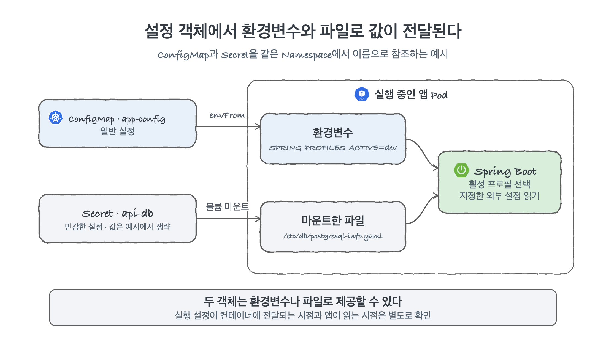
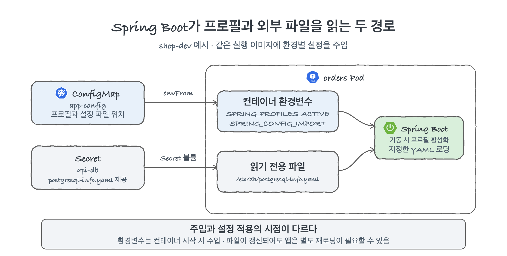
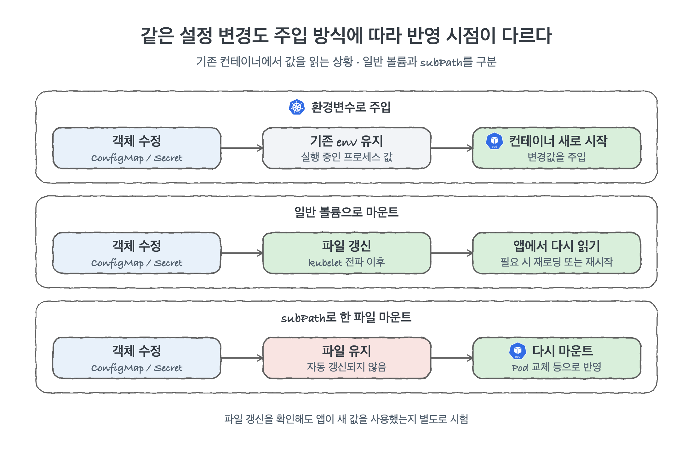

# ConfigMap과 Secret으로 실행 설정 분리하기

## 1. 실행 이미지와 환경별 설정을 분리한다

- **ConfigMap과 Secret은 애플리케이션 이미지에 환경별 값을 고정하지 않고, 실행 시 필요한 설정을 제공하는 리소스이다.**
- 같은 이미지를 개발·검증·운영에 사용하면서 프로필, 연결 주소와 인증 정보 등을 환경에 맞게 주입할 수 있다.
- 둘 다 Namespace 범위 리소스이며, Pod의 환경변수나 볼륨에서 직접 참조할 때는 같은 Namespace에 있어야 한다.

| 구분 | ConfigMap | Secret |
| :--- | :--- | :--- |
| 목적 | 일반적인 실행 설정을 제공한다. | 비밀번호, 토큰, 인증서 등 민감한 설정을 제공한다. |
| 주요 데이터 필드 | 문자열은 `data`, 바이너리 데이터는 `binaryData`이다. | base64 표현의 `data`와 문자열 입력용 `stringData`이다. |
| 제공 방식 | 환경변수 또는 볼륨 파일 등이다. | 환경변수 또는 볼륨 파일 등이다. |
| 사용 예 | 실행 프로필, 서비스 주소와 설정 파일 경로이다. | DB 인증 정보, 이미지 저장소 인증과 TLS 인증서이다. |

- ConfigMap을 만들었다고 앱의 환경변수가 자동으로 바뀌거나, Secret을 만들었다고 파일이 자동 생성되는 것은 아니다. Pod에 주입·마운트 관계를 선언해야 한다.
- Secret을 파일로만, ConfigMap을 환경변수로만 사용해야 하는 것은 아니다. 앱이 설정을 읽는 방식에 맞춰 선택한다.

## 2. 환경변수와 파일은 서로 다른 주입 경로이다



그림의 근거 · [ConfigMap](https://kubernetes.io/docs/concepts/configuration/configmap/) · [Secret](https://kubernetes.io/docs/concepts/configuration/secret/) · [Spring Boot 외부 설정](https://docs.spring.io/spring-boot/reference/features/external-config.html)

| 방식 | Pod에서 지정할 필드 | 동작 |
| :--- | :--- | :--- |
| 전체 키를 환경변수로 주입 | `envFrom.configMapRef` 또는 `envFrom.secretRef`이다. | 참조한 리소스의 키·값을 환경변수로 제공한다. |
| 특정 키만 환경변수로 주입 | `env[].valueFrom.configMapKeyRef` 또는 `secretKeyRef`이다. | 필요한 키를 선택하고 환경변수 이름을 따로 지정할 수 있다. |
| 볼륨으로 파일 제공 | Pod의 `volumes`와 컨테이너의 `volumeMounts`이다. | 참조한 데이터의 키를 파일 이름으로, 값을 파일 내용으로 제공한다. |

- 볼륨을 선언한 이름과 `volumeMounts[].name`을 맞추고, `mountPath`에 컨테이너 안의 디렉터리를 지정한다.
- 예를 들어 Secret의 키가 `postgresql-info.yaml`이고 마운트 경로가 `/etc/db`라면 파일은 `/etc/db/postgresql-info.yaml`로 제공된다.
- 앱은 이 환경변수나 파일을 실제로 읽어야 한다. 임의의 파일 경로를 환경변수로 전달하는 것만으로 모든 프레임워크가 자동 로딩하지는 않는다.
- 볼륨을 기존 파일이 있는 디렉터리에 마운트하면 이미지에 있던 파일이 가려질 수 있다. 설정 전용 경로를 사용한다.

## 3. Spring Boot에서는 프로필과 외부 설정 로딩을 연결한다

- `SPRING_PROFILES_ACTIVE`로 `spring.profiles.active`를 지정하면 활성 프로필에 맞는 설정을 사용할 수 있다.
- `SPRING_CONFIG_IMPORT`에 외부 YAML 경로를 지정하면 해당 파일을 Spring 설정으로 가져올 수 있다.
- 다음은 `shop-dev` Namespace가 이미 있고, Spring Boot 실행 이미지가 환경변수를 읽는다고 가정한 구성 예시이다. 인증 값은 실제 자격증명이 아닌 자리표시자이다.

```yaml
apiVersion: v1
kind: ConfigMap
metadata:
  name: app-config
  namespace: shop-dev
data:
  SPRING_PROFILES_ACTIVE: "dev"
  SPRING_CONFIG_IMPORT: "file:/etc/db/postgresql-info.yaml"
---
apiVersion: v1
kind: Secret
metadata:
  name: api-db
  namespace: shop-dev
type: Opaque
stringData:
  postgresql-info.yaml: |
    spring:
      datasource:
        url: "jdbc:postgresql://postgresql:5432/app"
        username: "<DB_USERNAME>"
        password: "<DB_PASSWORD>"
---
apiVersion: v1
kind: Pod
metadata:
  name: api
  namespace: shop-dev
spec:
  containers:
    - name: api
      image: registry.example.com/orders:1.0.0
      envFrom:
        - configMapRef:
            name: app-config
      volumeMounts:
        - name: db-config
          mountPath: /etc/db
          readOnly: true
  volumes:
    - name: db-config
      secret:
        secretName: api-db
```

- ConfigMap은 사용할 프로필과 설정 파일 위치를 전달하고, Secret은 파일 내용을 제공한다. 앱은 기동 시 외부 파일을 읽어 DB 설정을 구성한다.
- 실행 인자나 JVM 시스템 속성에 같은 설정을 지정하면 환경변수보다 우선할 수 있다. 최종 설정값이 예상과 다르면 설정의 우선순위를 확인한다.
- Kubernetes의 `command`·`args`에서 환경변수를 치환할 때는 `$(VAR_NAME)` 형식을 사용한다. 셸을 실행하지 않는 인자에 `${VAR_NAME}`을 적었다고 셸 방식으로 자동 확장되지는 않는다.
- Spring Boot가 환경변수를 직접 해석하는 방식과, 실행 명령을 만들 때 문자열을 치환하는 방식은 구분한다.



그림의 근거 · [Kubernetes ConfigMap 주입](https://kubernetes.io/docs/concepts/configuration/configmap/) · [Kubernetes Secret](https://kubernetes.io/docs/concepts/configuration/secret/) · [Spring Boot 외부 설정](https://docs.spring.io/spring-boot/reference/features/external-config.html) · [Spring Boot 프로필](https://docs.spring.io/spring-boot/reference/features/profiles.html)

## 4. 객체 변경, 컨테이너 반영과 앱 적용을 구분한다



그림의 근거 · [ConfigMap 변경 반영](https://kubernetes.io/docs/concepts/configuration/configmap/) · [Secret 변경 반영](https://kubernetes.io/docs/concepts/configuration/secret/)

| 주입 방식 | ConfigMap·Secret을 수정한 뒤 | 앱에 적용하려면 |
| :--- | :--- | :--- |
| 환경변수 | 이미 실행 중인 프로세스의 값은 바뀌지 않는다. | 컨테이너를 새로 시작하거나 Pod를 교체해 새 값을 주입한다. |
| 일반적인 볼륨 마운트 | kubelet의 동기화에 따라 파일 내용이 나중에 갱신될 수 있다. | 앱이 파일을 다시 읽고 필요한 상태를 갱신해야 한다. |
| `subPath` 마운트 | 마운트된 파일의 자동 갱신을 받지 않는다. | Pod 교체 등으로 새 마운트를 구성한다. |
| 앱이 기동 시에만 읽는 설정 | 파일이 바뀌어도 이미 메모리에 읽은 값은 유지될 수 있다. | 앱 재시작이나 별도 설정 재로딩 기능이 필요하다. |

- **설정 객체가 수정된 것, 파일이 갱신된 것, 앱의 실제 동작이 바뀐 것은 서로 다른 단계이다.**
- 설정 파일을 다시 읽어도 이미 생성한 DB 연결 풀이나 클라이언트가 자동으로 재구성되는지는 앱 구현에 따라 다르다.
- 같은 이름의 ConfigMap이나 Secret만 수정하면 Deployment의 Pod 템플릿이 바뀌지 않으므로 롤링 업데이트가 자동으로 시작되지는 않는다.
- 변경 후 Pod 교체를 배포 절차에 포함하거나, 버전별 설정 이름·체크섬 등으로 Pod 템플릿도 갱신하는 방법을 사용할 수 있다.
- 단일 Pod를 수동 삭제하는 방법과 Deployment를 통한 점진적 교체는 가용성에 미치는 영향이 다르다. 운영 중 반영 절차를 미리 정한다.

## 5. 환경별 값과 관리 책임을 함께 정한다

- 개발·검증·운영에 같은 이미지 버전을 배포하고, 각 환경의 ConfigMap과 Secret으로 차이를 제공한다.
- Namespace를 나누면 각 환경에서 `app-config`, `api-db`처럼 같은 이름을 사용할 수도 있다. 환경이 달라도 참조 구조를 유지하기 쉽다.
- 이미지가 같아도 설정값이 다르면 앱의 동작은 달라진다. 배포를 추적할 때 이미지 버전과 설정 변경을 함께 기록한다.

| 관리할 내용 | 합의할 책임 |
| :--- | :--- |
| 설정 키·기본값·필수값 | 앱이 어떤 값을 읽고 누락 시 어떻게 동작하는지 정한다. |
| 배포 시 값 선택과 검증 | 대상 환경, 참조 이름과 반영 절차를 확인한다. |
| 민감한 값과 접근 권한 | 자격증명을 누가 발급·변경하고 어떤 앱이 사용할지 정한다. |
| 변경 이후의 검증·복구 | 적용 여부를 확인하고 문제 시 되돌릴 방법을 정한다. |

- 앱 코드, CI/CD 스크립트와 서버 환경에 흩어져 있던 값을 공통 리소스로 관리할 수 있다. 다만 값을 옮겼다고 관리 주체와 변경 책임까지 자동으로 정해지지는 않는다.
- 환경별 값을 무작정 이미지에 넣거나 배포 스크립트에 중복하지 않고, 어떤 계층에서 어떤 설정을 관리할지 합의한다.

## 6. Secret의 데이터 표현과 보안 관리를 구분한다

- Secret의 `stringData`는 문자열로 값을 입력하는 쓰기 전용 편의 필드이다. 입력한 값은 `data`에 병합되며 일반 조회 결과에는 `stringData`가 반환되지 않는다.
- Secret의 API 표현에서 `data` 값은 base64 문자열이다. 컨테이너에 주입될 때는 원래 값이나 파일 내용으로 제공되므로 앱이 base64를 다시 해독할 필요는 없다.
- **base64는 암호화가 아니다. Secret을 읽을 권한이 있으면 원래 값을 알아낼 수 있다.** 저장 시 암호화와 접근 권한은 별도로 구성한다.
- 실제 자격증명을 소스 코드나 평문 배포 파일에 넣지 않고, 필요한 앱과 담당자에게만 접근을 허용한다.

| Secret 유형 | 용도 | 연결할 위치 |
| :--- | :--- | :--- |
| `Opaque` | DB 인증 정보 등 임의의 민감한 데이터를 제공한다. | 앱의 환경변수나 볼륨에서 참조한다. |
| `kubernetes.io/dockerconfigjson` | 비공개 이미지 저장소 인증 정보를 제공한다. | Pod의 `imagePullSecrets` 등에서 참조해 이미지 다운로드에 사용한다. |
| `kubernetes.io/tls` | TLS 인증서와 개인 키를 제공한다. | 해당 Secret을 사용하는 서버나 인그레스 등의 TLS 설정에서 참조한다. |

- Secret의 `type`은 데이터의 용도와 형식을 구분한다. 타입 이름만으로 앱에 주입되거나 인증이 자동 완성되지는 않는다.
- 클러스터 안에서 직접 관리하거나, Vault 같은 외부 비밀 관리 시스템과 연동할 수 있다. 외부 연동도 인증·주입·갱신 경로를 구성해야 한다.
- 자체 암호화를 추가한다면 복호화 키의 보관·권한·교체 책임이 생긴다. 암호문과 키를 같은 접근 범위에 함께 두는 방식만으로 보호가 완성되지는 않는다.
- 자격증명 교체는 Secret 수정에서 끝나지 않는다. 앱에 새 값이 반영되고 기존 연결이 필요한 방식으로 갱신되는지 확인한다.

## 7. 리소스, 주입 결과와 앱의 실제 사용값을 순서대로 확인한다

| 단계 | 확인할 내용 |
| :--- | :--- |
| 리소스 확인 | ConfigMap·Secret의 이름, Namespace와 필요한 키가 맞는지 확인한다. |
| Pod 참조 확인 | `envFrom`, `valueFrom`, `volumes`와 `volumeMounts`가 대상을 정확히 가리키는지 확인한다. |
| 컨테이너 내부 확인 | 일반 환경변수 값과 파일의 존재·읽기 권한을 확인한다. |
| 앱 동작 확인 | 활성 프로필, 외부 설정 로딩과 DB 연결 등 기대 동작을 확인한다. |
| 변경 반영 확인 | 수정 전후에 Pod 교체·파일 갱신·앱 재로딩 중 어떤 단계가 필요한지 확인한다. |

```bash
kubectl get configmaps,secrets -n <namespace>
kubectl describe pod <pod> -n <namespace>
kubectl exec <pod> -n <namespace> -c <container> -- printenv SPRING_PROFILES_ACTIVE
kubectl exec <pod> -n <namespace> -c <container> -- test -r /etc/db/postgresql-info.yaml
kubectl logs <pod> -n <namespace> -c <container>
```

- 컨테이너 이미지에 `printenv`나 `test` 같은 실행 도구가 있어야 예시 명령을 사용할 수 있다.
- 파일 경로가 맞아도 앱이 읽는 설정 경로가 다르거나 더 높은 우선순위의 값이 있으면 기대와 다르게 동작할 수 있다.
- 디버깅 로그나 설정 조회 API에 비밀번호·토큰 등 전체 설정을 노출하지 않는다. 민감한 값은 마스킹하고 필요한 동작 중심으로 확인한다.
