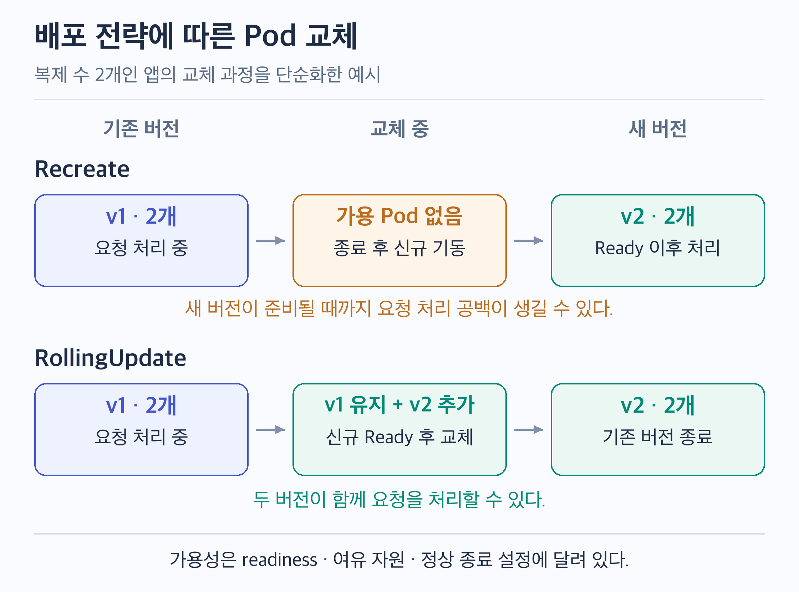
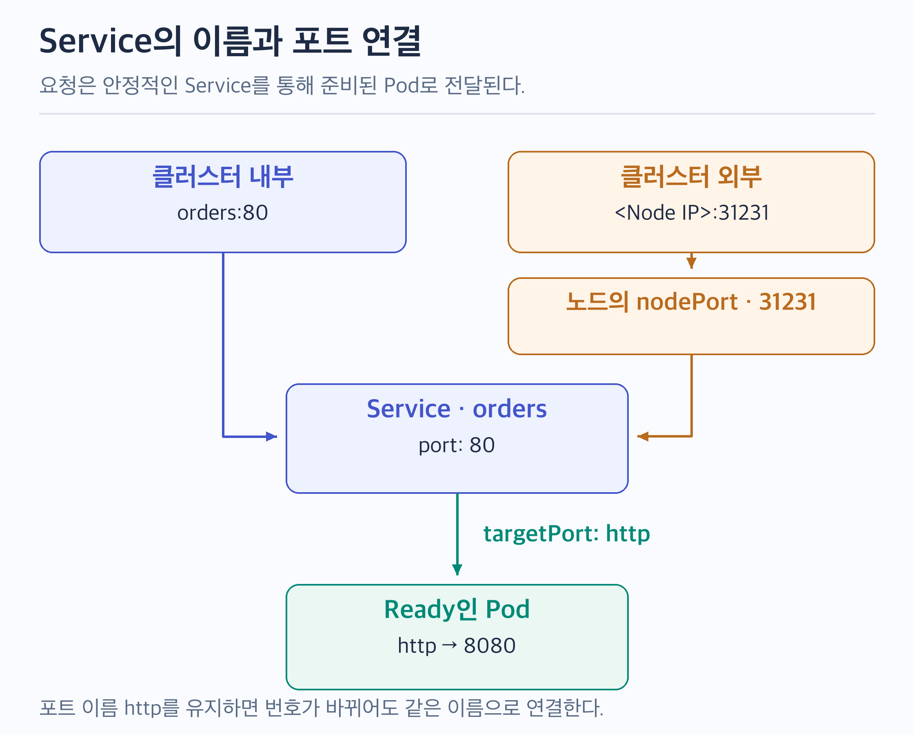
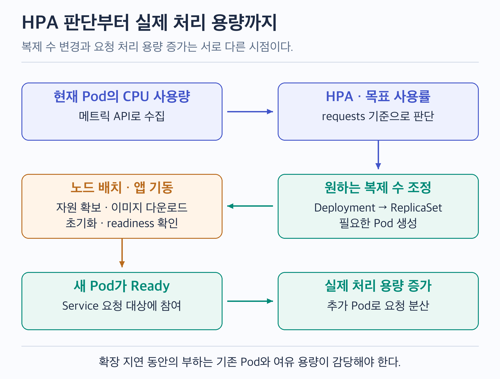

# PV·PVC, Deployment, Service, HPA로 앱 운영하기

## 1. 앱의 저장, 배포, 연결과 확장을 나눠 관리한다

| 운영 요구 | 담당 리소스 | 앱 개발자가 확인할 내용 |
| :--- | :--- | :--- |
| Pod를 교체해도 파일을 유지한다. | PV·PVC이다. | 저장 경로, 접근 모드와 노드 장애 시 데이터 유지 여부이다. |
| 새 버전으로 Pod를 교체한다. | Deployment이다. | 배포 전략, 기동 시간과 버전 간 호환성이다. |
| Pod가 바뀌어도 같은 주소로 호출한다. | Service이다. | 선택자, 준비 상태, DNS 이름과 포트 연결이다. |
| 부하에 따라 Pod 수를 조절한다. | HPA이다. | 메트릭, 자원 요청량, 복제 수 범위와 확장 지연이다. |

- **리소스가 선언한 상태와 실제로 요청을 처리할 수 있는 상태를 구분한다.** Pod 수가 늘어도 기동이 끝나지 않으면 처리 용량은 바로 늘지 않는다.
- 저장소의 접근 제약, 배포 중 추가 자원과 Service의 연결 대상은 서로 영향을 준다. 각 리소스의 설정을 따로 보는 것만으로 운영 동작을 판단하기 어렵다.

## 2. PV·PVC는 Pod의 수명과 저장 데이터의 수명을 분리한다

- 컨테이너의 쓰기 가능 계층에 저장한 파일은 컨테이너를 새로 만들 때 유지되지 않는다. `emptyDir`도 Pod가 삭제되면 함께 사라지므로 장기 보관용 저장소가 아니다.
- **PVC는 필요한 저장 공간을 요청하고, Pod는 PVC에 바인딩된 PV를 통해 실제 스토리지를 사용한다.** Pod의 `volumes[].persistentVolumeClaim.claimName`으로 PVC를 참조하고 컨테이너에는 `volumeMounts[].mountPath`로 파일 경로를 제공한다.
- PVC는 Namespace 범위이고 PV는 클러스터 범위이다. Pod가 참조하는 PVC는 같은 Namespace에 있어야 하며, 하나의 PV는 하나의 PVC와 바인딩된다.

| 저장 방식 | 연결 방법 | 유지 범위와 제약 |
| :--- | :--- | :--- |
| `hostPath` | Pod가 노드의 경로를 직접 마운트한다. | 같은 노드의 파일을 재사용할 수 있지만, 다른 노드의 같은 경로에는 다른 데이터가 있다. |
| `local` PV | 노드의 디스크·경로를 PV로 표현하고 PVC로 연결한다. | PV의 `nodeAffinity`에 따라 Pod가 실행될 노드가 제한된다. |
| 네트워크·클라우드 스토리지 | NFS나 CSI 드라이버 등으로 외부 저장소를 연결한다. | 노드 교체 시 재연결 가능 여부, 동시 접근과 장애 복구는 저장소·드라이버의 지원에 달려 있다. |

- `hostPath`는 노드 로그 수집처럼 노드의 파일에 접근해야 하는 앱이나 테스트에 사용할 수 있다. 호스트 파일 권한과 노드별 경로 차이도 관리해야 한다.
- 로컬 PV는 저장 장치가 있는 노드의 장애를 자동으로 해결하지 않는다. 운영에 사용한다면 데이터 복제, 백업과 복구 절차를 함께 설계한다.
- PVC의 용량·접근 모드·StorageClass 등에 맞는 PV가 바인딩된다. 프로비저너가 구성되어 있으면 PVC 요청에 따라 저장소와 PV를 동적으로 만들 수도 있다.
- 이 연결 구조는 앱에서 저장소 구현을 분리하는 데 도움이 된다. 이미 사용 중인 PV의 경로나 저장 장치를 임의로 바꿔도 무중단으로 이전된다는 의미는 아니다.

### 접근 모드와 삭제 정책을 함께 확인한다

| 설정 | 의미 | 주의할 점 |
| :--- | :--- | :--- |
| `ReadWriteOnce` | 한 노드에서 읽기·쓰기로 마운트할 수 있다. | Pod 하나만 사용한다는 뜻은 아니다. 여러 노드의 동시 쓰기는 별도 지원이 필요하다. |
| `ReadWriteMany` | 여러 노드에서 읽기·쓰기로 마운트할 수 있다. | 실제 스토리지와 드라이버가 이 모드를 지원해야 한다. |
| 반환 정책 `Retain` | PVC 해제 후 저장 자원과 데이터를 보존한다. | 재사용·정리 작업을 관리자가 처리해야 한다. |
| 반환 정책 `Delete` | PVC 해제 후 지원되는 프로비저너가 PV와 외부 저장 자원을 삭제한다. | PVC 삭제가 실제 데이터 삭제로 이어질 수 있다. |

- 일반적인 Deployment의 Pod 교체만으로 별도 PVC가 함께 삭제되지는 않는다. PVC를 삭제하는 작업과 Pod를 교체하는 작업을 구분한다.
- 여러 복제본이 같은 파일에 접근할 수 있어도 동시 쓰기의 정합성까지 자동 보장되지는 않는다. 앱의 파일 처리 방식과 저장소의 잠금·일관성 특성을 확인한다.
- 롤링 업데이트 중 기존·신규 Pod가 다른 노드에서 같은 `ReadWriteOnce` 볼륨을 사용하려 하면 볼륨 연결 때문에 새 Pod가 대기할 수 있다.

## 3. Deployment는 배포 중 가용성과 추가 자원량을 조절한다

- 이미지 등 Pod 템플릿을 바꾸면 Deployment가 새 ReplicaSet을 만들고 기존·신규 ReplicaSet의 복제 수를 조정한다.
- `replicas`만 바꾸는 것은 복제 수 조정이다. Pod 템플릿 변경에 따른 새 버전 배포와 구분한다.



| 전략 | 교체 방식 | 운영상 특징 |
| :--- | :--- | :--- |
| `Recreate` | 기존 버전의 Pod를 종료한 뒤 새 버전을 생성한다. | 새 앱이 준비될 때까지 요청을 처리하지 못하는 구간이 생길 수 있다. |
| `RollingUpdate` | 허용 범위 안에서 새 Pod를 추가하고 기존 Pod를 줄인다. | 배포 중 두 버전이 함께 요청을 처리할 수 있고 추가 자원이 필요하다. |

### maxUnavailable과 maxSurge는 서로 다른 제한이다

| 필드 | 의미 | 비율 계산 |
| :--- | :--- | :--- |
| `maxUnavailable` | 원하는 복제 수에서 사용 불가능해도 되는 Pod 수이다. | 백분율은 내림한다. 기본값은 `25%`이다. |
| `maxSurge` | 원하는 복제 수를 초과해 추가할 수 있는 Pod 수이다. | 백분율은 올림한다. 기본값은 `25%`이다. |

- 두 값은 정수나 백분율로 지정하며, 동시에 `0`일 수는 없다.
- 예를 들어 `replicas: 2`에 기본값을 적용하면 `maxUnavailable`은 `0`, `maxSurge`는 `1`이다. 정상적인 교체 과정에서는 가용 Pod 2개를 유지하면서 새 Pod 1개를 추가할 수 있다.
- 종료 유예 중인 Pod가 자원을 계속 사용하면 실제 자원 사용량은 이 복제 수 계산보다 더 커질 수 있다. 자원 사용량이 항상 특정 비율로 고정되는 것은 아니다.
- `maxUnavailable: 0`, `maxSurge: 100%`를 지정해도 Blue/Green 배포가 되지는 않는다. 신규 Pod가 준비되는 동안 두 버전이 Service의 연결 대상에 함께 포함될 수 있다.
- Blue/Green은 버전별 배포를 따로 유지하고 검증 후 Service 선택자 등으로 트래픽 대상을 전환하는 방식이다. 전환 중 기존 연결의 처리도 별도로 고려한다.
- **RollingUpdate가 무중단을 자동 보장하지는 않는다.** readinessProbe, 충분한 여유 자원, 앱의 정상 기동과 종료 중 요청 처리가 함께 맞아야 한다.
- 기존·신규 앱이 동시에 동작해도 API, DB 스키마와 공유 데이터 형식이 호환되어야 한다. 종료 시에는 진행 중인 요청을 마칠 수 있도록 graceful shutdown과 종료 유예 시간을 맞춘다.

## 4. Service는 바뀌는 Pod 대신 안정적인 접속 지점을 제공한다

- Pod를 교체하면 IP가 바뀔 수 있다. 호출하는 앱은 개별 Pod IP 대신 Service의 DNS 이름과 포트를 사용한다.
- 일반적인 선택자 기반 Service는 같은 Namespace에서 라벨이 일치하는 Pod를 찾고, EndpointSlice에 연결 대상 정보를 반영한다. 준비되지 않은 Pod는 기본적으로 일반 요청 대상에서 제외된다.
- Service는 Pod를 생성하거나 복제 수를 늘리지 않는다. 요청 분산도 모든 Pod가 HTTP 요청을 정확히 같은 수만큼 처리한다는 보장은 아니다.

| 호출 위치 | 주소 예시 |
| :--- | :--- |
| 같은 Namespace | `http://orders:80/version`이다. |
| 다른 Namespace | `http://orders.shop-prod:80/version`이다. |
| 전체 DNS 이름 | `orders.shop-prod.svc.<cluster-domain>`이다. `cluster.local`은 흔히 사용하는 클러스터 도메인이다. |

- 위 DNS 이름은 클러스터 내부 호출을 전제로 한다. 외부 호출은 NodePort, LoadBalancer나 Ingress 등 별도의 진입 경로가 필요하다.

### port, targetPort와 nodePort를 구분한다



| 필드 | 위치와 역할 | 예시 |
| :--- | :--- | :--- |
| `containerPort` | Pod에 컨테이너 포트 정보를 선언한다. | 앱이 `8080`에서 요청을 받는다. |
| `targetPort` | Service가 연결할 Pod의 포트 번호나 이름이다. | `8080` 또는 이름 `http`이다. |
| `port` | Service의 접속 포트이다. | 클러스터 내부에서 `orders:80`으로 호출한다. |
| `nodePort` | NodePort Service를 외부에서 호출할 노드 측 포트이다. | 접근 가능한 `<Node IP>:31231`로 호출한다. |

- `containerPort` 선언만으로 앱이 해당 포트에서 수신하거나 외부 방화벽이 열리지는 않는다. 앱의 실제 수신 포트와 네트워크 접근 조건을 확인한다.
- Pod에 `name: http`, `containerPort: 8080`을 선언하고 Service의 `targetPort: http`로 연결할 수 있다.
- 이때 Pod의 포트 번호를 바꿔도 `http`라는 이름을 유지하면 Service의 `targetPort`를 수정하지 않아도 된다. 숫자로 연결했다면 실제 포트 번호 변경에 맞춰 수정해야 한다.

```yaml
apiVersion: v1
kind: Service
metadata:
  name: orders
  namespace: shop-prod
spec:
  type: NodePort
  selector:
    app: orders
  ports:
    - name: http
      port: 80
      targetPort: http
      nodePort: 31231
```

- 같은 Namespace의 대상 Pod에는 `app: orders` 라벨과 이름이 `http`인 컨테이너 포트가 있어야 한다. 예시는 포트 연결을 위한 설정이며 실제 외부 접근에는 노드의 네트워크·방화벽 설정도 필요하다.
- Service의 기본 유형인 `ClusterIP`는 클러스터 내부 접속 지점을 제공한다. `NodePort`는 노드 포트로도 노출하고, `LoadBalancer`는 지원되는 인프라에서 외부 로드밸런서와 연결한다.

## 5. HPA의 CPU 사용률은 requests를 기준으로 계산한다

- **HPA는 관측한 메트릭을 기준으로 Deployment 등의 원하는 복제 수를 조정한다.** Pod 하나에 할당하는 CPU·메모리의 크기를 바꾸는 기능은 아니다.
- CPU `Utilization`을 사용하려면 대상 컨테이너에 CPU 요청량을 지정하고, Metrics Server 등으로 리소스 메트릭 API를 제공해야 한다.

| 설정 | 역할 | HPA와의 관계 |
| :--- | :--- | :--- |
| `requests.cpu: 100m` | 스케줄링과 CPU 사용률 계산의 기준이다. | CPU 사용량 `60m`은 요청량 대비 `60%`이다. |
| `limits.cpu: 200m` | 컨테이너의 CPU 사용 상한이다. | CPU 사용률 목표의 분모가 아니다. |
| `requests.memory`, `limits.memory` | 메모리 배치 기준과 사용 상한을 정한다. | CPU 메트릭만 설정한 HPA가 메모리를 기준으로 판단하지는 않는다. |
| JVM `-Xmx` | JVM 힙의 최대 크기를 정한다. | 컨테이너 전체 메모리와 다르며 HPA가 자동으로 바꾸지 않는다. |

- `1000m`은 CPU 1개에 해당한다. 요청량이 `100m`인 컨테이너가 `150m`을 사용하면 요청량 대비 사용률은 `150%`이다.
- CPU 요청량은 사용 상한이 아니다. 노드 전체 CPU 사용률이나 CPU 제한량 대비 비율과도 구분한다.
- 모든 Pod의 CPU 요청량이 같고 메트릭이 정상 수집되었다고 가정하면 다음처럼 계산할 수 있다.

```text
원하는 복제 수 = 올림(현재 복제 수 × 현재 평균 사용률 ÷ 목표 사용률)

Pod 2개, 각 CPU 요청량 100m
실제 사용량: 150m, 1m → 평균 사용률: (150% + 1%) ÷ 2 = 75.5%
목표 사용률: 60%

원하는 복제 수 = 올림(2 × 75.5 ÷ 60) = 3개
```

- 실제 결정에는 최소·최대 복제 수, 허용 오차, 누락된 메트릭, 준비되지 않은 Pod와 확장·축소 정책도 반영된다. 계산 결과가 즉시 준비된 Pod 수가 되는 것은 아니다.
- 요청량을 지나치게 작게 잡으면 같은 실제 부하에서도 사용률이 높아지고, 크게 잡으면 낮아진다. 부하 테스트와 실제 사용량을 바탕으로 요청량과 HPA 목표를 함께 정한다.

## 6. HPA는 확장 지연과 잦은 증감을 함께 고려해야 한다



- 트래픽 증가부터 메트릭 수집, HPA 판단, 노드 배치, 이미지 다운로드와 앱 기동까지 시간이 걸린다. JVM 초기화나 캐시 준비가 길면 확장 효과가 더 늦게 나타난다.
- HPA가 복제 수를 늘려도 배치할 노드 자원이 부족하면 Pod는 `Pending`에 머물 수 있다. 노드 수 확장은 별도의 기능과 용량 계획이 필요하다.
- `startupProbe`와 `readinessProbe`로 기동 중 상태와 요청 가능한 상태를 구분한다. 준비되기 전에 요청을 받으면 확장 과정에서도 오류가 발생할 수 있다.
- 짧은 부하 변화마다 Pod를 늘렸다 줄이는 현상을 줄이기 위해 `behavior`의 안정화 구간과 변경 속도를 조절한다.

```yaml
apiVersion: autoscaling/v2
kind: HorizontalPodAutoscaler
metadata:
  name: orders
  namespace: shop-prod
spec:
  scaleTargetRef:
    apiVersion: apps/v1
    kind: Deployment
    name: orders
  minReplicas: 2
  maxReplicas: 4
  metrics:
    - type: Resource
      resource:
        name: cpu
        target:
          type: Utilization
          averageUtilization: 60
  behavior:
    scaleUp:
      stabilizationWindowSeconds: 120
    scaleDown:
      stabilizationWindowSeconds: 600
      policies:
        - type: Pods
          value: 1
          periodSeconds: 60
```

- 예시는 같은 Namespace의 `orders` Deployment를 대상으로 복제 수를 2~4개 범위에서 조정한다. 대상 앱과 메트릭 수집 구성이 별도로 필요하다.
- `scaleUp`의 120초 안정화는 최근 구간의 낮은 복제 수 권고를 반영해 일시적인 급증에 보수적으로 대응하는 설정이다. CPU가 정확히 2분 동안 연속으로 60%를 넘었는지 검사하는 타이머가 아니다.
- `scaleDown`의 600초 안정화는 최근 구간의 높은 복제 수 권고를 고려해 축소를 늦춘다. 부하 감소 시점부터 항상 정확히 10분을 고정 대기하는 방식은 아니다.
- 예시의 축소 정책은 60초 구간에서 줄일 수 있는 Pod 수를 최대 1개로 제한한다. 안정화 구간은 판단에 사용할 이력을, 정책은 변경 속도를 정한다.
- 위 시간과 복제 수는 예시이다. 급격한 트래픽 증가를 견뎌야 하는 앱에서 긴 확장 안정화 구간은 대응을 늦출 수 있다. 최소 복제 수, 여유 자원과 기동 시간을 함께 조정한다.
- 목표 사용률이 `60%`라고 축소 기준이 자동으로 `20%`가 되는 것은 아니다. 같은 목표에 대한 계산과 안정화·속도 제한으로 증감을 판단한다.
- HPA가 복제 수를 관리할 때 CI/CD가 고정된 `spec.replicas`를 반복 적용하면 서로 덮어쓸 수 있다. 복제 수를 누가 관리할지 배포 방식에 맞춰 정한다.
- DB 연결 대기처럼 CPU가 낮아도 응답이 느려지는 병목에는 CPU만으로 확장 판단이 충분하지 않을 수 있다. Pod 증가로 DB 연결 수가 과도하게 늘지 않는지도 확인한다.

## 7. 선언한 개수보다 실제 가용 용량과 연결 상태를 확인한다

| 증상 | 확인 순서 |
| :--- | :--- |
| Pod 교체 후 파일이 없다. | 실제 쓰기 경로, 볼륨 마운트, PVC·PV 바인딩과 로컬 저장 노드를 확인한다. |
| 새 배포가 진행되지 않는다. | 신규 ReplicaSet, Pod 이벤트, 여유 자원, 볼륨 연결과 readinessProbe를 확인한다. |
| Service로 접속되지 않는다. | Namespace·DNS, 선택자·Pod 라벨, EndpointSlice의 준비 상태와 포트 연결을 확인한다. |
| HPA의 CPU 값이 없거나 복제 수가 늘지 않는다. | 메트릭 API, CPU 요청량, HPA 조건·이벤트와 최대 복제 수를 확인한다. |
| 복제 수는 늘었는데 처리량이 늘지 않는다. | Pending·기동 중 Pod, Ready 수, 요청 분산과 DB·외부 API 병목을 확인한다. |

```bash
kubectl get pvc -n <namespace>
kubectl get pv
kubectl rollout status deployment/<deployment> -n <namespace>
kubectl get deployments,replicasets,pods -n <namespace>
kubectl get service <service> -n <namespace> -o yaml
kubectl get endpointslices -n <namespace> -l kubernetes.io/service-name=<service>
kubectl describe hpa <hpa> -n <namespace>
kubectl top pods -n <namespace>
kubectl describe pod <pod> -n <namespace>
```

- `kubectl top`에도 리소스 메트릭 API가 필요하다. 원하는 복제 수, 실행 중인 수, Ready 수와 실제 요청 지연·오류율을 함께 확인한다.
- 부하 테스트에서는 확장 직후의 기동 지연, 배포 중 버전 공존, 축소 시 진행 중인 요청과 저장 데이터 유지까지 확인한다.
