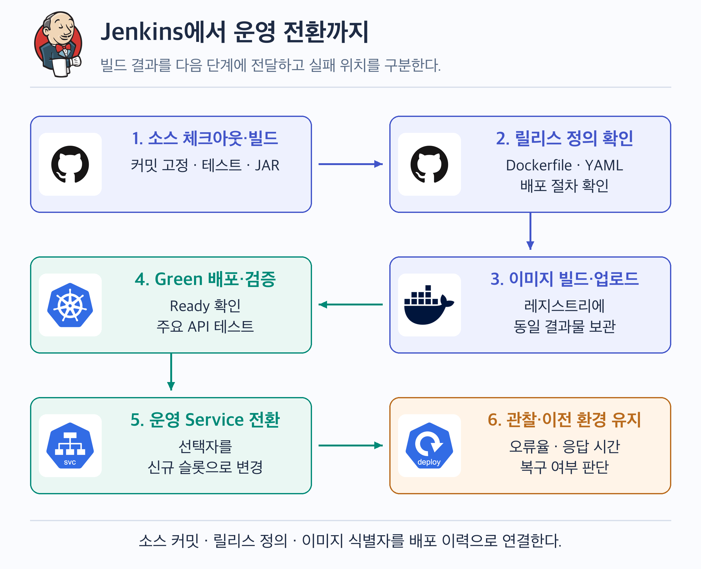
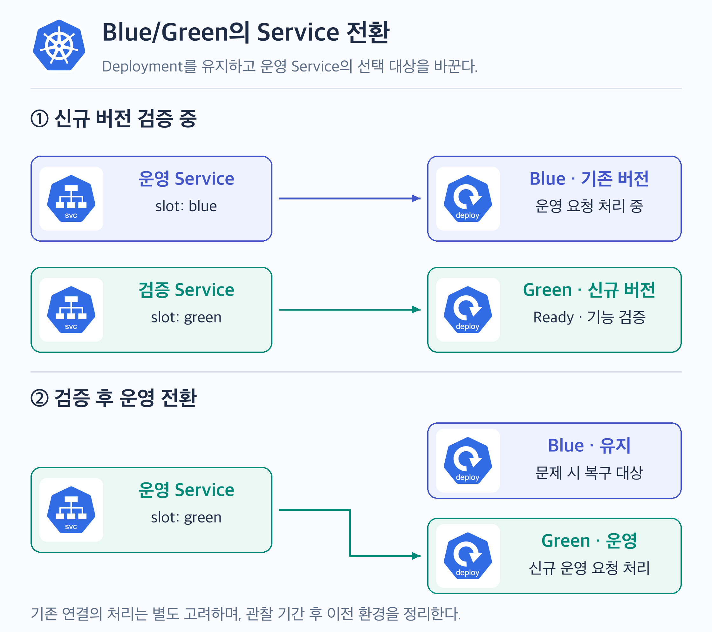

# Jenkins Pipeline부터 Blue/Green 배포까지 이해하기

## 1. 빌드부터 배포 검증까지 하나의 흐름으로 관리한다

- **Jenkins Pipeline은 소스 체크아웃, 빌드, 테스트, 이미지 배포와 실행 확인 등을 단계로 정의하고 실행하는 기능이다.** Jenkinsfile로 정의를 저장소에서 버전 관리할 수 있다.
- CI는 코드 통합 과정에서 빌드·테스트 등으로 변경을 검증하는 흐름이다. CD는 검증된 결과물을 배포 가능한 상태로 유지하거나 실제 환경에 배포하는 흐름까지 연결한다.
- 운영 전환에 수동 승인 단계를 둘 수도 있다. 파이프라인으로 구성했다고 모든 배포가 무조건 자동 승인되는 것은 아니다.

| 파일 | 담당하는 내용 | 확인할 관계 |
| :--- | :--- | :--- |
| `Jenkinsfile` | 어떤 순서와 실행 환경에서 작업할지 정의한다. | 체크아웃, 빌드, 업로드, 배포와 검증 단계를 연결한다. |
| `Dockerfile` | 애플리케이션 실행 이미지를 만드는 방법을 정의한다. | 빌드 결과물의 위치, 실행 환경과 시작 명령을 확인한다. |
| Kubernetes YAML | 배포할 리소스의 원하는 상태를 정의한다. | 이미지 버전, 설정 참조, 선택자와 포트 등을 확인한다. |

- Jenkins가 명령을 실행하고, 컨테이너 빌드 도구가 이미지를 만들며, Kubernetes가 선언된 리소스를 운영한다. 도구별 책임과 실패 지점을 구분한다.
- **빌드 성공, 이미지 업로드 성공, 리소스 생성 성공과 실제 서비스 정상 동작은 서로 다른 검증 단계이다.**

## 2. agent, stage와 steps로 실행 위치와 작업을 구분한다

| 구성 | 역할 | 주의할 점 |
| :--- | :--- | :--- |
| `pipeline` | Declarative Pipeline의 전체 구조이다. | 정해진 구조 안에서 단계와 옵션을 선언한다. |
| `agent` | 전체 파이프라인이나 특정 단계가 실행될 환경을 지정한다. | 필요한 도구와 접근 권한이 해당 환경에 있어야 한다. |
| `stages`, `stage` | 작업을 빌드·배포 등 의미 있는 단위로 구분한다. | 단계별 소요 시간과 실패 위치를 파악하기 쉬워진다. |
| `steps` | 해당 단계에서 실행할 명령을 정의한다. | `sh`, `checkout` 등 실제 실행 작업을 배치한다. |

- `agent any`는 사용 가능한 실행 환경 중 하나를 사용한다는 뜻이다. JDK, 이미지 빌드 도구나 `kubectl`을 자동으로 설치한다는 의미는 아니다.
- `agent { label 'build' }`처럼 라벨로 실행 환경을 고를 수 있다. 이 라벨은 Jenkins 실행 노드의 라벨이며 Kubernetes의 Node·Pod 선택자와는 별개이다.
- Jenkins controller는 작업을 조정하고 agent는 실제 빌드·배포 명령을 수행한다. VM이나 컨테이너 등으로 실행 환경을 구성할 수 있다.
- 단계마다 agent를 나누면 도구와 권한을 분리하기 쉽지만 작업 디렉터리가 같다고 가정할 수 없다. 결과물은 `stash`·`unstash`, 아티팩트 저장소나 이미지 레지스트리 등으로 전달한다.
- Declarative의 `pipeline { stages { stage { steps { ... } } } }` 구조와 Scripted의 `node { stage { ... } }` 구조를 구분한다. Scripted의 `stage` 안에는 일반적으로 `sh` 등의 단계를 직접 작성한다.

### 기본 Jenkinsfile의 구조

- 다음은 저장소에 Jenkinsfile·Gradle Wrapper·Dockerfile이 있고, `build` 라벨의 agent에 JDK와 Docker 실행 환경이 준비되어 있다고 가정한 빌드 예시이다.
- SCM과 연결된 Pipeline Job에서 실행하며, Dockerfile은 Gradle 빌드 결과물을 사용하도록 구성되어 있어야 한다.

```groovy
pipeline {
    agent { label 'build' }

    options {
        skipDefaultCheckout()
        disableConcurrentBuilds()
    }

    stages {
        stage('Checkout') {
            steps {
                checkout scm
            }
        }
        stage('Source Build') {
            steps {
                sh './gradlew clean build'
            }
        }
        stage('Container Build') {
            steps {
                sh 'docker build -t orders:${BUILD_NUMBER} .'
            }
        }
    }
}
```

- `skipDefaultCheckout()`으로 기본 체크아웃을 생략하고 `Checkout` 단계에서 명시적으로 실행한다. 일반적인 순차 실행에서 명령이 실패하면 뒤의 정상 단계로 진행하지 않는다.
- 예시는 로컬 이미지 빌드까지 수행한다. 레지스트리 인증·업로드, 클러스터 인증과 배포 검증은 별도 단계로 연결한다.
- `disableConcurrentBuilds()`는 같은 Pipeline Job의 동시 실행을 제한한다. 여러 Job이 같은 운영 Service를 변경한다면 배포 대상 단위의 실행 제어도 필요하다.

## 3. 소스 버전, 릴리스 정의와 이미지 버전을 연결한다



| 단계 | 주요 작업 | 다음 단계로 넘길 정보 |
| :--- | :--- | :--- |
| 소스 체크아웃 | 빌드할 저장소의 특정 커밋을 가져온다. | 소스 커밋 식별자이다. |
| 소스 빌드·테스트 | 코드를 검증하고 JAR 등 결과물을 만든다. | 빌드 결과물과 테스트 결과이다. |
| 릴리스 정의 체크아웃 | Dockerfile, YAML과 배포 스크립트 등을 가져온다. | 릴리스 정의의 버전과 대상 환경이다. |
| 이미지 빌드 | 실행 환경과 결과물을 묶어 이미지를 만든다. | 이미지 이름·태그 또는 다이제스트이다. |
| 이미지 업로드 | 클러스터가 받을 수 있는 레지스트리에 게시한다. | 실제 업로드된 이미지 식별자이다. |
| Kubernetes 배포 | 해당 이미지를 사용하는 신규 리소스를 생성한다. | Deployment 이름, 배포 슬롯과 설정 버전이다. |
| 배포 검증·전환 | 준비 상태와 기능을 확인한 뒤 운영 요청을 연결한다. | 현재 운영 버전과 되돌릴 이전 버전이다. |

- 앱 소스와 릴리스 정의를 같은 저장소에 둘 수도, 별도 저장소로 나눌 수도 있다. 별도 저장소라면 어느 커밋 조합으로 배포했는지 함께 기록한다.
- 빌드할 때마다 이미지 태그를 구분하고, 같은 결과물을 검증·운영에 전달한다. 운영 전환 단계에서 다시 빌드하면 검증한 이미지와 달라질 수 있다.
- `BUILD_NUMBER`는 Job별 번호이므로 여러 Job이 같은 이미지 저장소를 사용한다면 충돌을 피할 식별 규칙이 필요하다. 커밋 식별자나 이미지 다이제스트를 배포 이력과 연결할 수 있다.
- 저장소, 레지스트리와 클러스터 인증 정보는 Jenkins Credentials 등으로 제공한다. 실행 환경별로 필요한 접근 권한을 갖추고 Jenkinsfile에 실제 비밀번호·토큰을 고정하지 않는다.

## 4. Blue/Green은 신규 환경 준비와 운영 트래픽 전환을 분리한다

- **현재 운영 버전인 Blue를 유지한 채 신규 버전인 Green을 별도 Deployment로 준비하고, 검증 후 운영 Service의 선택자를 Green으로 바꾼다.**
- 색상은 배포 슬롯을 구분하는 이름이다. 항상 Blue가 구버전이고 Green이 신버전으로 고정되는 것은 아니며, 다음 배포에서 역할을 바꿀 수 있다.
- Green 전용 검증 Service를 두면 운영 Service는 Blue를 바라보는 상태에서 QA나 스모크 테스트를 수행할 수 있다. 검증용 진입 경로의 접근 범위도 따로 정한다.



| 구분 | RollingUpdate | Blue/Green |
| :--- | :--- | :--- |
| 버전 교체 | 한 Deployment에서 기존·신규 Pod를 점진적으로 교체한다. | 두 Deployment를 분리해 준비하고 운영 연결 대상을 전환한다. |
| 신규 버전 검증 | 일반적으로 배포 과정에서 준비 상태를 확인한다. | 운영 트래픽 전환 전에 별도 진입 경로로 검증할 수 있다. |
| 트래픽 변화 | 두 버전이 동시에 요청을 처리할 수 있다. | Service 전환으로 신규 환경에 운영 트래픽이 집중될 수 있다. |
| 추가 자원 | `maxSurge` 등 교체 설정에 따라 달라진다. | 두 환경을 같은 크기로 유지하는 동안 앱 용량이 약 두 배 필요하다. |
| 복구 방식 | 이전 Pod 템플릿으로 되돌리고 교체를 진행한다. | 이전 환경이 살아 있으면 Service 선택자를 되돌릴 수 있다. |

- Blue/Green은 Deployment의 `strategy.type` 값이 아니다. 별도 Deployment, 선택자와 배포 절차를 조합해 구현하며 각 Deployment 내부에는 RollingUpdate 전략을 사용할 수도 있다.
- Service 선택자 변경은 EndpointSlice와 네트워크 구성에 전파된다. 모든 요청과 기존 연결이 한순간에 원자적으로 이동하는 것은 아니며, keep-alive나 장기 연결의 처리도 고려한다.

## 5. Deployment별 관리 범위와 Service의 선택 범위를 맞춘다

| 리소스 | 이름 예시 | 선택 조건·라벨 예시 |
| :--- | :--- | :--- |
| Blue Deployment | `orders-blue`이다. | 선택자와 Pod 라벨에 `app: orders`, `slot: blue`를 사용한다. |
| Green Deployment | `orders-green`이다. | 선택자와 Pod 라벨에 `app: orders`, `slot: green`을 사용한다. |
| 운영 Service | `orders`이다. | `app: orders`와 현재 운영 슬롯을 선택한다. |
| 검증 Service | `orders-preview`이다. | `app: orders`와 검증할 슬롯을 선택한다. |

- 두 Deployment의 선택 범위가 겹치지 않도록 슬롯을 포함한다. 각 Deployment의 `spec.selector.matchLabels`는 자신의 Pod 템플릿 라벨과 일치해야 한다.
- Service의 선택자에는 같은 앱을 식별하는 공통 조건과 슬롯 조건을 함께 둔다. 슬롯 조건을 빼면 Blue와 Green이 모두 운영 요청 대상에 포함될 수 있다.
- `slot` 대신 `blue-green-no: "1"`, `blue-green-no: "2"`처럼 구분할 수도 있다. 숫자처럼 보이는 라벨 값도 YAML에서 문자열로 작성한다.
- `version: "2.0.0"` 같은 라벨은 버전 추적에 사용할 수 있지만, 라벨 수정만으로 앱 코드나 설정이 바뀌지는 않는다.
- Deployment의 선택자는 생성 후 변경할 수 없다. 배포 완료 후 관련 라벨을 일괄 수정하기보다 슬롯 구분을 유지하고 이미지·설정 버전과 현재 운영 슬롯을 관리한다.

```yaml
apiVersion: v1
kind: Service
metadata:
  name: orders
  namespace: shop-prod
spec:
  selector:
    app: orders
    slot: blue
  ports:
    - name: http
      port: 80
      targetPort: http
```

- 같은 Namespace에 해당 라벨과 이름이 `http`인 컨테이너 포트를 가진 Pod가 있다고 가정한 운영 Service 예시이다. Green으로 전환할 때는 공통 조건을 유지하고 `slot`을 `green`으로 변경한다.
- `orders-preview`는 별도 Service로 만들어 `slot: green`을 선택할 수 있다. 검증 Service만 생성했다고 외부에 자동 공개되지는 않는다.

## 6. 수동 전환에서 확인한 조건을 자동화 단계에 옮긴다

| 순서 | 수행할 작업 | 실패 시 처리 |
| :--- | :--- | :--- |
| 1. 현재 상태 확인 | 운영 슬롯, 이미지·설정 버전과 복구 대상을 기록한다. | 상태가 예상과 다르면 전환을 중단한다. |
| 2. 신규 환경 생성 | Green Deployment와 필요한 설정·검증 Service를 준비한다. | Blue의 운영 연결을 유지한다. |
| 3. 준비·기능 확인 | 신규 복제본 준비, 이미지 버전과 주요 API 동작을 확인한다. | 정해진 시간 안에 정상화되지 않으면 전환하지 않는다. |
| 4. 운영 트래픽 전환 | 운영 Service의 슬롯 선택자만 Green으로 변경한다. | 변경 결과와 실제 연결 대상을 다시 확인한다. |
| 5. 전환 후 관찰 | 운영 경로의 오류율, 응답 시간과 DB·외부 API 상태를 확인한다. | 복구 조건을 만족하면 이전 슬롯으로 되돌린다. |
| 6. 이전 환경 정리 | 관찰·롤백 유지 기간 이후 Blue와 검증용 리소스를 정리한다. | 현재 운영 리소스가 삭제 대상에 포함되지 않도록 확인한다. |

- `kubectl apply` 성공만으로 배포 검증을 끝내지 않는다. 신규 Deployment의 rollout 완료, 예상 복제 수, Ready 상태와 실제 실행 이미지까지 확인한다.
- Ready는 readinessProbe가 검사한 범위에서 요청 가능한 상태라는 뜻이다. 결제·조회 등 핵심 기능이나 운영 부하까지 검증했다는 의미는 아니다.
- 자동화에는 대기 시간 제한, 실패 시 중단, 전환 전후 상태 기록과 재실행 시 동작을 포함한다. 이미 Green이 운영 중인 작업을 재실행하면서 이전 단계의 가정을 그대로 적용하지 않는다.
- 같은 Service를 여러 배포 작업이 동시에 변경하지 않도록 실행을 제어한다. 한 작업의 롤백이 다른 작업이 배포한 버전을 되돌리지 않도록 현재 슬롯도 확인한다.
- 전환 직후 Blue를 삭제하면 선택자만 되돌리는 빠른 복구 경로가 사라진다. 이전 환경을 얼마 동안 어떤 크기로 유지할지 배포 정책으로 정한다.

## 7. 빠른 롤백에는 앱 밖의 상태도 되돌릴 수 있어야 한다

| 고려할 요소 | 문제가 생기는 이유 | 준비할 내용 |
| :--- | :--- | :--- |
| 트래픽 급증 | 신규 환경에 운영 요청이 집중되며 캐시·JIT·연결 풀이 충분히 준비되지 않을 수 있다. | 워밍업, 충분한 복제 수와 전환 직후 부하 관찰이다. |
| 자원과 오토스케일링 | 두 환경이 자원을 함께 사용하고 신규 환경의 HPA 반응에는 시간이 걸린다. | 노드 여유 용량, 전환 전 처리 용량과 슬롯별 HPA 대상이다. |
| DB 스키마·데이터 | 신규 앱이 바꾼 데이터나 스키마를 이전 앱이 읽지 못할 수 있다. | 두 버전이 함께 사용할 수 있는 호환성 있는 변경 순서이다. |
| ConfigMap·Secret | 같은 설정 객체를 수정하면 이전 환경도 갱신 영향을 받을 수 있다. | 버전별 설정 참조와 실제 반영 방식, 이전 설정의 보존이다. |
| 공유 저장소 | 두 환경이 같은 파일을 동시에 읽고 쓰거나 마운트 제약에 걸릴 수 있다. | 접근 모드, 데이터 형식과 동시 쓰기 동작이다. |
| 배치·메시지 소비 | 두 환경의 워커가 동시에 실행되면 Service 전환 전에도 작업을 처리할 수 있다. | 워커 활성화, 중복 처리 방지와 별도 전환 절차이다. |
| 진행 중인 요청 | 기존 연결이나 장기 작업이 Blue에 남아 있을 수 있다. | 연결 종료·대기 정책과 graceful shutdown이다. |

- **Service 선택자를 되돌리는 것은 요청 대상의 복구이다. 이미 변경된 데이터나 발송한 메시지까지 되돌리지는 않는다.**
- 운영 환경에서만 확인 가능한 기능을 검증 Service로 테스트할 때도 실제 데이터 변경, 외부 호출과 백그라운드 작업의 영향을 고려한다.
- Blue/Green은 신규 버전으로의 일괄 전환과 빠른 복구에 적합하다. 일부 트래픽부터 점진적으로 늘려야 한다면 별도 트래픽 분할 기능을 사용하는 Canary 등의 방식을 검토할 수 있다.
