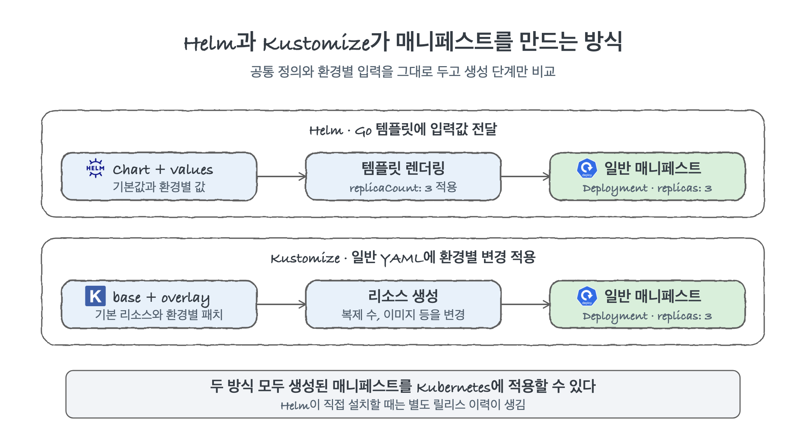
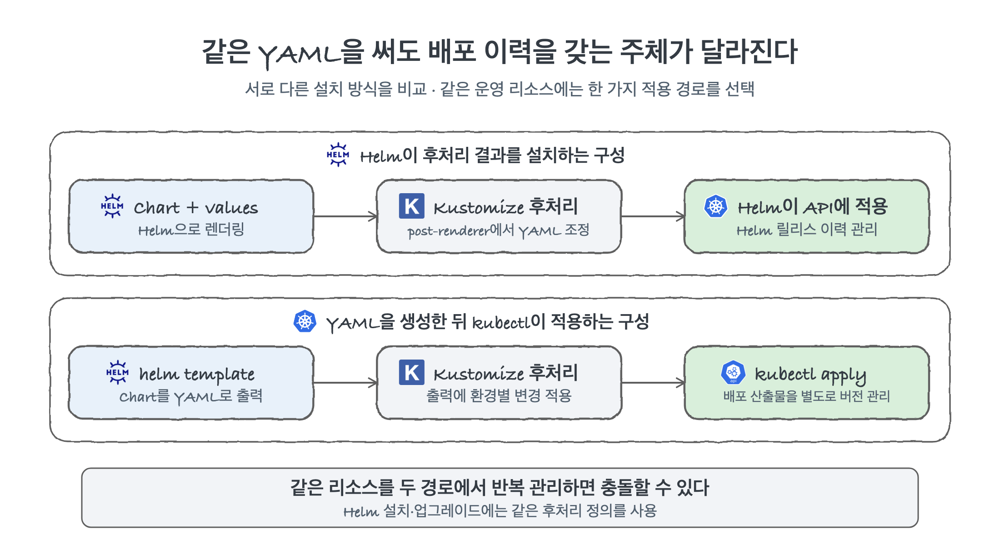
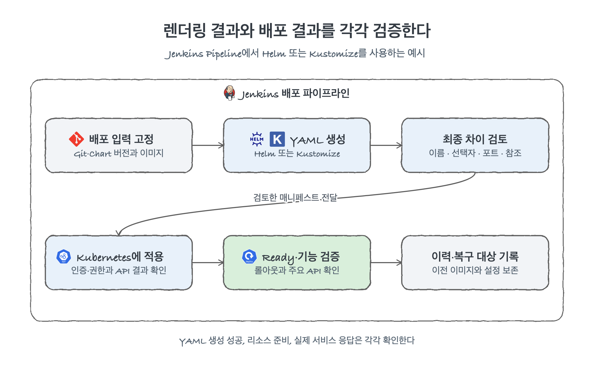

# Helm과 Kustomize로 배포 설정 관리하기

## 1. 환경마다 YAML을 복사하는 대신 공통 정의와 차이를 관리한다

- 앱마다 Deployment, Service, ConfigMap, HPA 등을 만들고 개발·검증·운영별로 복사하면 같은 변경을 여러 파일에 반복해야 한다.
- **Helm과 Kustomize는 공통 배포 정의를 재사용하면서 환경별 차이를 관리하는 도구이다.** 최종적으로는 Kubernetes가 처리할 일반 YAML을 만든다.
- Helm은 템플릿·설정값과 릴리스 관리에, Kustomize는 기존 YAML의 조합·변경에 중심을 둔다.

| 구분 | Helm | Kustomize |
| :--- | :--- | :--- |
| 기본 방식 | Go 템플릿에 values를 전달해 YAML을 생성한다. | 일반 YAML에 변환과 패치를 적용해 YAML을 생성한다. |
| 공통 정의 | Chart의 `templates/`와 기본 `values.yaml`이다. | `base`의 리소스와 `kustomization.yaml`이다. |
| 환경별 차이 | 환경별 values 파일과 `--set` 등으로 전달한다. | `overlays/dev`, `overlays/prod` 등에 선언한다. |
| 배포 관리 | 릴리스 단위 설치·업그레이드·이력 조회·롤백을 제공한다. | 빌드 결과를 `kubectl apply -k` 등으로 적용한다. 자체 릴리스 이력은 없다. |
| 재사용에 적합한 경우 | 여러 팀·환경에 같은 앱 패키지를 제공하거나 외부 Chart를 사용한다. | 공통 YAML을 유지하며 환경별 변경을 명시적으로 관리한다. |
| 복잡해지는 지점 | 조건문·헬퍼·서브차트가 늘어나면 최종 YAML을 추적하기 어려워진다. | overlay·패치가 여러 층으로 쌓이면 변경 순서와 대상을 추적하기 어려워진다. |



그림의 근거 · [Helm Chart](https://helm.sh/docs/v3/topics/charts/) · [Kustomize](https://kubernetes.io/docs/tasks/manage-kubernetes-objects/kustomization/)

- 앱 개수만으로 도구를 정하지 않는다. 패키지 배포·의존성 관리·릴리스 이력이 필요한지, 일반 YAML과 패치로 변경을 설명하기 쉬운지를 판단한다.
- Helm을 사용해도 Kustomize가 필요한 경우가 있으며, Kustomize도 큰 프로젝트에서 사용할 수 있다. 팀의 배포 방식과 유지보수 비용을 함께 본다.

## 2. 배포 도구는 CI/CD 환경에서 Kubernetes API를 사용한다

- Jenkins 같은 CI/CD 실행 환경에 필요한 CLI를 준비하고 대상 클러스터의 인증 정보와 권한을 제공한다. 빌드 agent와 클러스터 노드에 모든 도구를 똑같이 설치할 필요는 없다.
- Helm CLI는 Chart를 렌더링하고 릴리스에 속한 리소스를 Kubernetes API로 관리한다. 여러 리소스를 한 패키지로 다뤄도 실제 적용은 여러 API 작업이며, 전체가 하나의 트랜잭션으로 처리되는 것은 아니다.
- Kustomize는 단독 CLI로도 사용할 수 있고 `kubectl`에도 통합되어 있다. `kubectl kustomize`는 YAML 생성, `kubectl apply -k`는 생성 결과 적용에 사용한다.
- `kubectl`에 포함된 Kustomize와 단독 CLI의 버전이 다를 수 있다. 로컬과 CI/CD에서 도구 버전 및 지원 필드를 맞춘다.
- 외부 Chart는 Chart 저장소나 OCI 레지스트리 등에서 받을 수 있다. Artifact Hub는 패키지를 검색하고 배포 안내를 확인하는 곳이며 모든 Chart를 직접 보관하는 저장소는 아니다.
- Chart를 가져오는 저장소와 앱 실행 이미지를 가져오는 컨테이너 레지스트리의 역할을 구분한다. 두 곳의 버전과 접근 권한을 각각 확인한다.

## 3. Helm의 Chart와 Release를 구분한다

- **Chart는 앱을 배포하는 패키지이고, Release는 특정 이름과 Namespace로 설치한 인스턴스이다.** 같은 Chart를 환경별로 다른 values와 릴리스 이름으로 사용할 수 있다.
- `helm create orders`로 기본 구조를 생성한 뒤 앱에 필요한 리소스를 남기고 수정할 수 있다. 생성되는 기본 파일은 Helm 버전에 따라 달라질 수 있다.

```text
orders/
├── Chart.yaml
├── values.yaml
├── charts/
├── templates/
│   ├── _helpers.tpl
│   ├── deployment.yaml
│   ├── service.yaml
│   ├── configmap.yaml
│   └── NOTES.txt
└── .helmignore
```

| 구성 | 역할 | 주의할 점 |
| :--- | :--- | :--- |
| `Chart.yaml` | Chart 이름, 버전, 앱 버전과 의존성 등 메타데이터이다. | Chart의 `version`과 앱의 `appVersion`은 별개이다. |
| `values.yaml` | 템플릿에 사용할 기본 설정값이다. | 실제로 템플릿이 참조하는 값만 결과에 반영된다. |
| `templates/` | Kubernetes 리소스를 생성할 템플릿이다. | 렌더링 후 유효한 Kubernetes YAML이 되어야 한다. |
| `_helpers.tpl` | 이름 생성 등 재사용할 템플릿 함수를 정의한다. | `define`으로 정의하고 `include` 등으로 사용한다. |
| `charts/` | 의존하는 서브차트를 담는다. | 의존성의 버전과 설정 전달도 관리한다. |
| `NOTES.txt` | 설치·상태 조회 시 안내 문구를 출력한다. | Kubernetes 리소스로 적용하는 YAML과 구분한다. |
| `.helmignore` | Chart에 포함하지 않을 파일 패턴을 지정한다. | 패키징에서 불필요한 파일을 제외하는 용도이다. |

| 템플릿 표현 | 의미 |
| :--- | :--- |
| `{{ .Release.Name }}` | 설치할 릴리스 이름이다. |
| `{{ .Release.Namespace }}` | 릴리스의 대상 Namespace이다. |
| `{{ .Chart.Name }}`, `{{ .Chart.Version }}` | Chart의 이름과 버전이다. |
| `{{ .Chart.AppVersion }}` | Chart가 기록한 앱 버전이다. |
| `{{ .Values.replicaCount }}` | 전달받은 values의 복제 수 설정이다. |

- `appVersion`을 바꿨다고 실행 이미지가 자동으로 바뀌지는 않는다. 이미지 템플릿이 어떤 값을 참조하는지 확인한다.
- 같은 Chart로 여러 릴리스를 설치하려면 리소스 이름과 선택 범위가 충돌하지 않도록 설계한다. 릴리스 이름이 달라도 리소스 이름을 고정하면 충돌할 수 있다.

## 4. Helm은 기본 values에 환경별 값을 덮어써 렌더링한다

- 다음은 `Chart.yaml`을 갖춘 `orders` Chart에서 사용할 기본 `values.yaml`과 Deployment 템플릿 예시이다. 이미지 주소는 실행 가능한 앱 이미지로 교체해야 한다.

```yaml
# orders/values.yaml
replicaCount: 1
image:
  repository: registry.example.com/orders
  tag: "1.0.0"
```

```yaml
# orders/templates/deployment.yaml
apiVersion: apps/v1
kind: Deployment
metadata:
  name: {{ .Release.Name }}
spec:
  replicas: {{ .Values.replicaCount }}
  selector:
    matchLabels:
      app.kubernetes.io/instance: {{ .Release.Name | quote }}
  template:
    metadata:
      labels:
        app.kubernetes.io/instance: {{ .Release.Name | quote }}
    spec:
      containers:
        - name: orders
          image: "{{ .Values.image.repository }}:{{ .Values.image.tag }}"
          ports:
            - name: http
              containerPort: 8080
```

- 운영 환경의 `values-prod.yaml`에는 바꿀 값만 선언할 수 있다. 이 예시에서는 기본 이미지 저장소를 유지하고 복제 수와 태그를 변경한다.

```yaml
# values-prod.yaml
replicaCount: 3
image:
  tag: "1.0.1"
```

```bash
helm lint ./orders -f values-prod.yaml
helm template orders-prod ./orders -n shop-prod -f values-prod.yaml
helm upgrade --install orders-prod ./orders -n shop-prod \
  -f values-prod.yaml --wait --timeout 5m
helm history orders-prod -n shop-prod
```

- 대상 Namespace가 이미 있다고 가정한 명령이다. Namespace의 생성·권한 관리는 앱 릴리스와 분리할 수도 있다.
- `-f`를 여러 번 지정하면 뒤에 지정한 파일이 우선하며, `--set` 등으로 추가 값을 덮어쓸 수 있다. 반복 가능한 배포를 위해 환경별 파일과 최종 입력값을 기록한다.
- 숫자처럼 보이지만 문자열이어야 하는 값에는 따옴표나 `--set-string`을 사용한다. 템플릿의 문자열 필드에도 `quote` 등을 적용해 자료형이 바뀌지 않도록 한다.
- `helm lint`와 `helm template`은 적용 전 확인 단계이다. 렌더링 성공만으로 클러스터 정책·스토리지·앱 기동까지 검증한 것은 아니다.
- `--wait`는 리소스의 준비 조건을 정해진 시간까지 기다린다. 주요 API의 정상 응답이나 실제 운영 부하 검증은 별도로 수행한다.
- Helm의 롤백은 이전 릴리스 정의를 복원하는 기능이다. 이미 변경된 DB 데이터까지 복구하지는 않는다.

## 5. Kustomize는 base에 환경별 overlay를 적용한다

- `base`에는 공통 리소스를 두고, `overlays`에는 환경별 Namespace·이미지·복제 수와 패치 등을 선언한다. base는 자신을 사용하는 환경을 알 필요가 없다.
- 각 `kustomization.yaml`의 `resources`에 참조할 파일이나 디렉터리를 지정한다. 폴더에 YAML을 넣기만 하면 모두 자동 적용되는 것은 아니다.

```text
app/
├── base/
│   ├── kustomization.yaml
│   └── deployment.yaml
└── overlays/
    ├── dev/
    │   └── kustomization.yaml
    └── prod/
        └── kustomization.yaml
```

```yaml
# app/base/deployment.yaml
apiVersion: apps/v1
kind: Deployment
metadata:
  name: orders
spec:
  replicas: 1
  selector:
    matchLabels:
      app: orders
  template:
    metadata:
      labels:
        app: orders
    spec:
      containers:
        - name: orders
          image: registry.example.com/orders:1.0.0
          ports:
            - name: http
              containerPort: 8080
```

```yaml
# app/base/kustomization.yaml
apiVersion: kustomize.config.k8s.io/v1beta1
kind: Kustomization
resources:
  - deployment.yaml
```

```yaml
# app/overlays/prod/kustomization.yaml
apiVersion: kustomize.config.k8s.io/v1beta1
kind: Kustomization
resources:
  - ../../base
namespace: shop-prod
replicas:
  - name: orders
    count: 3
images:
  - name: registry.example.com/orders
    newTag: "1.0.1"
```

```bash
kubectl kustomize ./app/overlays/prod
kubectl diff -k ./app/overlays/prod
kubectl apply -k ./app/overlays/prod
```

- 결과는 `shop-prod` Namespace, 복제 수 3개, 이미지 태그 `1.0.1`인 Deployment이다. base 파일을 직접 수정하지 않고 환경별 값을 바꾼다.
- `namespace` 필드는 리소스의 Namespace를 지정하는 변환이다. Namespace 리소스를 따로 포함하거나 미리 생성해야 실제 Namespace가 존재한다.
- `replicas`, `images` 등 전용 필드로 표현하기 어려운 변경은 `patches`로 적용할 수 있다. 대상 리소스와 변경 경로가 정확한지 확인한다.
- overlay를 여러 환경에서 재사용할 수 있지만, 공통 정의를 수정하면 이를 참조하는 환경에도 영향을 준다. 각 환경의 최종 빌드 결과를 검토한다.
- Kustomize 자체에는 Helm의 릴리스 이력·롤백 기능이 없다. Git의 이전 정의로 되돌려 적용하는 방식과 삭제·정리 절차 등을 배포 도구에서 관리한다.
- `resources`에서 파일을 제거하고 다시 `apply`하는 것만으로 기존 리소스가 자동 삭제되지는 않는다. 제거할 리소스의 관리 방식도 정한다.

## 6. 함께 사용할 때는 같은 리소스의 관리 주체를 정한다

| 사용 방식 | 예시 | 관리할 경계 |
| :--- | :--- | :--- |
| 앱별로 선택한다. | 외부 오픈소스는 Helm Chart로, 자체 앱은 Kustomize로 배포한다. | 서로 관리하는 리소스가 겹치지 않게 한다. |
| Chart 렌더링 후 추가 변경을 한다. | Chart가 노출하지 않은 조직 공통 설정을 Kustomize로 적용한다. | Chart 버전과 후처리 정의를 함께 기록한다. |
| Helm의 후처리 과정에 연결한다. | post-renderer로 렌더링된 YAML을 수정한 뒤 Helm이 적용한다. | 설치·업그레이드 시 같은 후처리 절차를 유지한다. |

- Helm으로 설치한 리소스를 별도 `kubectl apply`로 계속 덮어쓰면 다음 업그레이드에서 변경이 충돌하거나 사라질 수 있다. **최종 선언과 적용·삭제·복구를 어느 도구가 책임질지 먼저 정한다.**
- `helm template`로 YAML만 생성한 뒤 `kubectl`로 적용하면 그 작업은 Helm 릴리스로 설치한 것이 아니다. Helm의 이력·롤백 기능이 자동으로 생기지는 않는다.
- post-renderer의 실행 파일·플러그인 연동 방식 등은 Helm 버전에 따라 다를 수 있다. CI/CD에서 버전과 실행 방식을 고정한다.
- 두 도구를 연결하면 관리 단계도 늘어난다. values나 단일 overlay로 충분하다면 불필요하게 겹치지 않는다.



그림의 근거 · [Helm 3 Post Rendering](https://helm.sh/docs/v3/topics/advanced/) · [Helm 3 template](https://helm.sh/docs/v3/helm/helm_template/) · [Kubernetes Kustomize](https://kubernetes.io/docs/tasks/manage-kubernetes-objects/kustomization/)

## 7. 배포 명령 실행과 Pod 교체 조건을 구분한다

- **Deployment는 Pod 템플릿인 `spec.template`이 변경될 때 새 롤아웃을 시작한다.** 같은 YAML을 다시 적용하거나 Helm 릴리스 이력이 추가되는 것만으로 Pod가 반드시 교체되지는 않는다.

| 변경 | 일반적인 동작 | 확인할 내용 |
| :--- | :--- | :--- |
| Pod 템플릿의 이미지 태그·다이제스트 변경 | 새 Pod로 교체한다. | 검증한 이미지와 실제 배포 이미지가 같은지 확인한다. |
| 같은 이미지 문자열을 유지하고 레지스트리의 이미지 내용만 변경 | 템플릿 변경이 없으면 롤아웃이 시작되지 않는다. | 변경을 식별할 고유 태그나 다이제스트를 사용한다. |
| ConfigMap·Secret의 데이터만 변경 | Deployment의 템플릿이 같으면 자동 롤아웃되지 않는다. | 주입 방식과 앱의 설정 재로딩·Pod 교체 절차를 확인한다. |
| Pod 템플릿의 annotation 변경 | 템플릿 변경으로 새 롤아웃이 시작된다. | 설정 체크섬 등 의미 있는 변경 기준을 사용할 수 있다. |
| Deployment 자체의 라벨·annotation만 변경 | Pod 템플릿이 같으면 롤아웃되지 않는다. | `metadata`와 `spec.template.metadata`의 위치를 구분한다. |

- 매번 임의의 annotation 값을 만들면 변경이 없어도 Pod가 교체되어 렌더링 결과와 배포 차이를 추적하기 어려워진다. 재시작이 필요한 변경을 명시적으로 표현한다.
- `imagePullPolicy: Always`는 컨테이너를 시작할 때 이미지 식별자를 확인하는 정책이다. 이미 실행 중인 컨테이너를 자동으로 새 이미지로 교체하는 기능은 아니다.
- `Always`여도 같은 다이제스트의 레이어가 노드에 있으면 재사용할 수 있다. `IfNotPresent`는 노드에 이미지가 없을 때 가져오므로 재사용되는 태그와 결합하면 노드마다 다른 결과가 생길 수 있다.
- 검증·운영에서는 고유한 태그를 덮어쓰지 않거나 다이제스트로 이미지를 고정해 배포와 롤백 대상을 식별한다. 개발 환경도 커밋·빌드 번호 등으로 변경을 추적할 수 있다.

## 8. 파이프라인에서는 생성 결과와 실제 배포 상태를 함께 검증한다



그림의 근거 · [Jenkins Pipeline](https://www.jenkins.io/doc/book/pipeline/) · [helm template](https://helm.sh/docs/v3/helm/helm_template/) · [Kustomize](https://kubernetes.io/docs/tasks/manage-kubernetes-objects/kustomization/) · [Deployment 검증](https://kubernetes.io/docs/concepts/workloads/controllers/deployment/)

| 단계·항목 | 확인할 내용 |
| :--- | :--- |
| 배포 입력 고정 | Chart·Git 버전, values·overlay와 이미지 식별자를 함께 기록한다. |
| 생성 결과 확인 | 대상 Namespace, 이름·선택자, 이미지, 포트와 설정 참조를 검토한다. |
| 적용 전 검증 | Helm lint·렌더링, Kustomize 빌드와 가능한 경우 클러스터 차이·정책 검증을 수행한다. |
| 적용 후 확인 | rollout·Ready 상태뿐 아니라 주요 API, 오류율과 응답 시간을 확인한다. |
| 복구·삭제 | 이전 이미지·설정과 리소스의 관리 주체, 저장 데이터의 유지 정책을 확인한다. |
| 인증 정보 | Jenkins Credentials 등에 보관하고 로그·렌더링 결과에 민감한 값을 노출하지 않는다. |
| 이미지 정리 | CI 빌드 캐시와 노드의 이미지 캐시를 구분하고 롤백용 레지스트리 이미지를 보존한다. |

- 레지스트리 로그인 정보를 파일에 저장했다고 암호화된 것은 아니다. credential helper나 임시 인증 설정을 활용하고 공유 agent에 인증 정보가 남지 않도록 정리한다.
- 노드의 미사용 이미지는 kubelet의 이미지 정리 정책 등에 따라 제거될 수 있다. 배포할 때마다 이전 이미지가 즉시 삭제되거나 레지스트리 이미지까지 함께 정리되는 것은 아니다.
- 급한 장애 대응으로 `kubectl`에서 직접 수정했다면 변경을 원본 Chart·values·overlay에도 반영한다. 다음 자동 배포가 임시 수정을 덮어쓰지 않도록 선언과 실제 상태를 맞춘다.
