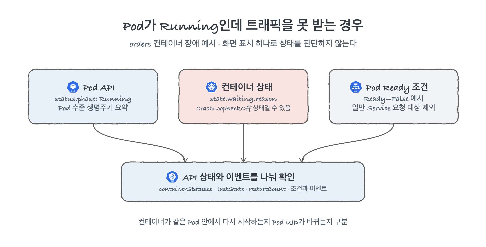
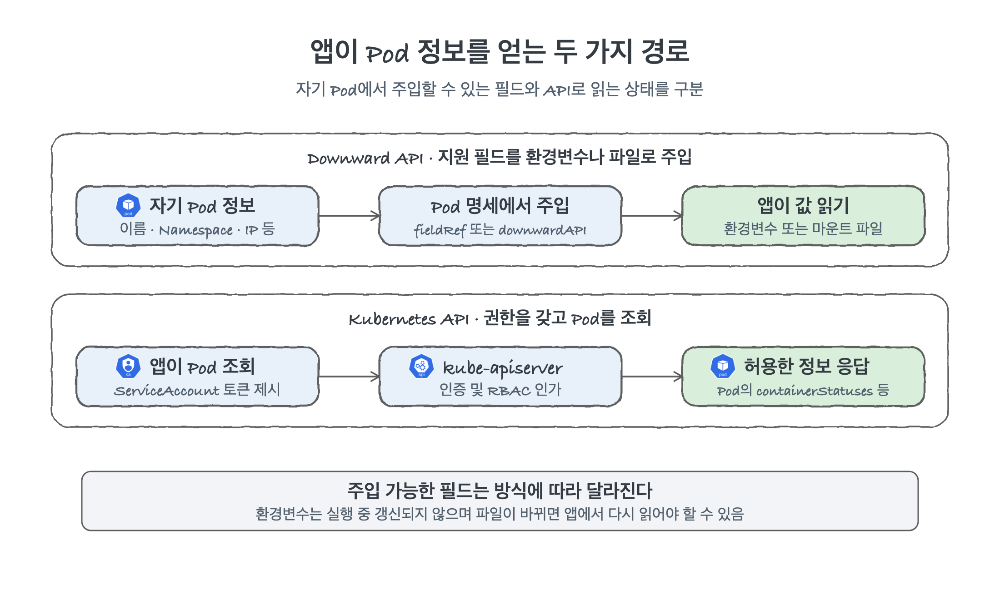
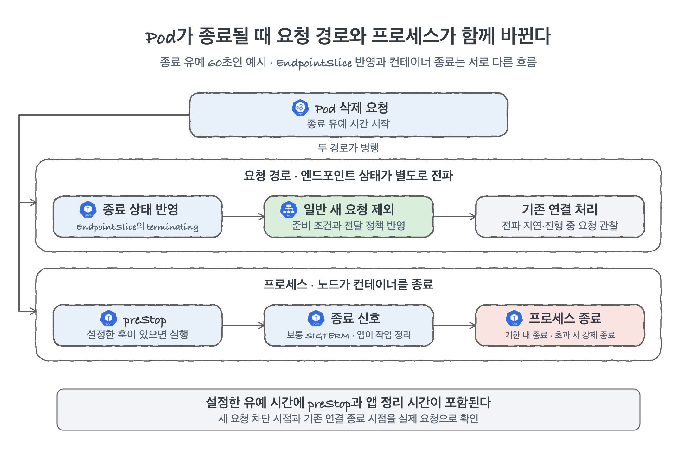

# 애플리케이션 개발자가 알아야 할 Pod 정보와 종료 처리

## 1. 앱은 실행 환경의 정보와 Pod의 생명주기를 함께 고려한다

- Pod는 재생성될 수 있고 이름·UID·IP도 바뀔 수 있다. 서버의 고정 IP를 설정에 넣는 방식만으로 실행 인스턴스를 식별하기 어렵다.
- **앱이 자기 Pod의 정보를 얻는 방법, 상태를 해석하는 방법과 요청을 잃지 않고 종료하는 방법을 구분한다.**
- 환경별 설정은 ConfigMap·Secret으로, 저장 데이터는 볼륨으로 제공하고, 기동·준비·복구 판단은 Probe와 연결한다. 여기에 Pod 식별 정보와 정상 종료 절차를 더한다.

| 필요한 기능 | 사용할 수 있는 수단 | 앱이 처리할 부분 |
| :--- | :--- | :--- |
| 자기 Pod의 이름·Namespace·IP 확인 | Downward API의 환경변수 등이다. | 로그·관측 정보에 인스턴스 식별자를 연결한다. |
| 라벨·annotation 읽기 | Downward API 볼륨 등이다. | 파일을 읽고 필요한 경우 변경을 다시 반영한다. |
| 상태·재시작 횟수 등 조회 | Kubernetes API이다. | 인증·권한·실패 처리와 조회 비용을 고려한다. |
| 배포·축소 중 요청 마무리 | `preStop`, 종료 유예 시간과 graceful shutdown이다. | 신규 작업 수락 중지, 진행 중 작업 완료와 외부 자원 정리를 구현한다. |
| 종료 원인 확인 | 컨테이너 상태·로그·이벤트·종료 메시지이다. | 짧은 진단 정보를 남기고 여러 단서를 함께 해석한다. |

- Service는 준비된 Pod 집합에 접근할 주소를 제공한다. Service를 반복 호출해 모든 Pod를 빠짐없이 발견하거나 특정 Pod를 계속 선택할 수 있다고 가정하지 않는다.
- Pod가 수집 서버에 자기 정보를 등록하는 구조라면 재등록, 만료와 종료 후 정리도 필요하다. Pod IP는 영구 식별자가 아니며, UID로 재생성된 인스턴스를 구분할 수 있다.

## 2. Pod phase, 컨테이너 상태와 kubectl의 표시값을 구분한다

| 구분 | 주요 값 | 의미 |
| :--- | :--- | :--- |
| Pod의 `status.phase` | `Pending`, `Running`, `Succeeded`, `Failed`, `Unknown`이다. | Pod 전체 생명주기의 요약이다. |
| 컨테이너의 `state` | `waiting`, `running`, `terminated`이다. | 해당 컨테이너의 현재 실행 상태이다. |
| 대기·종료 사유 `reason` | `ContainerCreating`, `CrashLoopBackOff`, `Completed`, `Error`, `OOMKilled` 등이다. | 특정 상태가 된 사유를 설명한다. |
| `kubectl get pod`의 `STATUS` | `Running`, `CrashLoopBackOff`, `Terminating` 등이다. | Pod·컨테이너의 정보를 사람이 보기 쉽게 요약한 표시값이다. |

- `Pending`에는 노드 배치 대기뿐 아니라 이미지 다운로드·볼륨 준비 등 실행 준비 시간도 포함된다.
- `Running`이어도 모든 컨테이너가 정상 요청을 처리한다는 뜻은 아니다. 준비 상태와 컨테이너별 상태를 확인한다.
- `Succeeded`는 모든 컨테이너가 성공적으로 종료되어 더 이상 재시작되지 않는 상태이다. `Failed`는 모든 컨테이너가 종료되고 하나 이상이 실패했으며 재시작되지 않는 상태이다.
- `CrashLoopBackOff`는 반복 종료·재시작에 따른 대기 상황을 나타낸다. `Terminating`도 삭제 중이라는 표시이며 둘 다 별도의 Pod phase가 아니다.
- **컨테이너 재시작과 Pod 교체는 다르다.** 같은 Pod 안에서 컨테이너가 재시작될 수 있고, Deployment가 삭제된 Pod 대신 새 Pod를 만들 수도 있다.
- Deployment의 Pod처럼 `restartPolicy: Always`인 경우 앱이 종료 코드 `0`으로 끝나도 컨테이너가 다시 시작될 수 있다. 종료 코드만으로 Pod의 최종 상태를 단정하지 않는다.



그림의 근거 · [Kubernetes Pod 생명주기](https://kubernetes.io/docs/concepts/workloads/pods/pod-lifecycle/) · [Kubernetes EndpointSlice](https://kubernetes.io/docs/concepts/services-networking/endpoint-slices/)

## 3. Downward API로 지원되는 자기 Pod 정보를 주입한다

- Downward API는 앱이 kube-apiserver를 직접 호출하지 않고도 일부 Pod·컨테이너 정보를 환경변수나 읽기 전용 파일로 받을 수 있게 한다.
- `fieldRef`는 지원되는 Pod 필드를, `resourceFieldRef`는 CPU·메모리 요청량·제한량 같은 컨테이너 자원 필드를 참조한다.



그림의 근거 · [Downward API](https://kubernetes.io/docs/concepts/workloads/pods/downward-api/) · [ServiceAccount](https://kubernetes.io/docs/concepts/security/service-accounts/) · [RBAC](https://kubernetes.io/docs/reference/access-authn-authz/rbac/)

| 얻을 정보 | 환경변수 | Downward API 볼륨 파일 |
| :--- | :--- | :--- |
| `metadata.name`, `metadata.namespace`, `metadata.uid` | 사용할 수 있다. | 사용할 수 있다. |
| 특정 라벨·annotation의 값 | `metadata.labels['key']` 등의 형식으로 참조한다. | 특정 키의 값도 참조할 수 있다. |
| 전체 라벨·annotation | 전체 맵을 직접 참조하는 방식은 지원하지 않는다. | `metadata.labels`, `metadata.annotations`를 파일로 제공할 수 있다. |
| `spec.nodeName`, `spec.serviceAccountName` | 사용할 수 있다. | 해당 `fieldRef`는 지원하지 않는다. |
| `status.podIP`, `status.hostIP` | 사용할 수 있다. | 해당 `fieldRef`는 지원하지 않는다. |
| 생성 시각, phase, 컨테이너 상태·재시작 횟수 | 임의의 필드를 모두 참조할 수 있는 것은 아니다. | Kubernetes API 등으로 조회한다. |

```yaml
apiVersion: v1
kind: Pod
metadata:
  name: orders-info
  namespace: shop-prod
  labels:
    app: orders
    version: "1.0.0"
spec:
  automountServiceAccountToken: false
  containers:
    - name: orders
      image: registry.example.com/orders:1.0.0
      env:
        - name: POD_NAME
          valueFrom:
            fieldRef:
              fieldPath: metadata.name
        - name: POD_NAMESPACE
          valueFrom:
            fieldRef:
              fieldPath: metadata.namespace
        - name: POD_IP
          valueFrom:
            fieldRef:
              fieldPath: status.podIP
      volumeMounts:
        - name: pod-info
          mountPath: /etc/podinfo
          readOnly: true
  volumes:
    - name: pod-info
      downwardAPI:
        items:
          - path: labels
            fieldRef:
              fieldPath: metadata.labels
          - path: annotations
            fieldRef:
              fieldPath: metadata.annotations
```

- 대상 Namespace와 앱 이미지가 준비되어 있다고 가정한 예시이다. 환경변수와 `/etc/podinfo/labels`, `/etc/podinfo/annotations` 파일을 앱에서 읽어 사용할 수 있다.
- 라벨·annotation 파일은 줄마다 `key="value"` 형태로 제공된다. JSON이나 일반 YAML 맵으로 제공된다고 가정하지 않는다.
- 이미 실행 중인 프로세스의 환경변수는 Pod 메타데이터를 바꿔도 자동 갱신되지 않는다. 일반적인 Downward API 볼륨은 변경이 나중에 반영될 수 있지만 앱이 파일을 다시 읽어야 하며 `subPath` 마운트는 갱신을 받지 못한다.
- 이 예시는 API 호출이 필요 없어 ServiceAccount 토큰 자동 마운트를 껐다. **Downward API 자체를 사용하기 위해 Pod 조회 권한을 부여할 필요는 없다.**
- 앱에서 Pod 정보 확인 API를 제공한다면 필요한 필드만 노출한다. annotation 전체나 실행 환경에 민감한 값이 포함될 수 있다.

## 4. Kubernetes API 조회에는 ServiceAccount와 RBAC를 연결한다

- Downward API가 지원하지 않는 상태나 다른 리소스 정보가 필요하면 Kubernetes API를 조회할 수 있다. 앱이 etcd에 직접 접근하는 방식은 아니다.
- Pod의 `spec.serviceAccountName`으로 실행 주체를 지정하고, 토큰으로 인증하며 RBAC 규칙으로 허용된 작업만 수행한다.

| 구성 | 역할 | 범위 |
| :--- | :--- | :--- |
| ServiceAccount | 클러스터 안에서 앱의 신원을 나타낸다. | Namespace 범위이다. |
| Role | 리소스 종류와 `get`, `list` 등의 허용 작업을 정의한다. | 특정 Namespace 범위이다. |
| RoleBinding | Role 또는 ClusterRole의 권한을 주체에게 연결한다. | 해당 Namespace 범위에서 권한을 부여한다. |
| ClusterRole | 재사용할 권한이나 클러스터 범위 리소스의 권한을 정의한다. | 클러스터 범위의 정의이며, 자동으로 관리자 권한이 되는 것은 아니다. |
| ClusterRoleBinding | ClusterRole의 권한을 주체에게 연결한다. | 클러스터 범위에서 권한을 부여한다. |

- 자동 마운트가 허용된 일반적인 Linux Pod에서는 `/var/run/secrets/kubernetes.io/serviceaccount/` 아래에 `token`, `ca.crt`, `namespace`가 제공된다.
- 현재의 일반적인 구성은 만료·교체되는 projected 토큰을 사용한다. ServiceAccount마다 영구 토큰 Secret을 직접 만들어야 하는 것은 아니다.
- API 서버의 TLS 인증서를 CA로 검증하고 토큰 교체를 지원하는 클라이언트를 사용한다. 토큰이 있어도 해당 리소스의 조회 권한이 없으면 요청이 거부된다.

```yaml
apiVersion: v1
kind: ServiceAccount
metadata:
  name: pod-reader
  namespace: shop-prod
---
apiVersion: rbac.authorization.k8s.io/v1
kind: Role
metadata:
  name: pod-reader
  namespace: shop-prod
rules:
  - apiGroups: [""]
    resources: ["pods"]
    verbs: ["get"]
---
apiVersion: rbac.authorization.k8s.io/v1
kind: RoleBinding
metadata:
  name: pod-reader
  namespace: shop-prod
subjects:
  - kind: ServiceAccount
    name: pod-reader
    namespace: shop-prod
roleRef:
  apiGroup: rbac.authorization.k8s.io
  kind: Role
  name: pod-reader
```

- API를 호출할 Pod에는 `serviceAccountName: pod-reader`를 지정하고 토큰 제공을 허용한다. 앞의 Downward API 전용 예시처럼 `automountServiceAccountToken: false`로 두면 자동 마운트되지 않는다.
- 이 권한은 `shop-prod`에서 이름을 지정한 Pod 조회를 허용한다. 자기 Pod 하나로 자동 제한되는 것은 아니며, 목록 조회·감시가 필요하면 `list`·`watch` 등 필요한 작업을 별도로 정한다.
- 자기 이름·Namespace를 주입받았다면 `/api/v1/namespaces/{namespace}/pods/{name}`로 자기 Pod를 조회할 수 있다. `status.containerStatuses`에서 상태·재시작 횟수 등을 확인한다.
- 업무 요청마다 API를 조회하면 제어 영역에 부하와 의존성이 생긴다. 필요한 정보만 조회하고 캐시·조회 주기·타임아웃·권한 거부 시 동작을 정한다.

## 5. Pod 종료는 요청 경로 변경과 프로세스 종료가 함께 진행된다

- **일반적인 정상 삭제에서는 종료 유예 시간이 시작되고, `preStop`이 있으면 이를 실행한 뒤 기본적으로 SIGTERM을 전달한다.** 앱은 남은 시간 안에 작업을 마무리해야 한다.
- 동시에 EndpointSlice 등 요청 경로에도 종료 상태가 반영된다. Service·로드밸런서의 전파가 컨테이너 종료와 정확히 같은 시각에 끝나는 것은 아니다.



그림의 근거 · [Pod 종료 절차](https://kubernetes.io/docs/concepts/workloads/pods/pod-lifecycle/) · [종료 중 엔드포인트](https://kubernetes.io/docs/tutorials/services/pods-and-endpoint-termination-flow/)

| 순서·경로 | 수행할 작업 | 앱 개발자가 고려할 점 |
| :--- | :--- | :--- |
| 삭제 요청 | Pod에 종료 예정 상태와 유예 시간을 기록한다. | 삭제 요청과 프로세스 종료 완료를 구분한다. |
| 요청 경로 반영 | 일반적인 신규 요청 대상에서 종료 중 Pod를 제외한다. | 전파 중 유입 요청과 기존 연결이 남을 수 있다. |
| `preStop` | 종료 신호 전 사전 작업을 수행한다. | 실행 시간도 종료 유예 시간에 포함된다. |
| SIGTERM 수신 | 앱의 정상 종료 로직을 시작한다. | 신규 작업을 중단하고 진행 중 작업을 마무리한다. |
| 기한 내 종료 | 프로세스를 정리하고 컨테이너를 종료한다. | HTTP 외의 워커·스레드·연결도 정리한다. |
| 기한 초과 | 남아 있는 프로세스가 SIGKILL로 종료될 수 있다. | 이후의 종료 훅·진단 파일 기록을 기대할 수 없다. |

- `terminationGracePeriodSeconds`는 Pod 수준이며 기본값은 30초이다. `lifecycle.preStop`은 컨테이너 수준이다.
- 다음은 전파 지연을 고려해 잠시 기다린 후 SIGTERM을 처리하도록 한 Pod `spec`의 부분 예시이다. 앱 이미지에 `sh`와 `sleep`이 있어야 한다.

```yaml
terminationGracePeriodSeconds: 60
containers:
  - name: orders
    image: registry.example.com/orders:1.0.0
    lifecycle:
      preStop:
        exec:
          command: ["sh", "-c", "sleep 5"]
    terminationMessagePath: /dev/termination-log
    terminationMessagePolicy: FallbackToLogsOnError
```

- 5초 대기는 예시이다. 실제 Service·인그레스·로드밸런서의 반영 시간을 측정해 결정하며, 이 대기만으로 무중단이 보장되지는 않는다.
- `preStop` 동안 아직 도착할 수 있는 요청을 앱이 처리할 수 있어야 한다. 종료 유예 시간 60초가 `preStop` 완료 후부터 새로 주어지는 것은 아니다.
- 앱이 컨테이너의 종료 신호를 받을 수 있도록 실행한다. 셸 스크립트가 JVM을 실행한다면 `exec java ...` 등으로 신호 전달 경로를 확인한다.
- 정상 종료 절차는 OOM 강제 종료나 노드 장애 등에서 항상 실행되는 것이 아니다. 이런 경우에도 중복·재처리가 안전하도록 작업을 설계한다.
- `--grace-period=0 --force`를 사용하는 강제 삭제는 정상적인 드레인·종료를 보장하지 않는다. API에서 Pod가 사라져도 기존 프로세스의 종료 확인을 기다린 것은 아닐 수 있다.

## 6. Graceful shutdown은 앱의 실제 작업을 정리하는 절차이다

1. 신규 HTTP 요청과 새 작업의 수락을 중단한다.
2. 이미 처리 중인 요청·트랜잭션·메시지 작업에 완료 또는 복구 시간을 준다.
3. 메시지 확인·재전달, 파일 반영과 커밋·롤백 결과를 정리한다.
4. 워커·스레드·연결 풀 등 자원을 순서에 맞게 종료한다.

- Spring Boot의 웹 서버 종료 설정 예시는 다음과 같다. 사용하는 Boot 버전과 내장 서버의 지원·기본값을 확인한다.

```yaml
server:
  shutdown: graceful
spring:
  lifecycle:
    timeout-per-shutdown-phase: 30s
```

- 이 설정으로 모든 메시지 리스너·비동기 작업·사용자 정의 스레드의 완료까지 자동 보장되지는 않는다. 앱의 생명주기 콜백과 각 실행기의 종료 설정을 연결한다.
- `timeout-per-shutdown-phase`는 종료 단계별 제한이다. 앱 전체가 반드시 30초 안에 끝난다는 뜻은 아니므로 총 종료 시간을 측정한다.
- Kubernetes의 유예 시간에는 `preStop`, 앱의 실제 종료 시간과 여유 시간을 모두 포함한다. DB·외부 API의 타임아웃과 트랜잭션 롤백 시간도 함께 고려한다.
- Service에서 제외되어도 메시지 큐 소비나 스케줄러 작업이 자동 중단되는 것은 아니다. 작업 유입 경로마다 종료·재처리 방식을 정한다.
- SIGTERM에 따른 종료가 `143`으로 관측될 수 있지만 앱·런타임에 따라 다르다. 특정 종료 코드만으로 요청이 정상 완료되었는지 판단하지 않는다.

## 7. 종료 원인은 상태, 이전 로그와 종료 메시지를 함께 확인한다

| 확인할 정보 | 의미 |
| :--- | :--- |
| `status.containerStatuses[].state` | 컨테이너의 현재 대기·실행·종료 상태이다. |
| `lastState` | 직전 컨테이너 실행의 상태와 종료 사유 등을 확인한다. |
| `restartCount` | 같은 Pod에서 해당 컨테이너가 재시작된 횟수이다. |
| 종료 상태의 `reason`, `exitCode`, `signal` | 어떤 방식으로 실행이 끝났는지 판단할 단서이다. |
| 종료 상태의 `message` | 종료 메시지 파일 또는 정책에 따른 로그 발췌 등이다. |
| 이벤트·애플리케이션 로그 | Probe 실패, 이미지·볼륨 문제와 업무 처리 결과 등이다. |

- `terminationMessagePath`는 컨테이너의 종료 메시지 파일 경로이며 기본값은 `/dev/termination-log`이다. 앱이 해당 파일에 짧은 진단 내용을 기록해야 한다.
- 파일에 전체 로그 대신 실패 원인의 요약을 남기고 실행 계정의 쓰기 권한을 확인한다. 설정만으로 Kubernetes가 앱 내부의 실패 원인을 대신 작성해 주지는 않는다.
- 기본 정책인 `File`은 파일 내용을 사용한다. `FallbackToLogsOnError`는 파일이 비어 있고 오류로 종료되었을 때 컨테이너 로그의 마지막 일부를 대신 사용할 수 있다.
- OOM·SIGKILL이나 프로세스 즉시 종료에서는 파일을 남기지 못할 수 있다. 종료 메시지가 없다는 이유로 정상 종료라고 판단하지 않는다.
- `137`은 SIGKILL과 관련된 종료 코드로 나타날 수 있지만 그것만으로 OOM을 확정하지 않는다. `OOMKilled` 사유, 메모리 사용량과 노드·Pod 이벤트를 함께 본다.

```bash
kubectl get pod <pod> -n <namespace> -o yaml
kubectl describe pod <pod> -n <namespace>
kubectl logs <pod> -n <namespace> -c <container>
kubectl logs <pod> -n <namespace> -c <container> --previous
kubectl get pod <pod> -n <namespace> \
  -o jsonpath='{.status.containerStatuses[*].lastState}'
```

- `--previous`는 같은 Pod의 해당 컨테이너에서 이전 실행의 로그를 확인하는 옵션이다. 이미 삭제된 Pod나 모든 재시작 이력의 로그를 영구 보관하는 기능은 아니다.
- 배포로 Pod 자체가 삭제된 뒤에도 확인하려면 로그·이벤트·메트릭을 외부 관측 시스템에 보관한다. 토큰·인증 정보가 종료 메시지나 로그에 남지 않도록 한다.

## 8. 정보 주입과 종료 동작을 실제 요청으로 검증한다

| 확인 상황 | 기대하는 결과 |
| :--- | :--- |
| Pod 생성·교체 | 앱이 새 이름·UID·IP를 식별하고 관측 정보와 연결한다. |
| 라벨·annotation 변경 | 환경변수와 파일의 반영 방식 차이를 확인하고 필요한 파일 재로딩을 수행한다. |
| API 접근 권한 부족 | 권한 거부를 진단하고 무제한 재시도로 부하를 늘리지 않는다. |
| 요청 처리 중 롤링 업데이트 | 진행 중인 요청의 성공 여부, 신규 요청 분산과 종료 시각을 확인한다. |
| 긴 요청·메시지 처리 중 축소 | 유예 시간 안의 완료 또는 안전한 재처리·롤백을 확인한다. |
| 종료 기한 초과·강제 종료 | 미완료 작업이 중복·유실 없이 복구되는지 확인한다. |
| 컨테이너 반복 재시작 | 직전 종료 상태·이전 로그·이벤트를 연결해 원인을 확인한다. |

- 정상 종료 시간과 요청 경로의 전파 시간을 관측해 `preStop`, 앱의 종료 제한과 Pod의 종료 유예 시간을 함께 조정한다.
- 종료 코드나 `Running` 표시 하나보다 실제 요청·작업의 처리 결과를 기준으로 동작을 검증한다.
