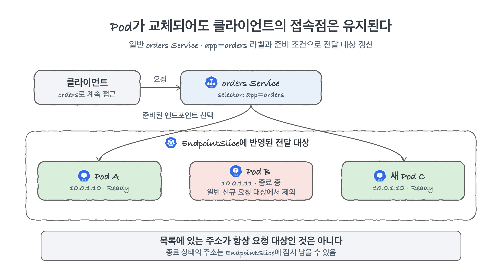
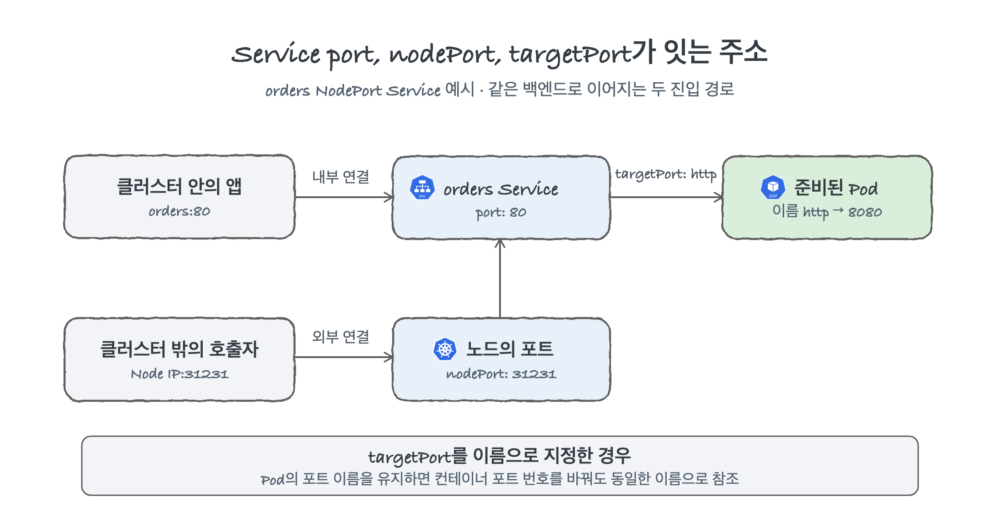

# 인프라 구성으로 이해하는 Service의 기능과 통신 경로

## 1. Service는 접속 지점과 실제 요청 대상을 연결한다

- **Service는 교체되는 Pod 대신 안정적인 이름과 접속 지점을 제공하고, 실제 요청 대상 정보를 이용해 연결을 전달한다.** Pod를 생성하거나 복제 수를 조정하는 기능은 아니다.
- 일반적인 선택자 기반 Service는 같은 Namespace에서 `selector`와 라벨이 일치하는 Pod를 찾는다. Pod의 IP·포트와 준비 상태는 EndpointSlice에 반영된다.
- 앱은 Service 이름으로 대상을 찾는 서비스 디스커버리와, 실제 연결 대상 목록을 관리하는 서비스 레지스트리를 통해 개별 Pod IP의 변경을 직접 추적하는 부담을 줄인다.

| 구성 | 역할 | 확인할 내용 |
| :--- | :--- | :--- |
| Service | 접속 이름, 노출 방식, 포트와 대상 선택 조건을 선언한다. | `type`, `selector`, `ports`와 트래픽 정책이다. |
| EndpointSlice | Service에 연결된 대상의 IP·포트와 상태를 담는다. | 주소가 존재하는지, `conditions.ready`와 노드 정보가 기대와 같은지 확인한다. |
| Pod | 앱이 실제 요청을 처리한다. | 라벨, 준비 상태와 실제 수신 포트가 맞는지 확인한다. |



- 준비되지 않은 Pod도 EndpointSlice에 기록될 수 있다. **목록에 주소가 존재하는 것과 일반 트래픽 대상으로 사용되는 것은 다르다.** 기본적으로 준비된 대상을 사용하며 `publishNotReadyAddresses` 같은 예외 설정을 구분한다.
- Readiness 실패는 Service의 일반 요청 대상에서 제외하는 동작이다. Pod IP 직접 접근이나 기존 연결까지 일괄 차단하는 네트워크 정책은 아니다.
- 강의의 `Endpoint` 그림은 기존 `Endpoints` 오브젝트를 나타낸다. 현재 대상 조회에는 EndpointSlice를 사용한다. Service 하나에 여러 Slice가 연결될 수 있으며 이름이 Service와 같을 필요도 없다. [EndpointSlice 공식 문서](https://kubernetes.io/docs/concepts/services-networking/endpoint-slices/)

## 2. DNS 조회와 패킷 전달은 서로 다른 구성 요소가 담당한다

| 인프라 영역·구성 요소 | 역할 |
| :--- | :--- |
| 노드 네트워크 | VM·물리 서버의 IP로 노드와 외부 장비가 통신한다. 강의의 예시는 `192.168.56.0/24`이다. |
| Pod 네트워크 | Pod IP로 앱 사이의 통신을 제공한다. CNI 플러그인과 네트워크 구성이 실제 연결을 담당한다. |
| Service 네트워크 | 일반 Service의 가상 IP를 할당하는 대역이다. 강의의 예시는 `10.96.0.0/12`이다. |
| CoreDNS | Service 이름을 ClusterIP, Pod IP 목록이나 별칭으로 해석한다. 사내·외부 이름은 DNS 전달 설정에 따라 조회한다. |
| kube-proxy 등 Service 구현 | Service와 EndpointSlice 변경을 반영해 패킷 전달·분산 규칙을 구성한다. |
| 외부 로드밸런서·라우터·방화벽 | 클러스터 밖의 요청을 접근 가능한 진입 주소와 포트로 전달한다. |

1. 같은 Namespace의 앱이 `orders`를 DNS로 조회한다.
2. 일반 Service라면 CoreDNS가 해당 Service의 ClusterIP를 응답한다.
3. 앱이 `<ClusterIP>:<port>`로 연결하면 Service 전달 규칙이 대상 Pod의 IP와 포트로 연결한다.
4. 선택된 Pod가 다른 노드에 있으면 Pod 네트워크를 통해 해당 노드로 전달한다.

- ClusterIP는 특정 노드에 배치된 앱 서버의 주소가 아니다. Service 오브젝트 자체가 별도 서버 프로세스로 실행되는 것도 아니다.
- kube-proxy는 일반적으로 커널의 패킷 처리 규칙을 관리한다. 요청마다 kube-apiserver를 호출하거나 모든 패킷을 kube-proxy 프로세스가 직접 중계하는 구조로 이해하지 않는다.
- 실제 전달 방식은 클러스터 구성에 따라 달라지며, CNI 구현이 kube-proxy의 역할을 대체할 수도 있다. CoreDNS 역시 Control Plane 노드에만 고정되는 구성 요소는 아니다.
- 강의에 나온 네트워크 대역은 실습 예시이다. 실제 환경에서는 노드·Pod·Service·사내망 사이의 주소 충돌과 라우팅 조건을 확인한다.

## 3. Service 유형과 세 가지 포트를 구분한다

| 유형 | 제공하는 접속 방식 | 대표 용도 |
| :--- | :--- | :--- |
| `ClusterIP` | 클러스터 내부의 가상 IP와 포트를 제공한다. 기본 유형이다. | 내부 API·백엔드 호출이다. |
| `NodePort` | ClusterIP와 함께 노드의 지정 포트를 노출한다. | 접근 가능한 `<Node IP>:<nodePort>`를 통한 호출이다. |
| `LoadBalancer` | 지원되는 인프라의 로드밸런서를 구성한다. 일반적으로 NodePort도 할당한다. | 클러스터 외부의 사용자·사내 시스템에 서비스를 제공한다. |
| `ExternalName` | Service 이름을 다른 DNS 이름의 별칭으로 연결한다. | 호출 대상의 DNS 이름을 Service 정의로 관리한다. |



| 필드 | 의미 | 예시 |
| :--- | :--- | :--- |
| `port` | Service를 호출할 때 사용하는 포트이다. | `orders:80`이다. |
| `targetPort` | 실제 대상 Pod의 포트 번호나 포트 이름이다. | `8080` 또는 `http`이다. |
| `nodePort` | 노드 주소로 외부 요청을 받을 포트이다. | `<Node IP>:31231`이다. |
| `protocol` | 해당 포트의 전송 프로토콜이다. | 기본값은 `TCP`이며 `UDP`, `SCTP`도 지원한다. |

```yaml
apiVersion: v1
kind: Service
metadata:
  name: orders
  namespace: shop-prod
spec:
  type: NodePort
  selector:
    app: orders
  ports:
    - name: http
      protocol: TCP
      port: 80
      targetPort: http
      nodePort: 31231
```

- 대상 Pod에는 `app: orders` 라벨과 `name: http`인 컨테이너 포트가 있어야 한다. 앱도 해당 포트에서 실제로 수신해야 한다.
- NodePort는 대상 Pod가 없는 노드에서도 진입점이 될 수 있다. 실제 접근 가능 여부는 노드 주소 설정·방화벽과 트래픽 정책에 따라 달라진다.
- NodePort의 기본 범위는 **`30000~32767`**이며, 수동 지정도 클러스터의 설정 범위 안에서 해야 한다. 강의의 `32768` 표기와 구분한다. [NodePort 공식 문서](https://kubernetes.io/docs/concepts/services-networking/service/#type-nodeport)
- 요청이 Service라는 별도 서버를 순서대로 방문하는 것은 아니다. `NodePort → Service → Pod`는 노출 포트와 대상 선택 관계를 설명하는 논리적 경로이다.

## 4. LoadBalancer와 externalIPs는 외부 주소를 준비하는 방식이 다르다

| 구분 | `LoadBalancer` | `externalIPs` |
| :--- | :--- | :--- |
| 선언 위치 | `spec.type: LoadBalancer`이다. | `spec.externalIPs` 목록이다. 별도의 Service 유형이 아니다. |
| 주소 준비 | 연동된 클라우드·로드밸런서 구현이 주소와 외부 장비를 관리한다. | 관리자가 해당 IP로 들어온 패킷이 노드에 도달하도록 구성해야 한다. |
| 호출 주소 | 로드밸런서의 IP 또는 호스트명과 공개 포트이다. | 지정한 IP와 Service의 `port`이다. |
| 강의의 활용 예 | 외부 사용자와 사내 시스템에 서비스를 공개한다. | 실습에서 특정 노드 IP의 `80`, `443` 포트로 접근한다. |

- **`type: LoadBalancer`를 선언하는 것만으로 모든 환경에서 외부 장비나 공인 IP가 생기지는 않는다.** 클라우드 연동이나 온프레미스용 로드밸런서 구현이 필요하다.
- 일반적인 경로는 `외부 클라이언트 → 로드밸런서 → NodePort → Pod`이다. Pod로 직접 전달하는 구현에서는 `allocateLoadBalancerNodePorts: false`를 사용할 수 있으므로 NodePort가 항상 필수인 것은 아니다.
- 외부 로드밸런서는 사내망 전용 주소를 제공할 수도 있다. 인터넷 공개 여부는 주소·라우팅·방화벽과 인프라 설정으로 결정한다.
- `externalIPs`는 지정한 IP를 노드에 자동 할당하거나 외부 경로를 광고하지 않는다. 외부 IP와 `port`로 들어온 트래픽을 Service 대상으로 전달하는 설정이다.
- `externalIPs`의 포트는 NodePort 할당 범위와 별개이지만, 실제 도달 가능성과 기존 포트·서비스와의 충돌을 확인해야 한다.
- `loadBalancerIP`는 Kubernetes v1.24부터 deprecated이며, `externalIPs`도 v1.36부터 deprecated이다. 사용하는 클러스터 버전을 확인하고 외부 IP 지정에는 지원되는 로드밸런서 구현의 설정을 따른다. [LoadBalancer 공식 문서](https://kubernetes.io/docs/concepts/services-networking/service/#type-loadbalancer), [External IPs 공식 문서](https://kubernetes.io/docs/concepts/services-networking/service/#external-ips)

## 5. ExternalName은 DNS 별칭이며 HTTP와 TLS를 변환하지 않는다

- `ExternalName`은 Service 이름을 조회했을 때 `externalName`에 지정한 DNS 이름을 CNAME으로 응답하도록 한다.
- ClusterIP를 할당하거나 Pod를 선택해 프록시하는 방식이 아니다. 실제 접속은 DNS 해석 결과를 받은 클라이언트가 수행한다.

```yaml
apiVersion: v1
kind: Service
metadata:
  name: ext-github
  namespace: shop-prod
spec:
  type: ExternalName
  externalName: github.com
```

```text
ext-github.shop-prod.svc.<cluster-domain>
  → CNAME: github.com
  → 대상 도메인의 IP 조회
  → 클라이언트가 해당 IP로 직접 연결
```

- 별칭을 유지하고 `externalName`을 바꾸면 호출 대상의 DNS 이름을 한곳에서 관리할 수 있다. 다만 클라이언트의 DNS 캐시와 연결 재사용에 따라 반영 시점이 달라질 수 있다.
- `https://ext-github`로 호출하면 클라이언트가 사용하는 TLS 서버 이름과 인증서의 `github.com`이 일치하지 않을 수 있다. HTTP `Host`도 대상 서버가 기대하는 이름과 다를 수 있다.
- 따라서 DNS 별칭만으로 HTTP·HTTPS 대상 변경이 항상 투명해지는 것은 아니다. 대상 이름으로 호출하거나 필요한 프록시·클라이언트 설정을 함께 설계한다. [ExternalName 공식 문서](https://kubernetes.io/docs/concepts/services-networking/service/#type-externalname)

## 6. Headless Service는 Pod 목록을 찾고 직접 연결할 때 사용한다

- **Headless Service는 `clusterIP: None`으로 가상 IP를 할당하지 않는 Service이다.** `type: Headless`라는 별도 유형을 선언하는 것이 아니다.
- 선택자가 있는 Headless Service는 DNS 조회에 대상 Pod의 IP 목록을 응답한다. Service의 가상 IP를 통한 분산 대신 클라이언트가 대상을 선택하고 연결한다.

| 구분 | 일반 ClusterIP Service | 선택자가 있는 Headless Service |
| :--- | :--- | :--- |
| DNS 응답 | Service의 ClusterIP이다. | 기본적으로 준비된 대상 Pod들의 IP이다. |
| 연결 방식 | 가상 IP의 전달 규칙을 통해 대상에 연결한다. | 클라이언트가 선택한 Pod에 직접 연결한다. |
| 대표 용도 | 여러 백엔드 중 하나에 요청을 전달한다. | 개별 인스턴스 식별, DB 구성원 탐색과 Pod별 수집이다. |

```yaml
apiVersion: v1
kind: Service
metadata:
  name: db
  namespace: shop-prod
spec:
  clusterIP: None
  selector:
    app: db
  ports:
    - name: database
      port: 5432
      targetPort: 5432
```

- 같은 Namespace에서 이름이 `db`인 StatefulSet이 `spec.serviceName: db`를 사용하고 Pod에 `app: db` 라벨이 있으면 `db-0.db`, `db-1.db` 같은 이름으로 개별 인스턴스를 찾을 수 있다.
- 전체 이름은 `db-0.db.shop-prod.svc.<cluster-domain>` 형태이다. 이름은 안정적으로 유지할 수 있어도 Pod 교체 후 IP는 바뀔 수 있다.
- StatefulSet의 네트워크 식별을 위한 Headless Service와, 일반 앱이 DB를 호출할 접속 지점은 용도에 따라 따로 둘 수 있다. Headless Service가 DB의 리더 선출이나 복제를 구현해 주지는 않는다.
- 모니터링 수집기가 Service 이름을 조회하면 Pod별 IP를 발견해 각각 수집할 수 있다. 일반 ClusterIP를 반복 호출하면 일부 Pod만 선택되어 Pod별 상태를 빠뜨릴 수 있다.
- Kubernetes API로 EndpointSlice를 직접 조회하는 디스커버리도 가능하다. 이 경우 API 접근 권한과 대상 변경의 추적을 별도로 관리한다.
- `publishNotReadyAddresses: true`를 사용하면 준비되지 않은 대상도 발견할 수 있다. 초기 DB 구성원 탐색 등에 필요할 수 있지만, 연결할 준비가 끝났다는 뜻은 아니다.
- 여러 IP를 받았을 때의 선택·재시도와 DNS 캐시 처리는 클라이언트가 담당한다. [Service와 Pod의 DNS 공식 문서](https://kubernetes.io/docs/concepts/services-networking/dns-pod-service/)

## 7. sessionAffinity는 클라이언트 IP를 기준으로 연결 대상을 유지한다

| 설정 | 동작 |
| :--- | :--- |
| `sessionAffinity: None` | 기본값이다. 클라이언트 IP를 기준으로 대상을 고정하지 않는다. |
| `sessionAffinity: ClientIP` | Service 구현이 관측하는 클라이언트 IP를 기준으로 같은 Pod에 연결하도록 한다. |

- 다음은 일반 Service의 `spec`에 추가할 설정이다.

```yaml
sessionAffinity: ClientIP
sessionAffinityConfig:
  clientIP:
    timeoutSeconds: 10800
```

- 기본 유지 시간은 `10800`초, 즉 3시간이다. 플랫폼에 따라 시간 설정 지원이 다를 수 있다. [Session affinity 공식 문서](https://kubernetes.io/docs/reference/networking/virtual-ips/#session-affinity)
- 사용자 계정·쿠키가 아닌 IP를 기준으로 한다. 앞단 프록시나 NAT 때문에 여러 사용자가 같은 IP로 보이면 한 Pod에 부하가 몰릴 수 있다.
- 선택된 Pod가 제거되면 다른 Pod로 연결될 수 있다. 서버 메모리에만 저장한 로그인 세션을 복제하거나 복구해 주지는 않는다.
- `None`이어도 기존 TCP 연결은 같은 대상과 통신한다. HTTP keep-alive나 연결 풀을 사용하는 실험에서 요청이 반복해서 같은 Pod에 도달하는 현상을 세션 고정과 혼동하지 않는다.

## 8. 트래픽 정책은 클러스터 전체와 현재 노드 중 대상 범위를 정한다

| 필드·값 | 적용되는 경로 | 대상 범위 |
| :--- | :--- | :--- |
| `internalTrafficPolicy: Cluster` | ClusterIP로 들어오는 내부 트래픽이다. 기본값이다. | 클러스터 전체의 준비된 대상을 사용할 수 있다. |
| `internalTrafficPolicy: Local` | ClusterIP로 들어오는 내부 트래픽이다. | 요청을 처리하는 노드의 로컬 대상으로 제한한다. 일반적인 Pod 호출에서는 호출한 Pod가 있는 노드이다. |
| `externalTrafficPolicy: Cluster` | NodePort·LoadBalancer·externalIPs로 들어오는 외부 트래픽이다. 기본값이다. | 다른 노드의 준비된 대상으로도 전달할 수 있다. |
| `externalTrafficPolicy: Local` | 외부 진입 경로의 트래픽이다. | 트래픽을 받은 노드의 로컬 대상으로 제한한다. |

- **`Local`은 다른 노드에 대상이 없다는 뜻이 아니라, 다른 노드로 전달하지 않는 정책이다.** 정상 서비스 중 로컬에 준비된 대상이 없으면 다른 노드로 자동 우회하지 않는다. 종료 중 연결 정리에는 별도 처리 규칙이 적용될 수 있다.
- 예를 들어 Worker 1에만 대상 Pod가 있다면 `externalTrafficPolicy: Cluster`에서는 Worker 2의 NodePort로 들어온 연결도 전달할 수 있다. `Local`에서는 Worker 2에 로컬 대상이 없어 전달하지 않는다.
- `internalTrafficPolicy: Local`도 호출 위치에 따라 성공 여부가 달라질 수 있다. 같은 Service를 호출해도 대상 Pod와 같은 노드의 앱만 정상 연결될 수 있다.
- `externalTrafficPolicy: Local`은 노드 사이의 추가 전달과 원본 IP 변환을 줄이고 클라이언트 IP를 보존할 때 사용한다. 앞단 로드밸런서·프록시가 주소를 바꾸는지도 함께 확인한다.
- `Local`을 사용하면 노드별 Pod 배치와 외부 로드밸런서의 상태 검사가 중요하다. 노드별 대상 수가 다르면 Pod별 부하도 불균등해질 수 있다.
- 두 정책은 각각 설정할 수 있다. 대상의 위치를 제한하는 정책과 클라이언트별 대상을 유지하는 `sessionAffinity`는 서로 다른 기능이다. [트래픽 정책 공식 문서](https://kubernetes.io/docs/reference/networking/virtual-ips/#traffic-policies)

## 9. 장애를 찾을 때는 이름 조회부터 외부 진입 경로까지 나눠 확인한다

| 증상 | 우선 확인할 내용 |
| :--- | :--- |
| Service 이름을 찾지 못한다. | Service 이름·Namespace, Pod의 DNS 설정과 CoreDNS 상태이다. |
| DNS는 성공하지만 연결되지 않는다. | 선택자·라벨, EndpointSlice의 주소·준비 상태, 실제 수신 포트이다. |
| Pod IP는 되지만 ClusterIP는 실패한다. | Service 포트 연결, Service 전달 규칙, 내부 트래픽 정책과 네트워크 정책이다. |
| 특정 노드에서만 성공한다. | `Local` 정책, 노드별 대상 Pod 배치와 노드별 네트워크 설정이다. |
| NodePort는 되지만 외부 주소는 실패한다. | 로드밸런서의 대상·상태 검사, 외부 IP 라우팅·방화벽과 DNS이다. |
| ExternalName은 조회되지만 HTTPS가 실패한다. | 인증서 이름, TLS 서버 이름과 HTTP `Host`이다. |
| 일부 Pod로만 연결된다. | 연결 재사용, ClientIP 고정, NAT와 노드별 대상 분포이다. |

```bash
kubectl get service orders -n shop-prod -o yaml
kubectl get pods -n shop-prod -l app=orders -o wide --show-labels
kubectl get endpointslices -n shop-prod \
  -l kubernetes.io/service-name=orders -o yaml
kubectl describe service orders -n shop-prod
```

- DNS 조회 도구와 HTTP 클라이언트가 있는 테스트 Pod에서는 다음처럼 확인할 수 있다. `test-client`는 실제 테스트 Pod 이름으로 바꾼다.

```bash
kubectl exec -n shop-prod test-client -- nslookup orders
kubectl exec -n shop-prod test-client -- curl -v http://orders:80/version
kubectl exec -n shop-prod test-client -- nslookup db
kubectl exec -n shop-prod test-client -- nslookup db-0.db
```

- Pod IP·ClusterIP·NodePort·로드밸런서 주소를 같은 호출 위치와 시간대에서 비교하면 실패 구간을 좁힐 수 있다. 외부 진입 경로는 실제 클러스터 외부의 클라이언트에서도 검증한다.
- Headless와 ExternalName은 ClusterIP가 없는 방식이다. 일반 Service와 같은 가상 IP 경로를 가정하지 않고 DNS 응답과 직접 연결 대상을 확인한다.
- Service 상태만으로 앱의 정상 동작을 판단하지 않는다. 대상 Pod의 로그·이벤트, 준비 상태와 실제 업무 API 응답을 함께 확인한다.
