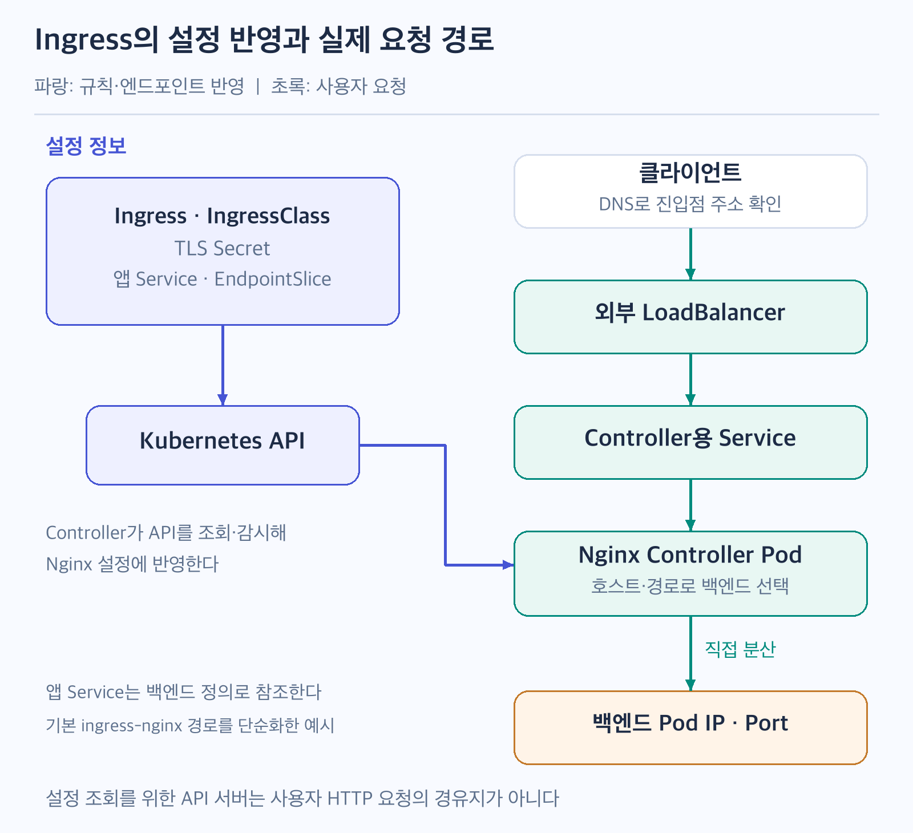
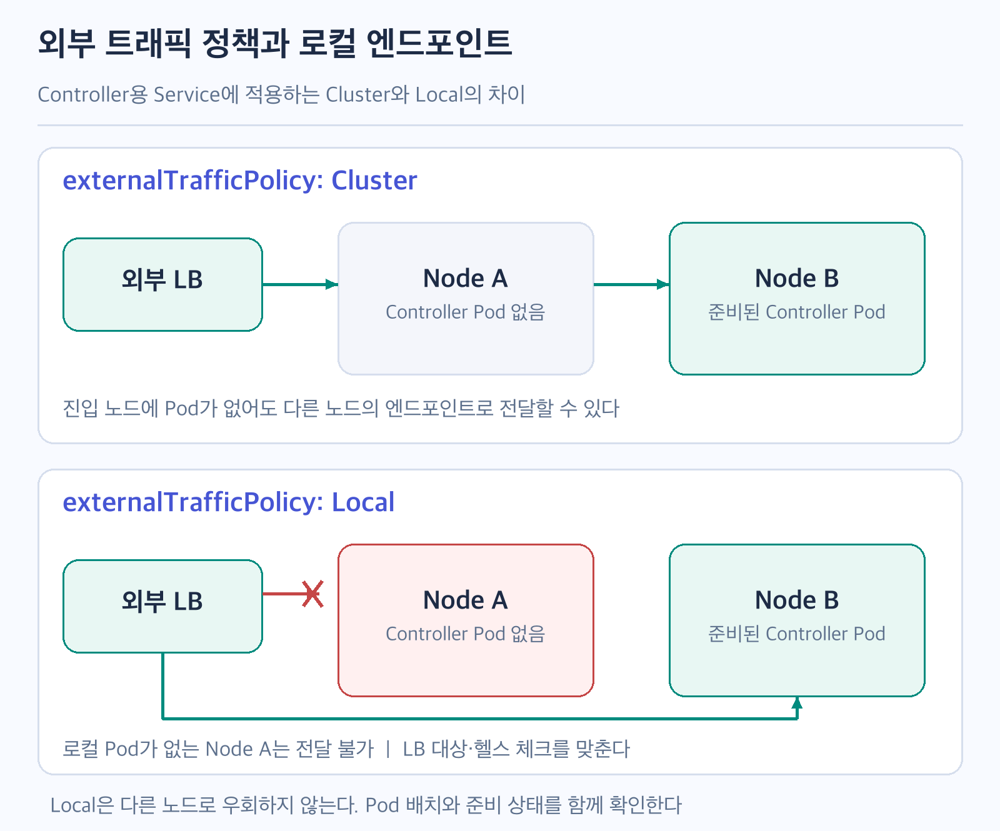

# Ingress와 Nginx로 HTTP 요청과 TLS 관리하기

## 1. Ingress는 요청 규칙을 선언하고 Controller가 실제로 처리한다

- **Ingress는 HTTP·HTTPS 요청을 호스트와 경로에 따라 백엔드 Service로 연결하는 규칙이다.** Ingress 오브젝트를 만드는 것만으로 요청을 처리할 프록시나 외부 주소가 자동으로 준비되는 것은 아니다.
- Ingress Controller는 Kubernetes API에서 규칙과 백엔드 정보를 조회하고 실제 프록시·로드밸런서 설정에 반영한다. Nginx 기반 Controller는 그 구현 중 하나이다.
- Service는 Pod에 연결할 주소와 포트를 제공하고, Ingress는 여러 Service 앞에서 HTTP 요청을 구분한다. 앱마다 별도 외부 로드밸런서를 두는 대신 공통 진입점을 사용할 수 있다.

| 구성 요소 | 역할 | 확인할 관계 |
| :--- | :--- | :--- |
| DNS | 도메인을 진입점 주소로 해석한다. | `portal.com`이 접근 가능한 로드밸런서 등의 주소를 가리켜야 한다. |
| 외부 LoadBalancer | 외부 연결을 Controller 쪽으로 전달한다. | 공인·사설 접근 범위, 대상 노드와 포트를 확인한다. |
| Controller용 Service | Controller Pod를 노출한다. | `LoadBalancer`나 `NodePort` 등 환경에 맞는 방식을 사용한다. |
| Ingress Controller | 규칙을 읽고 프록시를 구성한다. | 설치 여부, 담당 클래스와 리소스 조회 권한을 확인한다. |
| IngressClass | Ingress를 처리할 Controller 구현을 식별한다. | Ingress의 `spec.ingressClassName`이 클래스 이름을 참조한다. |
| Ingress | 호스트·경로·TLS와 백엔드를 선언한다. | Service 이름과 Service의 포트를 지정한다. |
| 앱 Service·EndpointSlice | 백엔드 연결 정의와 실제 엔드포인트 정보를 제공한다. | 선택자, 준비된 Pod 주소와 대상 포트를 확인한다. |
| TLS Secret | 서버 인증서와 개인 키를 보관한다. | Ingress의 `spec.tls[].secretName`으로 참조한다. |

- Controller용 Service와 앱 Service는 역할이 다르다. 외부에 Controller를 노출했다고 모든 앱 Service도 외부용 `LoadBalancer`로 만들 필요는 없다.
- 이 문서의 `nginx.ingress.kubernetes.io/*` 설정은 강의에서 사용한 커뮤니티 **ingress-nginx**의 기능이다. 해당 프로젝트는 2026년 3월 유지보수 종료 대상으로 공지되었으며 이후 버그·보안 수정이 제공되지 않는다. 신규 구성에서는 유지보수되는 Controller나 Gateway API 구현을 검토한다. Ingress API와 다른 Nginx 기반 제품의 지원 수명은 별개이다. [공식 종료 안내](https://kubernetes.io/blog/2025/11/11/ingress-nginx-retirement/)

## 2. 설정을 읽는 경로와 사용자 요청 경로를 구분한다



1. Controller가 Kubernetes API를 통해 자신이 담당하는 Ingress와 관련 리소스를 조회한다.
2. Ingress의 호스트·경로, Service의 포트와 엔드포인트 정보를 프록시 설정에 반영한다.
3. 클라이언트가 DNS로 진입점 주소를 얻고 HTTP·HTTPS 요청을 보낸다.
4. 외부 로드밸런서와 Controller용 Service를 통해 Nginx에 연결한다.
5. Nginx가 요청의 호스트·경로에 맞는 백엔드를 고르고 요청을 전달한다.

- **Ingress에 Service를 참조하더라도 실제 패킷이 반드시 그 Service의 ClusterIP를 통과하는 것은 아니다.** ingress-nginx는 기본적으로 백엔드 엔드포인트의 Pod IP·포트를 사용해 직접 분산한다.
- 따라서 `Service → Pod`는 선언 관계를 설명할 때와 실제 패킷 경로를 설명할 때 의미가 다를 수 있다. API 서버도 사용자 요청마다 통과하는 HTTP 프록시가 아니다.
- ingress-nginx의 `service-upstream` 등으로 Service의 ClusterIP를 사용하는 구성도 가능하다. Service의 트래픽 정책이나 세션 어피니티 효과를 판단할 때 실제 전달 방식을 먼저 확인한다.

## 3. IngressClass와 RBAC로 Controller의 담당 범위를 정한다

- `IngressClass`는 클러스터 범위 리소스이고 Ingress는 Namespace 범위 리소스이다. 클래스의 이름과 `spec.controller`가 가리키는 Controller 식별자를 구분한다.
- 예를 들어 `ingressClassName: nginx`는 이름이 `nginx`인 IngressClass를 참조한다. Controller Pod의 이름을 직접 선택하는 필드가 아니다.
- 여러 Controller를 운영할 때는 담당 클래스와 Controller 실행 옵션을 맞춘다. 같은 클래스를 여러 Controller가 의도치 않게 처리하면 설정·상태 갱신이 충돌할 수 있다.
- 기본 클래스로 지정한 IngressClass는 클래스가 생략된 새 Ingress에 적용될 수 있다. 기본 클래스 지정과 클래스 없는 Ingress를 처리하는 Controller 옵션은 구분하며, 앱 YAML에는 클래스를 명시하는 편이 추적하기 쉽다.
- Controller가 여러 Namespace의 리소스를 읽으려면 그 범위에 맞는 RBAC 권한이 필요하다. ClusterRole의 규칙과 ClusterRoleBinding의 ServiceAccount 연결을 확인한다.
- Controller의 조회 범위와 백엔드 참조 범위는 별개이다. 일반적인 Ingress의 Service 백엔드와 TLS Secret은 **Ingress와 같은 Namespace**에 둔다.

## 4. 호스트와 경로를 Service의 포트에 연결한다

- 다음은 `web` Namespace에 Controller가 처리할 `nginx` 클래스와 `portal` Service가 준비되어 있다고 가정한 예시이다. `portal` Service는 80번 포트를 제공해야 한다.

```yaml
apiVersion: networking.k8s.io/v1
kind: Ingress
metadata:
  name: portal
  namespace: web
spec:
  ingressClassName: nginx
  rules:
    - host: portal.example.com
      http:
        paths:
          - path: /
            pathType: Prefix
            backend:
              service:
                name: portal
                port:
                  number: 80
```

| 필드 | 의미 | 주의할 점 |
| :--- | :--- | :--- |
| `rules[].host` | 요청을 구분할 도메인이다. | DNS 레코드를 생성하는 설정은 아니다. |
| `paths[].path` | 요청 경로의 매칭 조건이다. | 경로를 매칭하는 것과 백엔드에 전달할 경로를 바꾸는 것은 다르다. |
| `pathType: Exact` | 경로가 정확히 일치해야 한다. | `/core`와 `/core/`는 다르다. |
| `pathType: Prefix` | `/`로 나눈 경로 요소 단위로 접두사를 비교한다. | `/core`는 `/core/hostname`에 매칭되지만 `/coreadmin`에는 매칭되지 않는다. |
| `pathType: ImplementationSpecific` | Controller 구현이 매칭 방식을 해석한다. | 정규식 등 구현별 기능을 사용할 때 해당 Controller의 규칙을 확인한다. |
| `backend.service.port` | 백엔드 Service가 제공하는 포트이다. | Pod의 `containerPort`나 외부 `nodePort`를 바로 지정하는 필드가 아니다. |

- 표준 경로 매칭에서는 가장 긴 경로가 우선하고, 같은 길이라면 `Exact`가 `Prefix`보다 우선한다. 정규식 확장을 사용하면 Controller별 매칭 규칙도 확인한다.
- 내부 서버도 해당 진입점에 접근할 수 있으면 같은 라우팅을 이용할 수 있다. Controller용 Service의 DNS 이름으로 호출할 때도 요청의 `Host`가 Ingress 규칙과 맞아야 한다.
- 예를 들어 Service DNS 이름으로 연결해도 `Host: portal.example.com`을 보내면 해당 호스트 규칙을 시험할 수 있다. HTTPS에서는 인증서 검증과 SNI도 함께 맞춰야 한다.

## 5. 경로 분기와 Rewrite를 별도로 설정한다

- `/core/hostname`을 `core` 앱으로 보내더라도 앱이 `/hostname`만 제공한다면 접두사 `/core`를 제거해야 한다. Ingress의 경로 분기만으로 접두사가 자동 삭제되지는 않는다.
- ingress-nginx에서는 정규식 매칭과 `rewrite-target` annotation으로 전달 경로를 바꿀 수 있다. 다음 예시는 `web` Namespace의 `core` Service가 80번 포트를 제공한다고 가정한다.

```yaml
apiVersion: networking.k8s.io/v1
kind: Ingress
metadata:
  name: core
  namespace: web
  annotations:
    nginx.ingress.kubernetes.io/use-regex: "true"
    nginx.ingress.kubernetes.io/rewrite-target: /$2
spec:
  ingressClassName: nginx
  rules:
    - host: portal.example.com
      http:
        paths:
          - path: /core(/|$)(.*)
            pathType: ImplementationSpecific
            backend:
              service:
                name: core
                port:
                  number: 80
```

| 외부 요청 경로 | 매칭·변경 결과 |
| :--- | :--- |
| `/core/hostname` | 두 번째 캡처 그룹이 `hostname`이므로 `/hostname`으로 전달한다. |
| `/core/` 또는 `/core` | 두 번째 캡처 그룹이 비어 있으므로 `/`로 전달한다. |
| `/coreadmin` | `/core` 뒤에 `/`나 경로 끝이 없으므로 이 규칙에 매칭되지 않는다. |

- Rewrite는 프록시가 백엔드에 보낼 경로를 바꾸는 기능이고, Redirect는 클라이언트에 새 URL로 요청하라고 응답하는 기능이다. 브라우저 주소가 바뀌는지와 백엔드 수신 경로를 각각 확인한다.
- `cust` 앱에도 같은 방식으로 `/cust(/|$)(.*)`를 사용할 수 있다. annotation은 해당 Ingress에 적용되므로 Rewrite가 필요한 경로와 필요 없는 경로의 리소스 구성을 구분한다.
- ingress-nginx에서는 같은 호스트의 한 Ingress에서 `use-regex`나 `rewrite-target`을 사용하면 다른 경로의 정규식 처리에도 영향을 줄 수 있다. 같은 호스트의 전체 규칙을 함께 검토한다. [공식 annotation 설명](https://kubernetes.github.io/ingress-nginx/user-guide/nginx-configuration/annotations/#use-regex)

## 6. TLS 종료 위치와 인증서 참조를 맞춘다

- **Ingress에서 TLS를 종료하면 클라이언트와 Nginx 사이를 암호화하고, Nginx에서 앱으로 보내는 연결은 별도로 구성한다.** Ingress의 TLS 설정만으로 백엔드 연결까지 자동으로 HTTPS가 되지는 않는다.
- 외부 로드밸런서에서 TLS를 종료하는 구성도 가능하다. 어느 구간이 HTTP·HTTPS인지 먼저 그린 뒤 종료 후 재암호화가 필요한지를 정한다.

| TLS 적용 위치 | 관리하는 내용 | 확인할 점 |
| :--- | :--- | :--- |
| 외부 LoadBalancer | 클러스터 앞단에서 인증서와 TLS를 관리한다. | Controller까지 암호화를 유지하는지, 원래 프로토콜을 어떻게 전달하는지 확인한다. |
| Ingress Controller | 호스트별 인증서를 Secret으로 참조해 TLS를 종료한다. | 내부에서 같은 진입점을 호출하는 클라이언트도 TLS·리다이렉트 정책의 영향을 받는다. |
| 앱 | 앱이 직접 TLS 연결을 처리한다. | 앱별 인증서 배포·갱신이나 프록시와의 TLS 연결을 관리한다. |

- 인증서와 개인 키로 TLS Secret을 만든다. 파일은 실제 호스트에 맞는 인증서와 키로 준비한다.

```bash
kubectl create secret tls portal-tls -n web \
  --cert=tls.crt --key=tls.key
```

- 앞의 `portal` Ingress의 `spec` 아래에 다음 `tls` 설정을 추가한다. 기존 `ingressClassName`과 `rules`는 함께 유지한다.

```yaml
tls:
  - hosts:
      - portal.example.com
    secretName: portal-tls
```

- Secret의 타입은 `kubernetes.io/tls`이고 데이터 키는 `tls.crt`, `tls.key`이다. `cert`, `key`라는 임의의 키를 사용하는 것이 아니다.
- `tls.hosts`, `rules.host`와 인증서의 SAN에 포함된 호스트 이름을 맞춘다. Secret은 Ingress와 같은 Namespace에 있어야 한다.
- 자체 서명 인증서는 기본적으로 브라우저가 신뢰하지 않을 수 있다. 사설 CA 인증서도 클라이언트가 해당 CA를 신뢰하도록 구성하면 사용할 수 있으며, 사설 인증서가 모두 임시 테스트 전용인 것은 아니다.
- TLS는 HTTP 내용을 암호화하지만 네트워크 전달에 필요한 목적지 IP·포트까지 숨기지는 않는다. 내부 통신도 네트워크 경계와 요구사항에 따라 별도로 암호화한다.

### HTTP 리다이렉트와 외부 HTTPS 포트를 함께 확인한다

- ingress-nginx는 TLS가 설정된 Ingress에서 기본적으로 HTTP를 HTTPS로 리다이렉트하며, `nginx.ingress.kubernetes.io/ssl-redirect` annotation으로 제어할 수 있다.
- HTTP를 `31080`, HTTPS를 `31443` NodePort로 직접 노출한 실습에서는 리다이렉트 URL이 기본 HTTPS 포트 443을 가리켜 접속에 실패할 수 있다. 응답의 `Location`이 실제 접근 가능한 주소·포트인지 확인한다.
- 외부에는 80·443을 노출하고 내부 NodePort로 전달하는 구성이라면 외부 URL에 NodePort를 넣을 필요가 없다. 외부 포트와 클러스터 안의 전달 포트를 구분한다.
- 원문의 `configuration-snippet` 방식은 Controller가 snippet annotation을 허용할 때만 적용할 수 있다. 임의 Nginx 설정을 삽입하는 기능이므로 외부 포트 매핑과 Controller의 지원 설정을 먼저 확인한다.

## 7. Ingress별 설정과 Controller 공통 설정을 구분한다

| 설정 위치 | 예시 | 적용 범위 |
| :--- | :--- | :--- |
| Ingress의 `spec` | 호스트, 경로, Service, TLS Secret이다. | 해당 Ingress의 표준 라우팅 정의이다. |
| Ingress의 annotation | Rewrite, 리다이렉트, 쿠키 기반 세션 유지 등이다. | Controller가 해석하는 구현별 설정이다. 같은 호스트에 영향이 합쳐질 수 있다. |
| Controller용 ConfigMap | 기본 분산 알고리즘, 접근 로그 형식 등이다. | 그 ConfigMap을 참조하는 Controller의 공통 설정이다. |
| Controller Pod의 실행 설정 | 실행 인자, 환경 변수와 시간대 등이다. | 해당 Controller 프로세스의 실행 환경이다. |

- ConfigMap을 임의로 생성하기만 하면 적용되는 것은 아니다. Controller의 실행 옵션이 실제로 참조하는 ConfigMap의 이름·Namespace를 확인한다.
- 다음은 Controller용 ConfigMap의 `data`에 넣을 설정 예시이다. `round_robin`은 순환 분산이고 `ewma`는 응답 시간 등을 반영하는 Peak EWMA 방식이다.

```yaml
data:
  load-balance: "ewma"
```

- **순환 분산의 설정값은 `round_robin`이다.** 알고리즘 이름을 설명할 때 쓰는 `round-robin` 표기와 실제 ConfigMap 값을 구분한다. [공식 load-balance 설정](https://kubernetes.github.io/ingress-nginx/user-guide/nginx-configuration/configmap/#load-balance)
- EWMA가 느린 엔드포인트의 선택을 줄이는 데 도움이 될 수 있지만, Pod의 CPU 사용량을 직접 읽어 항상 균등하게 만드는 기능은 아니다. 요청 특성, 장애와 재시도 동작도 함께 본다.
- 설정 종류에 따라 동적 갱신이나 Nginx reload가 일어날 수 있다. ConfigMap 저장 성공만으로 반영을 단정하지 않고 Controller 로그와 실제 요청 결과를 확인한다.
- 시간대 환경 변수 변경도 이미지의 지원 여부와 로그 형식에 따라 결과가 달라진다. UTC 사용 등 조직의 로그 시각 기준을 맞추고 실제 타임스탬프를 확인한다.

## 8. 세션 유지와 세션 데이터 저장을 구분한다

- 세션에는 로그인 상태, 사용자 설정과 임시 작업 정보 등이 포함될 수 있다. 여러 Pod가 요청을 처리할 때는 어떤 Pod로 보내는지와 데이터가 어디에 있는지를 나눠 설계한다.

| 방식 | 동작 | 제약·확인할 점 |
| :--- | :--- | :--- |
| 브라우저 쿠키 | 세션 ID나 서명·암호화한 상태 등을 클라이언트가 보관한다. | 쿠키에 담는 데이터와 위변조 방지, `Secure`·`HttpOnly` 등의 정책을 확인한다. |
| 스티키 세션 | 같은 클라이언트를 같은 백엔드로 보내도록 선택한다. | Pod 장애·교체 시 메모리 세션이 사라질 수 있고 부하가 치우칠 수 있다. |
| 서버 간 세션 복제 | 각 서버가 세션 변경을 다른 서버에 전달한다. | 복제 지연, 정합성과 서버·네트워크 부하를 관리한다. |
| 공통 세션 저장소 | 앱들이 Redis 같은 외부 저장소에서 세션을 읽고 쓴다. | Pod 확장이 쉬워지지만 저장소의 가용성·만료·접근 제어를 관리해야 한다. |

- 쿠키를 쓴다는 사실만으로 세션 정보 전체를 브라우저에 저장하는 것은 아니다. 서버 측 세션 ID를 쿠키에 보관하면서 공통 저장소를 함께 사용할 수도 있다.
- Service는 `sessionAffinity: ClientIP`로 자신이 관측한 클라이언트 IP에 따라 같은 엔드포인트를 선택하도록 설정할 수 있다. 다음은 Service의 `spec`에 추가하는 부분이다.

```yaml
sessionAffinity: ClientIP
sessionAffinityConfig:
  clientIP:
    timeoutSeconds: 600
```

- 600초는 어피니티의 타임아웃이지, 해당 Pod가 10분 동안 반드시 살아 있고 연결이 보장된다는 뜻은 아니다. 엔드포인트가 바뀌면 선택 결과도 달라질 수 있다.
- NAT 뒤의 여러 사용자가 하나의 IP로 보이거나 Nginx가 앱에 새 연결을 만들면 사용자가 아닌 NAT·프록시 IP를 기준으로 묶일 수 있다.
- ingress-nginx가 Pod IP로 직접 분산하면 앱 Service의 `ClientIP` 설정이 그 분산을 제어하지 않는다. Nginx 계층에서 쿠키 기반 affinity를 설정하는 것과 구분한다.
- **스티키 세션은 요청 대상 선택이고, 공통 세션 저장소는 상태의 보관 방식이다.** 스티키 세션만으로 Pod 장애 시 로그인 상태가 복구되는 것은 아니다.

## 9. 트래픽 정책과 Client IP는 실제 네트워크 경로에 따라 판단한다



| Service 필드·값 | 전달 범위 | 확인할 점 |
| :--- | :--- | :--- |
| `sessionAffinity: None` | IP 기반 고정을 사용하지 않는다. | 기본값이다. |
| `sessionAffinity: ClientIP` | 클라이언트 IP별 엔드포인트 선택을 유지한다. | 어떤 IP가 관측되는지와 해당 Service를 실제로 경유하는지 확인한다. |
| `internalTrafficPolicy: Cluster` | 내부 요청을 클러스터의 준비된 엔드포인트로 전달한다. | 기본값이며 다른 노드로 전달할 수 있다. |
| `internalTrafficPolicy: Local` | 내부 요청을 요청 노드의 준비된 엔드포인트로 제한한다. | 로컬 엔드포인트가 없으면 다른 노드의 Pod로 대체 전달하지 않는다. |
| `externalTrafficPolicy: Cluster` | 외부에서 들어온 요청을 클러스터의 준비된 엔드포인트로 전달한다. | 기본값이며 노드 간 전달과 소스 IP 변환이 발생할 수 있다. |
| `externalTrafficPolicy: Local` | 외부에서 들어온 요청을 진입 노드의 준비된 엔드포인트로 제한한다. | 노드 간 추가 전달을 피하고 원본 소스 IP 보존에 유리하다. LB 자체의 주소 변환 여부는 별도로 확인한다. |

- `internalTrafficPolicy: Local`은 통신할 두 앱을 같은 노드에 스케줄링하는 기능이 아니다. Pod affinity 등으로 배치를 맞춰야 하며, 그 결과 자원 분산과 스케줄링 제약이 생길 수 있다.
- `externalTrafficPolicy: Local`인데 외부 LB가 Controller Pod가 없는 노드에도 계속 트래픽을 보내면 그 요청은 전달되지 않는다. LB가 준비된 로컬 엔드포인트가 있는 노드를 선택하도록 헬스 체크와 대상 구성을 맞춘다.
- Deployment는 선택한 노드들에 복제본을 배치하고, DaemonSet은 실행 조건을 만족하는 각 대상 노드에 Pod를 배치한다. DaemonSet을 사용해도 taint·toleration·노드 선택 조건과 준비 상태는 확인해야 한다.
- 위 정책은 Service를 통한 전달에 적용된다. Nginx가 백엔드 Pod IP에 직접 연결하는 구간까지 앱 Service의 정책이 강제되는 것은 아니다. [공식 트래픽 정책 설명](https://kubernetes.io/docs/reference/networking/virtual-ips/#traffic-policies)
- 앱의 TCP 연결 상대는 사용자 대신 Nginx일 수 있다. 앱에서 사용자 IP를 사용할 때는 신뢰하는 프록시가 전달한 `X-Forwarded-For`·`X-Real-IP` 등의 헤더와 신뢰 범위를 함께 설정한다. 클라이언트가 보낸 헤더를 무조건 신뢰하지 않는다.

## 10. 장애가 나면 진입점부터 엔드포인트까지 순서대로 확인한다

| 확인 단계 | 확인할 내용 |
| :--- | :--- |
| DNS·외부 LB | 도메인 해석 결과, 접근 가능한 주소·포트, LB 대상과 헬스 체크이다. |
| Controller용 Service | `port`, `targetPort`, `nodePort`와 Controller Pod의 준비 상태이다. |
| Controller·IngressClass | Controller 실행 상태, 클래스 일치, 조회 범위와 RBAC 권한이다. |
| Ingress | Namespace, Host·경로·`pathType`, annotation과 이벤트이다. |
| 앱 Service·EndpointSlice | Service 포트, Pod 선택자, 준비된 엔드포인트와 실제 앱 수신 포트이다. |
| TLS·리다이렉트 | Secret 이름·데이터 키, 인증서 호스트·신뢰·만료와 `Location`의 주소·포트이다. |
| 세션·Client IP | 분산을 수행하는 계층, 관측 IP, 신뢰할 프록시와 세션 저장 위치이다. |

```bash
kubectl get ingressclass
kubectl get ingress -n web
kubectl describe ingress portal -n web
kubectl get svc,pods -n ingress-nginx
kubectl logs -n ingress-nginx deployment/ingress-nginx-controller
kubectl get svc portal core -n web
kubectl get endpointslices -n web \
  -l kubernetes.io/service-name=core
```

- Controller의 Namespace·Deployment 이름은 실제 설치 이름으로 바꾼다. 명령 예시의 `ingress-nginx`라는 이름이 필수값은 아니다.
- HTTP 경로는 `curl -i -H 'Host: portal.example.com' http://<진입점주소>:<HTTP포트>/core/hostname`처럼 호스트를 맞춰 시험할 수 있다. 리다이렉트를 따라가기 전에 응답 코드와 `Location`을 확인한다.
- Controller 접근 로그, 백엔드 앱 로그와 엔드포인트 상태를 같은 시간대에 비교한다. 라우팅 성공뿐 아니라 Rewrite 후 경로, 인증서, 세션 유지와 장애 시 동작도 검증한다.
