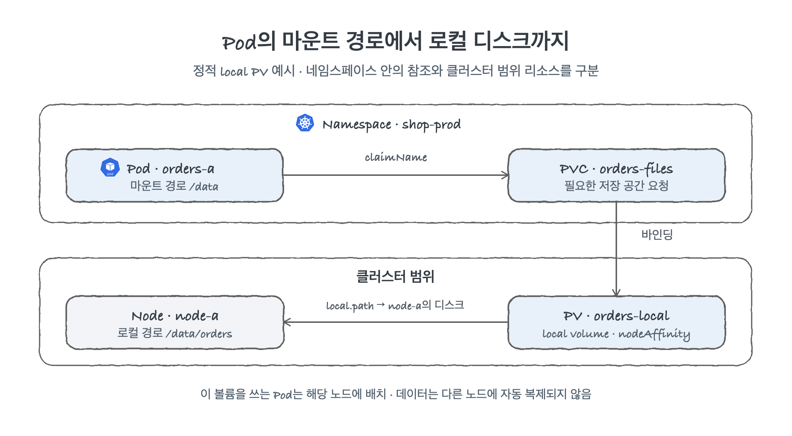

# Volume의 종류와 PV·PVC의 연결 구조 이해하기

## 1. 저장소의 사용 목적을 먼저 정한다

- **PV·PVC를 이해하려면 앱이 데이터를 어떻게 저장하고 공유해야 하는지부터 정한다.** DB의 데이터 디스크, 여러 앱이 공유하는 디렉터리와 API로 접근하는 객체 저장소는 사용 방식이 다르다.
- 기능 사용법만 익히면 어떤 스토리지를 구축하고 어떤 설정을 적용해야 하는지 판단하기 어렵다. 사용 목적 → 스토리지 특성 → 구축 방식 → Kubernetes 리소스 순서로 연결한다.
- 컨테이너의 쓰기 가능 계층에 저장한 파일은 컨테이너를 새로 만들 때 유지되지 않는다. `emptyDir`는 같은 Pod 안의 컨테이너 재시작에는 유지되지만 Pod가 삭제되면 사라진다.
- PV·PVC는 Pod와 저장 데이터의 수명을 분리하는 데 사용한다. 데이터 공유, 복제와 장애 복구는 실제 스토리지와 앱의 구성까지 확인해야 한다.

| 필요한 동작 | 먼저 검토할 저장 방식 | 확인할 질문 |
| :--- | :--- | :--- |
| DB가 자신의 데이터를 빠르게 읽고 쓴다. | Block Storage이다. | 지연 시간, IOPS와 장애 시 볼륨 재연결이 요구를 만족하는가? |
| 여러 앱 복제본이 같은 파일을 읽고 쓴다. | File Storage이다. | 여러 노드에서 접근할 수 있고 동시 쓰기를 처리할 수 있는가? |
| 이미지·영상·첨부 파일 등을 대용량으로 보관한다. | Object Storage이다. | 앱이 객체 API를 사용하고 용량·비용·접근 권한을 관리할 수 있는가? |

## 2. Block·File·Object는 데이터를 사용하는 인터페이스가 다르다

| 구분 | Block Storage | File Storage | Object Storage |
| :--- | :--- | :--- | :--- |
| 저장 단위 | 고정 크기의 블록이다. | 디렉터리와 파일이다. | 키로 식별하는 객체이다. |
| 앱에서 사용하는 방식 | 디스크 장치로 연결하고 보통 파일시스템을 구성해 사용한다. | NFS 같은 네트워크 파일시스템을 마운트한다. | HTTP API나 SDK로 업로드·다운로드한다. |
| 대표 예 | 로컬 디스크, 클라우드 블록 볼륨과 Longhorn 볼륨이다. | NAS와 NFS이다. | S3 호환 서비스와 MinIO이다. |
| 주요 용도 | DB 등 디스크 I/O 특성이 중요한 데이터 저장이다. | 여러 앱 복제본이 함께 사용하는 파일 저장이다. | 계속 증가하는 대용량 파일·콘텐츠 보관이다. |
| 공유·접근 특성 | 일반적으로 한 노드에서 쓰는 구성이 흔하며 다중 연결 지원은 제품마다 다르다. | 여러 클라이언트가 같은 파일시스템에 접근할 수 있다. | 여러 앱이 같은 객체 서비스에 API로 접근한다. |
| 고려할 비용 | 디스크 성능, 연결 제약과 복제 비용이다. | 네트워크 지연, 서버 성능과 파일 잠금이다. | 요청·전송 비용과 객체 단위 처리 방식이다. |

- Block Storage도 네트워크를 통해 제공될 수 있다. 물리적으로 서버에 장착한 디스크만을 뜻하지 않는다.
- Block Storage가 항상 가장 빠르거나 공유가 절대 불가능한 것은 아니다. 실제 성능과 동시 연결 여부는 제품·드라이버·파일시스템에 따라 달라진다.
- 블록 스토리지를 PV로 제공하더라도 앱은 보통 마운트된 디렉터리를 사용한다. PV·PVC의 `volumeMode: Block`은 파일시스템 없이 원시 블록 장치를 제공하는 별도 설정이다.
- Object Storage는 일반적으로 PVC로 마운트하지 않고 앱에서 API로 사용한다. 파일의 일부 수정, 디렉터리 조작과 잠금이 로컬 파일시스템처럼 동작한다고 가정하지 않는다.

## 3. Pod는 PVC를 참조하고 PV가 실제 저장소를 표현한다



| 구성요소·필드 | 역할 | 연결 기준 |
| :--- | :--- | :--- |
| 컨테이너의 `volumeMounts` | 볼륨을 컨테이너 내부 경로에 마운트한다. | `name`은 Pod 볼륨 이름, `mountPath`는 앱이 사용할 경로이다. |
| Pod의 `volumes` | 사용할 볼륨의 출처를 선언한다. | `persistentVolumeClaim.claimName`으로 PVC 이름을 참조한다. |
| PVC | 앱에 필요한 저장 공간을 요청하는 Namespace 범위 리소스이다. | 용량, 접근 모드, StorageClass 등으로 PV와 바인딩된다. |
| PV | 실제 저장 자원과 연결 정보를 표현하는 클러스터 범위 리소스이다. | NFS 서버·경로, 로컬 경로 또는 CSI 볼륨 식별자 등을 가진다. |
| 실제 스토리지 | 파일이나 블록 데이터를 보관한다. | 노드 디스크, NFS 서버와 외부 스토리지 서비스 등이다. |

- **Pod → PVC → PV는 참조·바인딩 관계이다. 파일 데이터가 PVC와 PV라는 API 객체 안에 저장되는 것은 아니다.**
- Pod와 PVC는 같은 Namespace에 있어야 한다. PVC와 PV의 이름은 같을 필요가 없으며 하나의 PV는 하나의 PVC에 바인딩된다.
- 하나의 PVC를 여러 Pod가 참조할 수 있지만, 실제 동시 사용 가능 범위는 접근 모드와 스토리지의 지원에 달려 있다.
- `volumes[].name`과 `volumeMounts[].name`을 맞춘다. PVC 이름은 `claimName`에, 컨테이너 내부 경로는 `mountPath`에 지정한다.

### hostPath와 local PV는 특정 노드의 데이터에 의존한다

- `hostPath`는 Pod에서 노드 경로를 직접 마운트한다. `local` PV는 노드의 저장 공간을 PV로 표현하고 PVC를 통해 사용한다.
- `local` PV에는 `nodeAffinity`로 저장소가 있는 노드를 지정한다. 해당 볼륨을 사용하는 Pod도 그 노드 조건에 맞게 배치되어야 한다.
- 서로 다른 노드에 `/data/files`라는 같은 경로가 있어도 같은 데이터가 아니다. Pod의 `nodeSelector`로 노드를 고정해도 데이터가 다른 노드로 복제되지는 않는다.
- 단순한 노드 디렉터리를 장기 저장소로 쓰는 학습 구성과 복제·백업을 갖춘 운영용 로컬 스토리지 구성을 구분한다.

## 4. 용량과 접근 모드는 바인딩 조건과 실제 지원 범위를 함께 본다

| PVC의 요청 | PV에서 확인하는 조건 | 주의할 점 |
| :--- | :--- | :--- |
| `resources.requests.storage` | 요청 이상인 `capacity.storage`이다. | 선언한 용량이 모든 백엔드에서 파일 쓰기 한도로 강제되는 것은 아니다. |
| `accessModes` | 요청한 접근 모드를 지원하는지 확인한다. | 설정만 바꾼다고 스토리지에 없는 기능이 생기지는 않는다. |
| `storageClassName` | 같은 StorageClass인지 확인한다. | 생략과 명시적인 빈 문자열 `""`은 의미가 다르다. |
| `volumeMode` | `Filesystem` 또는 `Block`이 맞는지 확인한다. | 기본값은 `Filesystem`이다. |
| `selector` | PV의 라벨이 조건을 만족하는지 확인한다. | 정적 PV 선택에 사용할 수 있으며 비어 있지 않으면 동적 프로비저닝이 제한된다. |

| 접근 모드 | 의미 | 혼동하기 쉬운 점 |
| :--- | :--- | :--- |
| `ReadWriteOnce`·RWO | 한 노드에서 읽기·쓰기로 마운트한다. | 같은 노드의 여러 Pod가 사용할 수 있으므로 Pod 하나만을 뜻하지 않는다. |
| `ReadOnlyMany`·ROX | 여러 노드에서 읽기 전용으로 마운트한다. | 접근 모드 선언만으로 실제 쓰기 방지가 완성되지는 않는다. |
| `ReadWriteMany`·RWX | 여러 노드에서 읽기·쓰기로 마운트한다. | 스토리지와 드라이버가 지원해야 하며 동시 쓰기의 정합성은 별도 문제이다. |
| `ReadWriteOncePod`·RWOP | 클러스터에서 단일 Pod만 볼륨을 사용하도록 제한한다. | 지원하는 CSI 볼륨과 관련 구성요소가 필요하다. |

- **용량·접근 모드는 단순한 설명문이 아니라 PV·PVC를 연결하는 조건이다. 다만 선언한 값과 실제 저장소의 제한·권한은 구분한다.**
- 예를 들어 NFS PV에 `capacity.storage: 2Gi`를 지정했다고 서버의 공유 디렉터리에 2Gi 쿼터가 자동 생성되지는 않는다. 실제 용량 제한은 서버·프로비저너의 구현을 확인한다.
- 읽기 전용 접근이 필요하면 마운트의 `readOnly`와 서버의 권한도 함께 구성한다. 접근 모드의 의미와 제약은 [Kubernetes Persistent Volumes 문서](https://kubernetes.io/docs/concepts/storage/persistent-volumes/#access-modes)를 참고한다.

## 5. 정적 PV 생성과 StorageClass를 통한 동적 생성을 구분한다

| 방식 | 구성 순서 | 적합한 예 |
| :--- | :--- | :--- |
| 정적 프로비저닝 | 관리자가 실제 저장소와 PV를 준비하고, PVC가 조건에 맞는 PV에 바인딩된다. | 기존 NFS 공유 경로나 로컬 디스크를 연결한다. |
| 동적 프로비저닝 | 드라이버·프로비저너와 StorageClass를 준비하고, PVC 요청에 맞춰 저장 자원과 PV를 생성한다. | 클라우드 디스크나 Longhorn 볼륨을 필요할 때 할당한다. |

- StorageClass는 저장소의 종류와 생성 정책을 정의하는 클러스터 범위 리소스이다. 앱은 PVC에서 `storageClassName`으로 이를 선택한다.
- StorageClass만 만들면 모든 스토리지가 자동 생성되는 것은 아니다. 지정한 프로비저너와 실제 저장소·접근 권한이 준비되어야 한다.
- 동적 생성에도 PV가 사용된다. 사용자가 PV를 직접 작성하지 않는다는 차이이다.

| StorageClass 필드 | 역할 |
| :--- | :--- |
| `provisioner` | 볼륨을 생성할 스토리지 드라이버·프로비저너를 지정한다. |
| `parameters` | 디스크 종류, 복제 수 등 구현별 생성 옵션을 전달한다. |
| `reclaimPolicy` | 동적으로 생성할 PV의 반환 정책을 정한다. |
| `volumeBindingMode` | 볼륨 바인딩·프로비저닝 시점을 정한다. |
| `mountOptions` | 지원되는 볼륨의 마운트 옵션을 지정한다. |

- `Immediate`는 PVC 생성 후 바인딩·프로비저닝을 진행한다. `WaitForFirstConsumer`는 PVC를 사용하는 Pod의 배치 조건을 고려할 수 있도록 처리를 늦춘다.
- `WaitForFirstConsumer`라면 사용하는 Pod가 생기기 전 PVC가 `Pending`인 것이 정상일 수 있다.
- `storageClassName`을 생략하면 기본 StorageClass가 적용될 수 있다. `storageClassName: ""`는 클래스 없는 PV를 요청하며 해당 PVC의 동적 생성을 사용하지 않는다. 자세한 필드는 [Kubernetes Storage Classes 문서](https://kubernetes.io/docs/concepts/storage/storage-classes/)를 참고한다.

## 6. 구축 위치와 앱의 사용 패턴을 나눠 선택한다

| 구축 방식 | 연결 구조 | 운영에서 확인할 내용 |
| :--- | :--- | :--- |
| 노드 디렉터리 사용 | `hostPath` 또는 `local` PV로 노드 저장 공간을 사용한다. | 노드 종속성, 디스크 장애와 데이터 복구이다. |
| 기존 사내 스토리지 연동 | NFS 등 이미 구축된 저장소를 PV로 표현한다. | 네트워크 연결, 서버 가용성, 권한과 할당 방식이다. |
| 클라우드 스토리지 사용 | CSI·StorageClass 등으로 관리형 저장소를 연결한다. | 지원 접근 모드, 영역 제약, 비용과 백업이다. |
| 클러스터에 스토리지 솔루션 구축 | Longhorn·NFS·MinIO 등으로 필요한 저장 인터페이스를 제공한다. | 데이터 배치, 복제, 용량 증설과 솔루션 자체의 운영이다. |

### DB는 Pod별 독립 볼륨과 DB 복제를 연결한다

- StatefulSet의 `volumeClaimTemplates`로 Pod별 PVC를 만들고 각 PVC에 별도 PV를 연결할 수 있다. 예를 들어 `db-0`과 `db-1`이 각자의 `/data`를 사용한다.
- Pod가 교체되어도 해당 인스턴스의 저장소를 재사용한다. 서로 다른 DB Pod의 데이터를 같게 유지하는 일은 DB의 복제 기능이 담당한다.
- Headless Service는 Pod별 네트워크 식별·발견을 돕는다. 쓰기 요청을 Primary 한 곳으로 보내는 정책은 DB 구성, 클라이언트나 별도 Service에서 처리한다. [Kubernetes StatefulSets 문서](https://kubernetes.io/docs/concepts/workloads/controllers/statefulset/)의 저장소·네트워크 식별 구조를 참고한다.

### 여러 앱이 같은 파일을 사용한다면 공유 파일시스템을 연결한다

- Deployment의 여러 Pod가 같은 PVC를 참조하고, NFS 등 여러 노드 접근을 지원하는 저장소를 마운트한다.
- 각 컨테이너에서 `/mnt/shared/data.txt`를 읽으면 같은 서버 파일을 사용하도록 구성할 수 있다.
- Service는 앱 요청을 Pod에 분산하고 NFS는 파일 데이터를 공유한다. Service가 파일을 복제하는 것은 아니다.
- 같은 파일을 동시에 수정한다면 잠금, 덮어쓰기와 부분 기록을 앱에서 어떻게 처리할지 정한다.

### 대용량 객체는 앱에서 API로 접근한다

- Deployment의 앱이 MinIO 같은 Object Storage에 SDK·API로 접근한다. API 주소와 버킷 등 일반 설정은 ConfigMap, 접근 키 등 인증 정보는 Secret이나 워크로드 인증 방식으로 제공한다.
- 앱이 객체 API를 호출하는 경로에는 일반적으로 앱용 PV·PVC가 필요하지 않다. 클러스터 안에 구축한 객체 스토리지 서버 자체는 데이터를 보관할 별도 볼륨이 필요할 수 있다.
- 다운로드한 파일을 컨테이너에 저장하는 것과 객체를 스토리지에 영구 보관하는 것은 다르다. 로컬 캐시가 없어져도 원본 객체를 다시 가져올 수 있게 한다.

### Longhorn 실습은 볼륨 생성과 연결을 담당하는 구성요소로 나눠 본다

- StatefulSet이 Pod별 PVC를 만들면 Longhorn StorageClass와 프로비저너가 각 볼륨·PV를 준비하고 노드에서 사용할 수 있게 연결한다.
- `longhorn-ui`, `longhorn-manager`, 드라이버와 엔진은 관리·데이터 처리에, CSI 관련 구성요소는 Kubernetes의 저장 요청 연동에 관여한다.
- `csi-provisioner`, `csi-attacher`, `csi-resizer`, `csi-snapshotter`는 각각 생성, 연결, 확장과 스냅샷 요청을 연동하는 구성요소이다. 이름이 보인다고 관련 기능이 모두 구성된 것은 아니다.

## 7. NFS 예시에서 실제 경로와 컨테이너 경로를 연결한다

- 다음은 NFS 서버와 공유 경로가 이미 준비되어 있고, 클러스터 노드에서 마운트할 수 있다고 가정한 정적 구성이다. 서버 주소·경로는 실제 환경에 맞게 바꾼다.
- `shop-dev` Namespace가 존재하고, NFS 서버의 export 설정·파일 권한과 노드의 NFS 클라이언트 도구가 준비되어야 한다.

```yaml
apiVersion: v1
kind: PersistentVolume
metadata:
  name: shared-nfs
  labels:
    storage: shared-files
spec:
  capacity:
    storage: 2Gi
  volumeMode: Filesystem
  accessModes:
    - ReadWriteMany
  persistentVolumeReclaimPolicy: Retain
  storageClassName: ""
  nfs:
    server: 192.0.2.20
    path: /nfs-server
---
apiVersion: v1
kind: PersistentVolumeClaim
metadata:
  name: app-files
  namespace: shop-dev
spec:
  storageClassName: ""
  volumeMode: Filesystem
  accessModes:
    - ReadWriteMany
  resources:
    requests:
      storage: 2Gi
  selector:
    matchLabels:
      storage: shared-files
---
apiVersion: v1
kind: Pod
metadata:
  name: files-reader
  namespace: shop-dev
spec:
  containers:
    - name: reader
      image: busybox:1.37
      command: ["sh", "-c", "sleep 3600"]
      volumeMounts:
        - name: files
          mountPath: /mnt/shared
  volumes:
    - name: files
      persistentVolumeClaim:
        claimName: app-files
```

- PVC의 `selector`는 `storage: shared-files` 라벨이 있는 PV를 고른다. 이외에 클래스·용량·접근 모드 등의 조건도 맞아야 한다.
- Pod는 `claimName: app-files`를 참조하고, `files`라는 볼륨을 `/mnt/shared`에 마운트한다.
- 서버의 `/nfs-server/data.txt`는 컨테이너의 `/mnt/shared/data.txt`로 보인다. 서버 경로와 컨테이너 경로가 같을 필요는 없다.
- 이 PVC를 다른 Pod에서도 참조하면 같은 공유 경로를 사용할 수 있다. 예시의 `2Gi`는 NFS 서버에 쿼터를 설정하는 명령이 아니다.

## 8. 바인딩·마운트·앱 동작과 삭제 정책을 순서대로 확인한다

| 단계·증상 | 확인할 내용 |
| :--- | :--- |
| PVC가 `Pending`이다. | PV 조건, StorageClass·프로비저너와 `WaitForFirstConsumer` 여부를 확인한다. |
| PVC는 `Bound`인데 Pod가 배치되지 않는다. | PV의 노드·영역 조건과 Pod 배치 조건이 충돌하는지 확인한다. |
| Pod에서 볼륨 마운트가 실패한다. | CSI 상태, NFS 연결·export·클라이언트 도구와 이벤트를 확인한다. |
| 마운트되었지만 파일에 접근하지 못한다. | `mountPath`, 앱 실행 사용자의 UID·GID, 서버 권한과 읽기 전용 설정을 확인한다. |
| Pod 교체 후 파일이 보이지 않는다. | 같은 PVC를 사용하는지, 실제 저장 경로와 노드가 바뀌지 않았는지 확인한다. |

```bash
kubectl get pv
kubectl get pvc -n shop-dev
kubectl get storageclass
kubectl describe pvc app-files -n shop-dev
kubectl describe pv shared-nfs
kubectl describe pod files-reader -n shop-dev
kubectl exec files-reader -n shop-dev -- ls -l /mnt/shared
```

| PV 반환 정책 | PVC 삭제 후의 처리 | 관리할 책임 |
| :--- | :--- | :--- |
| `Retain` | 기존 저장 자원과 데이터를 보존한다. | 관리자가 데이터 정리와 PV 재사용 절차를 처리한다. |
| `Delete` | 지원하는 드라이버가 PV와 외부 저장 자원을 삭제한다. | PVC 삭제 전에 데이터 보존·백업 여부를 확인한다. |

- 일반적인 Pod 교체만으로 별도 PVC가 함께 삭제되지는 않는다. StatefulSet의 PVC 보존 정책 등 상위 리소스의 삭제 설정도 확인한다.
- `Retain`으로 남은 PV가 새 PVC에 곧바로 자동 재바인딩되는 것은 아니다. 기존 바인딩 정보를 포함한 재사용 절차가 필요하다.
- PV·PVC를 사용한다는 것과 고가용성·백업이 준비되었다는 것은 별개이다. Pod 교체, 노드 장애, 스토리지 서버 장애와 실수로 인한 삭제를 나누어 복구 방법을 정한다.
