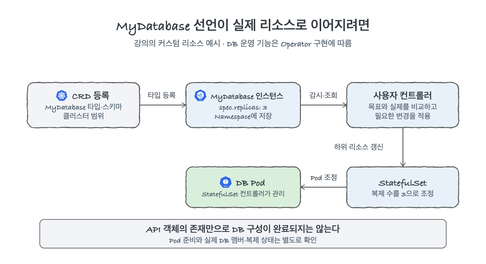

# 쿠버네티스 패턴을 컨트롤러·Pod·CRD로 이해하기

## 1. 어떤 단위로 작업을 관리할지 먼저 정한다

- **컨트롤러는 Pod의 배치와 실행을 관리하고, Pod 디자인 패턴은 한 Pod 안에서 초기화·본 작업·보조 작업을 나눈다.** 여러 리소스의 설정과 운영 절차를 하나의 선언으로 표현하려면 CRD와 별도 컨트롤러를 조합할 수 있다.

| 필요한 동작 | 사용할 리소스 | 관리하는 단위 |
| :--- | :--- | :--- |
| 일반 웹·API 앱의 복제본을 유지하고 배포한다. | Deployment | `Deployment → ReplicaSet → Pod`로 이어진다. |
| DB 인스턴스마다 고정 식별자와 저장소를 유지한다. | StatefulSet | Pod별 이름과 `volumeClaimTemplates`로 생성한 PVC를 유지한다. |
| 노드마다 로그나 지표를 수집한다. | DaemonSet | 배치 조건을 만족하는 노드마다 Pod를 둔다. |
| 마이그레이션·백업·데이터 정리 작업을 완료한다. | Job | 성공 조건을 충족할 때까지 작업 Pod를 관리한다. |
| 정해진 시각마다 백업이나 집계를 실행한다. | CronJob | 스케줄에 맞춰 Job을 만들고, Job이 Pod를 관리한다. |

- Service·EndpointSlice는 접속 지점과 대상을 연결하고 Ingress·IngressClass는 HTTP 라우팅을 구성한다. StatefulSet과 Headless Service를 조합하면 개별 DB Pod를 DNS로 찾을 수 있다. [Service](10_service.md), [Ingress](11_ingress.md)
- ConfigMap·Secret은 설정을 공급한다. ServiceAccount·RoleBinding·Role은 앱의 API 접근 주체와 권한을 연결하고, PVC·PV·StorageClass는 저장소를 요청하고 연결한다. HPA는 지원되는 워크로드의 복제본 수를 지표에 따라 조정한다. [ConfigMap·Secret](05_understanding_k8s_via_app_features_configmap_secret.md), [Pod의 API 접근](09_pod.md), [저장소](12_pv_and_pvc.md), [HPA](06_understanding_k8s_via_app_features_core_resources.md)

## 2. DaemonSet으로 노드마다 필요한 작업을 실행한다

- **DaemonSet은 대상 노드마다 Pod 하나가 실행되도록 관리한다.** 조건을 만족하는 노드가 추가되면 해당 노드에도 Pod를 만든다. `nodeSelector`·`nodeAffinity`와 taint·toleration에 따라 실제 대상이 달라진다. [Kubernetes DaemonSet 문서](https://kubernetes.io/docs/concepts/workloads/controllers/daemonset/)
- 노드 로그 수집기는 해당 노드의 로그 파일을 읽어 중앙 시스템으로 전송한다. node-exporter는 `/proc/stat`·`/proc/meminfo` 같은 호스트 정보를 읽어 노드별 지표를 제공하고 Prometheus가 각 대상의 지표를 수집한다. Ingress Controller도 진입 대상 노드마다 프록시가 필요한 구성에서 DaemonSet으로 배치할 수 있다.
- `hostPath`는 노드의 파일 경로를 마운트하고 `hostNetwork: true`는 노드의 네트워크를 사용한다. 각각 Pod 템플릿에서 선택하는 설정이다. 노드 파일을 읽기만 한다면 읽기 전용으로 마운트하고, 호스트 네트워크를 사용한다면 노드의 포트 충돌과 노출 범위를 확인한다.

## 3. CronJob의 실행 시각과 Job의 완료 조건을 구분한다

| 설정 위치 | 주요 필드 | 의미 |
| :--- | :--- | :--- |
| CronJob | `schedule`, `timeZone` | Job을 만들 시각과 시간대를 지정한다. `0 * * * *`는 매시 정각이다. |
| CronJob | `concurrencyPolicy`, `suspend` | 같은 CronJob에서 실행이 겹칠 때의 처리 방식과 새 Job 생성의 일시 중단 여부를 정한다. `suspend: true`여도 이미 시작한 Job은 계속 실행된다. |
| CronJob | `startingDeadlineSeconds` | 예정 시각을 놓쳤을 때 Job을 늦게 생성할 수 있는 기한이다. |
| CronJob | `successfulJobsHistoryLimit`, `failedJobsHistoryLimit` | 성공·실패한 Job을 각각 몇 개까지 보관할지 정한다. |
| Job | `parallelism`, `completions` | 병렬 실행 목표 수와 완료에 필요한 성공 수를 정한다. 실패 후 재시도까지 포함하면 생성된 Pod 수는 `completions`보다 많을 수 있다. |
| Job | `backoffLimit`, Pod의 `restartPolicy` | 실패를 허용할 범위를 정한다. `Never`에서는 Job이 새 Pod로 재시도할 수 있고, `OnFailure`에서는 같은 Pod 안에서 발생한 컨테이너 재시작도 실패 한도 계산에 반영된다. |
| Job | `activeDeadlineSeconds`, `ttlSecondsAfterFinished` | 전자는 Job의 실행 기한이다. 후자는 성공·실패로 종료된 Job과 하위 Pod가 자동 정리 대상이 되기까지의 시간이다. |

- 다음 예시는 서울 시간 기준 매시 정각에 실행 시각을 출력한다. 이전 Job이 실행 중이면 `Forbid`로 실행이 겹치지 않게 한다. `* */1 * * *`는 분 필드가 `*`이므로 매분 실행에 해당한다. [Kubernetes CronJob 문서](https://kubernetes.io/docs/concepts/workloads/controllers/cron-jobs/)

```yaml
apiVersion: batch/v1
kind: CronJob
metadata:
  name: hourly-report
spec:
  schedule: "0 * * * *"
  timeZone: Asia/Seoul
  concurrencyPolicy: Forbid
  successfulJobsHistoryLimit: 2
  failedJobsHistoryLimit: 2
  jobTemplate:
    spec:
      parallelism: 2
      completions: 4
      backoffLimit: 1
      activeDeadlineSeconds: 300
      ttlSecondsAfterFinished: 86400
      template:
        spec:
          restartPolicy: Never
          containers:
            - name: report
              image: busybox:1.37
              command: ["date", "-u"]
```

- 한 Job에서 최대 두 작업 Pod를 병렬로 실행하도록 요청하고 네 번 성공하면 완료한다. 예시의 `date -u` 출력은 UTC이며, `.spec.timeZone`은 CronJob의 스케줄에 적용된다. 실행 기한에 도달하면 Job은 실패 처리되고 실행 중인 Pod는 종료 절차에 들어간다. 완료 이력 제한에 걸리면 TTL 전에 Job이 정리될 수 있다. [Kubernetes Job 문서](https://kubernetes.io/docs/concepts/workloads/controllers/job/)
- **배치·백업·알림의 업무 처리에는 멱등성을 고려한다.** 같은 예정 시각에 Job이 두 번 만들어지거나 누락될 수 있고, 같은 Job도 실패한 작업을 다시 실행할 수 있다. 처리 기준 시각이나 작업 ID로 결과를 구분하면 재실행 시 중복 반영을 막을 수 있다.

## 4. 일반 Init Container는 앱 기동에 필요한 준비 작업을 끝낸다

- 일반 `initContainers`는 선언 순서대로 실행한다. 각 작업이 성공해야 다음 초기화 단계와 앱 컨테이너 기동이 진행된다. 실패한 초기화 컨테이너는 일반적으로 kubelet이 재시도하며 Pod의 `restartPolicy: Never`에서는 Pod가 실패 처리된다. [Kubernetes Init Containers 문서](https://kubernetes.io/docs/concepts/workloads/pods/init-containers/)

| 초기화 작업 | 구성 예 | 확인할 점 |
| :--- | :--- | :--- |
| 볼륨 권한 준비 | 공유 볼륨에 디렉터리를 만들고 앱 UID·GID가 사용할 권한을 부여한다. | 초기화 컨테이너와 앱의 권한을 각각 지정하고 볼륨의 권한 변경 지원을 확인한다. |
| 설정 파일 준비 | Secret으로 받은 파일을 변환해 공유 볼륨에 쓰고 앱이 결과 파일을 읽는다. | Secret 변경을 실행 중인 앱에 반영해야 한다면 별도 갱신 경로가 필요하다. |
| 기동 의존성 확인 | DB의 DNS·포트 또는 준비 상태를 확인한 뒤 앱을 시작한다. | 대기 시간과 실패 처리 방식을 정하고, 기동 후 연결 끊김은 앱에서 처리한다. |

- 같은 Pod의 컨테이너는 IP와 포트 공간을 공유하고 `localhost`로 통신한다. 파일을 공유하려면 같은 볼륨을 각 컨테이너에 마운트한다. 초기화 컨테이너가 `/work`에 쓴 결과를 앱이 `/config`에서 읽는 구성도 가능하다. [Kubernetes Pods 문서](https://kubernetes.io/docs/concepts/workloads/pods/)

## 5. Sidecar는 앱과 함께 실행하며 보조 작업을 수행한다

| 패턴 | 분리하는 역할 | 예 |
| :--- | :--- | :--- |
| Sidecar | 앱과 함께 유지되는 보조 기능이다. | 인증 에이전트, 로그 수집기 또는 설정 리로더이다. |
| Adapter | 앱이 만든 데이터의 표현을 외부 시스템에 맞춘다. | 공유 볼륨의 CSV를 읽어 JSON으로 변환한 뒤 전송한다. |
| Ambassador | 외부 시스템과의 통신을 로컬 프록시로 중계한다. | 앱이 `localhost`의 HTTP 프록시를 호출하면 프록시가 외부 gRPC 서버와 통신한다. 서비스 메시의 Sidecar Proxy도 통신 중계에 쓰인다. |

- **Adapter는 데이터 형식 변환이 중심이고 Ambassador는 통신 중계가 중심이다.** 둘 다 메인 앱과 함께 배포하는 Sidecar로 구현할 수 있다. 앱별 파일을 읽고 앱과 함께 교체할 기능은 Sidecar, 노드 전체의 파일을 수집할 기능은 DaemonSet으로 구성할 수 있다.
- 강의 예시처럼 보조 컨테이너를 `containers`에 넣으면 일반 앱 컨테이너로 실행된다. 목록 순서로 기동을 제어할 수 없으므로 앱이 프록시를 사용하려면 연결 재시도나 준비 상태를 고려한다.
- Kubernetes의 네이티브 Sidecar는 `initContainers` 항목에 `restartPolicy: Always`를 지정한다. 앱 시작 전에 기동해 계속 실행되고, `startupProbe`로 다음 초기화 단계의 진행을 제어할 수 있다. Job에서는 메인 작업이 끝나면 이 Sidecar가 Job 완료를 막지 않는다. 이 기능은 Kubernetes v1.33에서 안정화되었다. [Kubernetes Sidecar Containers 문서](https://kubernetes.io/docs/concepts/workloads/pods/sidecar-containers/)

## 6. CRD는 선언 형식을 등록하고 컨트롤러가 동작을 구현한다

- **CRD(CustomResourceDefinition)는 새 API 타입의 이름·버전·스키마를 등록한다.** Custom Resource는 등록한 타입으로 만든 개별 객체이다. 강의의 `MyDatabase`는 DB 이름과 복제본 수를 담는 API이며, 이를 감시하는 컨트롤러를 구현하면 StatefulSet·Service·Secret 같은 하위 리소스를 생성하고 관리할 수 있다. [Kubernetes CRD 문서](https://kubernetes.io/docs/tasks/extend-kubernetes/custom-resources/custom-resource-definitions/)

| CRD의 설정 | 강의 예 | 의미 |
| :--- | :--- | :--- |
| `metadata.name`, `spec.group` | `mydatabases.1pro.com`, `1pro.com` | CRD 이름은 `<plural>.<group>` 형식이고, 그룹은 인스턴스의 `apiVersion`에 사용된다. |
| `spec.names` | `kind: MyDatabase`, `plural: mydatabases`, `shortNames: [mydb]` | YAML의 타입 이름과 `kubectl get`에서 사용할 리소스 이름을 정한다. |
| `spec.scope` | `Namespaced` | 인스턴스가 Namespace에 속한다. CRD 자체는 클러스터 범위 리소스이다. |
| `spec.versions[]` | `name: v1`, `served: true`, `storage: true` | API로 제공할 버전과 저장에 사용할 버전을 지정한다. 저장 버전은 하나만 지정한다. |
| `schema.openAPIV3Schema` | `spec.name`은 문자열, `spec.replicas`는 정수 | API 서버가 인스턴스의 필드 구조와 타입을 검증한다. |

- 다음 YAML은 강의의 `mydatabases.1pro.com` CRD가 먼저 등록되어 있다고 가정한다. `metadata.name`은 Kubernetes에서 조회할 객체 이름이고, `spec.name`은 이 API가 컨트롤러에 전달하는 설정이다.

```yaml
apiVersion: 1pro.com/v1
kind: MyDatabase
metadata:
  name: dev-redis
  namespace: default
spec:
  name: redis-01
  replicas: 2
```

- `kubectl get mydb -n default`에서 객체가 보이면 API 등록과 저장을 확인한 것이다. 실제 DB 생성은 컨트롤러가 객체를 읽고 하위 리소스에 반영했는지, 생성한 Pod가 준비됐는지까지 확인한다.



그림의 근거 · [Kubernetes CRD](https://kubernetes.io/docs/tasks/extend-kubernetes/custom-resources/custom-resource-definitions/) · [Kubernetes Operator 패턴](https://kubernetes.io/docs/concepts/extend-kubernetes/operator/) · [Kubernetes 컨트롤러](https://kubernetes.io/docs/concepts/architecture/controller/)

## 7. 재조정은 선언한 상태에 실제 상태를 계속 맞추는 동작이다

- **컨트롤러는 목표 상태와 실제 상태를 비교하고 필요한 변경을 반복 적용한다.** 예를 들어 `MyDatabase.spec.replicas`가 `2`에서 `3`으로 바뀌면 컨트롤러는 StatefulSet의 복제본 수를 맞추고 StatefulSet 컨트롤러가 Pod를 추가한다. DB 멤버 추가와 복제 상태 확인은 DB 구성과 Operator의 운영 로직에 달려 있다. [Kubernetes Controllers 문서](https://kubernetes.io/docs/concepts/architecture/controller/), [Operator 패턴 문서](https://kubernetes.io/docs/concepts/extend-kubernetes/operator/)

| 예 | 목표 상태 | 재조정하는 대상 |
| :--- | :--- | :--- |
| Prometheus Operator | `Prometheus` 리소스와 연결된 모니터링 설정이다. | StatefulSet과 수집 설정을 관리한다. Pod의 설정 리로더는 설정이 바뀌면 Prometheus에 재로딩을 요청한다. |
| Argo CD | `Application`이 가리키는 Git의 선언이다. | 클러스터 리소스와 차이를 비교한다. 클러스터에서 직접 수정한 변경을 자동으로 되돌리려면 자동 동기화와 `selfHeal`을 활성화한다. |

- Prometheus Operator는 앱 설치·설정에 필요한 운영 지식을 컨트롤러에 담는다. Argo CD가 Git에서 `Prometheus` 리소스를 적용하고 Prometheus Operator가 그 리소스를 바탕으로 StatefulSet을 관리하는 구성도 가능하다. [Prometheus Operator API 문서](https://prometheus-operator.dev/docs/api-reference/api/), [Argo CD 자동 동기화 문서](https://argo-cd.readthedocs.io/en/stable/user-guide/auto_sync/)

## 8. 원하는 상태가 실제로 반영되는지 확인한다

| 확인 상황 | 먼저 볼 내용 |
| :--- | :--- |
| 일부 노드에 DaemonSet Pod가 없다. | 원하는·준비된 Pod 수, 대상 노드의 라벨·taint와 Pod 이벤트를 확인한다. |
| 예정 시각에 작업이 실행되지 않았다. | CronJob의 시간대·일시 중단·동시 실행 정책과 Job 생성 이벤트를 확인한다. |
| Job은 생성됐지만 실패했다. | Job의 성공·실패 수와 종료 조건을 보고, 작업 Pod의 이벤트와 로그를 확인한다. |
| 앱 컨테이너가 시작하지 않는다. | `initContainerStatuses`와 초기화 컨테이너 로그에서 실패 단계를 확인한다. |
| CR은 조회되지만 하위 리소스가 없다. | 컨트롤러의 실행 상태, 감시 Namespace·RBAC·로그와 구현이 제공하는 CR 상태를 확인한다. |

```bash
kubectl get daemonset -A
kubectl get cronjob,job
kubectl describe cronjob hourly-report
kubectl get pods -l "batch.kubernetes.io/job-name=${job_name}"
kubectl logs "$pod_name" -c "$init_container_name"
kubectl get crd mydatabases.1pro.com
kubectl api-resources --api-group=1pro.com
kubectl get mydb dev-redis -n default -o yaml
```

- 명령은 각 리소스가 있는 Namespace에서 실행한다. `job_name`, `pod_name`, `init_container_name`에는 실제 리소스와 컨테이너 이름을 넣는다.
- 배치는 업무 결과와 중복 처리 여부까지 보고, Operator는 하위 리소스 생성과 실제 앱의 준비 상태까지 확인한다.
