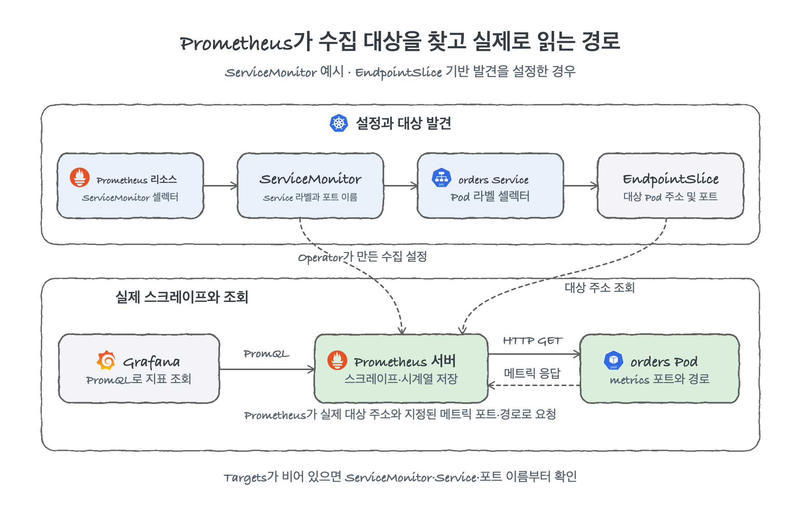

# 쿠버네티스 모니터링에서 메트릭 수집과 해석 이해하기

## 1. Prometheus는 메트릭을 시계열로 수집하고 조회한다

- **시계열은 메트릭 이름과 라벨 조합으로 식별하고, 각 샘플은 시각과 값을 담는다.** 같은 CPU 메트릭이라도 노드·코어·동작 모드 라벨이 다르면 별도 시계열이다. Prometheus는 HTTP 엔드포인트를 주기적으로 조회하는 pull 방식으로 메트릭을 수집하고, PromQL로 기간별 변화율이나 라벨별 집계를 계산한다. [Prometheus 개요](https://prometheus.io/docs/introduction/overview/)
- Counter는 누적 CPU 시간이나 요청 수처럼 계속 증가하는 값이다. 프로세스가 재시작하면 초기화될 수 있으므로 구간의 변화는 `rate()` 같은 함수로 해석한다. Gauge는 메모리 사용량이나 준비된 Pod 수처럼 오르내리는 현재 상태를 표현한다.
- 라벨은 Namespace나 노드별로 데이터를 나누는 데 쓰인다. 라벨 값 조합마다 새 시계열이 생기므로 사용자 ID·요청 ID처럼 계속 늘어나는 값을 메트릭 라벨로 사용하면 저장·조회 비용이 증가한다. [Prometheus 메트릭과 라벨 명명 가이드](https://prometheus.io/docs/practices/naming/)

## 2. 수집·운영·시각화·알림을 담당하는 구성요소를 구분한다

| 구성요소 | 맡는 역할 | 얻을 수 있는 정보나 결과 |
| :--- | :--- | :--- |
| node-exporter | 노드의 OS·하드웨어 지표를 노출한다. 보통 DaemonSet으로 배치한다. | CPU 모드별 누적 시간, 메모리, 디스크와 네트워크 상태를 제공한다. |
| kube-state-metrics | Kubernetes API 객체의 선언과 상태를 메트릭으로 노출한다. | Pod 상태·라벨, Deployment의 복제본 수, 컨테이너의 requests·limits를 제공한다. |
| kubelet·cAdvisor | 노드에서 실행하는 컨테이너의 자원 사용량을 노출한다. | 컨테이너의 실제 CPU 사용 시간과 메모리 working set 등을 제공한다. |
| 앱·Ingress Controller | 해당 컴포넌트에서 계측한 메트릭을 노출한다. | 요청량, 응답 코드와 요청 처리 시간 등을 제공한다. |
| Prometheus Operator | `Prometheus`·`ServiceMonitor` 등 선언을 감시해 실행 리소스와 수집 설정을 관리한다. | Prometheus용 StatefulSet과 수집 설정을 만들고 변경을 반영한다. |
| Prometheus | 대상을 스크레이프하고 시계열을 저장하며 조회·규칙 평가를 처리한다. | PromQL 조회 결과를 제공하고 알림 규칙의 평가 결과를 Alertmanager로 보낸다. |
| Grafana | 데이터 소스를 조회하고 패널로 시각화한다. | 타임라인과 상태 요약을 보여 주고 Namespace·워크로드·노드별로 좁혀 볼 수 있다. |
| Alertmanager | 수신한 알림을 중복 제거·그룹화하고 수신처로 전달한다. | 규칙에 따라 이메일·Slack 등으로 보내며, 일시 중지와 억제 정책을 적용할 수 있다. |

- `kube-prometheus-stack`은 Prometheus Operator와 관련 구성요소, 규칙 및 Grafana 대시보드를 함께 제공하는 Helm 차트이다. Operator가 만든 수집 설정은 Secret에 저장되며, Prometheus Pod의 설정 리로더가 변경을 감지해 Prometheus에 재로딩을 요청한다. [kube-prometheus-stack 차트](https://github.com/prometheus-community/helm-charts/tree/main/charts/kube-prometheus-stack), [Prometheus Operator 설계](https://prometheus-operator.dev/docs/getting-started/design/), [Prometheus Operator API](https://prometheus-operator.dev/docs/api-reference/api/), [Alertmanager 문서](https://prometheus.io/docs/alerting/latest/alertmanager/)
- kube-state-metrics의 requests·limits는 **선언된 값**이다. 소비 중인 양은 kubelet·cAdvisor의 메트릭으로 확인한다. Metrics Server는 CPU·메모리의 리소스 메트릭 API를 제공하며 HPA의 리소스 기반 스케일링 등에 사용된다. [kube-state-metrics](https://github.com/kubernetes/kube-state-metrics), [Kubernetes 리소스 메트릭 파이프라인](https://kubernetes.io/docs/tasks/debug/debug-cluster/resource-metrics-pipeline/), [HPA](06_understanding_k8s_via_app_features_core_resources.md)
- Prometheus의 로컬 TSDB를 PVC에 보존한다면 스토리지의 파일시스템 호환성과 보존 기간을 확인한다. Prometheus 공식 문서는 로컬 TSDB에 NFS를 지원하지 않는다고 명시한다. 여러 Prometheus를 통합 조회하거나 객체 저장소에 장기 보관하려면 Thanos를 연계할 수 있다. [Prometheus 저장소 문서](https://prometheus.io/docs/prometheus/latest/storage/), [Thanos 문서](https://thanos.io/tip/thanos/quick-tutorial.md/), [PV·PVC](12_pv_and_pvc.md)

## 3. ServiceMonitor는 Service를 기준으로 스크레이프 대상을 찾는다

| 선택 단계 | 설정과 확인할 관계 |
| :--- | :--- |
| Prometheus → ServiceMonitor | `serviceMonitorSelector`는 ServiceMonitor의 라벨을, `serviceMonitorNamespaceSelector`는 ServiceMonitor가 있는 Namespace를 선택한다. |
| ServiceMonitor → Service | `spec.selector`는 Service의 라벨을 선택한다. `spec.namespaceSelector`는 대상 Service를 찾을 Namespace를 지정하며, 기본적으로 같은 Namespace를 대상으로 한다. |
| Service → 엔드포인트 | 일반적인 Pod 기반 Service에서는 `spec.selector`가 대상 Pod를 결정한다. Prometheus는 Service에 연결된 엔드포인트를 찾아 수집한다. |
| ServiceMonitor → 메트릭 포트·경로 | `endpoints[].port`는 Service의 포트 이름을 참조한다. 메트릭 경로와 HTTP·HTTPS 설정은 대상이 실제로 노출한 값과 맞춘다. |

- **ServiceMonitor의 Service 선택은 Service 객체의 라벨을 기준으로 한다.** Service가 Pod를 선택하는 라벨과 별도로 확인한다. Operator는 선택된 ServiceMonitor에서 수집 설정을 생성하고, 설정 리로더가 이를 Prometheus에 반영한다. [Prometheus Operator 문제 해결 가이드](https://prometheus-operator.dev/docs/platform/troubleshooting/), [Service와 EndpointSlice](10_service.md)
- ingress-nginx에서는 사용자 요청을 받는 포트와 컨트롤러 메트릭을 제공하는 포트를 구분한다. Grafana에 들어가는 사용자 트래픽, Grafana가 Prometheus를 조회하는 트래픽, Prometheus가 컨트롤러의 메트릭을 수집하는 트래픽은 각각 연결 대상이 다르다. [ingress-nginx 메트릭 문서](https://kubernetes.github.io/ingress-nginx/user-guide/monitoring/), [Ingress 요청 경로](11_ingress.md)

그림의 근거 · [Prometheus Operator 설계](https://prometheus-operator.dev/docs/getting-started/design/) · [Prometheus Operator API](https://prometheus-operator.dev/docs/api-reference/api/) · [Grafana Prometheus 데이터 소스](https://grafana.com/docs/grafana/latest/datasources/prometheus/)

## 4. CPU·메모리의 요청량·상한·실측값을 함께 본다

| 구분 | CPU | 메모리 |
| :--- | :--- | :--- |
| `requests` | 스케줄러가 배치 가능 용량을 계산할 때 사용한다. 경합 시 CPU 배분 가중치에도 반영된다. | 스케줄러의 배치 기준이다. 노드 메모리 압박 상황에서도 요청량 대비 사용량을 비교한다. |
| `limits` | 상한에 닿으면 CPU 실행 시간이 제한돼 throttling과 처리 지연이 생길 수 있다. | 메모리 상한을 넘는 상황에서 커널이 프로세스를 OOM으로 종료할 수 있다. |
| 실측값 | 기동과 트래픽 피크 때의 사용량을 throttling·응답 시간과 함께 해석한다. | 기동 피크와 장기 추세를 본다. JVM 앱은 heap 외에 metaspace·native 메모리 등도 소비한다. |

- CPU의 `1000m`은 1코어이다. 메모리의 `1Gi`는 `1024Mi`이고, `1G`는 `1000M`이다. 대시보드에 비율을 표시할 때는 사용량을 requests·limits·Allocatable 중 무엇으로 나눴는지 명시한다. 예를 들어 CPU를 `400m` 쓰고 요청량이 `250m`, 상한이 `500m`이면 요청량 기준 160%, 상한 기준 80%이다.
- **노드에 실제 유휴 자원이 있어도 기존 Pod의 requests를 합산한 뒤 새 Pod의 요청을 수용할 수 없다면 배치가 어려울 수 있다.** CPU 사용률 기반 HPA는 requests를 기준으로 사용률을 계산하므로 요청량을 바꾸면 같은 사용량에도 스케일링 판단이 달라질 수 있다. [Kubernetes 리소스 관리 문서](https://kubernetes.io/docs/concepts/configuration/manage-resources-containers/), [HPA](06_understanding_k8s_via_app_features_core_resources.md)

## 5. QoS와 노드 압박에 따른 퇴거를 함께 해석한다

| QoS 클래스 | 컨테이너 수준 CPU·메모리 설정 기준 | 운영에서 확인할 점 |
| :--- | :--- | :--- |
| `Guaranteed` | 모든 컨테이너에서 CPU와 메모리 각각의 requests·limits가 설정되고 서로 같다. | 배치할 때 지정한 용량이 반영되며, 컨테이너의 메모리 상한을 넘으면 OOM 종료가 발생할 수 있다. |
| `Burstable` | `Guaranteed` 조건을 충족하지 않으며 하나 이상의 컨테이너에 CPU나 메모리의 request 또는 limit가 있다. | 노드에 여유가 있으면 요청량을 초과해 사용할 수 있다. |
| `BestEffort` | 어느 컨테이너에도 CPU·메모리 requests·limits가 없다. | 노드의 남은 자원을 쓰며, 자원 압박 상황에서 퇴거될 가능성이 높다. |

- 표는 컨테이너 수준의 자원 설정을 기준으로 한다. Pod 수준의 자원 설정을 사용하는 경우에는 해당 기준도 적용된다. 특정 QoS 클래스를 모든 앱에 일괄 적용하기보다 앱의 자원 변화와 배치 여유를 함께 본다. [Kubernetes Pod QoS 문서](https://kubernetes.io/docs/concepts/workloads/pods/pod-qos/)
- 노드 압박 시 kubelet은 요청량 초과 여부, Pod Priority, 요청량 대비 사용량을 고려해 퇴거 순서를 정한다. `OOMKilled`는 프로세스가 메모리 부족으로 종료된 단서이고, kubelet의 노드 압박 퇴거는 Pod 이벤트와 노드 상태에서 확인한다. [Kubernetes 노드 압박 퇴거 문서](https://kubernetes.io/docs/concepts/scheduling-eviction/node-pressure-eviction/), [Pod 상태와 종료 원인](09_pod.md)

## 6. Grafana에서는 노드 여유와 워크로드 상태를 연결한다

| 대시보드 관점 | 함께 볼 값 | 답할 질문 |
| :--- | :--- | :--- |
| 노드와 클러스터 용량 | `Capacity`, `Allocatable`, requests·limits 합계, 실제 사용량 | 물리적 자원과 Pod 배치에 쓸 수 있는 자원은 각각 얼마이며, 요청량이 큰 Pod를 추가할 여유가 있는가? |
| Pod·컨테이너 상태 | Pod 수와 상태, Ready 복제본, 재시작 횟수와 종료 원인 | 자원 피크 전후에 배치 지연, OOM 종료나 복제본 감소가 발생했는가? |
| 시스템·애드온 | Namespace·노드별 CPU·메모리와 네트워크 지표 | CoreDNS, CNI, Ingress 같은 공용 컴포넌트에 부하가 집중되는가? |
| 애플리케이션 | 워크로드별 CPU·메모리, 요청량, 오류율, 응답 시간 | 자원 변화가 어느 서비스의 요청 처리에 영향을 주었는가? |

- `Capacity`는 노드가 보고하는 전체 자원이고, `Allocatable`은 시스템 예약분 등을 고려해 Pod가 사용할 수 있는 자원이다. 배치 여유를 판단할 때는 노드별 `Allocatable`과 그 노드에 배치된 Pod의 requests를 비교한다. limits 합계가 `Allocatable`보다 클 수 있으므로 실제 사용량과 함께 해석한다. [Kubernetes 노드 자원 예약 문서](https://kubernetes.io/docs/tasks/administer-cluster/reserve-compute-resources/)
- 패널의 단위·조회 구간·집계 기준을 맞춘다. 노드나 Pod를 여러 그룹으로 나누어 비교할 때는 같은 시간대에 자원 사용과 요청 결과가 어떻게 변했는지 확인한다. [Grafana 대시보드 문서](https://grafana.com/docs/grafana/latest/visualizations/dashboards/), [서비스와 인프라 모니터링 지표](../architecture-design-for-operations/03_monitoring_infrastructure_and_services_with_use_and_red.md)

## 7. PromQL 벡터 매칭으로 다른 시계열의 라벨을 연결한다

- 노드 CPU의 비유휴 시간 비율은 `node_cpu_seconds_total`의 `idle` Counter에 `rate()`를 적용한 뒤, 코어별 결과를 `instance` 기준으로 평균내고 1에서 빼서 구한다. `rate()`는 구간의 초당 평균 증가율을 계산하며 Counter 리셋과 구간 경계를 고려한다. 비유휴 시간은 애플리케이션이 실제로 실행된 시간과 범위가 다르므로 필요하면 `iowait` 등 모드별 지표를 따로 본다. [Prometheus `rate()` 문서](https://prometheus.io/docs/prometheus/latest/querying/functions/#rate), [node-exporter](https://github.com/prometheus/node_exporter)

| 매칭 설정 | 기준 | 사용 예 |
| :--- | :--- | :--- |
| `on(...)` | 괄호에 지정한 라벨의 값으로 양쪽 시계열을 매칭한다. | `instance`로 CPU 지표와 노드 이름 정보를 연결한다. 여러 클러스터를 통합 조회한다면 클러스터 식별자도 확인한다. |
| `group_left(...)` | 같은 키에 왼쪽 시계열이 여러 개이고 오른쪽 시계열이 하나인 다대일 매칭을 허용한다. 괄호에는 오른쪽에서 가져올 라벨을 지정한다. | 왼쪽에 컨테이너별 사용량, 오른쪽에 Pod별 라벨 메트릭을 두고 `namespace`·`pod`로 연결한다. |
| `group_right(...)` | 같은 키에 왼쪽 시계열이 하나이고 오른쪽 시계열이 여러 개인 일대다 매칭을 허용한다. 괄호에는 왼쪽에서 가져올 라벨을 지정한다. | 왼쪽에 VM 정보, 오른쪽에 해당 VM의 디스크별 사용량을 두고 VM의 OS 라벨을 붙인다. |

- **`group_left`와 `group_right`는 매칭 키 하나에 여러 시계열이 있는 쪽을 가리킨다.** 반대쪽에는 키마다 시계열이 하나여야 한다. 같은 `instance`가 여러 scrape job에서 수집되거나 여러 클러스터에 반복되면 필터·추가 라벨·집계로 매칭 키의 유일성을 맞춘다. 산술 연산에서 대응하는 시계열이 없으면 해당 결과도 빠진다. [PromQL 벡터 매칭 문서](https://prometheus.io/docs/prometheus/latest/querying/operators/#vector-matching)
- 라벨만 붙일 때는 `node_uname_info`처럼 샘플 값이 실제로 `1`인 정보 메트릭을 곱해 계산값을 유지할 수 있다. `kube_node_labels`와 노드별 자원 지표는 `node`로, `kube_pod_labels`와 컨테이너 사용량은 `namespace`·`pod`로 연결할 수 있다. 사용자 정의 라벨이 빠져 있으면 kube-state-metrics의 라벨 허용 목록과 실제 노출 이름을 확인한다. [kube-state-metrics 노드 메트릭](https://github.com/kubernetes/kube-state-metrics/blob/main/docs/metrics/cluster/node-metrics.md), [Pod 메트릭](https://github.com/kubernetes/kube-state-metrics/blob/main/docs/metrics/workload/pod-metrics.md)

## 8. 지표가 보이지 않으면 수집부터 조회까지 순서대로 확인한다

| 증상 | 먼저 확인할 내용 |
| :--- | :--- |
| Prometheus에 대상이 나타나지 않는다. | ServiceMonitor를 선택하는 라벨·Namespace, Service 선택자와 포트 이름, 엔드포인트 발견 권한을 확인한다. |
| 대상은 있지만 `Down` 상태이다. | Prometheus에서 대상까지의 연결, 메트릭 경로·포트·TLS·인증과 스크레이프 오류를 확인한다. |
| Prometheus에 값이 있지만 Grafana 패널이 비어 있다. | 데이터 소스, 시간 범위, 변수 필터와 벡터 매칭 키를 확인한다. |
| CPU·메모리 비율이 예상과 다르다. | 분자와 분모의 대상·단위·집계가 같은지 확인한다. 값이 0인 경우와 기준 메트릭이 수집되지 않은 경우도 구분한다. |
| 알림 규칙은 발화했지만 메시지가 오지 않는다. | Alertmanager에서 수신 여부와 라우팅·그룹화·일시 중지 설정을 확인한다. |
