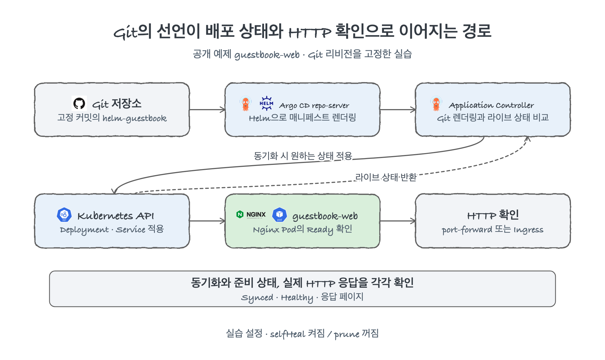

# Deploying and Monitoring Kubernetes Applications with GitOps

Ingress로 요청을 서비스에 연결하고, Helm으로 매니페스트를 패키징한다. Prometheus와 Grafana에서 상태를 확인한 뒤, Argo CD가 공개 Git 저장소의 원하는 상태를 클러스터에 적용하도록 구성한다. 명령은 Argo CD가 설치된 **로컬 실습 클러스터**를 대상으로 한다. 실습 컨텍스트가 `kind-ops-lab`인 경우 아래처럼 지정한다. [Argo CD 설치 실습](../observability/04_deploying_applications_with_argo_cd_and_gitops.md) · [Argo CD · Core Concepts](https://argo-cd.readthedocs.io/en/stable/core_concepts/)

```bash
KUBE_CONTEXT=kind-ops-lab
kubectl --context "${KUBE_CONTEXT:?}" get nodes
```

## 1. 한 도메인에서 서비스로 트래픽 보내기

Ingress의 `host`와 `path`가 HTTP 요청과 맞으면 지정한 Service로 전달한다. Ingress 리소스는 규칙을 저장하고, Ingress Controller가 그 규칙을 읽어 데이터 경로를 구성한다. `ingressClassName`은 그 리소스를 담당할 IngressClass를 지정한다. 한 호스트의 `/`와 `/api`에 서로 다른 Service를 연결하면, 같은 요청에 두 `Prefix` 규칙이 일치할 때 더 긴 `/api`가 우선한다. Kubernetes의 Ingress API는 안정 상태로 유지되며 신규 기능은 Gateway API에서 개발된다. [Kubernetes · Ingress](https://kubernetes.io/docs/concepts/services-networking/ingress/) · [Kubernetes · Ingress Controllers](https://kubernetes.io/docs/concepts/services-networking/ingress-controllers/) · [Gateway API 실습](../observability/02_deploying_spring_boot_on_kind_with_gateway_api.md)

아래를 `guestbook-ingress.yaml`로 저장한다. 4절에서 `guestbook-web` Service를 만든 뒤 적용한다. 먼저 `kubectl --context "${KUBE_CONTEXT:?}" get ingressclass`로 설치된 클래스 이름을 확인하고, 사용하는 클래스에 맞춰 `traefik`을 바꾼다.

```yaml
apiVersion: networking.k8s.io/v1
kind: Ingress
metadata:
  name: guestbook-web
  namespace: gitops-ops-lab
spec:
  ingressClassName: traefik
  rules:
    - host: guestbook.local.test
      http:
        paths:
          - path: /
            pathType: Prefix
            backend:
              service:
                name: guestbook-web
                port:
                  number: 80
```

Ingress를 적용한 뒤 컨트롤러의 HTTP 서비스로 포트 포워딩하고 올바른 `Host` 헤더로 확인할 수 있다. `INGRESS_NAMESPACE`와 `INGRESS_SERVICE`에는 설치한 컨트롤러의 네임스페이스와 Service 이름을 지정한다. Service에 연결된 Pod가 준비 중이면 `EndpointSlice`와 Pod 상태를 함께 확인한다. [Kubernetes · Ingress](https://kubernetes.io/docs/concepts/services-networking/ingress/) · [Kubernetes · kubectl port-forward](https://kubernetes.io/docs/reference/kubectl/generated/kubectl_port-forward/)

```bash
kubectl --context "${KUBE_CONTEXT:?}" apply -f guestbook-ingress.yaml
kubectl --context "${KUBE_CONTEXT:?}" -n "${INGRESS_NAMESPACE:?}" port-forward \
  --address 127.0.0.1 "svc/${INGRESS_SERVICE:?}" 18080:80
# 별도 터미널에서
curl -fsS -H 'Host: guestbook.local.test' http://127.0.0.1:18080/
```

## 2. Helm 차트와 클러스터 모니터링

Helm 차트는 리소스 템플릿과 기본값을 모은 패키지다. 같은 차트를 쓰더라도 `values.yaml`이나 `-f`로 이미지 버전과 자원 설정을 환경별로 바꿀 수 있다. `helm template`로 생성될 리소스를 확인하고, `helm upgrade --install`로 이름을 붙인 릴리스를 설치하거나 업데이트한다. 차트 버전을 지정하면 같은 차트로 변경을 검토하고 재현할 수 있다. [Helm · Charts](https://helm.sh/docs/topics/charts/) · [Helm · Upgrade](https://helm.sh/docs/v3/helm/helm_upgrade/) · [Helm과 Kustomize](08_helm_vs_kustomize_comparing_and_using_together.md)

클러스터 지표를 보려면 공식 커뮤니티 차트 `kube-prometheus-stack`을 사용할 수 있다. 이 실습은 Prometheus Operator와 CRD를 설치할 수 있는 전용 클러스터를 전제로 한다. `helm search repo` 결과에서 대상 Kubernetes 버전과 호환되는 차트 버전을 확인하고, 그 버전을 `PROM_STACK_VERSION`에 지정한다. [kube-prometheus-stack · Chart Usage](https://github.com/prometheus-community/helm-charts/tree/main/charts/kube-prometheus-stack)

```bash
helm repo add prometheus-community https://prometheus-community.github.io/helm-charts
helm repo update prometheus-community
helm search repo prometheus-community/kube-prometheus-stack --versions

chart=prometheus-community/kube-prometheus-stack
helm template ops-monitor "$chart" -n ops-monitoring \
  --version "${PROM_STACK_VERSION:?}" > ops-monitor.yaml
helm --kube-context "${KUBE_CONTEXT:?}" upgrade --install ops-monitor "$chart" \
  --namespace ops-monitoring --create-namespace \
  --version "$PROM_STACK_VERSION" --wait --timeout 10m
kubectl --context "${KUBE_CONTEXT:?}" -n ops-monitoring get pod,svc
```

조회한 서비스 이름을 `GRAFANA_SERVICE`와 `PROMETHEUS_SERVICE`에 지정하고, 각 터미널에 같은 `KUBE_CONTEXT`를 지정한 뒤 한 명령씩 실행한다. 브라우저에서 Grafana는 `http://127.0.0.1:13000`, Prometheus는 `http://127.0.0.1:19090`으로 접속한다. [Kubernetes · kubectl port-forward](https://kubernetes.io/docs/reference/kubectl/generated/kubectl_port-forward/)

```bash
kubectl --context "${KUBE_CONTEXT:?}" -n ops-monitoring port-forward \
  --address 127.0.0.1 "svc/${GRAFANA_SERVICE:?}" 13000:80
kubectl --context "${KUBE_CONTEXT:?}" -n ops-monitoring port-forward \
  --address 127.0.0.1 "svc/${PROMETHEUS_SERVICE:?}" 19090:9090
```

Prometheus의 Targets 화면에서는 scrape 상태를, Grafana에서는 노드와 워크로드 지표를 본다. `up == 0`으로 수집에 실패한 대상부터 확인한다. 앱을 배포한 뒤에는 `kube_pod_status_ready{namespace="gitops-ops-lab",condition="true"}`에서 Pod별 준비 여부를 본다. 클러스터 지표는 배포 상태와 원인 범위를 좁히는 데 쓰고, 실제 요청의 오류율·지연은 애플리케이션 메트릭이나 인그레스 지표로 확인한다. [Prometheus · Jobs and Instances](https://prometheus.io/docs/concepts/jobs_instances/) · [kube-state-metrics · Pod Metrics](https://github.com/kubernetes/kube-state-metrics/blob/main/docs/metrics/workload/pod-metrics.md) · [Kubernetes 모니터링과 PromQL](15_kubernetes_monitoring.md)

## 3. 배포 전략과 확인할 지표

| 전략 | 전환 방식 | 배포 중에 확인할 점 |
| --- | --- | --- |
| RollingUpdate | Pod를 조금씩 교체한다. | `maxSurge`로 늘어나는 용량, `maxUnavailable` 범위, 새 Pod의 readiness |
| Recreate | 배포를 갱신할 때 기존 Pod를 종료한 뒤 새 Pod를 만든다. | 구·신 버전이 동시에 실행되지 않아야 하는 조건과 서비스 중단 시간 |
| Blue/Green | 두 환경을 유지하고 Service 셀렉터나 라우팅 대상을 전환한다. | 두 환경을 운영할 용량, 전환 직후 오류율, 이전 환경으로 복귀할 조건 |
| Canary | 일부 트래픽을 새 버전으로 보내 검증 후 비율을 늘린다. | 버전별 오류율과 지연, 충분한 요청 수, 이상 시 트래픽 비율 회수 |

Kubernetes Deployment의 기본 전략은 RollingUpdate다. Blue/Green과 비율 기반 Canary는 여러 워크로드와 라우팅 규칙을 함께 관리하는 패턴이다. Pod 복제본의 비율로 버전마다 정확한 요청 비율을 보장하기는 어려우므로, 퍼센트가 중요하면 트래픽 계층에서 비율을 지정한다. 상태가 저장되는 서비스를 배포할 때는 두 버전이 같은 데이터와 스키마를 사용할 수 있는지도 확인한다. [Kubernetes · Deployment Strategies](https://kubernetes.io/docs/concepts/workloads/controllers/deployment/#strategy) · [Blue/Green 실습](07_jenkins_pipeline_from_basics_to_blue_green.md) · [19번 Istio 라우팅 실습](19_routing_and_resilience_with_istio.md)

## 4. 공개 Git 저장소를 Argo CD에 연결하기

Argo CD가 설치된 같은 실습 클러스터에서 아래를 `guestbook-application.yaml`로 저장한다. 공개 예제 저장소의 `helm-guestbook` 경로를 검증한 Git 커밋에 고정하고, 차트의 이미지와 리소스 이름을 덮어쓴다. Nginx의 기본 페이지로 HTTP 응답을 확인할 수 있다. Argo CD에서 Helm은 템플릿 렌더링에 사용되고, 배포 상태와 수명 주기는 Argo CD Application이 관리한다. [공개 예제의 Helm 차트](https://github.com/argoproj/argocd-example-apps/tree/8088f4c0d970abb09e250248cc97e35623447cb5/helm-guestbook) · [Argo CD · Helm](https://argo-cd.readthedocs.io/en/stable/user-guide/helm/) · [Argo CD · Application Specification](https://argo-cd.readthedocs.io/en/stable/user-guide/application-specification/)

```yaml
apiVersion: argoproj.io/v1alpha1
kind: Application
metadata:
  name: guestbook-ops-lab
  namespace: argocd
spec:
  project: default
  source:
    repoURL: https://github.com/argoproj/argocd-example-apps.git
    targetRevision: 8088f4c0d970abb09e250248cc97e35623447cb5
    path: helm-guestbook
    helm:
      valuesObject:
        fullnameOverride: guestbook-web
        image:
          repository: nginx
          tag: "1.27-alpine"
        replicaCount: 2
  destination:
    server: https://kubernetes.default.svc
    namespace: gitops-ops-lab
  syncPolicy:
    automated:
      selfHeal: true
      prune: false
    syncOptions:
      - CreateNamespace=true
```

```bash
kubectl --context "${KUBE_CONTEXT:?}" apply -f guestbook-application.yaml
kubectl --context "${KUBE_CONTEXT:?}" -n argocd get application guestbook-ops-lab
# 첫 동기화로 Deployment가 생긴 뒤
kubectl --context "${KUBE_CONTEXT:?}" -n gitops-ops-lab rollout status deploy/guestbook-web --timeout=180s
kubectl --context "${KUBE_CONTEXT:?}" -n gitops-ops-lab port-forward \
  --address 127.0.0.1 svc/guestbook-web 18082:80
# 별도 터미널에서
curl -fsS http://127.0.0.1:18082/
```

Application이 `Synced`와 `Healthy`에 도달하고 Nginx 페이지가 반환되는지 확인한다. 직접 운영하는 GitOps 저장소에서는 배포 브랜치 또는 승인한 버전을 `targetRevision`으로 지정한다. CI가 이미지를 빌드·검증하고 digest를 GitOps 저장소에 기록하면 Argo CD가 새 상태를 적용한다. 자동 동기화와 self-heal이 켜진 환경에서 복구할 때는 Git의 이미지 참조를 검증된 이전 digest로 되돌린다. Git에서 삭제한 리소스까지 자동 정리하려면 적용 범위를 검토한 뒤 `prune`을 활성화한다. [Argo CD · Automated Sync](https://argo-cd.readthedocs.io/en/stable/user-guide/auto_sync/) · [Argo CD · Sync Options](https://argo-cd.readthedocs.io/en/stable/user-guide/sync-options/) · [CI에서 이미지 digest 기록하기](../observability/03_building_container_ci_with_github_actions.md)



그림의 근거 · [Argo CD 아키텍처](https://argo-cd.readthedocs.io/en/stable/operator-manual/architecture/) · [Argo CD Helm](https://argo-cd.readthedocs.io/en/stable/user-guide/helm/) · [Argo CD 자동 동기화](https://argo-cd.readthedocs.io/en/stable/user-guide/auto_sync/)
