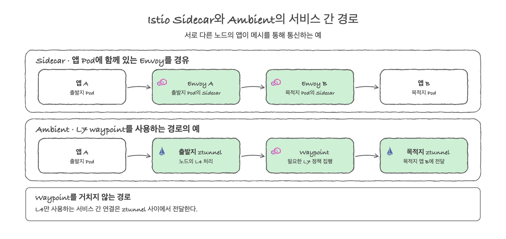

# Istio 아키텍처, 진입 API와 설치 방식

## 1. 제어 평면과 데이터 평면

Istio는 Kubernetes 워크로드 사이의 트래픽에 라우팅, 보안, 관측 정책을 적용하는 서비스 메시다. 제어 평면의 `istiod`는 서비스 발견 정보와 정책을 읽고 프록시에 필요한 구성을 배포하며 인증서 발급도 담당한다. 실제 요청을 전달하는 곳은 데이터 평면이다. 따라서 트래픽 장애를 보면 Kubernetes 리소스에 선언된 의도, 프록시에 적용된 구성, 실제 네트워크 경로를 차례로 확인한다. [Istio · Architecture](https://istio.io/latest/docs/ops/deployment/architecture/) · [Istio · Debugging Envoy and Istiod](https://istio.io/latest/docs/ops/diagnostic-tools/proxy-cmd/)

이 문서의 Istio 동작 기준은 1.32 계열이다. 공식 지원표에서 이 계열의 지원 Kubernetes 버전은 1.33~1.37이며, 빌드와 검증에 사용한 Kubernetes Gateway API 버전은 v1.6.1이다. 설치나 업그레이드 시 지원표에서 사용할 릴리스와 Kubernetes 버전의 조합을 확인한다. [Istio · 1.32 릴리스](https://istio.io/latest/news/releases/1.32.x/announcing-1.32/) · [Istio · Supported Releases](https://istio.io/latest/docs/releases/supported-releases/#support-status-of-istio-releases)

## 2. Ingress, Istio API, Kubernetes Gateway API

- Kubernetes Ingress(`networking.k8s.io/v1`)는 인그레스 컨트롤러가 구현하는 HTTP(S) 외부 진입 규칙이다. 주로 호스트와 경로를 Service에 연결한다. Kubernetes는 Ingress API를 유지하며 새 기능은 Gateway API에서 개발한다. [Kubernetes · Ingress](https://kubernetes.io/docs/concepts/services-networking/ingress/)
- Istio API에서 Istio `Gateway`(`networking.istio.io/v1`)는 선택한 게이트웨이 프록시의 포트, 프로토콜, 호스트 등을 선언한다. `VirtualService`가 Gateway에 바인딩되어 요청을 목적지로 보낸다. `DestinationRule`은 목적지가 정해진 후 적용할 서브셋과 연결 정책을 정의한다. [Istio · Gateway](https://istio.io/latest/docs/reference/config/networking/gateway/) · [Istio · Traffic Management](https://istio.io/latest/docs/concepts/traffic-management/)
- Kubernetes Gateway API(`gateway.networking.k8s.io`)는 `GatewayClass`에서 구현체를 고르고, `Gateway`에서 리스너를 선언하고, `HTTPRoute`에서 규칙과 백엔드를 연결한다. Istio의 기본 자동 배포 방식에서는 Gateway에 대응하는 Deployment와 Service를 컨트롤러가 구성한다. 실제 적용 여부는 Gateway와 Route의 상태 조건에서 확인한다. [Kubernetes Gateway API · 모델과 리소스](https://gateway-api.sigs.k8s.io/guides/getting-started/introduction/) · [Istio · Kubernetes Gateway API](https://istio.io/latest/docs/tasks/traffic-management/ingress/gateway-api/)

## 3. Sidecar 모드와 Ambient 모드

Sidecar 모드에서는 워크로드 Pod 안의 Envoy가 해당 워크로드의 메시 트래픽을 처리한다. HTTP 헤더와 경로 등 L7 정보를 바탕으로 라우팅과 정책을 적용할 수 있으며, 프록시의 리소스와 수명주기는 앱 Pod에 함께 배치된다. [Istio · Architecture](https://istio.io/latest/docs/ops/deployment/architecture/) · [Istio · Traffic Management](https://istio.io/latest/docs/concepts/traffic-management/)

Ambient 모드에서는 노드의 `ztunnel`이 등록된 워크로드의 L4 보안과 터널링을 담당한다. HTTP 라우팅이나 HTTP 단위의 인가가 필요하면 필요 범위에 Envoy 기반 waypoint를 배치한다. Ambient에서 `VirtualService` 지원은 Alpha이며 waypoint 설정에서 Gateway API와 혼용하는 동작은 지원되지 않는다. 기존 정책을 Ambient로 옮길 때는 어떤 지점에서 정책을 집행할지와 Gateway API로 옮길 수 있는 필드를 확인한다. [Istio · Ambient Overview](https://istio.io/latest/docs/ambient/overview/) · [Istio · Use Layer 7 features](https://istio.io/latest/docs/ambient/usage/l7-features/) · [Istio · Migrate policies](https://istio.io/latest/docs/ambient/migrate/migrate-policies/)

같은 메시에서도 정책을 실제 집행하는 지점은 Sidecar와 Ambient에서 달라진다. 아래 그림은 각 모드의 서비스 간 처리 위치를 단순화한 것이다. [Istio · Architecture](https://istio.io/latest/docs/ops/deployment/architecture/) · [Istio · Ambient Overview](https://istio.io/latest/docs/ambient/overview/) · [Istio · Use Layer 7 features](https://istio.io/latest/docs/ambient/usage/l7-features/)

모드별로 트래픽을 넘기는 프록시와 정책 적용 위치를 표시했다. [Istio · Architecture](https://istio.io/latest/docs/ops/deployment/architecture/) · [Istio · Ambient Overview](https://istio.io/latest/docs/ambient/overview/) · [Istio · Use Layer 7 features](https://istio.io/latest/docs/ambient/usage/l7-features/)

## 4. istio-init과 Istio CNI가 트래픽을 연결하는 방식

Sidecar에서는 기본적으로 `istio-init` 컨테이너가 트래픽 가로채기 규칙을 설정한다. 선택적으로 Istio CNI를 쓰면 기본 CNI 뒤에 동작하는 체인 플러그인이 Pod 네트워크 설정 시점에 리다이렉션을 관리한다. 이 구성에서는 리다이렉션에 필요한 권한을 Istio CNI 노드 에이전트에 둔다. Ambient에서는 Istio CNI가 필수 구성 요소다. [Istio · Istio CNI node agent](https://istio.io/latest/docs/setup/additional-setup/cni/) · [Istio · Ambient 설치 구성](https://istio.io/latest/docs/ambient/install/helm/)

## 5. 설치 방식을 선택하고 적용 상태 확인하기

공식 설치 경로는 `istioctl` 또는 Helm이다. Sidecar 모드로 설치할 때는 제어 평면과 게이트웨이 구성, 주입 방식, 필요한 CNI 설정을 확인한다. Ambient의 Helm 구성은 CRD를 제공하는 `base`, 제어 평면 `istiod`, Istio CNI, `ztunnel`을 포함한다. 게이트웨이와 waypoint는 필요한 진입 경로와 L7 정책에 맞춰 준비한다. [Istio · Install with Istioctl](https://istio.io/latest/docs/setup/install/istioctl/) · [Istio · Install with Helm](https://istio.io/latest/docs/setup/install/helm/) · [Istio · Installation Configuration Profiles](https://istio.io/latest/docs/setup/additional-setup/config-profiles/) · [Istio · Ambient 설치 구성](https://istio.io/latest/docs/ambient/install/helm/)

설치 이후에는 Sidecar 주입을 사용할 네임스페이스의 라벨 또는 revision과 실제 Pod의 Envoy 주입 여부를 대조한다. Ambient에서는 `istio.io/dataplane-mode=ambient` 라벨과 실제 메시 등록, CNI·`ztunnel` 상태를 확인한다. `istioctl analyze`로 구성 문제를 찾고, Envoy 기반 경로의 상태는 `proxy-status`와 `proxy-config`로 구성 동기화와 라우트를 확인할 수 있다. [Istio · Installing the Sidecar](https://istio.io/latest/docs/setup/additional-setup/sidecar-injection/) · [Istio · Add workloads to the mesh](https://istio.io/latest/docs/ambient/usage/add-workloads/) · [Istio · Istioctl Analyze](https://istio.io/latest/docs/ops/diagnostic-tools/istioctl-analyze/) · [Istio · Debugging Envoy and Istiod](https://istio.io/latest/docs/ops/diagnostic-tools/proxy-cmd/)
