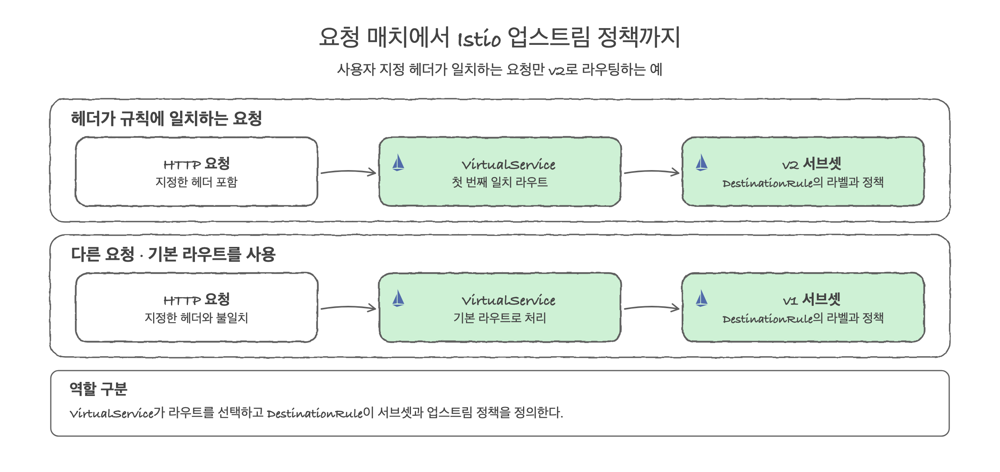

# Istio 요청 라우팅, 점진 배포와 회복성 정책

## 1. VirtualService에서 요청을 나누고 DestinationRule에서 목적지를 구체화하기

`VirtualService`의 HTTP 라우트는 선언한 순서로 평가된다. 예를 들어 특정 테스트 헤더가 있는 요청을 `v2`로 보내고 나머지를 `v1`로 보내려면 헤더 매치 뒤에 기본 라우트를 둔다. 대상 서비스의 `DestinationRule`에 버전별 라벨을 담은 `subsets`를 선언해야 그 이름으로 요청을 보낼 수 있다. 서비스와 정책이 다른 네임스페이스에 있을 때는 짧은 이름이 규칙의 네임스페이스를 기준으로 해석되므로 서비스 FQDN을 확인한다. 외부 진입점과 메시 내부 요청 중 어디에 규칙을 적용할지도 `spec.gateways`에서 확인한다. [Istio · VirtualService](https://istio.io/latest/docs/reference/config/networking/virtual-service/) · [Istio · DestinationRule](https://istio.io/latest/docs/reference/config/networking/destination-rule/) · [Istio · Traffic Management](https://istio.io/latest/docs/concepts/traffic-management/)

Istio 설정을 승인된 사용자에게만 적용하려면 별도의 인증·인가 정책으로 접근을 제한한다. HTTP 헤더 매치는 요청의 라우팅 조건이며, 그 값을 보낸 사용자의 신원을 검증하는 역할은 인증 정책이 맡는다. [Istio 보안](22_securing_istio_with_tls_mtls_and_jwt.md)에서 요청 인증과 인가를 이어서 본다. [Istio · VirtualService](https://istio.io/latest/docs/reference/config/networking/virtual-service/) · [Istio · Security](https://istio.io/latest/docs/concepts/security/)

요청 매치, 목적지 선택, 업스트림 정책 적용이 이어지는 순서다. [Istio · VirtualService](https://istio.io/latest/docs/reference/config/networking/virtual-service/) · [Istio · DestinationRule](https://istio.io/latest/docs/reference/config/networking/destination-rule/)

라우트 선택과 목적지 서브셋 정의가 연결되는 지점이다. [Istio · VirtualService](https://istio.io/latest/docs/reference/config/networking/virtual-service/) · [Istio · DestinationRule](https://istio.io/latest/docs/reference/config/networking/destination-rule/) · [Istio · Traffic Management](https://istio.io/latest/docs/concepts/traffic-management/)

## 2. Fault Injection과 프록시 로그로 장애 구간 확인하기

HTTP fault injection은 `delay`로 응답 지연을 추가하거나 `abort`로 지정한 오류 응답을 반환하도록 구성한다. 제한된 테스트 헤더와 비율을 함께 쓰면 의도한 요청에만 장애를 주입할 수 있다. `VirtualService` 참조는 클라이언트 측 fault가 활성화된 경우 해당 타임아웃·재시도가 활성화되지 않는다고 명시한다. 따라서 장애가 난 상위 서비스의 타임아웃을 확인할 때는 장애를 넣는 홉과 타임아웃을 관찰할 홉을 구분한다. [Istio · VirtualService](https://istio.io/latest/docs/reference/config/networking/virtual-service/) · [Istio · Fault Injection](https://istio.io/latest/docs/tasks/traffic-management/fault-injection/)

HTTP 응답 코드만으로 프록시가 만든 오류와 업스트림이 반환한 오류를 구분하기는 어렵다. Envoy 액세스 로그에서 `RESPONSE_FLAGS`, `RESPONSE_CODE_DETAILS`, `UPSTREAM_HOST`를 확인하면 요청이 어느 업스트림으로 향했고 프록시가 어떤 이유로 연결 또는 요청을 종료했는지 살펴볼 수 있다. 기대한 라우트가 적용되지 않으면 `istioctl proxy-config routes`로 해당 프록시의 실제 설정을 확인한다. [Istio · Envoy Access Logs](https://istio.io/latest/docs/tasks/observability/logs/access-log/) · [Envoy 1.40 · Access log format](https://www.envoyproxy.io/docs/envoy/v1.40.0/configuration/observability/access_log/usage) · [Istio · Debugging Envoy and Istiod](https://istio.io/latest/docs/ops/diagnostic-tools/proxy-cmd/)

## 3. 가중치 기반 Traffic Shifting과 Argo Rollouts

Istio의 가중 라우팅은 목적지마다 설정한 비율로 일치하는 요청을 분배한다. 예를 들어 stable에 90, canary에 10의 가중치를 둘 수 있다. ReplicaSet의 Pod 개수와 라우팅 가중치는 별도로 관리되며, 짧은 관측 구간의 실측 비율은 요청 수와 트래픽 특성에 따라 달라질 수 있다. [Istio · VirtualService](https://istio.io/latest/docs/reference/config/networking/virtual-service/) · [Istio · Traffic Shifting](https://istio.io/latest/docs/tasks/traffic-management/traffic-shifting/) · [Argo Rollouts · Istio traffic management](https://argo-rollouts.readthedocs.io/en/stable/features/traffic-management/istio/)

Argo Rollouts의 Istio 연동에서는 컨트롤러가 지정된 `VirtualService` 라우트의 가중치를 단계에 맞춰 갱신한다. Host-level은 stable·canary에 별도 Kubernetes Service를 쓰고, Subset-level은 하나의 Service와 `DestinationRule`의 서브셋을 사용한다. 배포 도구가 쓰는 라우트 이름과 목적지를 선언에 맞추고, GitOps 컨트롤러도 같은 필드를 동기화하는 구성이라면 컨트롤러 간 가중치 소유권을 명확히 한다. [Argo Rollouts · Istio traffic management](https://argo-rollouts.readthedocs.io/en/stable/features/traffic-management/istio/) · [Argo Rollouts · Integrating with GitOps](https://argo-rollouts.readthedocs.io/en/stable/features/traffic-management/istio/#integrating-with-gitops)

## 4. Circuit Breaking에서 연결 제한과 엔드포인트 퇴출 구분하기

`DestinationRule.trafficPolicy`는 목적지 또는 서브셋에 적용하는 정책이다. `connectionPool`은 TCP 연결 수, 준비된 연결을 기다리는 HTTP 요청 수, 활성 HTTP 요청 한도 등을 제어한다. 예를 들어 `http1MaxPendingRequests`는 이름과 달리 참조 문서상 HTTP/1.1과 HTTP/2에 모두 적용되는 대기열 제한이다. Envoy는 업스트림 클러스터 단위로 한도를 집행한다. [Istio · DestinationRule](https://istio.io/latest/docs/reference/config/networking/destination-rule/) · [Envoy 1.40 · Circuit breaking](https://www.envoyproxy.io/docs/envoy/v1.40.0/intro/arch_overview/upstream/circuit_breaking) · [Istio · Circuit Breaking](https://istio.io/latest/docs/tasks/traffic-management/circuit-breaking/)

`outlierDetection`은 연속 오류 같은 신호로 특정 업스트림 엔드포인트를 풀에서 일정 기간 제외한다. `consecutive5xxErrors`는 연속 실패 수, `baseEjectionTime`은 퇴출 기간의 기준, `maxEjectionPercent`는 동시에 제외할 수 있는 대상 비율의 상한을 다룬다. 연결 풀 한도 초과와 특정 엔드포인트 퇴출은 서로 다른 동작이다. 503을 진단할 때는 한도 초과, 정상 대상 부족, 대상 자체의 응답을 따로 확인한다. [Istio · DestinationRule](https://istio.io/latest/docs/reference/config/networking/destination-rule/) · [Istio · Circuit Breaking](https://istio.io/latest/docs/tasks/traffic-management/circuit-breaking/) · [Envoy 1.40 · Access log format](https://www.envoyproxy.io/docs/envoy/v1.40.0/configuration/observability/access_log/usage)
