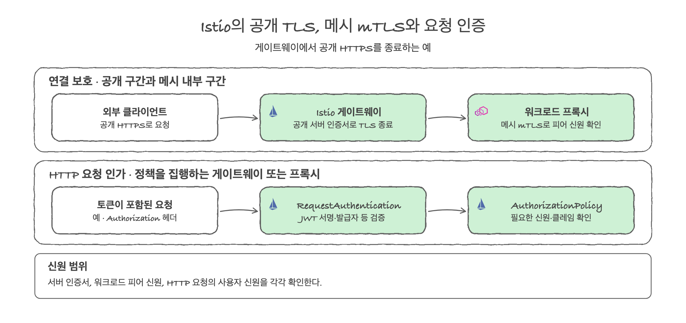

# Istio TLS·mTLS, 인증서와 JWT 기반 인가

## 1. 공개 HTTPS와 메시 내부 mTLS의 보호 구간

공개 서비스에 HTTPS를 적용하면 클라이언트는 접속하는 서버의 이름과 인증서를 검증하고 TLS 연결로 데이터를 보호한다. 게이트웨이에서 TLS를 종료하는 구성에서는 게이트웨이 뒤의 업스트림 연결에 별도의 TLS 정책이 적용된다. 메시 내부 mTLS에서는 양 끝의 프록시가 서로의 워크로드 신원을 확인한다. Istio는 워크로드 신원에 Kubernetes ServiceAccount에 해당하는 식별 정보를 사용한다. [Istio · Understanding TLS Configuration](https://istio.io/latest/docs/ops/configuration/traffic-management/tls-configuration/) · [Istio · Security](https://istio.io/latest/docs/concepts/security/) · [Istio · Secure Gateways](https://istio.io/latest/docs/tasks/traffic-management/ingress/secure-ingress/)

외부 클라이언트에서 게이트웨이까지의 TLS와 게이트웨이에서 메시 워크로드까지의 연결을 따로 확인한다. Istio `Gateway`에서 TLS를 그대로 통과시키는 구성과 종료시키는 구성은 어디에서 HTTP 정책을 집행할 수 있는지가 다르다. [Istio · Understanding TLS Configuration](https://istio.io/latest/docs/ops/configuration/traffic-management/tls-configuration/) · [Istio · Secure Gateways](https://istio.io/latest/docs/tasks/traffic-management/ingress/secure-ingress/)

통신 구간의 보호와 요청 신원에 대한 접근 결정을 비교했다. [Istio · Understanding TLS Configuration](https://istio.io/latest/docs/ops/configuration/traffic-management/tls-configuration/) · [Istio · Security](https://istio.io/latest/docs/concepts/security/) · [Istio · RequestAuthentication](https://istio.io/latest/docs/reference/config/security/request_authentication/) · [Istio · AuthorizationPolicy](https://istio.io/latest/docs/reference/config/security/authorization-policy/)

## 2. PeerAuthentication과 업스트림 TLS 선택

`PeerAuthentication`은 워크로드가 받는 연결에 대한 mTLS 요구를 정의한다. Sidecar에서 `PERMISSIVE`는 평문과 mTLS를 허용하며 `STRICT`는 mTLS를 요구한다. 반대로 `DestinationRule.trafficPolicy.tls`는 클라이언트 프록시의 업스트림 연결을 설정한다. 명시적인 TLS 설정이 없을 때 Auto mTLS가 메시 참여 여부 등을 바탕으로 메시 내부 연결의 mTLS 사용을 결정한다. 수신 측을 `STRICT`로 바꾸기 전에 평문으로 접근하는 호출자와 프록시의 실제 전송 설정을 점검한다. [Istio · PeerAuthentication](https://istio.io/latest/docs/reference/config/security/peer_authentication/) · [Istio · Understanding TLS Configuration](https://istio.io/latest/docs/ops/configuration/traffic-management/tls-configuration/) · [Istio · DestinationRule](https://istio.io/latest/docs/reference/config/networking/destination-rule/)

Ambient에서는 `ztunnel` 사이의 HBONE 연결에 mTLS가 포함된다. 공식 `PeerAuthentication` 참조는 Ambient에서 `DISABLE`을 지원하지 않으며, `STRICT`로 메시를 거치지 않는 연결을 제한할 수 있다고 설명한다. 인증과 인가의 적용 범위는 데이터 평면 모드와 정책을 집행하는 구성 요소에 맞춰 확인한다. [Istio · PeerAuthentication](https://istio.io/latest/docs/reference/config/security/peer_authentication/) · [Istio · Ambient Overview](https://istio.io/latest/docs/ambient/overview/) · [Istio · Use Layer 7 features](https://istio.io/latest/docs/ambient/usage/l7-features/)

## 3. cert-manager에서 발급하는 게이트웨이 인증서와 메시 인증서

공개 게이트웨이의 서버 인증서는 cert-manager의 `Issuer` 또는 `ClusterIssuer`로 발급하고 Kubernetes Secret에 저장할 수 있다. Kubernetes Gateway API에서 cert-manager의 Gateway 어노테이션 방식을 사용하면 TLS를 종료하는 리스너의 설정을 바탕으로 인증서를 생성하며, 이 연동에서 생성하는 Secret은 Gateway와 같은 네임스페이스에 둔다. 이 방식을 쓰려면 Gateway API CRD를 설치하고 cert-manager의 Gateway API 지원을 활성화한다. Istio 게이트웨이에서 Kubernetes Secret을 참조하는 방식은 사용하는 Gateway API에 맞춰 확인한다. [cert-manager · Annotated Gateway resource](https://cert-manager.io/docs/usage/gateway/) · [Istio · Secure Gateways](https://istio.io/latest/docs/tasks/traffic-management/ingress/secure-ingress/)

메시 워크로드 인증서 발급을 cert-manager에 맡기는 연동은 istio-csr를 사용한다. 에이전트가 워크로드의 인증서 서명 요청을 받아 cert-manager로 서명을 요청한다. 공개 도메인 인증서 발급과 메시 내부 워크로드 인증서 발급은 요청 주체와 신뢰 루트가 다를 수 있다. 메시의 발급 경로를 바꿀 때는 워크로드가 신뢰할 루트, 기존 인증서와의 호환성, 발급·회전 상태를 함께 확인한다. [cert-manager · Securing Istio Service Mesh](https://cert-manager.io/docs/usage/istio-csr/) · [Istio · Security](https://istio.io/latest/docs/concepts/security/)

## 4. JWT 검증과 접근 허용 규칙

`RequestAuthentication`은 선택한 HTTP 트래픽 처리 지점에서 JWT 규칙을 적용한다. `issuer`, 필요한 `audiences`, 서명 검증용 JWKS 등의 설정으로 토큰의 발급자와 대상 서비스를 판단한다. 잘못된 토큰을 보낸 요청은 검증에서 거절되지만 토큰이 없는 요청은 인증된 신원 없이 통과할 수 있다. 토큰을 필수로 하려면 `AuthorizationPolicy`에서 검증된 `requestPrincipals` 또는 필요한 클레임을 허용 조건에 넣는다. [Istio · RequestAuthentication](https://istio.io/latest/docs/reference/config/security/request_authentication/) · [Istio · AuthorizationPolicy](https://istio.io/latest/docs/reference/config/security/authorization-policy/) · [Istio · JWT Token Authorization](https://istio.io/latest/docs/tasks/security/authorization/authz-jwt/)

인가 정책에서는 워크로드 인증서가 제공하는 피어 신원과 JWT가 제공하는 요청 신원을 각각 조건으로 사용할 수 있다. 공식 JWT 예제에서 잘못된 토큰은 401, 인증은 통과했지만 인가 조건을 충족하지 못한 요청은 403으로 관찰된다. 운영에서는 무토큰, 유효 토큰, 만료 또는 잘못된 토큰, 권한이 부족한 토큰의 네 가지 입력에서 기대 결과를 확인한다. Ambient에서 HTTP 인가를 적용할 때는 요청이 L7 정책을 집행하는 waypoint나 게이트웨이를 지나는지 확인한다. [Istio · Security](https://istio.io/latest/docs/concepts/security/) · [Istio · AuthorizationPolicy](https://istio.io/latest/docs/reference/config/security/authorization-policy/) · [Istio · JWT Token Authorization](https://istio.io/latest/docs/tasks/security/authorization/authz-jwt/) · [Istio · Use Layer 7 features](https://istio.io/latest/docs/ambient/usage/l7-features/)
