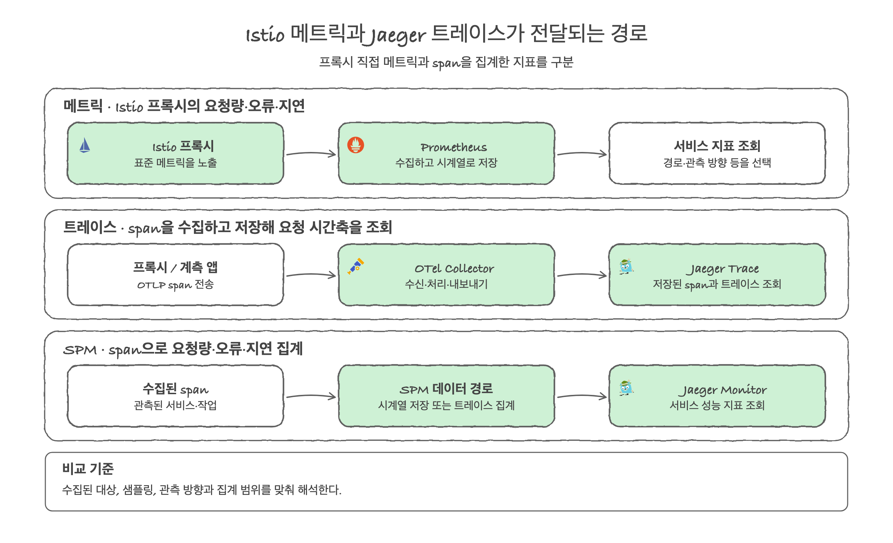

# Istio 관측성, OpenTelemetry·Jaeger와 Prometheus

## 1. 메트릭, 로그, 트레이스의 질문 구분하기

Istio 프록시는 지표, 액세스 로그, 트레이스를 생성할 수 있다. 메트릭은 서비스 요청량·실패율·지연이 어떻게 달라졌는지, 로그는 한 프록시를 통과한 요청의 상태와 업스트림이 무엇인지, 트레이스는 하나의 요청이 여러 서비스에서 어디에 시간을 썼는지를 보는 데 활용한다. `Telemetry` API는 적용 범위와 제공자, 샘플링, 로그·메트릭 설정을 지정하는 데 사용한다. [Istio · Telemetry API](https://istio.io/latest/docs/reference/config/telemetry/) · [Istio · Istio Standard Metrics](https://istio.io/latest/docs/reference/config/metrics/) · [Istio · Envoy Access Logs](https://istio.io/latest/docs/tasks/observability/logs/access-log/) · [Istio · Distributed Tracing Overview](https://istio.io/latest/docs/tasks/observability/distributed-tracing/overview/)

## 2. Istio에서 Jaeger로 트레이스를 전달하는 방법

Istio의 OpenTelemetry 제공자는 Envoy의 span을 OTLP/gRPC 또는 OTLP/HTTP로 내보낼 수 있다. 한 제공자 구성에서는 둘 중 하나의 전송 방식을 선택한다. OTLP를 지원하는 Jaeger로 직접 보낼 수도 있고, OpenTelemetry Collector를 중간에 두고 수신·처리·내보내기 파이프라인을 구성할 수도 있다. Istio에서는 메시 구성의 확장 제공자와 `Telemetry.tracing`의 제공자 지정을 연결한다. [Istio · OpenTelemetry tracing provider](https://istio.io/latest/docs/tasks/observability/distributed-tracing/opentelemetry/) · [Istio · Jaeger trace exporter](https://istio.io/latest/docs/tasks/observability/distributed-tracing/jaeger/) · [Istio · Telemetry API](https://istio.io/latest/docs/reference/config/telemetry/) · [OpenTelemetry Collector · Configuration](https://opentelemetry.io/docs/collector/configuration/)

Jaeger 2.23은 OpenTelemetry Collector를 기반으로 구성되고, 저장 백엔드에 저장된 트레이스를 Query와 UI로 조회할 수 있다. 운영 설치에서 수집과 조회의 배치 방식, 보존할 스토리지, 인증과 접근 제어를 정한다. 수집이 비어 있으면 서비스 이름과 포트, OTLP 전송 방식, Collector의 수신·처리·전송 경로, Jaeger의 저장 상태를 차례로 확인한다. [Jaeger 2.23 · Architecture](https://www.jaegertracing.io/docs/2.23/architecture/) · [Jaeger 2.23 · Deployment](https://www.jaegertracing.io/docs/2.23/deployment/) · [OpenTelemetry Collector · Configuration](https://opentelemetry.io/docs/collector/configuration/)

## 3. Trace context와 샘플링

프록시에서 자동으로 span을 만들어도 앱이 받은 추적 컨텍스트를 다음 HTTP 호출로 넘겨야 백엔드가 이를 같은 trace로 연결할 수 있다. 예를 들어 W3C Trace Context를 쓰는 환경에서는 앱 또는 계측 라이브러리가 `traceparent` 같은 헤더를 읽고 다음 호출에 전파한다. 프록시는 네트워크 구간을 보여 주고, 내부 함수나 데이터베이스 쿼리 수준의 정보는 애플리케이션 계측으로 추가할 수 있다. [Istio · Distributed Tracing Overview](https://istio.io/latest/docs/tasks/observability/distributed-tracing/overview/) · [Istio · OpenTelemetry tracing provider](https://istio.io/latest/docs/tasks/observability/distributed-tracing/opentelemetry/) · [W3C · Trace Context](https://www.w3.org/TR/trace-context/)

`Telemetry`의 샘플링은 어떤 요청에 대해 span을 수집할지를 제어한다. Jaeger에 특정 요청이 보이지 않으면 샘플링, 헤더 전파, 수집 경로를 확인한다. 문제를 재현하며 일시적으로 수집 범위를 높일 때는 Collector와 저장소 처리량을 함께 확인한다. [Istio · Telemetry API](https://istio.io/latest/docs/reference/config/telemetry/) · [Istio · OpenTelemetry tracing provider](https://istio.io/latest/docs/tasks/observability/distributed-tracing/opentelemetry/) · [OpenTelemetry Collector · Configuration](https://opentelemetry.io/docs/collector/configuration/)

## 4. Jaeger의 Trace 화면에서 병목 확인하기

Jaeger UI에서 관련 서비스와 시간 범위로 트레이스를 좁힌 뒤 문제가 발생한 요청을 열고, 부모·자식 span과 시간축을 따라 서비스별 체류 시간을 비교한다. 실패한 span의 상태와 속성을 확인하고, 트레이스 ID를 남기는 애플리케이션 로그가 있다면 같은 ID로 대조한다. 자식 span이 병렬로 실행되면 각 길이를 합한 값과 요청 전체 시간은 다르다. [Jaeger 2.23 · Frontend/UI Configuration](https://www.jaegertracing.io/docs/2.23/deployment/frontend-ui/) · [OpenTelemetry · Traces](https://opentelemetry.io/docs/concepts/signals/traces/) · [Istio · Distributed Tracing Overview](https://istio.io/latest/docs/tasks/observability/distributed-tracing/overview/)

## 5. Prometheus의 Istio 메트릭과 Jaeger SPM

Istio의 표준 메트릭에는 요청 카운터 `istio_requests_total`과 요청 지연 히스토그램 `istio_request_duration_milliseconds`가 있다. Prometheus에서 관측 방향(`reporter`), 목적지, 응답 코드를 정해 집계하면 같은 메시 요청에서 출발지와 목적지 기록이 섞이는 일을 피할 수 있다. 예를 들어 서버 측 실패율을 볼 때는 분자와 분모에 동일한 `reporter="destination"`와 서비스 필터를 적용한다. [Istio · Istio Standard Metrics](https://istio.io/latest/docs/reference/config/metrics/) · [Istio · Querying Metrics from Prometheus](https://istio.io/latest/docs/tasks/observability/metrics/querying-metrics/)

Jaeger UI의 Monitor는 Service Performance Monitoring(SPM) 기능이다. Jaeger 2.23에서는 span에서 집계한 RED 지표(요청량·오류·지연)를 Prometheus 호환 저장소에서 조회하거나, Elasticsearch/OpenSearch에 저장한 트레이스에서 직접 계산하도록 구성할 수 있다. Istio 표준 메트릭과 Jaeger SPM을 비교할 때는 샘플링 지점, 서비스·작업 이름, 관측 방향과 집계 범위를 함께 확인한다. [Jaeger 2.23 · Service Performance Monitoring](https://www.jaegertracing.io/docs/2.23/architecture/spm/) · [Istio · Istio Standard Metrics](https://istio.io/latest/docs/reference/config/metrics/) · [Istio · Telemetry API](https://istio.io/latest/docs/reference/config/telemetry/)

아래 그림은 Istio 메트릭과 Jaeger SPM을 함께 쓸 때 각 화면이 어떤 데이터를 조회하는지 보여 준다. [Istio · OpenTelemetry tracing provider](https://istio.io/latest/docs/tasks/observability/distributed-tracing/opentelemetry/) · [Istio · Querying Metrics from Prometheus](https://istio.io/latest/docs/tasks/observability/metrics/querying-metrics/) · [Jaeger 2.23 · Architecture](https://www.jaegertracing.io/docs/2.23/architecture/) · [Jaeger 2.23 · Service Performance Monitoring](https://www.jaegertracing.io/docs/2.23/architecture/spm/)

Prometheus의 표준 메트릭과 Jaeger에서 보는 트레이스·성능 지표의 입력 데이터를 표시했다. [Istio · OpenTelemetry tracing provider](https://istio.io/latest/docs/tasks/observability/distributed-tracing/opentelemetry/) · [Istio · Querying Metrics from Prometheus](https://istio.io/latest/docs/tasks/observability/metrics/querying-metrics/) · [Jaeger 2.23 · Architecture](https://www.jaegertracing.io/docs/2.23/architecture/) · [Jaeger 2.23 · Service Performance Monitoring](https://www.jaegertracing.io/docs/2.23/architecture/spm/)
