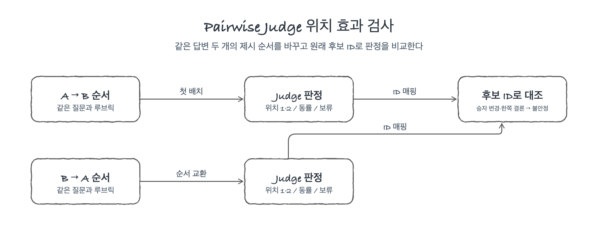

# Calibrating Pairwise LLM Judges

Pairwise는 같은 질문에 대한 두 답변을 한 기준으로 비교한다. 결과를 A, B, 동률, 판단 보류로 제한해 의미를 명확히 한다. [Zheng et al. · Judging LLM-as-a-Judge](https://arxiv.org/abs/2306.05685) · [Shi et al. · Judging the Judges](https://arxiv.org/abs/2406.07791)

## 1. 답변 순서를 바꿔 위치 효과를 측정한다

A/B와 B/A를 모두 평가하고 표시 라벨을 원래 후보 ID로 매핑해 비교한다. 우승 후보가 바뀌거나 한 번만 결론이 나면 불안정으로 분류한다. 동률은 질 차이를 찾지 못한 경우, 보류는 자료가 부족한 경우로 따로 센다. [Zheng et al. · Judging LLM-as-a-Judge](https://arxiv.org/abs/2306.05685) · [Shi et al. · Judging the Judges](https://arxiv.org/abs/2406.07791)

그림의 근거 · [Zheng et al. · Judging LLM-as-a-Judge](https://arxiv.org/abs/2306.05685) · [Shi et al. · Judging the Judges](https://arxiv.org/abs/2406.07791)

## 2. 사람 판정에 대해 어느 방향에서 틀리는지 확인한다

사람이 라벨링한 보정용 표본으로 혼동 행렬, 단순 일치율, 같은 표본의 사람과 Judge 판정을 비교해 Cohen의 카파를 확인한다. 통과율이 치우친 표본에서는 카파와 함께 라벨별 사례 수와 오류 방향을 본다. [scikit-learn · Confusion Matrix](https://scikit-learn.org/stable/modules/generated/sklearn.metrics.confusion_matrix.html) · [scikit-learn · Cohen’s Kappa](https://scikit-learn.org/stable/modules/generated/sklearn.metrics.cohen_kappa_score.html) · [Zheng et al. · Judging LLM-as-a-Judge](https://arxiv.org/abs/2306.05685)

## 3. 이산 판정에서 남는 변동을 보고한다

라벨을 좁히면 비교할 결과의 의미가 선명해진다. 반복 샘플에서 실제 불일치율을 확인하고, 서로 다른 길이·언어·근거 수를 가진 질의에서 위치와 장황함 편향을 분리해 본다. Judge 변경도 별도의 평가 변경으로 기록한다. [Zheng et al. · Judging LLM-as-a-Judge](https://arxiv.org/abs/2306.05685) · [Shi et al. · Judging the Judges](https://arxiv.org/abs/2406.07791) · [Liu et al. · G-Eval](https://arxiv.org/abs/2303.16634)
