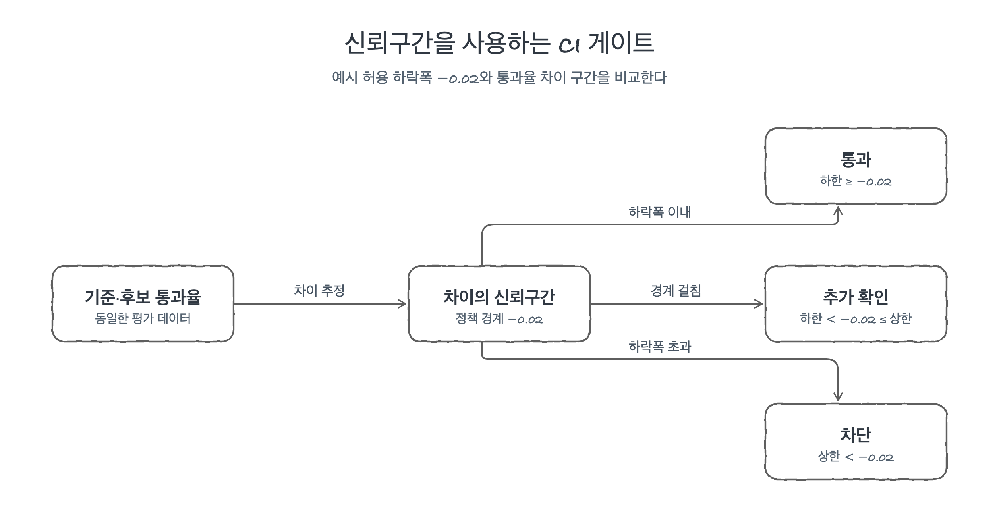

# Gating Regressions in CI

검토한 기준 스냅샷과 후보 평가를 같은 데이터로 비교한다. CI는 통과, 차단, 추가 증거 필요를 구분하고 비교 결과를 산출물로 남긴다. [Jest 30 · Snapshot Testing](https://jestjs.io/docs/30.0/snapshot-testing) · [GitHub · Required Status Checks](https://docs.github.com/en/repositories/configuring-branches-and-merges-in-your-repository/managing-protected-branches/about-protected-branches) · [SciPy 1.16.1 · Bootstrap](https://docs.scipy.org/doc/scipy-1.16.1/reference/generated/scipy.stats.bootstrap.html)

## 1. 확정 조건과 변동 조건을 다른 게이트로 적용한다

| 조건 | 예시 처리 | 근거 |
| --- | --- | --- |
| 결정적 계약 | 출력 스키마 위반, 잘못된 출처 ID, 필수 케이스 누락은 사전에 정한 기준으로 검사한다. | [JSON Schema 2020-12 · Validation](https://json-schema.org/draft/2020-12/json-schema-validation) · [pytest · Parametrize](https://docs.pytest.org/en/stable/how-to/parametrize.html) |
| 통계적 품질 | 핵심 지표에서 사전에 정한 허용 하락폭과 paired 델타의 신뢰구간을 비교한다. | [SciPy 1.16.1 · Bootstrap](https://docs.scipy.org/doc/scipy-1.16.1/reference/generated/scipy.stats.bootstrap.html) · [scikit-learn · Metrics and Scoring](https://scikit-learn.org/stable/modules/model_evaluation.html) |
| 평가 인프라 | 동일 평가셋과 유효 결과 수를 확인한다. 누락된 케이스를 빼면 결과에 편향이 생길 수 있다. | [scikit-learn · Cross-Validation](https://scikit-learn.org/stable/modules/cross_validation.html) · [scikit-learn · Metrics and Scoring](https://scikit-learn.org/stable/modules/model_evaluation.html) · [pytest · Parametrize](https://docs.pytest.org/en/stable/how-to/parametrize.html) |

## 2. 비교 메타데이터와 판정을 CI에 전달한다

기준과 후보의 커밋, 평가셋 및 루브릭 버전을 기록한 뒤 케이스 델타·실패 목록·요약을 보관한다. GitHub 예에서는 이 작업을 required status check로 연결하고, 증거가 모자란 판정의 수동 검토 기준을 미리 정한다. [GitHub · Required Status Checks](https://docs.github.com/en/repositories/configuring-branches-and-merges-in-your-repository/managing-protected-branches/about-protected-branches) · [Jest 30 · Snapshot Testing](https://jestjs.io/docs/30.0/snapshot-testing) · [SciPy 1.16.1 · Bootstrap](https://docs.scipy.org/doc/scipy-1.16.1/reference/generated/scipy.stats.bootstrap.html)

허용 하락폭을 0.02로 정한 통과율 예에서 델타 구간의 하한이 -0.02 이상이면 그 기준을 통과로 분류한다. 상한이 -0.02보다 작으면 차단하고, 경계를 걸치면 추가 확인으로 보낸다. 이 값과 구간 규칙은 실습의 사전 정책이다. [SciPy 1.16.1 · Bootstrap](https://docs.scipy.org/doc/scipy-1.16.1/reference/generated/scipy.stats.bootstrap.html) · [GitHub · Required Status Checks](https://docs.github.com/en/repositories/configuring-branches-and-merges-in-your-repository/managing-protected-branches/about-protected-branches)

그림의 근거 · [SciPy 1.16.1 · Bootstrap](https://docs.scipy.org/doc/scipy-1.16.1/reference/generated/scipy.stats.bootstrap.html) · [GitHub · Required Status Checks](https://docs.github.com/en/repositories/configuring-branches-and-merges-in-your-repository/managing-protected-branches/about-protected-branches)
