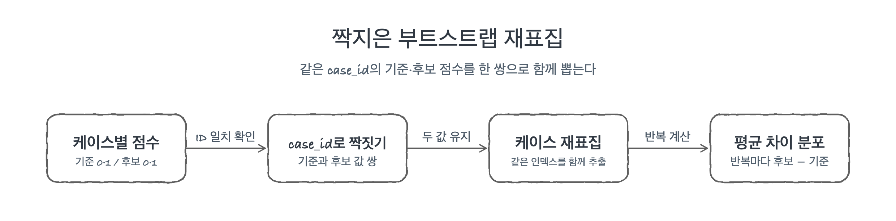

# Using Paired Bootstrap for Regression Detection

같은 케이스에 대한 기준과 후보 판정은 짝을 이룬다. 평가 케이스 인덱스를 짝째 다시 뽑아 평균 차이의 분포를 구한다. [SciPy 1.16.1 · Bootstrap](https://docs.scipy.org/doc/scipy-1.16.1/reference/generated/scipy.stats.bootstrap.html) · [scikit-learn · Cross-Validation](https://scikit-learn.org/stable/modules/cross_validation.html)

## 1. 같은 순서의 케이스 값을 짝지어 재표집한다

각 값은 0 또는 1이다. case_id가 일치하고 비교 가능한 상태인지 하네스에서 먼저 검사한다. 이 코드는 정렬된 예시 배열과 고정한 난수 시드를 사용한다. [SciPy 1.16.1 · Bootstrap](https://docs.scipy.org/doc/scipy-1.16.1/reference/generated/scipy.stats.bootstrap.html) · [pytest · Parametrize](https://docs.pytest.org/en/stable/how-to/parametrize.html)

```python
import numpy as np
from scipy.stats import bootstrap

baseline = np.array([1, 0, 1, 0, 1, 1, 0, 1, 1, 0, 1, 0], dtype=float)
candidate = np.array([1, 1, 1, 0, 1, 1, 1, 1, 0, 1, 1, 1], dtype=float)

def mean_delta(new, old, axis):
    return np.mean(new - old, axis=axis)

estimate = mean_delta(candidate, baseline, axis=0)
result = bootstrap(
    (candidate, baseline),
    mean_delta,
    paired=True,
    n_resamples=10_000,
    confidence_level=0.95,
    method="percentile",
    rng=np.random.default_rng(42),
)
lower, upper = result.confidence_interval
assert np.isclose(estimate, 0.25)
assert lower <= estimate <= upper
print(f"delta={estimate:+.1%}  95% CI [{lower:+.1%}, {upper:+.1%}]")
```



그림의 근거 · [SciPy 1.16.1 · Bootstrap](https://docs.scipy.org/doc/scipy-1.16.1/reference/generated/scipy.stats.bootstrap.html) · [scikit-learn · Cross-Validation](https://scikit-learn.org/stable/modules/cross_validation.html)

## 2. 작은 표본과 반복 실행의 단위를 확인한다

이 예는 독립적인 질문이 재표집 단위라고 가정한다. 같은 원문의 변형이나 같은 질문의 여러 응답이 상관돼 있으면 원문 또는 질문 단위로 묶어 재표집하는 설계를 검토한다. 표본이 적거나 개선·악화가 거의 없으면 구간을 단독 배포 근거로 쓰기 전에 케이스 수와 변동을 확인한다. [SciPy 1.16.1 · Bootstrap](https://docs.scipy.org/doc/scipy-1.16.1/reference/generated/scipy.stats.bootstrap.html) · [scikit-learn · Cross-Validation](https://scikit-learn.org/stable/modules/cross_validation.html)

## 3. 새 실패를 별도 회귀 세트에 반영한다

재현되는 실패는 원인을 분류하고 입력과 기대값을 검수한 뒤 회귀 세트에 추가한다. 확인에 사용한 홀드아웃을 수정용 사례에 편입했다면 새 홀드아웃을 분리하고 이전 평가셋과 버전을 구별한다. [scikit-learn · Cross-Validation](https://scikit-learn.org/stable/modules/cross_validation.html) · [pytest · Parametrize](https://docs.pytest.org/en/stable/how-to/parametrize.html) · [Jest 30 · Snapshot Testing](https://jestjs.io/docs/30.0/snapshot-testing)
