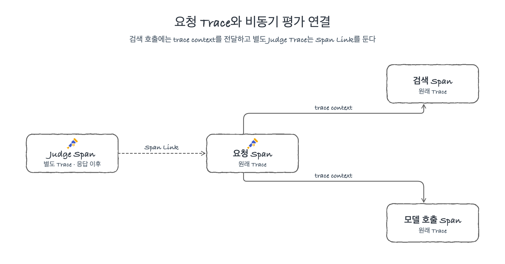

# Instrumenting LLM Requests with OpenTelemetry

오프라인 평가셋은 고정된 입력에서 품질을 비교한다. 운영 Trace는 실제 요청의 검색, 모델 호출, 출력 검증과 재시도가 어느 경계에서 지연되거나 실패했는지 보여 준다. [scikit-learn · Cross-Validation](https://scikit-learn.org/stable/modules/cross_validation.html) · [OpenTelemetry · Traces](https://opentelemetry.io/docs/concepts/signals/traces/)

## 1. 요청과 작업 단위를 Span으로 표현한다

| Span | 기록할 정보 | 근거 |
| --- | --- | --- |
| answer.request | 총 시간, 최종 상태, 앱 버전과 정책 버전 | [OpenTelemetry · Traces](https://opentelemetry.io/docs/concepts/signals/traces/) |
| retrieval.search | 검색 지연, 결과 건수, 문서 집합 또는 인덱스 버전 | [OpenTelemetry · Traces](https://opentelemetry.io/docs/concepts/signals/traces/) · [NIST · TREC Overview](https://trec.nist.gov/overview.html) |
| model.generate | 요청·응답 모델, 시도와 지연, 제공자가 보고한 토큰 | [OpenTelemetry · Traces](https://opentelemetry.io/docs/concepts/signals/traces/) · [OpenTelemetry GenAI · Spans](https://raw.githubusercontent.com/open-telemetry/semantic-conventions/v1.37.0/docs/gen-ai/gen-ai-spans.md) |
| output.validate | 스키마 실패나 근거 부족처럼 코드로 분류한 결과 | [OpenTelemetry · Traces](https://opentelemetry.io/docs/concepts/signals/traces/) · [JSON Schema 2020-12 · Validation](https://json-schema.org/draft/2020-12/json-schema-validation) |

## 2. 비동기 평가와 정보 노출을 별도로 설계한다

요청 흐름과 직접 연결된 호출은 trace context를 전달한다. 응답 이후 별도 실행되는 Judge를 추적하려면 별도 Trace에서 원래 요청 Span의 컨텍스트에 링크를 둘 수 있다. 민감한 프롬프트·응답 원문 수집은 기본으로 꺼 두고, 메타데이터의 보관·접근 범위를 제어한다. [OpenTelemetry · Context Propagation](https://opentelemetry.io/docs/concepts/context-propagation/) · [OpenTelemetry · Traces](https://opentelemetry.io/docs/concepts/signals/traces/) · [OpenTelemetry GenAI · Spans](https://raw.githubusercontent.com/open-telemetry/semantic-conventions/v1.37.0/docs/gen-ai/gen-ai-spans.md) · [OpenTelemetry · Handling Sensitive Data](https://opentelemetry.io/docs/security/handling-sensitive-data/)

그림의 근거 · [OpenTelemetry · Context Propagation](https://opentelemetry.io/docs/concepts/context-propagation/) · [OpenTelemetry · Traces](https://opentelemetry.io/docs/concepts/signals/traces/) · [OpenTelemetry GenAI · Spans](https://raw.githubusercontent.com/open-telemetry/semantic-conventions/v1.37.0/docs/gen-ai/gen-ai-spans.md) · [OpenTelemetry · Handling Sensitive Data](https://opentelemetry.io/docs/security/handling-sensitive-data/)

샘플링은 관측 비용과 대표성에 영향을 준다. 오류 Trace를 더 많이 남기는 경우 그 Trace 집합만으로 전체 오류율을 계산하지 않고, 별도의 전체 요청 카운터를 함께 사용한다. [OpenTelemetry · Sampling](https://opentelemetry.io/docs/concepts/sampling/) · [OpenTelemetry · Traces](https://opentelemetry.io/docs/concepts/signals/traces/)
