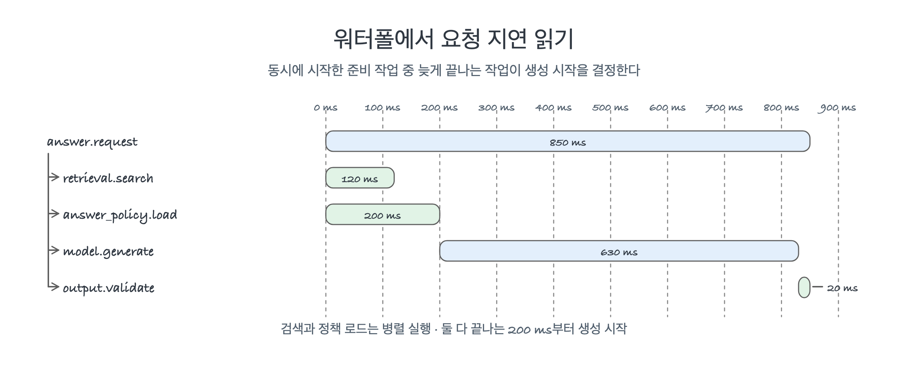

# Reading LLM Trace Waterfalls

워터폴은 Span의 부모 관계와 시간축을 보여 준다. 겹치는 작업과 다음 단계의 시작을 막는 의존관계를 구별해 느린 요청을 조사한다. [OpenTelemetry · Traces](https://opentelemetry.io/docs/concepts/signals/traces/) · [Grafana · Trace Visualization](https://grafana.com/docs/grafana/latest/visualizations/explore/trace-integration/)

## 1. 같은 요청의 작업 순서를 시간축으로 읽는다

| 작업 | 예시 시간 범위 | 관찰 | 근거 |
| --- | --- | --- | --- |
| answer.request | 0~850ms | 사용자 요청의 전체 구간 | [OpenTelemetry · Traces](https://opentelemetry.io/docs/concepts/signals/traces/) · [Grafana · Trace Visualization](https://grafana.com/docs/grafana/latest/visualizations/explore/trace-integration/) |
| retrieval.search | 0~120ms | 다른 준비 작업과 병렬로 실행 | [OpenTelemetry · Traces](https://opentelemetry.io/docs/concepts/signals/traces/) · [Grafana · Trace Visualization](https://grafana.com/docs/grafana/latest/visualizations/explore/trace-integration/) |
| answer_policy.load | 0~200ms | 정책 로드와 검색이 모두 끝나야 생성 시작 | [OpenTelemetry · Traces](https://opentelemetry.io/docs/concepts/signals/traces/) · [Grafana · Trace Visualization](https://grafana.com/docs/grafana/latest/visualizations/explore/trace-integration/) |
| model.generate | 200~830ms | 모델 응답의 대부분을 차지하는 직렬 구간 | [OpenTelemetry · Traces](https://opentelemetry.io/docs/concepts/signals/traces/) · [OpenTelemetry GenAI · Spans](https://raw.githubusercontent.com/open-telemetry/semantic-conventions/v1.37.0/docs/gen-ai/gen-ai-spans.md) |
| output.validate | 830~850ms | 응답을 내보내기 직전의 로컬 검사 | [OpenTelemetry · Traces](https://opentelemetry.io/docs/concepts/signals/traces/) · [Grafana · Trace Visualization](https://grafana.com/docs/grafana/latest/visualizations/explore/trace-integration/) |

이 예의 병렬 준비 구간은 200ms다. 120ms와 200ms를 더하지 않는다. 생성 630ms와 출력 검사 20ms를 합해 사용자 요청의 850ms가 된다. 분산 시스템에서는 계측 누락이나 서버 간 시계 편차도 보고, 겹치는 Span을 모두 더해 병목을 판단하지 않는다. [OpenTelemetry · Traces](https://opentelemetry.io/docs/concepts/signals/traces/) · [Grafana · Trace Visualization](https://grafana.com/docs/grafana/latest/visualizations/explore/trace-integration/)

그림의 근거 · [OpenTelemetry · Traces](https://opentelemetry.io/docs/concepts/signals/traces/) · [Grafana · Trace Visualization](https://grafana.com/docs/grafana/latest/visualizations/explore/trace-integration/)

## 2. 평가 실패와 느린 요청을 함께 조사한다

근거 부족 사례의 검색 결과 건수와 인덱스 버전을 보고, 느린 생성에서는 최초 토큰 대기나 반복 호출 여부를 확인한다. 일회성 Trace로 가설을 세운 뒤 성공·오류 집단의 지연 분포를 비교해 영향 범위를 판단한다. [OpenTelemetry · Traces](https://opentelemetry.io/docs/concepts/signals/traces/) · [OpenTelemetry GenAI · Spans](https://raw.githubusercontent.com/open-telemetry/semantic-conventions/v1.37.0/docs/gen-ai/gen-ai-spans.md) · [OpenTelemetry GenAI · Metrics](https://raw.githubusercontent.com/open-telemetry/semantic-conventions/v1.37.0/docs/gen-ai/gen-ai-metrics.md) · [OpenTelemetry · Sampling](https://opentelemetry.io/docs/concepts/sampling/)
