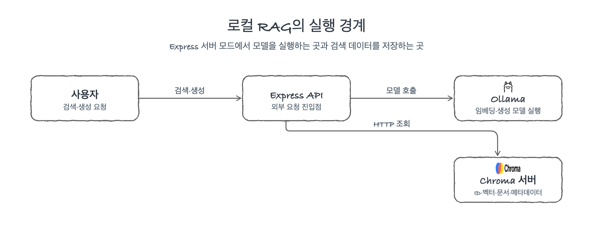

# Understanding ChromaDB and the RAG Stack

Chroma 컬렉션은 ID, 벡터, 문서 내용, 메타데이터를 다룬다. 이 실습에서는 Ollama가 모델 실행을, Chroma가 벡터 저장과 조회를, Express가 외부 API를 담당한다. [Chroma · Architecture](https://docs.trychroma.com/reference/architecture/overview) · [Chroma · Manage Collections](https://docs.trychroma.com/docs/collections/manage-collections) · [Chroma · Adding Data](https://docs.trychroma.com/docs/collections/add-data) · [Ollama · API Introduction](https://docs.ollama.com/api/introduction) · [Express 5 · API](https://expressjs.com/en/5x/api/)

## 1. 로컬 영속 모드와 서버 모드를 선택한다

Python 실습에서는 PersistentClient가 경로에 데이터를 보존한다. Express 실습에서는 Chroma 서버를 별도로 켜고 HTTP로 호출한다. 실행 중인 서버의 저장 디렉터리를 두 번째 임베디드 클라이언트가 동시에 쓰지 않도록 서버를 쓰기 진입점으로 사용한다. [Chroma · Clients](https://cookbook.chromadb.dev/core/clients/) · [Chroma · Client-Server Mode](https://docs.trychroma.com/docs/run-chroma/client-server) · [Chroma · Architecture](https://docs.trychroma.com/reference/architecture/overview)

그림의 근거 · [Chroma · Architecture](https://docs.trychroma.com/reference/architecture/overview) · [Chroma · Manage Collections](https://docs.trychroma.com/docs/collections/manage-collections) · [Chroma · Adding Data](https://docs.trychroma.com/docs/collections/add-data) · [Ollama · API Introduction](https://docs.ollama.com/api/introduction) · [Express 5 · API](https://expressjs.com/en/5x/api/)

## 2. 컬렉션에 묶이는 조건을 기록한다

모델 태그나 리비전, 벡터 차원, 거리 함수, 청크 형식, 데이터 범위를 함께 기록한다. 이름이 같거나 차원이 같아도 다른 임베딩 모델의 벡터를 한 검색 공간에 섞어 쓰지 않는다. [Chroma · Configure Collections](https://docs.trychroma.com/docs/collections/configure) · [Chroma · Manage Collections](https://docs.trychroma.com/docs/collections/manage-collections) · [Ollama · Embeddings](https://docs.ollama.com/capabilities/embeddings)
