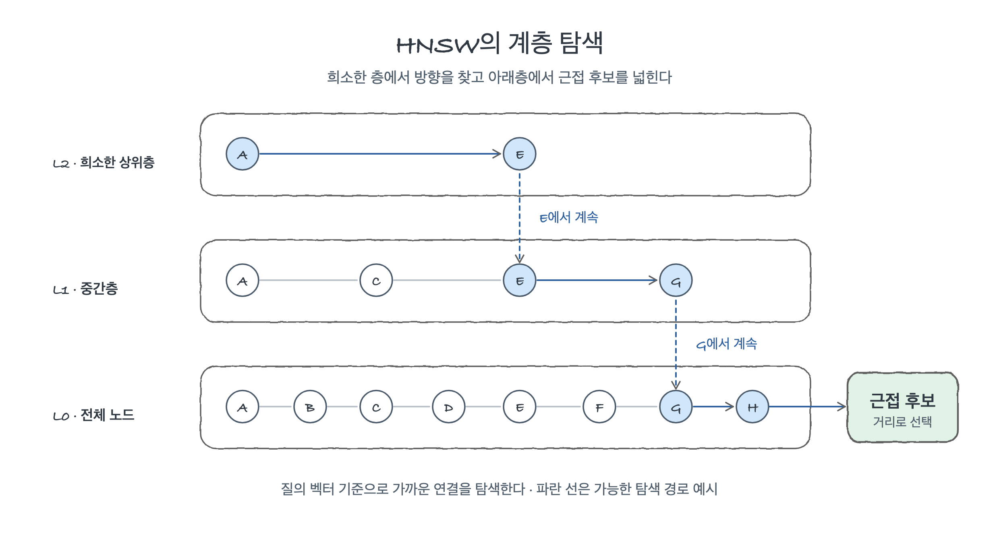

# Understanding HNSW and Vector Distance

HNSW는 벡터를 여러 층의 근접 그래프로 연결한다. 위쪽의 희소한 층에서 대략적인 위치를 찾고 아래층에서 후보를 넓힌다. [Malkov·Yashunin · HNSW](https://arxiv.org/abs/1603.09320) · [Chroma · Configure Collections](https://docs.trychroma.com/docs/collections/configure)

## 1. 거리 함수와 탐색 방법의 역할을 구분한다

벡터 간 거리는 어떤 후보가 가깝다고 볼지 결정한다. 그래프 탐색은 데이터를 모두 비교하는 대신 가까운 후보를 근사적으로 찾는다. Chroma 로컬 HNSW와 분산 구성은 적용할 색인 방식과 설정이 다를 수 있다. [Malkov·Yashunin · HNSW](https://arxiv.org/abs/1603.09320) · [Chroma · Configure Collections](https://docs.trychroma.com/docs/collections/configure) · [Chroma · Architecture](https://docs.trychroma.com/reference/architecture/overview)

그림의 근거 · [Malkov·Yashunin · HNSW](https://arxiv.org/abs/1603.09320) · [Chroma · Configure Collections](https://docs.trychroma.com/docs/collections/configure)

## 2. 정확 검색과 같은 조건에서 비교한다

고정한 벡터·거리·필터로 전체 검색한 top-k를 기준으로 ANN 재현율을 구한다. 사람의 관련성 라벨을 기준으로 하는 검색 Recall@k는 별도 지표로 보고한다. [Malkov·Yashunin · HNSW](https://arxiv.org/abs/1603.09320) · [ir-measures · Retrieval Metrics](https://ir-measur.es/en/latest/measures.html) · [pgvector · Indexing and Distances](https://github.com/pgvector/pgvector)
