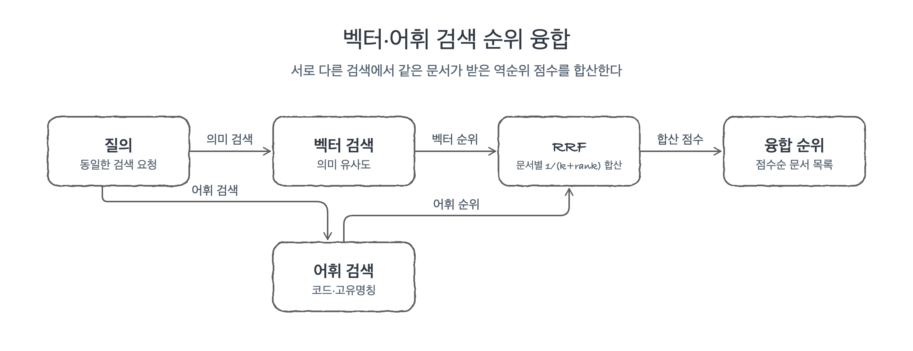

# Designing and Evaluating Hybrid Retrieval

하이브리드 검색은 동의어가 중요한 벡터 검색과 코드·고유명칭을 찾는 어휘 검색의 후보를 조합한다. 한 방식의 거리와 다른 방식의 점수를 직접 더할 때는 척도를 먼저 맞춰야 한다. [Cormack et al. · Reciprocal Rank Fusion](https://cormack.uwaterloo.ca/cormacksigir09-rrf.pdf) · [PostgreSQL 18 · Full Text Search](https://www.postgresql.org/docs/18/textsearch-intro.html) · [Elastic · kNN Search](https://www.elastic.co/docs/solutions/search/vector/knn) · [Chroma Cloud · Hybrid Search](https://docs.trychroma.com/cloud/search-api/hybrid-search)

## 1. 순위 기반으로 서로 다른 후보를 합친다

RRF는 각 목록에서 문서의 역순위 점수 1/(k+rank)를 더한다. 다음 코드는 목록마다 중복을 한 번으로 모으고, 동일 점수는 ID로 정렬한다. k와 각 후보 수는 평가한다. [Cormack et al. · Reciprocal Rank Fusion](https://cormack.uwaterloo.ca/cormacksigir09-rrf.pdf) · [Chroma Cloud · Hybrid Search](https://docs.trychroma.com/cloud/search-api/hybrid-search)



그림의 근거 · [Cormack et al. · Reciprocal Rank Fusion](https://cormack.uwaterloo.ca/cormacksigir09-rrf.pdf) · [Chroma Cloud · Hybrid Search](https://docs.trychroma.com/cloud/search-api/hybrid-search)

```python
from collections import defaultdict

def fuse(rankings, k=60):
    if k < 0:
        raise ValueError("k must be nonnegative")
    scores = defaultdict(float)
    for ranking in rankings:
        for rank, doc_id in enumerate(dict.fromkeys(ranking), start=1):
            scores[doc_id] += 1 / (k + rank)
    return sorted(scores, key=lambda doc_id: (-scores[doc_id], doc_id))

assert fuse([["semantic", "both"], ["exact", "both"]])[0] == "both"
```

## 2. 같은 문서 집합과 권한 조건에서 평가한다

로컬 Chroma 실습은 별도 어휘 검색 결과와 애플리케이션에서 융합할 수 있다. Chroma Cloud의 Search API는 문서에 설명된 하이브리드 기능 범위에서 사용한다. 벡터·키워드·융합의 Recall@k와 지연을 동일한 질의에 대해 비교한다. [Chroma Cloud · Hybrid Search](https://docs.trychroma.com/cloud/search-api/hybrid-search) · [Chroma · Query and Get](https://docs.trychroma.com/docs/querying-collections/query-and-get) · [ir-measures · Retrieval Metrics](https://ir-measur.es/en/latest/measures.html) · [OWASP · RAG Security](https://cheatsheetseries.owasp.org/cheatsheets/RAG_Security_Cheat_Sheet.html)
