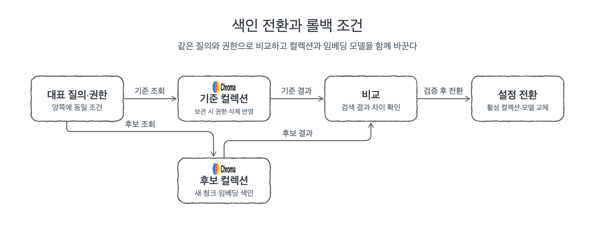

# Migrating Chunking and Embedding Strategies

분할 규칙·모델·차원·거리 변경은 기존 색인과 다른 검색 계약을 만들 수 있다. 새 버전 컬렉션에 다시 색인하고 전환한다. [Chroma · Configure Collections](https://docs.trychroma.com/docs/collections/configure) · [Chroma · Manage Collections](https://docs.trychroma.com/docs/collections/manage-collections) · [Ollama · Embeddings](https://docs.ollama.com/capabilities/embeddings)

## 1. 새 컬렉션의 백필과 증분 동기화를 설계한다

원문 버전과 처리 체크포인트를 저장한다. 백필이 시작한 시점 이후의 추가·수정·삭제를 새 색인에도 반영하고, 각 청크의 ID와 정책 상태가 일치하는지 대조한다. 동일 차원이어도 다른 모델의 벡터를 혼합하지 않는다. [Chroma · Manage Collections](https://docs.trychroma.com/docs/collections/manage-collections) · [Chroma · Updating Data](https://docs.trychroma.com/docs/collections/update-data) · [Chroma · Deleting Data](https://docs.trychroma.com/docs/collections/delete-data) · [Ollama · Embeddings](https://docs.ollama.com/capabilities/embeddings)

## 2. 비교 후 검색 경로를 전환한다

대표 질의와 권한 필터를 기준/후보 컬렉션에 보내 결과 차이를 비교한다. 앱의 활성 컬렉션 설정과 임베딩 모델을 함께 바꾼다. 이전 색인을 롤백용으로 보관하면 전환 뒤 권한·삭제 반영 조건도 유지한다. [Chroma · Query and Get](https://docs.trychroma.com/docs/querying-collections/query-and-get) · [Chroma · Manage Collections](https://docs.trychroma.com/docs/collections/manage-collections) · [ir-measures · Retrieval Metrics](https://ir-measur.es/en/latest/measures.html) · [OWASP · RAG Security](https://cheatsheetseries.owasp.org/cheatsheets/RAG_Security_Cheat_Sheet.html)

그림의 근거 · [Chroma · Query and Get](https://docs.trychroma.com/docs/querying-collections/query-and-get) · [Chroma · Manage Collections](https://docs.trychroma.com/docs/collections/manage-collections) · [ir-measures · Retrieval Metrics](https://ir-measur.es/en/latest/measures.html) · [OWASP · RAG Security](https://cheatsheetseries.owasp.org/cheatsheets/RAG_Security_Cheat_Sheet.html)
