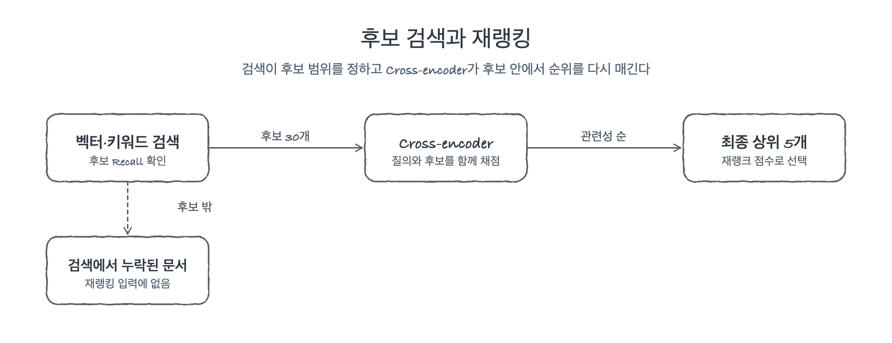

# Reranking Candidates with Cross-Encoders

Bi-encoder는 질의와 문서를 따로 계산해 미리 만든 문서 벡터를 빠르게 검색한다. Cross-encoder는 질의와 각 후보를 함께 읽어 관련성을 다시 매긴다. [Reimers·Gurevych · Sentence-BERT](https://arxiv.org/abs/1908.10084) · [Sentence Transformers · Retrieve & Re-Rank](https://www.sbert.net/examples/sentence_transformer/applications/retrieve_rerank/README.html)

## 1. 처음의 후보와 최종 순위 책임을 정한다

예를 들어 벡터·키워드 검색에서 후보 30개를 모으고, 질의와 문서 쌍을 Cross-encoder에 보내 상위 5개를 남긴다. 처음 후보에 없는 문서는 재랭커가 복구할 수 없으므로 후보 Recall을 먼저 봐야 한다. [Sentence Transformers · Retrieve & Re-Rank](https://www.sbert.net/examples/sentence_transformer/applications/retrieve_rerank/README.html) · [ir-measures · Retrieval Metrics](https://ir-measur.es/en/latest/measures.html) · [Cormack et al. · Reciprocal Rank Fusion](https://cormack.uwaterloo.ca/cormacksigir09-rrf.pdf)

그림의 근거 · [Sentence Transformers · Retrieve & Re-Rank](https://www.sbert.net/examples/sentence_transformer/applications/retrieve_rerank/README.html) · [ir-measures · Retrieval Metrics](https://ir-measur.es/en/latest/measures.html) · [Cormack et al. · Reciprocal Rank Fusion](https://cormack.uwaterloo.ca/cormacksigir09-rrf.pdf)

## 2. 재랭크 점수와 접근 경계를 유지한다

재랭커 점수는 모델이 정의한 값이고 Chroma 거리와 직접 비교하지 않는다. 이미 접근을 허용한 후보만 재랭커에 보내고, 긴 문서가 잘리는 설정이 중요한 조건을 빼는지 확인한다. [Sentence Transformers · Retrieve & Re-Rank](https://www.sbert.net/examples/sentence_transformer/applications/retrieve_rerank/README.html) · [Chroma · Configure Collections](https://docs.trychroma.com/docs/collections/configure) · [OWASP · RAG Security](https://cheatsheetseries.owasp.org/cheatsheets/RAG_Security_Cheat_Sheet.html)
