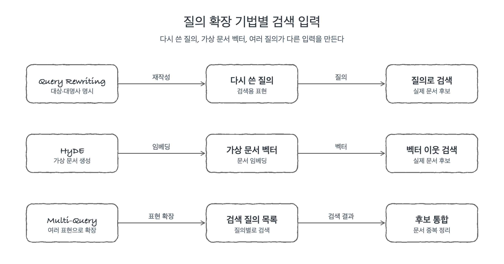

# Expanding Queries with Rewriting, HyDE, and Multi-Query

질의를 바꾸거나 여러 표현으로 확장하면 검색어와 원문 간 표현 차이를 줄일 수 있다. 확장 비용과 질문 의도 변경도 함께 평가한다. [Ma et al. · Query Rewriting for RAG](https://arxiv.org/abs/2305.14283) · [Gao et al. · HyDE](https://arxiv.org/abs/2212.10496) · [LangChain · MultiQueryRetriever](https://reference.langchain.com/python/langchain-classic/retrievers/multi_query/MultiQueryRetriever)

## 1. 세 기법이 검색에 넘기는 입력을 구분한다

| 기법 | 검색 입력과 결과 | 근거 |
| --- | --- | --- |
| Query Rewriting | 대명사나 생략된 대상을 풀어 검색용 질의로 바꾼다. | [Ma et al. · Query Rewriting for RAG](https://arxiv.org/abs/2305.14283) |
| HyDE | 가상으로 생성한 문서를 임베딩해 실제 문서 이웃을 검색한다. | [Gao et al. · HyDE](https://arxiv.org/abs/2212.10496) |
| Multi-Query | 여러 검색어를 만들어 후보를 모으고 중복을 정리한다. | [LangChain · MultiQueryRetriever](https://reference.langchain.com/python/langchain-classic/retrievers/multi_query/MultiQueryRetriever) · [Cormack et al. · Reciprocal Rank Fusion](https://cormack.uwaterloo.ca/cormacksigir09-rrf.pdf) |

그림의 근거 · [Ma et al. · Query Rewriting for RAG](https://arxiv.org/abs/2305.14283) · [Gao et al. · HyDE](https://arxiv.org/abs/2212.10496) · [LangChain · MultiQueryRetriever](https://reference.langchain.com/python/langchain-classic/retrievers/multi_query/MultiQueryRetriever)

## 2. 원래 의도와 실제 근거를 보존한다

원 질의도 후보 경로에 두고 확장 개수와 시간에 상한을 둔다. HyDE의 가상 문서는 검색을 유도하는 데 사용하고 답변의 인용은 실제로 검색한 문서만 허용한다. 상품 코드나 날짜가 바뀐 사례를 별도로 검증한다. [Ma et al. · Query Rewriting for RAG](https://arxiv.org/abs/2305.14283) · [Gao et al. · HyDE](https://arxiv.org/abs/2212.10496) · [LangChain · MultiQueryRetriever](https://reference.langchain.com/python/langchain-classic/retrievers/multi_query/MultiQueryRetriever) · [OWASP · RAG Security](https://cheatsheetseries.owasp.org/cheatsheets/RAG_Security_Cheat_Sheet.html)
