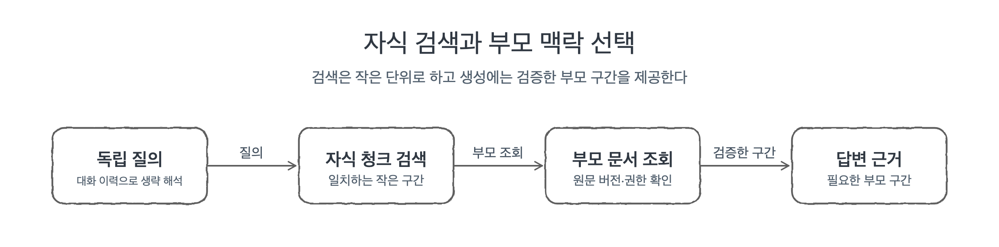

# Designing Parent–Child, Self-Query, and Conversational RAG

대화형 RAG는 대화에서 질문의 생략을 풀고, 메타데이터를 해석하며, 실제 답에 필요한 맥락을 찾아 제공한다. [LangChain · ParentDocumentRetriever](https://reference.langchain.com/python/langchain-classic/retrievers/parent_document_retriever/ParentDocumentRetriever) · [LangChain · SelfQueryRetriever](https://reference.langchain.com/python/langchain-classic/retrievers/self_query/base/SelfQueryRetriever) · [Ma et al. · Query Rewriting for RAG](https://arxiv.org/abs/2305.14283) · [Lewis et al. · Retrieval-Augmented Generation](https://arxiv.org/abs/2005.11401)

## 1. 대화 해석과 메타데이터 조건을 검증한다

예를 들어 “그럼 지난 버전에서는요?”를 이전 턴의 제품·정책과 함께 독립 질의로 풀어 쓴다. Self-query는 모델의 필터 제안을 허용된 필드·연산자·타입으로 검증한다. 사용자의 접근 범위는 서버 정책에서 별도로 정하고 강제한다. [Ma et al. · Query Rewriting for RAG](https://arxiv.org/abs/2305.14283) · [LangChain · SelfQueryRetriever](https://reference.langchain.com/python/langchain-classic/retrievers/self_query/base/SelfQueryRetriever) · [Chroma · Metadata Filtering](https://docs.trychroma.com/docs/querying-collections/metadata-filtering) · [OWASP · RAG Security](https://cheatsheetseries.owasp.org/cheatsheets/RAG_Security_Cheat_Sheet.html)

## 2. 자식 검색과 부모 조합 뒤에 출처를 확인한다

자식으로 검색하고 원문 버전과 권한이 일치하는 부모의 필요한 구간만 반환한다. 대화 이력은 질문 해석에 쓰고, 답변에 필요한 사실은 검색한 근거와 대조한다. 버전 문의·주제 전환·자료 부족 케이스를 각각 평가한다. [LangChain · ParentDocumentRetriever](https://reference.langchain.com/python/langchain-classic/retrievers/parent_document_retriever/ParentDocumentRetriever) · [OWASP · RAG Security](https://cheatsheetseries.owasp.org/cheatsheets/RAG_Security_Cheat_Sheet.html) · [Lewis et al. · Retrieval-Augmented Generation](https://arxiv.org/abs/2005.11401) · [ir-measures · Retrieval Metrics](https://ir-measur.es/en/latest/measures.html)

그림의 근거 · [LangChain · ParentDocumentRetriever](https://reference.langchain.com/python/langchain-classic/retrievers/parent_document_retriever/ParentDocumentRetriever) · [OWASP · RAG Security](https://cheatsheetseries.owasp.org/cheatsheets/RAG_Security_Cheat_Sheet.html) · [Lewis et al. · Retrieval-Augmented Generation](https://arxiv.org/abs/2005.11401) · [ir-measures · Retrieval Metrics](https://ir-measur.es/en/latest/measures.html)
