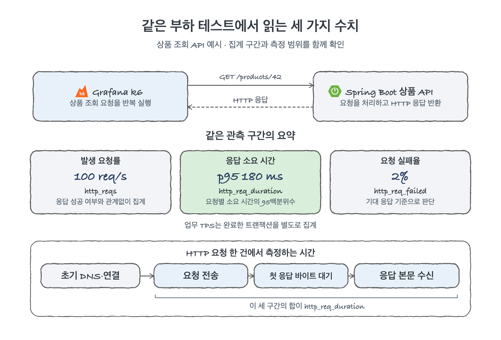

# 부하 테스트의 기본 개념과 도구 선정

## 1. 부하 테스트에서 확인할 것

- 부하 테스트에서는 시스템에 요청을 보내면서 처리량과 응답 시간을 확인한다.
- **Throughput은 얼마나 많은 요청을 처리하는지, Latency는 요청에 얼마나 빨리 응답하는지를 나타낸다.**
- 두 지표를 함께 보면 시스템의 처리 능력과 사용자가 경험하는 응답 속도를 구분해 이해할 수 있다.

## 2. 처리량(Throughput)

- 단위 시간에 시스템이 처리하는 요청이나 작업의 수이다.
- 부하 테스트에서는 주로 1초 동안 처리한 양을 측정한다.
- 예를 들어 서버가 1초에 최대 100개의 API 요청을 처리한다면 최대 처리량은 100 RPS이다.

| 단위 | 의미 | 예시 |
| :--- | :--- | :--- |
| TPS (Transactions Per Second) | 1초 동안 처리한 트랜잭션 수 | 초당 100개 트랜잭션 처리 → 100 TPS |
| RPS (Requests Per Second) | 1초 동안 처리한 요청 수 | 초당 100개 API 요청 처리 → 100 RPS |

- 트랜잭션 하나가 요청 하나에 대응하면 TPS와 RPS를 같은 값으로 볼 수 있다.
- 트랜잭션 하나에 여러 요청이 포함되면 두 수치가 달라질 수 있으므로 측정 단위를 확인한다.

## 3. 지연 시간(Latency)

- Latency는 요청을 보낸 뒤 응답을 받기까지 걸리는 시간이다.
- 보통 밀리초(ms)나 초(s)로 표현한다.
- 평균 Latency가 2.5초라면 요청 한 건의 응답을 받기까지 평균적으로 2.5초가 걸린다는 뜻이다.

### 고속도로로 이해하기

| 부하 테스트의 개념 | 고속도로 비유 |
| :--- | :--- |
| 요청 또는 트래픽 | 자동차 |
| 네트워크 | 고속도로 |
| Throughput | 단위 시간에 목적지에 도착하는 자동차 수 |
| Latency | 자동차 한 대가 출발지에서 목적지까지 가는 데 걸리는 시간 |

- **Throughput은 처리한 양을, Latency는 요청 한 건에 걸린 시간을 설명한다.**

## 4. 부하 테스트 도구 k6

- k6는 시스템에 많은 요청을 보내 성능을 측정하는 부하 테스트 도구이다.
- 비교적 적은 메모리로 많은 요청을 발생시킬 수 있고, 사용법이 간단해 빠르게 테스트를 시작할 수 있다.
- 다른 부하 테스트 도구로는 nGrinder, JMeter, ab, Locust 등이 있다.

그림의 근거 · [Grafana k6 내장 지표](https://grafana.com/docs/k6/latest/using-k6/metrics/reference/) · [Grafana k6 사용자 지정 지표](https://grafana.com/docs/k6/latest/using-k6/metrics/create-custom-metrics/) · [Grafana k6 임계값](https://grafana.com/docs/k6/latest/using-k6/thresholds/)

## 5. 도구 사용보다 중요한 역량

- **테스트 결과를 정확히 해석하고, 데이터를 근거로 적절한 성능 개선 방법을 선택하는 역량이 중요하다.**
- 처음에는 도구 하나를 골라 요청을 발생시키고 결과를 해석하는 방법을 익힌다.
- 여러 도구의 사용법을 나열하기보다, 어떤 부하를 주었고 어떤 결과를 관찰했으며 무엇을 개선했는지 설명할 수 있어야 한다.
- 실제 테스트와 결과 해석, 성능 개선을 반복하며 경험을 쌓는다.
