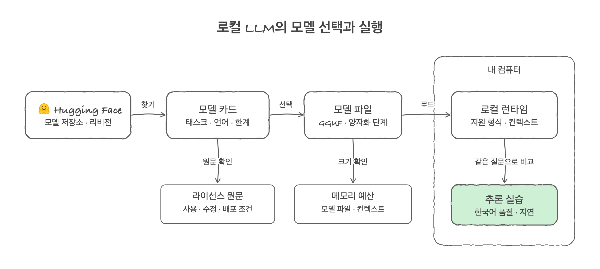

# Understanding Local LLMs and Model Selection

그림 근거 · [Hugging Face 모델 카드](https://huggingface.co/docs/hub/model-cards) · [Hugging Face GGUF](https://huggingface.co/docs/hub/gguf) · [LM Studio 메모리 추정](https://lmstudio.ai/docs/cli/local-models/load)

로컬 LLM은 모델을 내려받아 사용자 장비에서 추론하는 방식이다. 다운로드를 마친 모델로 오프라인 채팅을 실습할 수 있다. 같은 실행 도구에서 클라우드 모델을 선택할 수도 있으므로, 입력이 어디에서 처리되는지는 모델과 실행 모드를 기준으로 확인한다. [LM Studio · Offline Operation](https://lmstudio.ai/docs/app/offline) · [Ollama · Cloud](https://docs.ollama.com/cloud)

## 1. 공개 모델과 런타임을 구분한다

공개 가중치를 받아 직접 실행하려면 모델 아키텍처와 파일 형식을 지원하는 런타임이 필요하다. 모델의 공개 가중치, 사용 권한, 학습에 관한 정보는 각각 확인한다. OSI의 Open Source AI Definition은 수정에 필요한 형태에 파라미터 외에도 코드와 데이터 정보를 포함한다. [Hugging Face · GGUF](https://huggingface.co/docs/hub/gguf) · [OSI · Open Source AI Definition](https://opensource.org/ai/open-source-ai-definition)

## 2. Hugging Face에서 모델과 파일을 고른다

모델 카드에서 지원 태스크·언어, 사용법·한계, 기반 모델과 라이선스를 읽고 `Files`에서 실제 파일을 확인한다. 커뮤니티 양자화본을 쓸 때는 게시자와 원본 모델을 함께 기록한다. 재현 기록에는 저장소 ID, 리비전과 파일명을 남긴다. [Hugging Face · Model Cards](https://huggingface.co/docs/hub/model-cards) · [Hugging Face · GGUF](https://huggingface.co/docs/hub/gguf)

게이트가 있는 모델은 계정으로 접근을 요청해야 하며 게시자가 자동 또는 수동 승인을 선택할 수 있다. 다운로드 조건과 사용 조건은 모델 카드와 라이선스 원문에서 각각 확인한다. [Hugging Face · Gated Models](https://huggingface.co/docs/hub/models-gated)

## 3. 양자화와 메모리의 관계를 확인한다

가중치 양자화는 더 적은 비트로 가중치를 표현해 파일 크기와 메모리 부담을 줄인다. GGUF는 모델을 담는 파일 형식이고 그 안에 여러 정밀도의 텐서를 담을 수 있다. 같은 모델의 양자화 단계별로 한국어 응답 품질, 첫 응답 지연과 생성 속도를 비교한다. [Hugging Face · GGUF와 Quantization Types](https://huggingface.co/docs/hub/gguf)

모델 파일 크기는 메모리 계획의 출발점이다. 컨텍스트를 늘리면 추론 메모리도 늘어나므로, 실제 사용할 길이로 모델을 로드해 여유 메모리를 확인한다. LM Studio는 `lms load --estimate-only`로 컨텍스트와 GPU 오프로딩 설정을 반영한 추정치를 제공한다. [Ollama · Context Length](https://docs.ollama.com/context-length) · [LM Studio · lms load](https://lmstudio.ai/docs/cli/local-models/load)

## 4. 모델별 라이선스 원문을 비교한다

- **MIT 사례인 Microsoft Phi-4.** 모델 저장소의 MIT 라이선스는 사용·수정·배포를 허용하며 복사본 또는 상당 부분에 저작권과 허가 문구를 포함하도록 요구한다. [Microsoft Phi-4 · LICENSE](https://huggingface.co/microsoft/phi-4/blob/main/LICENSE)
- **Meta Llama 4.** Llama 4 Community License의 재배포 조건과 표시 의무, 사용 정책을 확인한다. Llama 계열의 다른 버전은 해당 버전의 라이선스를 읽는다. [Meta · Llama 4 Community License](https://dev.meta.ai/llama/llama4/license)
- **Google Gemma.** 배포 시 적용되는 고지와 사용 제한을 Gemma Terms of Use의 Distribution and Restrictions에서 확인한다. [Google · Gemma Terms of Use](https://gemma.ai/resources/terms/)

## 5. 맥에서 첫 후보를 좁힌다

LM Studio의 macOS 요구 사항은 Apple Silicon이며 RAM은 16GB 이상을 권장한다. 이 수치는 앱의 권장 사양이다. 첫 실습은 작은 인스트럭션 모델과 짧은 컨텍스트로 시작하고, 같은 입력으로 지연과 품질을 기록한 뒤 모델 크기나 컨텍스트 중 하나를 바꾼다. [LM Studio · System Requirements](https://lmstudio.ai/docs/app/system-requirements) · [LM Studio · lms load](https://lmstudio.ai/docs/cli/local-models/load)
