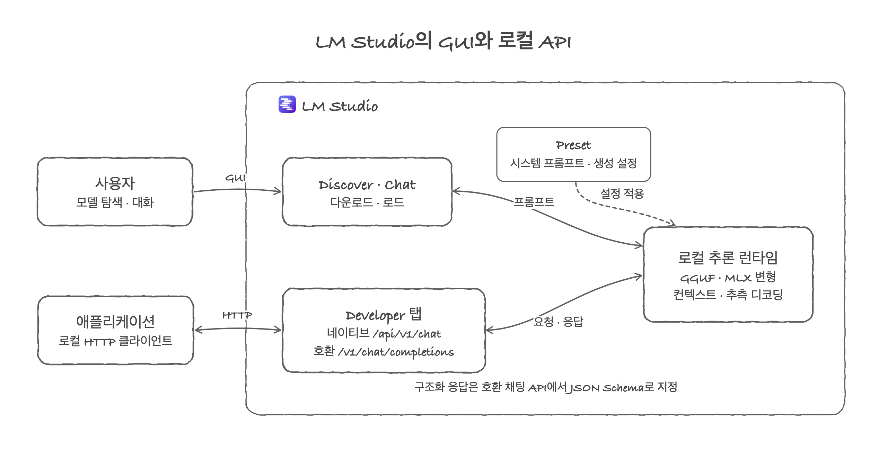

# Running Local Models with LM Studio



그림 근거 · [LM Studio 시작하기](https://lmstudio.ai/docs/app/basics) · [LM Studio 프리셋](https://lmstudio.ai/docs/app/presets) · [LM Studio API 서버](https://lmstudio.ai/docs/developer/core/server) · [REST API v1](https://lmstudio.ai/docs/developer/rest) · [구조화 응답](https://lmstudio.ai/docs/developer/openai-compat/structured-output)

## 1. 모델을 내려받고 GUI에서 실행한다

LM Studio를 설치한 뒤 Discover에서 모델과 파일을 고르고 Chat 화면에서 모델을 로드한다. 짧은 한국어 질문으로 첫 응답을 확인한다. 다운로드를 끝낸 모델은 오프라인 채팅에서도 사용할 수 있다. [LM Studio · Get Started](https://lmstudio.ai/docs/app/basics) · [LM Studio · Offline Operation](https://lmstudio.ai/docs/app/offline)

## 2. 시스템 프롬프트와 Preset으로 설정을 재현한다

시스템 프롬프트에는 응답의 역할과 형식을 적고, 사용자 프롬프트에는 실제 과제를 담는다. Preset은 시스템 프롬프트와 생성 설정을 함께 저장할 수 있으므로 모델과 입력을 고정한 채 서로 다른 설정을 비교하기 좋다. [LM Studio · Config Presets](https://lmstudio.ai/docs/app/presets)

생성 설정에서 `temperature`는 토큰 선택의 무작위성에 영향을 주고, `top_k`는 후보 개수, `top_p`는 후보 확률의 누적합을 기준으로 범위를 제한한다. `min_p`는 확률이 낮은 후보를 걸러낸다. 한 번에 한 설정만 바꿔 같은 프롬프트로 응답 차이를 확인한다. [LM Studio · Chat Request Parameters](https://lmstudio.ai/docs/developer/rest/chat)

## 3. JSON 스키마로 응답 구조를 지정한다

OpenAI 호환 `POST /v1/chat/completions`에서 `response_format.type=json_schema`를 사용하고, 스키마를 `response_format.json_schema`에 전달한다. `choices[0].message.content`는 JSON 문자열이므로 파싱한 뒤 필드와 값의 의미를 검증한다. 공식 문서가 안내하는 모델별 지원 여부를 확인한다. [LM Studio · Structured Output](https://lmstudio.ai/docs/developer/openai-compat/structured-output)

## 4. GGUF·MLX, 컨텍스트, 추측 디코딩을 따로 비교한다

LM Studio에서 모델 리포지터리가 제공하는 GGUF 또는 MLX 변형과 사용 가능한 런타임을 확인한다. Apple Silicon에서는 모델·양자화·컨텍스트를 기록한 상태로 비교한다. `lms load`의 `--context-length`, `--gpu`, `--estimate-only`로 로드 조건을 점검할 수 있다. [LM Studio · model.yaml](https://lmstudio.ai/docs/app/modelyaml) · [LM Studio · lms load](https://lmstudio.ai/docs/cli/local-models/load)

추측 디코딩은 초안 모델이 다음 토큰을 제안하고 대상 모델이 이를 검증하는 방식이다. 실제 속도 이득은 모델 조합과 초안의 채택률에 따라 달라진다. 같은 프롬프트로 사용 전후의 생성 속도를 재고, 가능하면 채택된 초안 토큰 수도 기록한다. [LM Studio · Speculative Decoding](https://lmstudio.ai/docs/app/advanced/speculative-decoding) · [LM Studio · SDK Speculative Decoding](https://lmstudio.ai/docs/typescript/llm-prediction/speculative-decoding)

컨텍스트 길이와 최대 출력 토큰을 따로 설정한다. 긴 문서로 실험할 때는 입력 길이와 출력 설정을 함께 기록하고, 대화 이력이 긴 경우와 짧은 경우를 비교한다. [LM Studio · Chat Request Parameters](https://lmstudio.ai/docs/developer/rest/chat) · [LM Studio · lms load](https://lmstudio.ai/docs/cli/local-models/load)

## 5. Developer 탭에서 REST API를 연다

Developer 탭에서 서버를 켜고 화면에 표시된 주소를 확인한다. 기본 예시는 포트 `1234`를 사용한다. 네이티브 REST v1에서는 `GET /api/v1/models`로 모델을 확인하고 `POST /api/v1/chat`으로 대화한다. OpenAI 호환 클라이언트는 `/v1`을 베이스 URL로 사용한다. [LM Studio · Local Server](https://lmstudio.ai/docs/developer/core/server) · [LM Studio · REST API v1](https://lmstudio.ai/docs/developer/rest) · [LM Studio · OpenAI-compatible Structured Output](https://lmstudio.ai/docs/developer/openai-compat/structured-output)

```bash
curl -fsS http://127.0.0.1:1234/api/v1/models
```
